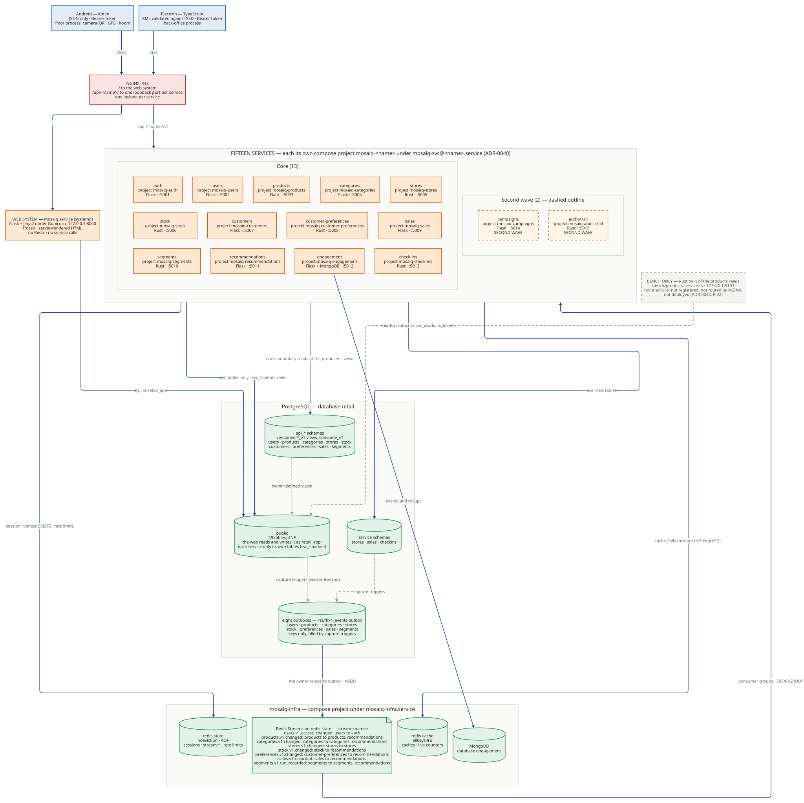

# MOSAIQ — Retail Segmentation Platform

Retail customer segmentation, delivered as a frozen server-rendered web system
plus **fifteen single-rule services**, an Android floor client and an Electron
back-office client, on one GCP Compute Engine instance.

Course project — Integración de Aplicaciones Computacionales, Team 03.
Everything written is in English.

> The product is **MOSAIQ**, with the design system recorded in
> [ADR-0002](docs/adr/0002-mosaiq-identity-and-design-system.md).

## Team

| Person | Role |
|---|---|
| Dr. Raúl Morales Saucedo | Product Owner |
| Raquel | Proxy PO, Developer |
| Estefanía | Data modeling |
| Max | Infrastructure, deployment |
| Marcelo | Scrum Master, Full stack |

## Architecture



The web system (`mosaiq.service`, Flask + Jinja2) reads PostgreSQL as
`retail_app`, uses no Redis and calls no service. The fifteen services each run
as their own compose project `mosaiq-<name>` under `mosaiq-svc@<name>.service`,
behind NGINX at `/api/<name>/`; Redis (`redis-state`, `redis-cache`) and MongoDB
run as project `mosaiq-infra`. Services never call one another: they meet only
through versioned `api_*` objects in PostgreSQL and Redis Streams
([ADR-0044](docs/adr/0044-boundaries-meet-only-through-versioned-database-contracts-and-redis-streams.md)).
The application, deployment and infrastructure views, and how to re-render them,
are in [`docs/architecture/`](docs/architecture/README.md).

| Service | Port | Language |
|---|---|---|
| auth, users, products, categories | 5001–5004 | Flask |
| stores, stock | 5005, 5006 | Rust |
| customers | 5007 | Flask |
| customer-preferences | 5008 | Rust |
| sales | 5009 | Flask |
| segments | 5010 | Rust |
| recommendations, engagement (with MongoDB) | 5011, 5012 | Flask |
| check-ins | 5013 | Rust |
| campaigns *(second wave)* | 5014 | Flask |
| audit-trail *(second wave)* | 5015 | Rust |

The Rust build of the products reads in [`bench/`](bench/README.md) is a
benchmark artifact: it is not one of the fifteen, is never routed by NGINX and is
never deployed.

## Stack

Python 3.12 · Flask + Jinja2 · Rust (axum) · PostgreSQL 18 · Redis · MongoDB ·
Gunicorn and compose projects under systemd · NGINX as reverse proxy
([ADR-0009](docs/adr/0009-nginx-as-the-reverse-proxy.md)) · Kotlin and Jetpack
Compose (Android) · TypeScript and Electron (desktop) · CentOS 10 Stream on GCP.

## Structure

| Directory | Contents |
|---|---|
| `services/` | The fifteen services, one directory and one compose file each |
| `contracts/` | Each service's versioned contract (OpenAPI, XSD), the stream descriptions and `registry.yaml` ([`contracts/streams/README.md`](contracts/streams/README.md)) |
| `clients/android/` | The Android floor client, JSON only ([`README`](clients/android/README.md)) |
| `clients/desktop/` | The Electron back-office client, XML only ([`README`](clients/desktop/README.md)) |
| `bench/` | The bench-only Rust twin of the products reads and its load runs ([`README`](bench/README.md)) |
| `deploy/` | Instance deployment: systemd units, NGINX, the infrastructure project ([`README`](deploy/README.md)) |
| `docker/` | The database init script and the local gateway and stack configuration |
| `docs/` | Documentation, decisions, evidence |
| `sql/` | `00_create_database.sql`, `01_schema.sql`, `02_seed_30_per_table.sql`, plus `verify_integrity.sql` and `seed-exempt.txt` |
| `tests/` | The `pytest` suite CI runs |
| `web/` | The web system, organized by layers |

## Where to find things

| What | Where |
|---|---|
| Contracts of each service | [`contracts/`](contracts/registry.yaml) |
| One sheet per service: rule, endpoints, data, events, failure behaviour | [`docs/services/`](docs/services/README.md) |
| The accepted-exceptions register (E-01 to E-22) | [`docs/services/README.md`](docs/services/README.md#accepted-exceptions-register) |
| The decisions of the distributed delivery, ADR-0034 to ADR-0046 | [`docs/adr/`](docs/adr/0034-fifteen-single-rule-services-each-the-only-service-writer-of-its-data.md); the list is in [`docs/services/README.md`](docs/services/README.md) |
| Scope of the distributed delivery | [`docs/scope-delivery-2-distributed.md`](docs/scope-delivery-2-distributed.md) |
| The benchmark report, Flask against Rust | [`docs/evidence/products-reads-flask-vs-rust.md`](docs/evidence/products-reads-flask-vs-rust.md), method in [`bench/README.md`](bench/README.md) |
| The demonstration document | [`docs/demo-system-guide.md`](docs/demo-system-guide.md) (the web system's journey; the distributed demonstration is F18-05) |

## Analytics modules

Server-rendered pages in the same application, each gated by a permission. Which
roles reach which page is in
[`docs/analytics-permission-map.md`](docs/analytics-permission-map.md).

| Page | What it does | Decision |
|---|---|---|
| `/admin/sales-import/` | Import sales from a versioned CSV, with a row-level acceptance and rejection report | [ADR-0020](docs/adr/0020-csv-is-the-sole-sales-ingestion-entry-point-for-this-delivery.md) |
| `/segment-run/` | Run `RFM_RULES` or `KMEANS` segmentation over a chosen window | [ADR-0017](docs/adr/0017-segment-assignment-history-replaces-the-mutable-current-segment.md), [ADR-0030](docs/adr/0030-k-means-clusters-are-paired-with-labels-by-proportional-rank.md) |
| `/run-history/`, `/segment-history-report/` | Past runs with their parameters and quality measures; a customer's assignment history | ADR-0017 |
| `/migration-matrix/`, `/migration-explanation/`, `/model-comparison/` | Segment migration between runs, and the two strategies compared through stable labels | ADR-0030 |
| `/consumption-reports/` | Consumption profiles and shifts by store, channel and category | — |
| `/catalog/` | Adds per-customer product recommendations to the consultation module | — |
| `/campaigns/`, `/experiments/`, `/experiment-report/` | Campaigns, and experiments with separate assignment, exposure and conversion | [ADR-0019](docs/adr/0019-experiment-measurement-separates-assignment-exposure-and-conversion.md) |
| `/segmentation-dashboard/` | Segment sizes, RFM distribution, migration and revenue by segment | — |

Every analytics page labels a figure Synthetic when the rows behind it are
seeded: each sale and segmentation run records its `data_origin`
([ADR-0052](docs/adr/0052-data-provenance-is-recorded-per-sale-and-per-segmentation-run.md)).
No setting turns the label on or off.

## Running it

The web system runs two ways, and behaves identically under both — it reads the same
configuration from the environment either way. Containers for local work,
gunicorn under systemd on the instance, which is the default there:
[ADR-0006](docs/adr/0006-run-under-both-systemd-and-docker-compose.md).

### With containers

Requires Docker with the Compose plugin. Nothing else — no Python, no local
PostgreSQL.

```bash
cp .env.example .env
docker compose up --build
```

That creates the database, applies the schema, loads the seed data and starts
the application, in that order. It is then at http://localhost:8000

**`--build` is not optional after the first time.** Plain `docker compose up`
reuses the image already on the machine, so on a second run it starts a
container built from whatever the source looked like when you last built it.
It reports success and serves stale code; `docker compose down -v` does not
help, because the staleness is in the image rather than the container or the
volumes.

```bash
docker compose down       # stop, keeping the data
docker compose down -v    # stop and discard the database volume
```

**After a schema or seed change, discard the volume.** The SQL scripts run only
when the database volume is empty, so a volume created before `sql/` changed
keeps the old schema, and `--build` does not touch it. The application then
starts against the old tables and errors on every page that needs the new
ones. When a pull of `develop` touches `sql/`, run `docker compose down -v`
before `docker compose up --build`.

The database is published on `127.0.0.1:5432`, so `psql -h localhost -U postgres
-d retail` reaches it from the host.

To exercise the NGINX reverse proxy locally, as it sits on the instance
([ADR-0009](docs/adr/0009-nginx-as-the-reverse-proxy.md)):

```bash
docker compose -f compose.yaml -f compose.proxy.yaml up
```

The application is then behind NGINX at http://localhost:8080. Plain
`docker compose up` is unchanged.

### Without containers

Requires Python 3.12 and a local PostgreSQL.

```bash
cp .env.example .env          # adjust the connection string

psql -U postgres -f sql/00_create_database.sql
psql -U postgres -d retail -f sql/01_schema.sql
psql -U postgres -d retail -f sql/02_seed_30_per_table.sql

python -m venv .venv && source .venv/bin/activate
pip install -r web/requirements.txt
flask --app web.app run
```

The application is then at http://localhost:5000

The three scripts must run in that order against an empty database — that is
Definition of Done item 3, and CI checks it on every pull request.

### The full stack: the fifteen services

[`compose.distributed.yaml`](compose.distributed.yaml) brings up PostgreSQL, the
infrastructure (`redis-state`, `redis-cache`, MongoDB), all fifteen services and
a local gateway that stands in for NGINX. It includes the infrastructure's own
compose file and each service's, so each service keeps its own compose project
shape (F13-08). Requires Docker with the Compose plugin. Run from the repository
root:

```bash
docker network create mosaiq                   # once
bash docker/distributed/auth-keys.sh           # once: auth's local key pair
bash .github/scripts/stage-contracts.sh --all  # each service's contracts
docker compose -f compose.distributed.yaml up --build --wait
```

Every service is then at `http://127.0.0.1:8080/api/<name>/`, as the clients
reach `https://<host>/api/<name>/` on the instance. Set `MOSAIQ_GATEWAY_PORT`
to use another port. This file is for a laptop; nothing deployed reads it. The
web system keeps its own `compose.yaml` and does not join this network.

**Run both clients against it:**

```bash
# Electron back office (XML), from clients/desktop/
npm ci && npm start

# Android floor client (JSON), from clients/android/; the emulator reaches the
# gateway at http://10.0.2.2:8080
./gradlew installDebug
```

The desktop client's default base URL is the gateway, so it needs no setting.
Sign-in, the instance base URL and the checks are in
[`clients/desktop/README.md`](clients/desktop/README.md) and
[`clients/android/README.md`](clients/android/README.md). On the instance, the
services run as described in [`deploy/README.md`](deploy/README.md).

### Signing in

The seed creates thirty accounts, all with the password `Password123!`, hashed
with argon2id. `admin@mosaiq-demo.com` is the administrator, and there is
exactly one. The rest are `user2@…` through `user30@…`, spread across the other
six roles.

Sign-in is rate limited: after `LOGIN_THROTTLE_MAX_ATTEMPTS` failures (5 by
default) within `LOGIN_THROTTLE_WINDOW_SECONDS` (15 minutes), the application
answers 429 until the window passes. Behind NGINX, the proxy also limits
`POST /login` per client address.

Demonstration data only. Nothing here is a secret and nothing here belongs on
the instance.

Run the checks the pipeline runs with `pytest`, `black --check .` and
`ruff check .`, after `pip install -r web/requirements-dev.txt`.

Using an AI coding agent? Also run `touch ~/.claude/rs-local.md` so the
personal-context import resolves.

### On the instance

The seed's thirty accounts all share the password above, which is fine locally
and is a hole on a published host. Before an instance is reachable from
outside, one command gives it a real administrator and closes the seeded
logins:

```bash
flask --app web.app provision-administrator \
    --name "Real Person" --email person@udem.edu --deactivate-demo-accounts
flask --app web.app account-report   # "Demonstration accounts that can still sign in: 0"
```

The procedure, and what it does about the single-administrator rule, is in
[`docs/runbook-instance-accounts.md`](docs/runbook-instance-accounts.md).

## Documentation

Start at [`docs/README.md`](docs/README.md). The diagrams:
[`docs/architecture/`](docs/architecture/README.md). Deploying on the instance:
[`deploy/README.md`](deploy/README.md).

## Contributing

See [`CONTRIBUTING.md`](CONTRIBUTING.md). `main` is protected and `develop`
requires a reviewed pull request.
