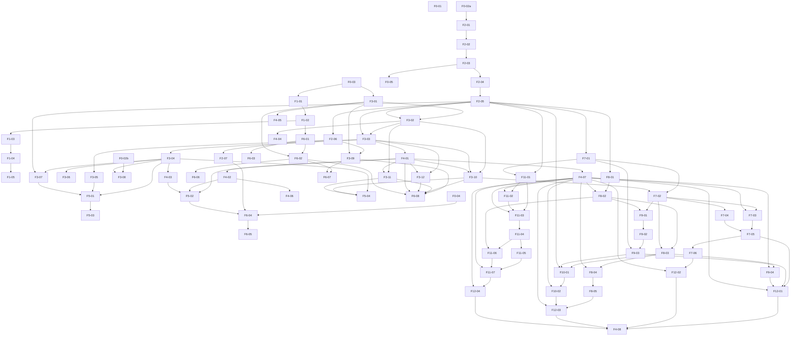

# Backlog

Work across every delivery, grouped by planning phase. Phases 0-6 record the
completed first delivery. Phases 7-12 cover the monolith analytics part of the
second delivery, and phases 13-18 its distributed stage. Phases 19-29 are the
third delivery. Story identifiers are `F<phase>-<n>`. The `AN-<n>` stories close
gaps left in phases 7-12.

Estimates are set by the team at Planning, not here. Since the second delivery
there is no project board: each issue carries its own state and priority
([`process.md`](process.md) §8), and this document does not duplicate them — a
backlog that copies issue state drifts from it within a week.

Priority: **P0** the delivery fails without it · **P1** required, schedulable
later · **P2** optional.

**Phases 13–18 are the distributed stage of the second delivery.** They
follow ADR-0034 to ADR-0046, scoped in
[`scope-delivery-2-distributed.md`](scope-delivery-2-distributed.md). F13-01 (#408)
accepted that decision set on 2026-10-15. **The
analytics phase is not finished.** The gaps found on 2026-10-13 are the
`AN-*` stories at the end of this file (epic #405).

## Dependency graph

The two setup chains — infrastructure (`F1-*`) and the data model (`F0-02a` ->
`F2-*`) — run in parallel and converge at `F3-03`, once both the application
skeleton and the schema exist to authenticate against. The early-deployment
branch (`F1-02` -> `F6-01` -> `F6-02`) is deliberately shallow so a reverse
proxy and process manager exist as soon as the application serves a page.

---

## Phase 0 — Preparation

| ID | Story | Priority | Depends on |
|---|---|---|---|
| F0-01 | Reset the repository, documentation and board to the monolith scope | P0 | — |
| F0-02a | Decide the company name and business domain identity | P0 | — |
| F0-02b | Decide the design system for the interface | P0 | — |
| F0-03 | Every member has a GCP account, the SDK CLI, an editor and Git working | P0 | — |
| F0-04 | Confirm the host assignment and whether the team delivers once (Q-1, Q-2) | P0 | — |
| F0-05 | Functional and non-functional requirements, user stories, business rules and the permission matrix | P0 | F2-03 |

**F0-02 is split.** Company name and design system are independent decisions
gated on different open questions (`docs/scope.md` §8, Q-3 and Q-4), and only
one of them feeds the data model chain. `F2-01` needs the business domain
identity (Q-3) to model against; it does not need the design system (Q-4),
which only `F3-08` consumes. Bundling both under one story meant `F2-01`
carried a blocker it had no reason to carry. Both are now resolved: the
company name is MOSAIQ, and the design system is recorded in
[ADR-0002](adr/0002-mosaiq-identity-and-design-system.md).

**F0-05 was written after the model, not before it.** Requirements belong in
Phase 0 and the story sits there, but it depends on `F2-03`: the model was built
first and the requirements were written against it. That inversion is a fact
about how the project ran, not a plan, and the dependency edge records it rather
than pretending the order was the tidy one.

## Phase 1 — GCP infrastructure

| ID | Story | Priority | Depends on |
|---|---|---|---|
| F1-01 | Create the Compute Engine instance: e2-standard-2, 50 GB persistent disk, CentOS 10 Stream | P0 | F0-03 |
| F1-02 | Firewall rules allowing HTTP/80 and SSH/22; SSH access verified by every member | P0 | F1-01 |
| F1-03 | Install PostgreSQL from the official repository on the instance | P0 | F1-02 |
| F1-04 | Configure `postgresql.conf` and `pg_hba.conf` for remote access by the application role | P0 | F1-03 |
| F1-05 | Create the application database role with least privilege, separate from the owner | P0 | F1-04 |

## Phase 2 — Database

| ID | Story | Priority | Depends on |
|---|---|---|---|
| F2-01 | Conceptual model: entities, attributes, relationships, functional and multivalued dependencies | P0 | F0-02a |
| F2-02 | Normalize to 4NF, with a written justification for each decision | P0 | F2-01 |
| F2-03 | Logical model: ER diagram and data dictionary | P0 | F2-02 |
| F2-04 | `sql/00_create_database.sql` | P0 | F2-03 |
| F2-05 | `sql/01_schema.sql` with primary keys, foreign keys, `UNIQUE`, `CHECK` and indexes | P0 | F2-04 |
| F2-06 | `sql/02_seed_30_per_table.sql`, at least 30 rows per table | P0 | F2-05 |
| F2-07 | Integrity verification: positive and negative cases, with evidence | P0 | F2-06 |

**F2-02 is the phase's real deliverable.** The scripts are mechanical once the
model is right; a model that is wrong is discovered during Phase 3 and costs the
application layer that was built on top of it.

## Phase 3 — Application

| ID | Story | Priority | Depends on |
|---|---|---|---|
| F3-01 | Flask application skeleton organized by layers | P0 | F0-03 |
| F3-02 | Database connection driven by environment variables | P0 | F3-01, F2-05 |
| F3-03 | Authentication: login, logout, password hashing | P0 | F3-02, F2-05 |
| F3-04 | Administrator module: complete CRUD over every catalog | P0 | F3-03 |
| F3-05 | Regular user module: listing, search and detail views | P0 | F3-03 |
| F3-06 | User management: create, edit, deactivate | P0 | F3-04 |
| F3-07 | Image handling: upload JPG/PNG/WebP, store under `uploads/`, keep the path in the database | P0 | F3-04, F2-05 |
| F3-08 | Apply the chosen design system across the interface | P1 | F0-02b, F3-04 |
| F3-09 | One command brings the whole stack up through Docker Compose | P1 | F2-06, F3-01 |
| F3-10 | Segment assignment process: score RFM over recorded sales, match the rules, write the assignment | P0 | F3-02, F3-03, F4-01 |
| F3-11 | Audit log view for the administrator and the auditor | P0 | F3-02, F4-01 |
| F3-12 | Authenticated application shell and navigation | P0 | F3-03, F4-01 |

**F3-10 and F3-11 exist because the demonstration needs them.** The
first-partial demonstration list asks for "ejecución de un proceso principal"
and "registro de auditoría", and neither had a story. `F3-10` is a deliberately
narrow slice of the RFM work `roadmap.md` defers — quintile scoring and a match
against the `segment_rule` bands already in the schema, and nothing else. It
inherits [ADR-0004](adr/0004-model-ahead-of-the-deferred-segmentation-modules.md),
including the warning that `customer.current_segment_id` is a column the
segment-history module will have to migrate. `F3-11` reads the `audit_log` the
triggers have been filling since `F2-05`; nothing in the application looks at it
today.

**F3-12 is the shell every other Phase 3 story hangs off.** `F3-03` establishes
a session, `F3-04` and `F3-05` build modules, and `F3-08` styles whatever
exists — none of them builds the page a signed-in user lands on or the
navigation between modules. Without it the application is a set of URLs someone
has to already know, and every demonstration item is reached through it.

**F3-09 is Docker Compose, not a shell script.** It was written as a script that
ran the three SQL files and started Flask.
[ADR-0006](adr/0006-run-under-both-systemd-and-docker-compose.md) decides the
application runs under both systemd and Compose, so the one command is
`docker compose up`. This does not change the deployment: systemd stays the
default on the instance and `F6-01` and `F6-02` are untouched.

**F3-02 depends on the schema, not the infrastructure role.** Connecting
through environment variables needs a database to connect to (`F2-05`), not
the provisioned least-privilege VM role (`F1-05`) — that role is an
operational concern, not a precondition for writing the connection code.
Chaining Phase 3 through five infrastructure stories put them on the critical
path for no reason; the least-privilege runtime role is instead verified as an
acceptance criterion at `F6-02`, where the application is actually deployed
against it. `F3-07` also gains `F2-05`: the schema stores the image path
alongside the catalog row, so it has to exist before an upload can be
persisted.

## Phase 4 — Security and roles

| ID | Story | Priority | Depends on |
|---|---|---|---|
| F4-01 | Roles and permissions with an authorization middleware enforcing them at the route level | P0 | F3-03 |
| F4-02 | Single administrator: refused by the application **and** by a partial unique index | P0 | F4-01 |
| F4-03 | Input validation and sanitization; every SQL statement parameterized | P0 | F3-04 |
| F4-04 | Secure sessions; no secrets in source, all configuration in `.env` | P0 | F3-02 |
| F4-05 | Controlled error handling and basic application logging | P1 | F3-01 |
| F4-06 | Create the real administrator on the instance without a published password | P0 | F3-03, F4-02 |
| F4-07 | Assign each Delivery 2 analytics surface to permissions held by the existing role profiles | P0 | F4-01 |
| F4-08 | Verify every Delivery 2 analytics route is default-deny and permits only its declared profiles | P0 | F12-01, F12-02, F12-03, F12-04 |

**F4-06 closes the gap the seed leaves open.** `sql/02_seed_30_per_table.sql`
creates thirty demonstration accounts, the administrator among them, all with a
password published in this repository. That is right for local work and for the
demonstration, and it is a hole on a public host. `F4-02` makes it harder rather
than easier: with the partial unique index in place, a real administrator cannot
simply be added alongside the seeded one. Someone has to decide whether the
instance carries the demonstration accounts at all.

**F4-02 needs both halves.** The application check alone is bypassed by a direct
`INSERT`; the index alone produces an unexplained database error in the user
interface. Neither is sufficient by itself.

**The Delivery 2 profiles already exist.** `ANALYST`, `STORE_MANAGER`,
`MARKETING`, `INVENTORY_PLANNER` and `AUDITOR` are seeded and enforced by the
default-deny gate in
[ADR-0007](adr/0007-permissions-in-code-with-a-default-deny-middleware.md).
`F4-07` assigns the new surfaces to permissions; it does not recreate roles or
weaken the twice-enforced single-administrator rule. `F4-08` stays in the
security phase but waits for the last analytics routes so it can verify the
complete surface.

## Phase 5 — Testing and quality

| ID | Story | Priority | Depends on |
|---|---|---|---|
| F5-01 | Functional tests over registration, login, each CRUD module and image upload | P0 | F3-04, F3-05, F3-07 |
| F5-02 | Negative tests: unauthorized access, invalid data, controlled errors | P0 | F4-01, F4-02, F4-03 |
| F5-03 | Code review pass over consistency, error handling and logging | P1 | F5-01 |
| F5-04 | Screenshots of the key functionality as evidence | P0 | F3-04, F3-10, F3-11 |

**"Phase 3" and "Phase 4" are not issues.** They cannot be expressed as a
GitHub relationship, so `F5-01` and `F5-02` are enumerated against the actual
stories they exercise. Enumerating also drops `F3-08` from `F5-01`'s
blockers — it is P1 and cosmetic, and gating functional tests on the design
system pass would hold up testing for a story that doesn't affect behavior.

## Phase 6 — Deployment and publication

| ID | Story | Priority | Depends on |
|---|---|---|---|
| F6-01 | NGINX or Apache configured as a reverse proxy in front of the application | P0 | F1-02 |
| F6-02 | Gunicorn under `systemd`, restarting automatically | P0 | F6-01, F3-01 |
| F6-03 | SSL certificate with forced HTTPS | P2 | F6-01 |
| F6-04 | Publish the documentation and evidence page on the assigned host | P0 | F0-04, F2-07, F5-02 |
| F6-05 | Final verification: links, images, downloads, checked in a private window | P0 | F6-04 |
| F6-06 | Continuous deployment: automatically update the assigned host on every merge to `main` | P1 | F6-02 |
| F6-07 | Capture proof of deployment as evidence | P0 | F6-01, F6-02, F3-09 |
| F6-08 | Rehearse the technical demonstration end to end on the instance | P0 | F3-09, F3-10, F3-11, F3-12, F4-01, F6-02 |

**F6-06 targets one environment, not two.** There is a single GCP instance
(`docs/scope.md` C-5), and it is the assigned host; `develop` stays an
integration branch gated by CI, but nothing deploys from it. The pipeline
triggers only on merge to `main`, after review, and needs `F6-02` — a
`systemd`-managed `gunicorn` process already has to exist for the pipeline to
restart it. The single-environment decision is recorded as an ADR as part of
this story, not assumed silently.

**F6-04 needs the evidence it publishes to exist.** As written, its only
blocker was `F0-04` (the host assignment), which made it look startable in
week one — but the page carries integrity evidence (`F2-07`) and negative-test
results (`F5-02`), neither of which exists that early.

**Three deliverables had no story at all.** `docs/scope.md` §5 asks for
screenshots of the key functionality (deliverable 10) and proof of deployment
(deliverable 13), and the first-partial document asks for a technical
demonstration. `F5-01` captured test output rather than screenshots, `F6-02`
made the service survive a reboot without recording that it does, and nothing
rehearsed the demonstration. `F5-04`, `F6-07` and `F6-08` are those three.

**F6-08 does not wait for the documentation page.** It was listed as blocked
by `F6-04`, which put the one deliverable that cannot be corrected after
submission five levels deep on the critical path, behind
`F4-01 -> F4-02 -> F5-02 -> F6-04 -> F6-08`. Rehearsing the demonstration needs
the application deployed and supervised on the instance — `F6-02` — not a
published docs page. The blockers here now match the ones recorded on #110.

**F6-08 is the one that cannot be fixed afterwards.** Eight demonstration items,
each owned by a different story, and nothing until now checked that they work in
sequence, on the instance, against one set of data.

**Deploy early.** F6-01 and F6-02 depend on almost nothing and are scheduled as
soon as the application serves a single page. A first deployment attempted near
the delivery date is the most common way this kind of project fails.

## Phase 7 — Segmentation traceability

| ID | Story | Priority | Depends on |
|---|---|---|---|
| F7-01 | Add the ordered stable segment-label vocabulary to the 4NF model, schema and seed | P0 | F2-05 |
| F7-02 | Replace `customer.current_segment_id` in the 4NF model, schema and seed with durable runs and assignment history, and move every current-segment write and read to the open history row | P0 | F7-01, F3-10 |
| F7-03 | Run-history view with method, parameters, executor, counts and customer assignments | P0 | F7-02, F4-07 |
| F7-04 | Detect each customer's label migration between any two completed runs, including the unassigned state | P0 | F7-02 |
| F7-05 | Migration matrix for two selected runs | P0 | F7-03, F7-04 |
| F7-06 | Per-customer migration explanation from the R, F and M measure and score deltas between two runs | P0 | F7-05 |
| F7-07 | Customer segment timeline: every assignment with R/F/M, the assignment open as of a date, recency in days, the date a label was entered, and the sales that entered and left the calculation between two runs (#337) | P0 | F7-06 |
| F7-08 | Link the migration explanation from the migration matrix and the customer timeline, and state it in plain language with changed/stable thresholds, rank-only score changes and new customers (#338) | P0 | F7-06, F7-07 |

**The label vocabulary starts here.** Assignment history needs a constrained
label before it can store the first durable result. Putting the vocabulary in
Phase 9 would make Phase 7 persist unconstrained strings or depend forward on
the modelling phase. [ADR-0018][adr-0018] defines the order and the
method-independent boundary that `F7-01` records.

**F7-02 retires the old source of truth in one story.** At planning time F3-10
(#102) wrote `customer.current_segment_id`, while catalog queries read it.
Dropping the column without rewriting both sides would leave the application broken.
The schema, the run transaction and all present-tense reads therefore move
together under [ADR-0017][adr-0017].

## Phase 8 — Sales ingestion and consumption profile

| ID | Story | Priority | Depends on |
|---|---|---|---|
| F8-01 | Define the durable source transaction identifier and duplicate rule in the 4NF model, schema and seed | P0 | F2-05 |
| F8-02 | Import versioned sales CSV files row by row and return a reconciled rejection report with row numbers and reasons | P0 | F8-01, F4-07 |
| F8-03 | Build the customer consumption profile: total spend, average ticket, frequency, last purchase, dominant channel and store, favourite categories, frequent products, average discount, RFM, and current and previous segment | P0 | F8-02, F7-02 |
| F8-04 | Server-rendered consumption profile view | P0 | F8-03, F4-07 |
| F8-05 | Detect channel, store and category shifts in the consumption profile | P0 | F8-04 |
| F8-06 | Show dominant channel and store and top categories before and now on the consumption profile, with shares of purchases, and claim a shift only with enough purchases and a clear leader (#341) | P0 | F8-05, F12-03 |

**The CSV contract needs one schema story first.** The current database
generates `transaction.transaction_id`, while the file supplies a transaction
identifier used for retries and duplicate detection. [ADR-0020][adr-0020]
leaves that physical mapping to the 4NF analysis, so `F8-01` settles it before
the importer persists a row.

## Phase 9 — Segmentation modelling

| ID | Story | Priority | Depends on |
|---|---|---|---|
| F9-01 | Formalize the existing RFM rules as the `RFM_RULES` adapter behind a method-agnostic run pipeline | P0 | F7-02, F8-02 |
| F9-02 | Implement the `KMEANS` adapter over normalized RFM features, recording its parameters and quality metrics | P0 | F9-01 |
| F9-03 | Map K-means clusters to stable labels with ADR-0018's deterministic best-to-worst ordering | P0 | F9-02, F7-01 |
| F9-04 | Model comparison view over rule-based and K-means runs | P0 | F9-03, F4-07 |
| F9-05 | Run K-means with any k of at least 2, pairing clusters with the stable labels by proportional rank and recording shared and unused labels on the run (#336, ADR-0030) | P0 | F9-03, F9-04 |

**The adapters stop at the same boundary.** A run may record its method and
parameters, but assignment history, comparison and every later consumer read
the stable label. Raw K-means cluster ids never enter that contract.

## Phase 10 — Recommendations

| ID | Story | Priority | Depends on |
|---|---|---|---|
| F10-01 | Recommend products from the stable segment label, preferred categories and purchase history, restricted to stock in the customer's usual store, with a reason for every result | P0 | F8-03, F9-03, F2-05 |
| F10-02 | Server-rendered customer recommendation view that never shows a zero-stock product | P0 | F10-01, F4-07 |

**Recommendations do not know the segmentation method.** They receive the
stable label produced by the pipeline and cannot branch on `RFM_RULES`,
`KMEANS` or a raw cluster id. That keeps the contract in ADR-0018 testable at
the consumer boundary.

## Phase 11 — Campaigns and experiments

| ID | Story | Priority | Depends on |
|---|---|---|---|
| F11-01 | Revise the campaign and experiment schema, seed and 4NF model for stable-label targeting, zero or one control group, at least one treatment group, one arm per customer, a fixed conversion window, data origin, exposures and conversions | P0 | F2-05, F7-01 |
| F11-02 | Campaign workflow from draft through activation, completion or cancellation, targeting a stable segment label | P0 | F11-01, F4-07 |
| F11-03 | Experiment setup with an optional control, treatment groups, target metric, conversion window and data origin fixed before the first assignment | P0 | F11-01, F11-02, F4-07 |
| F11-04 | Record group assignment as a durable event before exposure or outcome is known | P0 | F11-03 |
| F11-05 | Record treatment exposure as a separate event and refuse exposure for the control group | P0 | F11-04 |
| F11-06 | Record conversion separately by linking an assignment to a qualifying sale inside the fixed window | P0 | F11-04, F8-02 |
| F11-07 | Measure intent-to-treat uplift from all assigned customers, validate it with A/A and fixed injected-uplift cases, and label every seeded or injected result `Synthetic` | P0 | F11-05, F11-06, F4-07 |

**F11-01 repairs constraints the current schema cannot express.** Today one
customer may enter two arms of the same experiment, and an experiment may have
zero or several control groups. Exposure and conversion have no durable home.
The schema story must land before the workflow that follows
[ADR-0019][adr-0019] uses those relations.

**Assignment, exposure and conversion stay separate.** An assigned customer
remains in the treatment denominator even without an exposure, and a purchase
becomes a conversion only through its recorded attribution inside the window.
Generated evidence keeps its `Synthetic` label through every result surface.

## Phase 12 — Analytics

| ID | Story | Priority | Depends on |
|---|---|---|---|
| F12-01 | Highcharts segmentation dashboard for segment sizes, RFM distribution, migration flow and revenue by stable segment label | P0 | F7-05, F8-03, F9-04, F4-07 |
| F12-02 | Filtered segment history and migration reports with per-customer explanations | P0 | F7-06, F4-07 |
| F12-03 | Filtered consumption-shift and recommendation reports | P0 | F8-05, F10-02, F4-07 |
| F12-04 | Filtered campaign and experiment reports for assignment, exposure, conversion and uplift, preserving the data-origin label | P0 | F11-07, F4-07 |

**The dashboard is server-rendered HTML with Highcharts.** This is Delivery 2
work, so the first delivery's C-1 and C-2 constraints do not govern it. The
choice does not abolish those constraints generally or introduce an ingestion
endpoint; ADR-0020 still makes CSV the only sales entry point for this phase.

## Distributed stage — dependency graph

Every phase 13–18 story with its blockers. Issue numbers are in each phase's
table. GitHub shows the same blockers in each issue's **Dependencies** section,
and every story is a sub-issue of its phase epic.

```mermaid
flowchart TD
    F13-01
    F13-01 --> F13-02
    F13-01 --> F13-03
    F13-02 --> F13-03
    F13-05 --> F13-03
    F13-07 --> F13-03
    F13-01 --> F13-04
    F13-02 --> F13-04
    F13-03 --> F13-04
    F13-05 --> F13-04
    F13-07 --> F13-04
    F13-01 --> F13-05
    F13-02 --> F13-05
    F13-01 --> F13-06
    F13-05 --> F13-06
    F13-01 --> F13-07
    F13-02 --> F13-07
    F13-01 --> F13-08
    F13-03 --> F13-08
    F13-05 --> F13-08
    F13-01 --> F13-09
    F13-02 --> F13-09
    F13-03 --> F13-09
    F13-04 --> F13-09
    F13-05 --> F13-09
    F13-06 --> F13-09
    F13-07 --> F13-09
    F13-08 --> F13-09
    F13-10
    F13-01 --> F13-11
    F13-07 --> F13-11
    F13-02 --> F14-01
    F14-01 --> F14-02
    F13-03 --> F14-02
    F13-05 --> F14-02
    F13-07 --> F14-02
    F13-08 --> F14-02
    F13-09 --> F14-02
    F14-04 --> F14-02
    F13-02 --> F14-03
    F14-03 --> F14-04
    F13-03 --> F14-04
    F13-05 --> F14-04
    F13-07 --> F14-04
    F13-08 --> F14-04
    F13-09 --> F14-04
    F13-11 --> F14-04
    F13-02 --> F14-05
    F14-05 --> F14-06
    F13-03 --> F14-06
    F13-05 --> F14-06
    F13-07 --> F14-06
    F13-08 --> F14-06
    F13-09 --> F14-06
    F13-02 --> F14-07
    F14-07 --> F14-08
    F13-03 --> F14-08
    F13-05 --> F14-08
    F13-07 --> F14-08
    F13-08 --> F14-08
    F13-09 --> F14-08
    F13-02 --> F14-09
    F14-09 --> F14-10
    F13-04 --> F14-10
    F13-05 --> F14-10
    F13-07 --> F14-10
    F13-08 --> F14-10
    F13-09 --> F14-10
    F13-02 --> F14-11
    F14-11 --> F14-12
    F13-04 --> F14-12
    F13-05 --> F14-12
    F13-07 --> F14-12
    F13-08 --> F14-12
    F13-09 --> F14-12
    F13-02 --> F14-13
    F14-13 --> F14-14
    F13-03 --> F14-14
    F13-05 --> F14-14
    F13-07 --> F14-14
    F13-08 --> F14-14
    F13-09 --> F14-14
    F13-02 --> F14-15
    F14-15 --> F14-16
    F13-04 --> F14-16
    F13-05 --> F14-16
    F13-07 --> F14-16
    F13-08 --> F14-16
    F13-09 --> F14-16
    F14-14 --> F14-16
    F13-02 --> F14-17
    F14-17 --> F14-18
    F13-03 --> F14-18
    F13-05 --> F14-18
    F13-07 --> F14-18
    F13-08 --> F14-18
    F13-09 --> F14-18
    F13-11 --> F14-18
    F14-06 --> F14-18
    F14-14 --> F14-18
    F14-12 --> F14-18
    F13-02 --> F14-19
    F14-19 --> F14-20
    F13-04 --> F14-20
    F13-05 --> F14-20
    F13-07 --> F14-20
    F13-08 --> F14-20
    F13-09 --> F14-20
    F14-14 --> F14-20
    F13-02 --> F14-21
    F14-21 --> F14-22
    F13-03 --> F14-22
    F13-05 --> F14-22
    F13-07 --> F14-22
    F13-08 --> F14-22
    F13-09 --> F14-22
    F13-11 --> F14-22
    F14-06 --> F14-22
    F14-08 --> F14-22
    F14-12 --> F14-22
    F14-14 --> F14-22
    F14-16 --> F14-22
    F14-18 --> F14-22
    F14-20 --> F14-22
    F13-02 --> F14-23
    F14-23 --> F14-24
    F13-03 --> F14-24
    F13-05 --> F14-24
    F13-06 --> F14-24
    F13-07 --> F14-24
    F13-08 --> F14-24
    F13-09 --> F14-24
    F14-06 --> F14-24
    F14-10 --> F14-24
    F14-14 --> F14-24
    F13-02 --> F14-25
    F14-25 --> F14-26
    F13-04 --> F14-26
    F13-05 --> F14-26
    F13-07 --> F14-26
    F13-08 --> F14-26
    F13-09 --> F14-26
    F14-10 --> F14-26
    F13-02 --> F14-27
    F14-27 --> F14-28
    F13-03 --> F14-28
    F13-05 --> F14-28
    F13-07 --> F14-28
    F13-08 --> F14-28
    F13-09 --> F14-28
    F13-11 --> F14-28
    F13-02 --> F14-29
    F14-29 --> F14-30
    F13-04 --> F14-30
    F13-05 --> F14-30
    F13-07 --> F14-30
    F13-08 --> F14-30
    F13-09 --> F14-30
    F13-01 --> F15-01
    F13-04 --> F15-01
    F13-07 --> F15-01
    F13-09 --> F15-01
    F14-02 --> F15-01
    F14-05 --> F15-01
    F14-06 --> F15-01
    F15-01 --> F15-02
    F14-06 --> F15-02
    F13-02 --> F16-01
    F14-01 --> F16-01
    F14-02 --> F16-01
    F16-01 --> F16-02
    F14-05 --> F16-02
    F14-06 --> F16-02
    F14-07 --> F16-02
    F14-08 --> F16-02
    F16-01 --> F16-03
    F14-13 --> F16-03
    F14-14 --> F16-03
    F14-15 --> F16-03
    F14-16 --> F16-03
    F14-19 --> F16-03
    F14-20 --> F16-03
    F14-21 --> F16-03
    F14-22 --> F16-03
    F14-05 --> F16-03
    F14-06 --> F16-03
    F14-07 --> F16-03
    F14-08 --> F16-03
    F14-17 --> F16-03
    F14-18 --> F16-03
    F16-01 --> F16-04
    F14-11 --> F16-04
    F14-12 --> F16-04
    F14-17 --> F16-04
    F14-18 --> F16-04
    F14-05 --> F16-04
    F14-06 --> F16-04
    F14-09 --> F16-04
    F14-10 --> F16-04
    F14-23 --> F16-04
    F14-24 --> F16-04
    F14-25 --> F16-04
    F14-26 --> F16-04
    F16-01 --> F16-05
    F16-02 --> F16-05
    F16-03 --> F16-05
    F16-04 --> F16-05
    F16-06 --> F16-05
    F16-07 --> F16-05
    F16-01 --> F16-06
    F14-03 --> F16-06
    F14-04 --> F16-06
    F16-01 --> F16-07
    F14-09 --> F16-07
    F14-10 --> F16-07
    F16-01 --> F16-08
    F14-27 --> F16-08
    F14-28 --> F16-08
    F14-19 --> F16-08
    F14-20 --> F16-08
    F16-01 --> F16-09
    F14-29 --> F16-09
    F14-30 --> F16-09
    F14-01 --> F17-01
    F14-02 --> F17-01
    F14-03 --> F17-01
    F14-04 --> F17-01
    F17-01 --> F17-02
    F17-03 --> F17-02
    F14-05 --> F17-02
    F14-06 --> F17-02
    F14-11 --> F17-02
    F14-12 --> F17-02
    F14-23 --> F17-02
    F14-24 --> F17-02
    F17-01 --> F17-03
    F14-09 --> F17-03
    F14-10 --> F17-03
    F14-25 --> F17-03
    F14-26 --> F17-03
    F17-01 --> F17-04
    F17-02 --> F17-04
    F17-03 --> F17-04
    F14-05 --> F17-04
    F14-06 --> F17-04
    F14-07 --> F17-04
    F14-08 --> F17-04
    F14-13 --> F17-04
    F14-14 --> F17-04
    F14-15 --> F17-04
    F14-16 --> F17-04
    F14-17 --> F17-04
    F14-18 --> F17-04
    F17-01 --> F17-05
    F17-02 --> F17-05
    F17-03 --> F17-05
    F17-04 --> F17-05
    F14-05 --> F17-05
    F14-06 --> F17-05
    F14-19 --> F17-05
    F14-20 --> F17-05
    F14-21 --> F17-05
    F14-22 --> F17-05
    F14-23 --> F17-05
    F14-24 --> F17-05
    F17-01 --> F17-06
    F17-02 --> F17-06
    F17-03 --> F17-06
    F17-04 --> F17-06
    F17-05 --> F17-06
    F13-05 --> F18-01
    F13-06 --> F18-01
    F13-07 --> F18-01
    F13-08 --> F18-01
    F13-09 --> F18-01
    F14-02 --> F18-01
    F14-04 --> F18-01
    F14-06 --> F18-01
    F14-08 --> F18-01
    F14-10 --> F18-01
    F14-12 --> F18-01
    F14-14 --> F18-01
    F14-16 --> F18-01
    F14-18 --> F18-01
    F14-20 --> F18-01
    F14-22 --> F18-01
    F14-24 --> F18-01
    F14-26 --> F18-01
    F18-01 --> F18-02
    F14-02 --> F18-02
    F18-01 --> F18-03
    F18-02 --> F18-03
    F13-05 --> F18-03
    F13-09 --> F18-03
    F18-02 --> F18-04
    F18-03 --> F18-04
    F18-03 --> F18-05
    F18-04 --> F18-05
    F16-01 --> F18-05
    F16-04 --> F18-05
    F17-02 --> F18-05
    F17-03 --> F18-05
    F17-04 --> F18-05
    F17-05 --> F18-05
    F18-03 --> F18-06
    F18-05 --> F18-06
    F15-02 --> F18-06
    F16-05 --> F18-06
    F17-06 --> F18-06
```

## Phase 13 — Distributed foundation

Epic #400.

| ID | Issue | Story | Priority | Depends on |
|---|---|---|---|---|
| F13-01 | #408 | Accept the distributed-stage decision set, ADR-0034 to ADR-0046 | P0 | — |
| F13-02 | #412 | Set the contract conventions, common types and resource registry, with the contracts checks | P0 | F13-01 |
| F13-03 | #416 | Release the Python kit mosaiq-kit, mechanism only and pinned by tag | P0 | F13-01, F13-02, F13-05, F13-07 |
| F13-04 | #420 | Release the Rust kit kit-rs with the same behaviour as the Python kit | P0 | F13-01, F13-02, F13-03, F13-05, F13-07 |
| F13-05 | #424 | Run redis-state and redis-cache with per-service ACL users and negative ACL tests | P0 | F13-01, F13-02 |
| F13-06 | #428 | Run one authenticated MongoDB server for engagement only, within the memory budget | P0 | F13-01, F13-05 |
| F13-07 | #434 | Create service and definer roles, the grant matrix check and the schema-section framework | P0 | F13-01, F13-02 |
| F13-08 | #438 | Give each service its own compose project on the shared mosaiq network, runnable locally | P0 | F13-01, F13-03, F13-05 |
| F13-09 | #442 | Build, test and release each service in CI with a path-filtered matrix and repository guards | P0 | F13-01, F13-02, F13-03, F13-04, F13-05, F13-06, F13-07, F13-08 |
| F13-10 | #446 | Spike: decide whether account email verification is part of the second delivery | P2 | — |
| F13-11 | #470 | Capture golden fixtures from the web and fail CI when the web drifts from them | P0 | F13-01, F13-07 |

**F13-01 gates everything below.** ADR-0016 forbids any service skeleton,
contract file or client before the record that specifies it is accepted. F13-10
is a decision spike and does not wait for it.

## Phase 14 — Microservices

Epic #399. Each of the fifteen services has two stories: the **contract** (odd
id) and the **implementation** (even id). The contract merges before its
implementation starts and before any client story that consumes it
([ADR-0035][adr-0035]). Each service's design is described in its sheet in
[`services/`](services/README.md). campaigns and audit-trail are the second
wave (P2), dropped first if memory runs short ([ADR-0040][adr-0040]).

| ID | Issue | Story | Priority | Depends on |
|---|---|---|---|---|
| F14-01 | #409 | Write the auth-service contract: sessions, JWKS, token claims and the liveness key | P0 | F13-02 |
| F14-02 | #413 | Implement auth-service: RS256 sign-in, 12-hour sessions, refresh rotation and revocation | P0 | F14-01, F13-03, F13-05, F13-07, F13-08, F13-09, F14-04 |
| F14-03 | #418 | Write the users-service contract: accounts, roles, passwords and administrator transfer | P0 | F13-02 |
| F14-04 | #421 | Implement users-service with the single-administrator rule enforced in code and index | P0 | F14-03, F13-03, F13-05, F13-07, F13-08, F13-09, F13-11 |
| F14-05 | #425 | Write the products-service contract, including the batch read by product ids | P0 | F13-02 |
| F14-06 | #429 | Implement products-service: unique SKU, non-negative price, deactivation and change stream | P0 | F14-05, F13-03, F13-05, F13-07, F13-08, F13-09 |
| F14-07 | #471 | Write the categories-service contract: tree reads, edits and the guarded delete | P0 | F13-02 |
| F14-08 | #472 | Implement categories-service: acyclic tree and the delete guard for customer interests | P0 | F14-07, F13-03, F13-05, F13-07, F13-08, F13-09 |
| F14-09 | #473 | Write the stores-service contract: store directory and ADMIN-only geofenced locations | P0 | F13-02 |
| F14-10 | #468 | Implement stores-service in Rust: store locations, directory view and change stream | P0 | F14-09, F13-04, F13-05, F13-07, F13-08, F13-09 |
| F14-11 | #440 | Write the stock-service contract: stock levels and the consume_v1 database function | P0 | F13-02 |
| F14-12 | #444 | Implement stock-service in Rust: never-negative stock, consume_v1 for sales, uncached reads | P0 | F14-11, F13-04, F13-05, F13-07, F13-08, F13-09 |
| F14-13 | #432 | Write the customers-service contract: search, registration and correction of customers | P0 | F13-02 |
| F14-14 | #436 | Implement customers-service: registered once with valid data, never deleted through services | P0 | F14-13, F13-03, F13-05, F13-07, F13-08, F13-09 |
| F14-15 | #474 | Write the customer-preferences contract: preference profiles and whole-set replaces | P0 | F13-02 |
| F14-16 | #475 | Implement customer-preferences in Rust: atomic whole-set replace of channels and interests | P0 | F14-15, F13-04, F13-05, F13-07, F13-08, F13-09, F14-14 |
| F14-17 | #449 | Write the sales-service contract: idempotent sale recording, read-back and channels | P0 | F13-02 |
| F14-18 | #454 | Implement sales-service: all-or-nothing sales that consume stock, with durable idempotency | P0 | F14-17, F13-03, F13-05, F13-07, F13-08, F13-09, F13-11, F14-06, F14-14, F14-12 |
| F14-19 | #458 | Write the segments-service contract: label vocabulary, current assignment and history | P0 | F13-02 |
| F14-20 | #461 | Implement segments-service in Rust: one current segment by label code, unassigned as is | P0 | F14-19, F13-04, F13-05, F13-07, F13-08, F13-09, F14-14 |
| F14-21 | #476 | Write the recommendations-service contract: reasons, empty-result statuses and staleness | P0 | F13-02 |
| F14-22 | #477 | Implement recommendations-service: RN-40 over seven published views, pinned by golden fixtures | P0 | F14-21, F13-03, F13-05, F13-07, F13-08, F13-09, F13-11, F14-06, F14-08, F14-12, F14-14, F14-16, F14-18, F14-20 |
| F14-23 | #464 | Write the engagement-service contract: QR scans, recommendation clicks, voids and summaries | P0 | F13-02 |
| F14-24 | #466 | Implement engagement-service on MongoDB: once per client event, voids, rollup and live counters | P0 | F14-23, F13-03, F13-05, F13-06, F13-07, F13-08, F13-09, F14-06, F14-10, F14-14 |
| F14-25 | #478 | Write the check-ins-service contract: GPS check-ins, server-computed verdicts and reviews | P0 | F13-02 |
| F14-26 | #479 | Implement check-ins-service in Rust: geofence verdicts and append-only reviews | P0 | F14-25, F13-04, F13-05, F13-07, F13-08, F13-09, F14-10 |
| F14-27 | #480 | Write the campaigns-service contract: drafts, draft-only edits and status transitions | P2 | F13-02 |
| F14-28 | #481 | Implement campaigns-service: the campaign state machine, pinned to the web by golden fixtures | P2 | F14-27, F13-03, F13-05, F13-07, F13-08, F13-09, F13-11 |
| F14-29 | #482 | Write the audit-trail-service contract: read-only audit entries for ADMIN and AUDITOR | P2 | F13-02 |
| F14-30 | #483 | Implement audit-trail-service in Rust: read-only, attributed and credential-free audit entries | P2 | F14-29, F13-04, F13-05, F13-07, F13-08, F13-09 |

| Service | Contract | Implementation |
|---|---|---|
| [auth](services/auth.md) | F14-01 (#409) | F14-02 (#413) |
| [users](services/users.md) | F14-03 (#418) | F14-04 (#421) |
| [products](services/products.md) | F14-05 (#425) | F14-06 (#429) |
| [categories](services/categories.md) | F14-07 (#471) | F14-08 (#472) |
| [stores](services/stores.md) | F14-09 (#473) | F14-10 (#468) |
| [stock](services/stock.md) | F14-11 (#440) | F14-12 (#444) |
| [customers](services/customers.md) | F14-13 (#432) | F14-14 (#436) |
| [customer-preferences](services/customer-preferences.md) | F14-15 (#474) | F14-16 (#475) |
| [sales](services/sales.md) | F14-17 (#449) | F14-18 (#454) |
| [segments](services/segments.md) | F14-19 (#458) | F14-20 (#461) |
| [recommendations](services/recommendations.md) | F14-21 (#476) | F14-22 (#477) |
| [engagement](services/engagement.md) | F14-23 (#464) | F14-24 (#466) |
| [check-ins](services/check-ins.md) | F14-25 (#478) | F14-26 (#479) |
| [campaigns](services/campaigns.md) | F14-27 (#480) | F14-28 (#481) |
| [audit-trail](services/audit-trail.md) | F14-29 (#482) | F14-30 (#483) |

## Phase 15 — Rust twin and benchmark

Epic #401.

| ID | Issue | Story | Priority | Depends on |
|---|---|---|---|---|
| F15-01 | #450 | Build the bench-only Rust products reads, never registered, routed, deployed or counted | P1 | F13-01, F13-04, F13-07, F13-09, F14-02, F14-05, F14-06 |
| F15-02 | #455 | Benchmark the products reads in Flask and Rust under one load and publish the report | P1 | F15-01, F14-06 |
| F15-03 | #751 | Re-run the Flask and Rust comparison with CPU, PSS and an enforced memory limit | P0 | — |

## Phase 16 — Desktop client (Electron, XML)

Epic #402.

| ID | Issue | Story | Priority | Depends on |
|---|---|---|---|---|
| F16-01 | #406 | Scaffold the Electron back office with secure defaults, per-service XSD validation and sign-in | P0 | F13-02, F14-01, F14-02 |
| F16-02 | #410 | Maintain products and the category tree from the desktop client, ADMIN only | P1 | F16-01, F14-05, F14-06, F14-07, F14-08 |
| F16-03 | #414 | Review customers, both preference sets, segment assignments and recommendations on the desktop | P1 | F16-01, F14-13, F14-14, F14-15, F14-16, F14-19, F14-20, F14-21, F14-22, F14-05, F14-06, F14-07, F14-08, F14-17, F14-18 |
| F16-04 | #417 | Show stock below a threshold, sales read-back, engagement summaries and voids, check-in review | P0 | F16-01, F14-11, F14-12, F14-17, F14-18, F14-05, F14-06, F14-09, F14-10, F14-23, F14-24, F14-25, F14-26 |
| F16-05 | #422 | Package the desktop client and build, lint and test it in CI | P1 | F16-01, F16-02, F16-03, F16-04, F16-06, F16-07 |
| F16-06 | #484 | Administer users and transfer the administrator role from the desktop client | P1 | F16-01, F14-03, F14-04 |
| F16-07 | #485 | Set and remove store locations and geofences from the desktop client | P1 | F16-01, F14-09, F14-10 |
| F16-08 | #486 | Manage campaigns and their transitions from the desktop client (second wave) | P2 | F16-01, F14-27, F14-28, F14-19, F14-20 |
| F16-09 | #487 | Browse the audit trail from the desktop client (second wave) | P2 | F16-01, F14-29, F14-30 |

## Phase 17 — Android client (Kotlin, JSON)

Epic #403.

| ID | Issue | Story | Priority | Depends on |
|---|---|---|---|---|
| F17-01 | #426 | Scaffold the Android floor app with JSON networking, single-flight refresh and sign-in | P0 | F14-01, F14-02, F14-03, F14-04 |
| F17-02 | #430 | Scan a product QR code and show the product and its stock at the checked-in store | P0 | F17-01, F17-03, F14-05, F14-06, F14-11, F14-12, F14-23, F14-24 |
| F17-03 | #433 | Pick the store and check in by GPS, through a retry-safe floor-write queue | P0 | F17-01, F14-09, F14-10, F14-25, F14-26 |
| F17-04 | #437 | Find or register a customer, capture interests and record a sale queued offline | P0 | F17-01, F17-02, F17-03, F14-05, F14-06, F14-07, F14-08, F14-13, F14-14, F14-15, F14-16, F14-17, F14-18 |
| F17-05 | #441 | Show the customer's current segment and recommendations, one RECO_CLICK per tap | P0 | F17-01, F17-02, F17-03, F17-04, F14-05, F14-06, F14-19, F14-20, F14-21, F14-22, F14-23, F14-24 |
| F17-06 | #445 | Build, lint and test the Android client in CI and publish the debug APK | P1 | F17-01, F17-02, F17-03, F17-04, F17-05 |

## Phase 18 — Deployment and end-to-end demonstration

Epic #404.

| ID | Issue | Story | Priority | Depends on |
|---|---|---|---|---|
| F18-01 | #448 | Run Docker Compose, the infrastructure project and one unit per service on the instance | P0 | F13-05, F13-06, F13-07, F13-08, F13-09, F14-02, F14-04, F14-06, F14-08, F14-10, F14-12, F14-14, F14-16, F14-18, F14-20, F14-22, F14-24, F14-26 |
| F18-02 | #452 | Route each service through its own NGINX include under /api/{service}/ on 443 | P0 | F18-01, F14-02 |
| F18-03 | #456 | Deploy and roll back one service at a time when its VERSION bump merges | P0 | F18-01, F18-02, F13-05, F13-09 |
| F18-04 | #459 | Record negative-test evidence across every deployed service and boundary | P0 | F18-02, F18-03 |
| F18-05 | #462 | Script and record the end-to-end demonstration across both clients, services and the web | P0 | F18-03, F18-04, F16-01, F16-04, F17-02, F17-03, F17-04, F17-05 |
| F18-06 | #465 | Redraw the architecture diagrams and update the README for the fifteen services | P1 | F18-03, F18-05, F15-02, F16-05, F17-06 |

## Closing the analytics phase

Epic #405. Every F7–F12 issue was closed, but an audit on 2026-10-13 found
these gaps. The web system receives these fixes and features. It still gets
no Redis and consumes no service.

| ID | Issue | Story | Priority | Depends on |
|---|---|---|---|---|
| AN-01 | #407 | Accept or reject ADR-0026, 0030, 0031, 0032 and 0033, whose implementations already merged | P0 | — |
| AN-02 | #411 | Release develop to main and attach the second delivery's proof of deployment | P0 | AN-01 |
| AN-03 | #415 | Show experiment results on a Highcharts dashboard | P1 | — |
| AN-04 | #419 | Notify users inside the web system when analytics work they care about finishes | P1 | — |
| AN-05 | #423 | Segmentation dashboard heatmap splits customers with tied measures across quintiles by customer id | P1 | — |
| AN-06 | #427 | Seeded experiments are marked OBSERVED and show as real data | P1 | — |
| AN-07 | #431 | Write the analytics requirements, user stories and traceability for the second delivery | P1 | — |
| AN-08 | #435 | Bring the data model document in line with the schema and justify the analytics tables in 4NF | P1 | — |
| AN-09 | #439 | Update the demonstration guide to the second delivery | P1 | AN-02 |
| AN-10 | #443 | Attach the missing evidence for the analytics stories | P1 | AN-02 |
| AN-11 | #447 | Run detail lists K-means quality measure names without their values | P2 | — |
| AN-12 | #451 | Decide whether experiment conversions are append-only for the application role | P2 | — |
| AN-13 | #453 | Run the integrity checks and the database-layer tests against a real PostgreSQL in CI | P2 | — |
| AN-14 | #457 | Decide how data provenance is marked and what AVERAGE_TICKET measures | P2 | — |
| AN-15 | #460 | Fix duplicate business-rule ids and stale counts, diagrams and index entries in the documentation | P2 | — |
| AN-16 | #463 | Make the seed exercise K-means, varied purchase behaviour and coherent experiment dates | P2 | AN-06 |
| AN-17 | #467 | Decide how STORE_MANAGER's "own store" scope is enforced, and finish the remaining dashboard and list gaps | P2 | — |
| AN-18 | #519 | Segment run form never shows the K-means fields: the CSP blocks its inline onchange | P1 | — |
| AN-19 | #559 | Record the data origin of every sale and segmentation run | P2 | AN-14 |
| AN-20 | #560 | Mark every analytics page Synthetic from the rows it reads, and retire DATA_IS_SYNTHETIC | P2 | AN-19 |

## Third delivery — dependency graph

Phases 19 to 29 are the third delivery, scoped in
[`scope-delivery-3.md`](scope-delivery-3.md). An arrow runs from a blocker to
what it blocks, and it matches the native relationships in GitHub, which win
if the two ever differ. Issues are unassigned until someone pulls them
([`process.md`](process.md) §8).

```mermaid
flowchart TD
    F19-03 --> F19-04
    F19-03 --> F19-05
    F19-05 --> F19-06
    F19-06 --> F19-07
    F19-02 --> F19-08
    F20-01 --> F20-02
    F20-03 --> F20-05
    F20-04 --> F20-05
    F20-07 --> F20-08
    F20-07 --> F20-09
    F20-06 --> F20-10
    F20-07 --> F20-10
    F21-01 --> F21-02
    F21-04 --> F21-05
    F21-05 --> F21-06
    F21-02 --> F21-03
    F21-06 --> F21-03
    F19-02 --> F22-03
    F21-01 --> F22-03
    F22-01 --> F22-03
    F22-02 --> F22-03
    F19-08 --> F22-04
    F22-03 --> F22-04
    F22-04 --> F22-05
    F21-03 --> F22-06
    F22-05 --> F22-06
    F22-05 --> F22-07
    F22-06 --> F22-08
    F22-07 --> F22-08
    F20-07 --> F20-11
    F22-08 --> F20-11
    F20-03 --> F20-12
    F20-05 --> F20-12
    F21-11 --> F21-12
    F21-05 --> F21-07
    F21-12 --> F21-07
    F21-07 --> F21-08
    F21-09 --> F21-10
    F19-03 --> F21-13
    F19-04 --> F21-14
    F21-13 --> F21-14
    F21-15 --> F21-16
    F21-16 --> F21-17
    F21-17 --> F21-18
    F21-17 --> F21-19
    F21-20 --> F21-21
    F21-13 --> F21-22
    F21-15 --> F21-22
    F21-14 --> F21-23
    F21-17 --> F21-23
    F21-22 --> F21-23
    F21-24 --> F21-25
    F22-05 --> F22-09
    F19-02 --> F22-10
    F22-02 --> F22-10
    F19-08 --> F22-11
    F22-10 --> F22-11
    F22-05 --> F22-12
    F22-11 --> F22-12
    F23-01 --> F22-12
    F22-11 --> F22-13
    F19-02 --> F22-14
    F22-01 --> F22-14
    F22-02 --> F22-14
    F21-17 --> F22-15
    F22-05 --> F22-15
    F22-13 --> F22-15
    F22-14 --> F22-15
    F22-13 --> F22-16
    F22-14 --> F22-16
    F22-15 --> F22-17
    F23-01 --> F23-02
    F23-02 --> F23-03
    F23-03 --> F23-04
    F23-03 --> F23-05
    F23-04 --> F23-06
    F23-05 --> F23-06
    F19-02 --> F23-08
    F23-07 --> F23-08
    F22-05 --> F23-09
    F22-11 --> F23-09
    F23-08 --> F23-09
    F23-01 --> F23-10
    F23-09 --> F23-10
    F22-15 --> F23-11
    F23-09 --> F23-11
    F24-02 --> F24-03
    F21-07 --> F24-04
    F21-10 --> F24-04
    F24-03 --> F24-04
    F24-03 --> F24-05
    F21-17 --> F24-06
    F24-03 --> F24-06
    F24-04 --> F24-07
    F20-06 --> F24-08
    F21-06 --> F24-08
    F24-04 --> F24-08
    F19-02 --> F25-03
    F19-03 --> F25-03
    F21-17 --> F25-04
    F25-03 --> F25-04
    F21-12 --> F25-05
    F25-04 --> F25-05
    F19-02 --> F25-06
    F25-01 --> F25-06
    F25-02 --> F25-06
    F19-08 --> F25-07
    F25-06 --> F25-07
    F25-04 --> F25-08
    F25-07 --> F25-08
    F25-07 --> F25-09
    F21-21 --> F25-10
    F25-07 --> F25-10
    F21-03 --> F25-11
    F25-07 --> F25-11
    F25-11 --> F25-12
    F25-11 --> F25-13
    F25-08 --> F25-14
    F25-10 --> F25-14
    F25-12 --> F25-14
    F25-13 --> F25-14
    F19-02 --> F26-01
    F19-03 --> F26-01
    F19-08 --> F26-02
    F21-03 --> F26-02
    F26-01 --> F26-02
    F22-16 --> F26-03
    F26-02 --> F26-03
    F24-05 --> F26-04
    F25-12 --> F26-04
    F25-13 --> F26-04
    F26-02 --> F26-04
    F21-06 --> F26-05
    F26-02 --> F26-05
    F26-06 --> F26-07
    F26-07 --> F26-08
    F26-08 --> F26-09
    F19-04 --> F27-01
    I722["#722"] --> F27-01
    I723["#723"] --> F27-01
    F21-13 --> F27-02
    F27-01 --> F27-02
    F21-16 --> F27-03
    F27-02 --> F27-03
    F21-05 --> F27-04
    F21-09 --> F27-04
    F27-01 --> F27-04
    F21-20 --> F27-05
    F25-03 --> F27-05
    F27-04 --> F27-05
    F21-20 --> F27-06
    F24-03 --> F27-06
    F27-03 --> F27-06
    F21-20 --> F27-07
    F25-03 --> F27-07
    F25-06 --> F27-07
    F27-01 --> F27-07
    F26-01 --> F27-08
    F27-01 --> F27-08
    F21-16 --> F27-09
    F27-02 --> F27-09
    F27-10 --> F27-11
    F27-11 --> F27-12
    F27-05 --> F27-13
    F27-11 --> F27-14
    F27-13 --> F27-14
    F27-07 --> F27-15
    F27-10 --> F27-15
    F27-11 --> F27-15
    F26-07 --> F28-02
    F28-01 --> F28-02
    F22-03 --> F28-03
    F28-01 --> F28-03
    F22-03 --> F28-04
    F28-01 --> F28-04
    F22-10 --> F28-05
    F28-01 --> F28-05
    F22-14 --> F28-06
    F28-01 --> F28-06
    F23-08 --> F28-07
    F28-01 --> F28-07
    F24-03 --> F28-08
    F28-01 --> F28-08
    F25-03 --> F28-09
    F28-01 --> F28-09
    F25-06 --> F28-10
    F28-01 --> F28-10
    F28-10 --> F28-11
    F26-01 --> F28-12
    F28-01 --> F28-12
    F23-06 --> F28-13
    F28-05 --> F28-13
    F26-01 --> F28-14
    F28-01 --> F28-14
    F21-24 --> F28-15
    F28-01 --> F28-15
    F22-06 --> F29-01
    F22-15 --> F29-02
    F22-16 --> F29-02
    I462["#462"] --> F29-03
    F20-02 --> F29-03
    F21-03 --> F29-03
    F20-07 --> F29-03
    F22-08 --> F29-04
    F22-12 --> F29-04
    F23-04 --> F29-04
    F23-10 --> F29-04
    F29-01 --> F29-04
    F29-02 --> F29-04
    F24-08 --> F29-05
    F25-14 --> F29-05
    F27-06 --> F29-05
    F27-07 --> F29-05
    F19-07 --> F29-06
    F21-14 --> F29-06
    F21-17 --> F29-06
    F27-13 --> F29-06
    F27-05 --> F29-09
    F27-08 --> F29-09
    F27-09 --> F29-09
    F27-13 --> F29-09
    F28-11 --> F29-09
    F28-14 --> F29-09
    F29-08 --> F29-09
    F29-03 --> F29-12
    F29-04 --> F29-12
    F29-05 --> F29-12
    F29-06 --> F29-12
    F29-09 --> F29-12
    F20-12 --> F29-07
    F29-12 --> F29-07
    I462["#462"] --> F29-10
    F22-15 --> F29-10
    F24-04 --> F29-10
    F25-05 --> F29-10
    F25-08 --> F29-10
    F25-10 --> F29-10
    F25-13 --> F29-10
    F27-05 --> F29-10
    F27-07 --> F29-10
    F28-06 --> F29-10
    F28-11 --> F29-10
    F29-12 --> F29-10
    F29-07 --> F29-11
    F29-09 --> F29-11
    F29-10 --> F29-11
    F15-03 --> F29-11
```

## Phase 19 — Third-delivery foundation

Epic #740.

| ID | Issue | Story | Priority | Depends on |
|---|---|---|---|---|
| F19-01 | #739 | Prepare the repository for the third delivery: scope, traceability and backlog | P0 | — |
| F19-02 | #752 | Decide which capabilities become containers and re-baseline the memory budget | P0 | — |
| F19-03 | #753 | Decide the floor roles, what each may read and how a user is tied to a store | P0 | — |
| F19-04 | #754 | Add the floor roles to the catalog, the seed and the service operation policy | P0 | F19-03 |
| F19-05 | #755 | Publish the store-assignment contract | P0 | F19-03 |
| F19-06 | #756 | Implement store assignments in users-service | P0 | F19-05 |
| F19-07 | #757 | Narrow store-bound operations to the caller's assigned stores | P0 | F19-06 |
| F19-08 | #758 | Re-baseline the memory gate for the services the map adds | P0 | F19-02 |
| F19-09 | #898 | Keep the status labels in step with the native relationships automatically | P1 | — |

## Phase 20 — Verified integration of the deployed system

Epic #741.

| ID | Issue | Story | Priority | Depends on |
|---|---|---|---|---|
| F20-01 | #759 | Record a real sale from Android through the instance's HTTPS gateway, with request, response and rows | P0 | — |
| F20-02 | #760 | Read that sale from Electron and write a draft campaign through the gateway, in XML validated by its XSD | P0 | F20-01 |
| F20-03 | #761 | Run every test suite against one commit from an empty environment with one command | P0 | — |
| F20-04 | #762 | Make the suites independent of the environment: Redis AOF, PostgreSQL major and shared state | P0 | — |
| F20-05 | #763 | Reproduce and classify every failure the report blamed on the environment, the two campaign failures first | P0 | F20-03, F20-04 |
| F20-06 | #764 | Measure Redis Streams propagation per consumer group and set a bound for each | P0 | — |
| F20-07 | #765 | Build the web-to-service parity harness and prove inventory parity | P0 | — |
| F20-08 | #766 | Prove audit parity between web writes and service writes | P0 | F20-07 |
| F20-09 | #767 | Prove segment parity between the web and segments-service | P0 | F20-07 |
| F20-10 | #768 | Prove recommendations parity after a change, within the propagation bound | P0 | F20-06, F20-07 |
| F20-11 | #783 | Prove RFM parity between the web's run and rfm-engine | P0 | F20-07, F22-08 |
| F20-12 | #784 | Publish a consolidated test result for one release | P0 | F20-03, F20-05 |

## Phase 21 — Completing the fifteen services

Epic #742.

| ID | Issue | Story | Priority | Depends on |
|---|---|---|---|---|
| F21-01 | #769 | Decide how a sale is cancelled or returned, and how late and duplicate sales are treated | P0 | — |
| F21-02 | #770 | Publish the sale-reversal contract and its stream | P0 | F21-01 |
| F21-03 | #774 | Implement sale cancellations and returns in sales-service | P0 | F21-02, F21-06 |
| F21-04 | #771 | Decide stock by channel, reservations and movements | P0 | — |
| F21-05 | #772 | Publish the stock-movement and availability contract | P0 | F21-04 |
| F21-06 | #773 | Implement stock movements in stock-service | P0 | F21-05 |
| F21-07 | #787 | Serve availability by store and channel from stock-service | P0 | F21-05, F21-12 |
| F21-08 | #788 | Reserve stock where F21-04 says a reservation applies | P2 | F21-07 |
| F21-09 | #789 | Publish the product commercial status, attributes, photo, barcode and relations contract | P0 | — |
| F21-10 | #790 | Implement product commercial status, attributes, photos, barcodes and relations | P0 | F21-09 |
| F21-11 | #785 | Publish the store hours, channels, status and commercial rules contract | P0 | — |
| F21-12 | #786 | Implement store hours, channels, status and commercial rules in stores-service | P0 | F21-11 |
| F21-13 | #791 | Publish the loyalty identifier and permitted-profile contract | P0 | F19-03 |
| F21-14 | #792 | Implement loyalty identifiers and role-minimised customer reads | P0 | F19-04, F21-13 |
| F21-15 | #793 | Decide consent, personalization restrictions, retention and anonymization | P0 | — |
| F21-16 | #794 | Publish the consent, restriction and preference-history contract | P0 | F21-15 |
| F21-17 | #795 | Implement consent, restrictions and preference history in customer-preferences | P0 | F21-16 |
| F21-18 | #796 | Infer interests from purchases, apart from declared ones | P1 | F21-17 |
| F21-19 | #797 | Apply retention and anonymization without breaking history | P1 | F21-17 |
| F21-20 | #798 | Publish the engagement taxonomy: visits, impressions, clicks, exposures and cart events | P0 | — |
| F21-21 | #799 | Implement the engagement taxonomy over MongoDB | P0 | F21-20 |
| F21-22 | #800 | Publish the customer-visit contract | P1 | F21-13, F21-15 |
| F21-23 | #801 | Implement customer visits in check-ins-service | P1 | F21-14, F21-17, F21-22 |
| F21-24 | #802 | Decide and publish the domain audit contract: calculations, models, permissions, critical events and authorized reads | P0 | — |
| F21-25 | #803 | Record domain events in the audit trail | P0 | F21-24 |

## Phase 22 — Dynamic segmentation and model versions

Epic #743.

| ID | Issue | Story | Priority | Depends on |
|---|---|---|---|---|
| F22-01 | #775 | Decide what makes segmentation dynamic: triggers, windows, periodicity and incremental scoring | P0 | — |
| F22-02 | #776 | Decide what a model version is, and how history stays honest across versions | P0 | — |
| F22-03 | #777 | Publish the rfm-engine contract | P0 | F19-02, F21-01, F22-01, F22-02 |
| F22-04 | #778 | Stand up rfm-engine as an independent service | P0 | F19-08, F22-03 |
| F22-05 | #779 | Update a customer's R, F and M from a sale event, touching only that customer | P0 | F22-04 |
| F22-06 | #780 | Apply reversals, late sales and duplicates to the profile | P0 | F21-03, F22-05 |
| F22-07 | #781 | Run a scheduled pass for customers whose window or recency changed | P0 | F22-05 |
| F22-08 | #782 | Verify the incremental result against a full recalculation and publish the difference | P0 | F22-06, F22-07 |
| F22-09 | #804 | Version the RFM rule sets: windows, percentiles and sale treatment | P0 | F22-05 |
| F22-10 | #805 | Publish the model-registry contract | P0 | F19-02, F22-02 |
| F22-11 | #806 | Stand up model-registry and register versions with their dataset and metrics | P0 | F19-08, F22-10 |
| F22-12 | #808 | Train K-means in the registry, pinned to the web's results by golden fixtures | P0 | F22-05, F22-11, F23-01 |
| F22-13 | #809 | Publish and roll back a model version without rewriting history | P0 | F22-11 |
| F22-14 | #810 | Publish the segments contract for per-version assignments, migrations and quality | P0 | F19-02, F22-01, F22-02 |
| F22-15 | #811 | Apply segment changes under the published version and announce them | P0 | F21-17, F22-05, F22-13, F22-14 |
| F22-16 | #812 | Serve migrations by version, with their explanation, from segments-service | P0 | F22-13, F22-14 |
| F22-17 | #813 | Keep the web's segment reports correct alongside incremental changes | P0 | F22-15 |

## Phase 23 — Model validity and drift

Epic #744.

| ID | Issue | Story | Priority | Depends on |
|---|---|---|---|---|
| F23-01 | #807 | Build a reproducible evaluation dataset for the model studies | P0 | — |
| F23-02 | #814 | Justify the variables, the normalization and the treatment of extreme values | P0 | F23-01 |
| F23-03 | #815 | Choose k with a recorded method and keep silhouette past 2,000 customers | P0 | F23-02 |
| F23-04 | #816 | Measure K-means stability and reproduce a registered result | P0 | F23-03 |
| F23-05 | #817 | Show the segments are interpretable and commercially useful | P0 | F23-03 |
| F23-06 | #818 | Compare RFM and K-means on stated criteria | P0 | F23-04, F23-05 |
| F23-07 | #819 | Define individual migration, data drift and concept drift, and what is monitored | P0 | — |
| F23-08 | #820 | Publish the drift contract | P0 | F19-02, F23-07 |
| F23-09 | #821 | Monitor data drift against each version's reference distribution | P0 | F22-05, F22-11, F23-08 |
| F23-10 | #822 | Inject controlled drift and measure detection and false alarms | P0 | F23-01, F23-09 |
| F23-11 | #823 | Monitor the predictive relation, if F23-07 adopted one | P1 | F22-15, F23-09 |

## Phase 24 — Inventory-bound recommendations

Epic #745.

| ID | Issue | Story | Priority | Depends on |
|---|---|---|---|---|
| F24-01 | #824 | Prove today's recommendations never offer an out-of-stock, inactive or elsewhere-only product | P0 | — |
| F24-02 | #825 | Decide the reference store and channel, availability, exclusions, alternatives and explanation | P0 | — |
| F24-03 | #826 | Publish the recommendations contract for store, channel, alternatives and decisions | P0 | F24-02 |
| F24-04 | #827 | Filter recommendations by availability at the reference store and channel | P0 | F21-07, F21-10, F24-03 |
| F24-05 | #828 | Record each recommendation's explanation | P0 | F24-03 |
| F24-06 | #829 | Exclude what the customer's consent and restrictions forbid | P0 | F21-17, F24-03 |
| F24-07 | #830 | Offer valid alternatives when a product is unavailable | P0 | F24-04 |
| F24-08 | #831 | Prove a stock change produces the expected recommendation update | P0 | F20-06, F21-06, F24-04 |

## Phase 25 — Campaign measurement

Epic #746.

| ID | Issue | Story | Priority | Depends on |
|---|---|---|---|---|
| F25-01 | #832 | Decide the experiment design: control, verifiable randomization, eligibility, sample size and metrics | P0 | — |
| F25-02 | #833 | Decide attribution apart from causal effect, with one sale counted once | P0 | — |
| F25-03 | #834 | Publish the campaigns contract for audiences, budgets, eligibility, exclusions and promotions | P0 | F19-02, F19-03 |
| F25-04 | #835 | Implement campaign audiences, eligibility, exclusions and budgets | P0 | F21-17, F25-03 |
| F25-05 | #836 | Apply promotions and valid discounts in the sale | P0 | F21-12, F25-04 |
| F25-06 | #837 | Publish the experimentation contract | P0 | F19-02, F25-01, F25-02 |
| F25-07 | #838 | Stand up experimentation and take service ownership of the experiment tables | P0 | F19-08, F25-06 |
| F25-08 | #839 | Assign customers stably and verifiably, and check the balance | P0 | F25-04, F25-07 |
| F25-09 | #840 | Plan the sample size before assignment | P0 | F25-07 |
| F25-10 | #841 | Record real exposures from the floor, apart from assignment | P0 | F21-21, F25-07 |
| F25-11 | #842 | Evaluate conversions in their window, net of reversals | P0 | F21-03, F25-07 |
| F25-12 | #843 | Attribute each sale to one campaign at most, and keep it apart from effect | P0 | F25-11 |
| F25-13 | #844 | Measure incremental effect with its uncertainty | P0 | F25-11 |
| F25-14 | #845 | Validate the experiment pipeline: A/A, injected effect, stability and contamination | P0 | F25-08, F25-10, F25-12, F25-13 |

## Phase 26 — KPIs, planning and data quality

Epic #747.

| ID | Issue | Story | Priority | Depends on |
|---|---|---|---|---|
| F26-01 | #846 | Publish the analytics-kpis contract | P0 | F19-02, F19-03 |
| F26-02 | #847 | Stand up analytics-kpis with net sales by segment, store, channel and period | P0 | F19-08, F21-03, F26-01 |
| F26-03 | #848 | Report migrations, retention and spend per segment | P0 | F22-16, F26-02 |
| F26-04 | #849 | Report conversion, recommendation and campaign performance | P0 | F24-05, F25-12, F25-13, F26-02 |
| F26-05 | #850 | Relate demand by segment to availability | P0 | F21-06, F26-02 |
| F26-06 | #851 | Decide how sales imports reach a service past the 64 KiB cap | P0 | — |
| F26-07 | #852 | Publish the sales-import and reconciliation contract | P0 | F26-06 |
| F26-08 | #853 | Import sales through sales-service with validation and rejections | P0 | F26-07 |
| F26-09 | #854 | Reconcile duplicates with existing sales and report data quality | P1 | F26-08 |

## Phase 27 — Android store operations

Epic #748.

| ID | Issue | Story | Priority | Depends on |
|---|---|---|---|---|
| F27-01 | #855 | Give each store profile its own navigation, with renewal, revocation and role access | P0 | F19-04, #722, #723 |
| F27-02 | #856 | Identify a customer by loyalty QR or authorized search | P0 | F21-13, F27-01 |
| F27-03 | #857 | Show the permitted commercial profile: segment, interests and restrictions | P0 | F21-16, F27-02 |
| F27-04 | #858 | Search the catalog, scan barcodes and show availability by store | P0 | F21-05, F21-09, F27-01 |
| F27-05 | #859 | Build a cart and confirm a sale with valid discounts and idempotency | P0 | F21-20, F25-03, F27-04 |
| F27-06 | #860 | Show explained, available recommendations and record what was really shown | P0 | F21-20, F24-03, F27-03 |
| F27-07 | #861 | Consume campaigns and record a real exposure | P0 | F21-20, F25-03, F25-06, F27-01 |
| F27-08 | #862 | Give the store manager local indicators, campaigns, conversions and stock | P0 | F26-01, F27-01 |
| F27-09 | #863 | Let the loyalty officer register customers, check consent and update preferences | P0 | F21-16, F27-02 |
| F27-10 | #864 | Decide Android notifications and capture incidents | P1 | — |
| F27-11 | #865 | Publish the capture-incident contract | P1 | F27-10 |
| F27-12 | #866 | Implement capture incidents | P1 | F27-11 |
| F27-13 | #867 | Keep offline drafts with a pending state, validated by the server on return | P0 | F27-05 |
| F27-14 | #868 | Let the commercial supervisor review incidents, syncs and applied promotions | P1 | F27-11, F27-13 |
| F27-15 | #869 | Raise notifications for campaigns, capture errors and incidents | P1 | F27-07, F27-10, F27-11 |

## Phase 28 — Desktop analysis console

Epic #749.

| ID | Issue | Story | Priority | Depends on |
|---|---|---|---|---|
| F28-01 | #870 | Rebuild the console shell: modules by work, loading, errors, pagination, filters, search, exports and session expiry | P0 | — |
| F28-02 | #871 | Add the import and data-quality module | P0 | F26-07, F28-01 |
| F28-03 | #872 | Add the customer exploration module | P0 | F22-03, F28-01 |
| F28-04 | #873 | Add the RFM configuration module | P0 | F22-03, F28-01 |
| F28-05 | #874 | Add the K-means configuration module | P0 | F22-10, F28-01 |
| F28-06 | #875 | Add the migration matrix module | P0 | F22-14, F28-01 |
| F28-07 | #876 | Add the drift analysis module | P0 | F23-08, F28-01 |
| F28-08 | #877 | Add the recommendations inspection module | P0 | F24-03, F28-01 |
| F28-09 | #878 | Add audiences, budget, conditions, validity and exclusions to the campaign module | P0 | F25-03, F28-01 |
| F28-10 | #879 | Add the A/B experiment module | P0 | F25-06, F28-01 |
| F28-11 | #880 | Add the conversion analysis module | P0 | F28-10 |
| F28-12 | #881 | Add the inventory planning module | P0 | F26-01, F28-01 |
| F28-13 | #882 | Add the model comparison module | P0 | F23-06, F28-05 |
| F28-14 | #883 | Add executive reports with PDF, CSV and Excel export | P0 | F26-01, F28-01 |
| F28-15 | #884 | Add versions, rule changes, campaigns, decisions and owners to the audit module | P0 | F21-24, F28-01 |
| F28-16 | #885 | Prove the Electron security defaults hold across the new modules | P0 | — |

## Phase 29 — Validation, acceptance and demonstration

Epic #750.

| ID | Issue | Story | Priority | Depends on |
|---|---|---|---|---|
| F29-01 | #886 | Validate RFM against hand-computed values | P0 | F22-06 |
| F29-02 | #887 | Validate migrations between two periods for the same customers | P0 | F22-15, F22-16 |
| F29-03 | #888 | Run the acceptance tests of the transaction path on the instance | P0 | #462, F20-02, F21-03, F20-07 |
| F29-04 | #889 | Run the acceptance tests of the segmentation path | P0 | F22-08, F22-12, F23-04, F23-10, F29-01, F29-02 |
| F29-05 | #890 | Run the acceptance tests of the personalization and campaign path | P0 | F24-08, F25-14, F27-06, F27-07 |
| F29-06 | #891 | Run the acceptance tests of privacy, revocation and disconnection | P0 | F19-07, F21-14, F21-17, F27-13 |
| F29-07 | #895 | Run the deployed-integration and reproducibility tests on a clean environment | P0 | F20-12, F29-12 |
| F29-08 | #892 | Plan the usability tests with store staff, analysts and administrators | P0 | — |
| F29-09 | #893 | Run the usability sessions and act on what they find | P0 | F27-05, F27-08, F27-09, F27-13, F28-11, F28-14, F29-08 |
| F29-10 | #896 | Demonstrate the complete loop on the deployed system, from purchase to measured effect | P0 | #462, F22-15, F24-04, F25-05, F25-08, F25-10, F25-13, F27-05, F27-07, F28-06, F28-11, F29-12 |
| F29-11 | #897 | Publish the service catalog compliance and update the delivery documents | P0 | F29-07, F29-09, F29-10, F15-03 |
| F29-12 | #894 | Release the third delivery to the instance | P0 | F29-03, F29-04, F29-05, F29-06, F29-09 |

[adr-0016]: adr/0016-the-second-delivery-reinstates-the-distributed-architecture.md
[adr-0017]: adr/0017-segment-assignment-history-replaces-the-mutable-current-segment.md
[adr-0018]: adr/0018-two-segmentation-strategies-behind-one-method-agnostic-pipeline.md
[adr-0019]: adr/0019-experiment-measurement-separates-assignment-exposure-and-conversion.md
[adr-0020]: adr/0020-csv-is-the-sole-sales-ingestion-entry-point-for-this-delivery.md
[adr-0035]: adr/0035-each-service-publishes-its-own-versioned-contract-and-no-two-services-share-a-resource.md
[adr-0040]: adr/0040-each-service-is-built-in-ci-and-runs-as-its-own-compose-project.md
