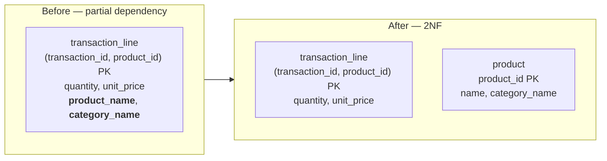
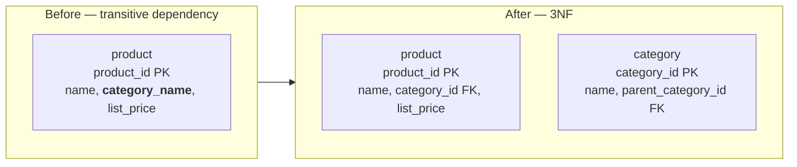
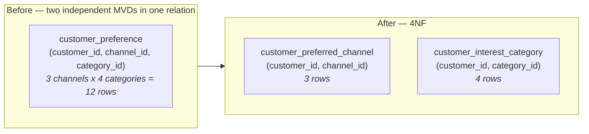

# Data model

The PostgreSQL model for MOSAIQ: the conceptual model, the normalization to
fourth normal form with the reason for each step, and the logical model as an
ER diagram and a data dictionary. §7 records the three MongoDB collections that
sit outside it, and why their shape needs no 4NF argument.

The model is implemented by [`sql/01_schema.sql`](../sql/01_schema.sql). Where
this document and that script disagree, the script is right and this document
is a bug — everything below was checked against it.

Stories: F2-01 (conceptual model), F2-02 (normalization), F2-03 (logical model).

---

## 1. Conceptual model

### Entities

This list is the 29-table `public` schema. Service-owned tables live in their
own schemas under ADR-0046 and are deliberately outside this list and diagram.

| Entity | What it is |
|---|---|
| `role` | A permission profile. Seven exist; see the matrix below |
| `channel` | A route to market: mobile app, web, physical store, marketplace, call centre |
| `category` | A product classification, self-referencing so a category can have a parent |
| `store` | A physical location that registers sales and holds inventory |
| `segment_rule` | The RFM bands that define a segment |
| `segment_label` | The stable, ordered vocabulary every segmentation run's assignments draw from |
| `segment` | A named RFM band, valid over a period, defined by one rule and carrying one stable label |
| `app_user` | Someone who signs in. Exactly one holds the administrator role |
| `app_session` | One sign-in, server-side: open until signed out, revoked or the configured idle/absolute lifetime expires (ADR-0022, ADR-0032) |
| `customer` | Someone the business sells to. Not every customer signs in |
| `customer_preferred_channel` | One preferred channel of a customer; one half of the independent-preferences 4NF decomposition |
| `customer_interest_category` | One category of interest of a customer; the other half of that decomposition |
| `segmentation_run` | One completed RFM-rules or K-means calculation, with its parameters and provenance |
| `customer_segment_history` | One customer's durable result in one segmentation run and its validity interval |
| `product` | Something sold, priced, and classified into one category |
| `transaction` | One sale: a customer, at a store, through a channel, at a time |
| `transaction_line` | One product within one sale, with its quantity and the price actually paid |
| `sales_load` | One administrator CSV upload attempt and its reconciled outcome |
| `sales_load_rejection` | One rejected file line and the business reason it was refused |
| `campaign` | Marketing action aimed at one stable segment label, over a date range, in a status |
| `experiment` | An A/B test, optionally attached to a campaign, with a fixed conversion window and a data origin |
| `experiment_group` | A control or treatment arm of an experiment |
| `experiment_assignment` | One customer's durable assignment to one arm of an experiment, before any outcome is known |
| `experiment_exposure` | One exposure event for an assigned customer, recorded separately from assignment |
| `experiment_conversion` | A qualifying sale linked back to an assignment, inside its experiment's conversion window |
| `inventory` | Stock of one product at one store |
| `stored_file` | The metadata of one file kept in the file store (a product's picture): its object path, content type, size, SHA-256, privacy, status and owner, never the bytes (ADR-0091) |
| `file_access` | One request for a PRIVATE stored file: the signed URL that was issued (with its expiry, 15 minutes at most) or the refusal, with who asked and in which role (ADR-0091, F29-14). Append-only |
| `notification` | One thing that happened that somebody should be told about: a sales load, a segmentation run, an experiment's end or a user's deactivation (ADR-0047). The event, kept once |
| `notification_recipient` | One user an event was written for, and when they read it |
| `audit_log` | Who changed which business rule or catalog row, when, and to what |

### Relationships

- `app_user` (N) — has — (1) `role`
- `app_user` (0..1) — signs in as — (0..1) `customer`
- `app_user` (1) — opens — (N) `app_session`
- `app_user` (1) — is assigned through — (N) `users.store_assignment` rows (N) — name — (1) `store`
- `app_user` (0..1) — performs — (N) `audit_log` entries
- `app_user` (0..1) — executes — (N) `segmentation_run` rows
- `channel` (1) — registers — (N) `customer`
- `customer` (1) — makes — (N) `transaction`
- `store` (1) — registers — (N) `transaction`
- `transaction` (1) — contains — (N) `transaction_line` (N) — references — (1) `product`
- `app_user` (0..1) — submits — (N) `sales_load`; the user is optional so deleting an account does not delete import history
- `sales_load` (1) — records — (N) `sales_load_rejection`
- `product` (N) — belongs to — (1) `category`
- `category` (N) — is a child of — (0..1) `category`
- `segment` (N) — is defined by — (1) `segment_rule`
- `segment` (N) — carries — (1) `segment_label`
- `segmentation_run` (1) — produces — (N) `customer_segment_history` rows
- `customer` (1) — has — (N) `customer_segment_history` rows
- `customer_segment_history` (N) — optionally records — (0..1) `segment`
- `customer_segment_history` (N) — optionally carries — (0..1) `segment_label`
- `campaign` (N) — targets — (1) `segment_label`
- `experiment` (1) — has — (N) `experiment_group`
- `experiment_group` (1) — has — (N) `experiment_assignment` — assigns — (1) `customer`
- `experiment_assignment` (1) — has — (N) `experiment_exposure`
- `experiment_assignment` (1) — has — (N) `experiment_conversion`
- `transaction` (1) — qualifies — (N) `experiment_conversion`
- `inventory` (N) — is stock of — (1) `product` at (1) `store`
- `sales_load` (0..1) — is announced by — (0..1) `notification`; likewise `segmentation_run` and `experiment`, and a `notification` names exactly one of those three or a user
- `app_user` (0..1) — is the subject of — (N) `notification`, one per deactivation
- `notification` (1) — is written for — (N) `notification_recipient` (N) — belongs to — (1) `app_user`
- `customer` (1) — has — (N) `customer_preferred_channel` rows (N) — reference — (1) `channel`
- `customer` (1) — has — (N) `customer_interest_category` rows (N) — reference — (1) `category`
- `app_user` (1) — owns — (N) `stored_file`
- `stored_file` (0..1) — is the picture of — (0..1) `product`
- `stored_file` (0..1) — is the source file of — (0..1) `sales_load`
- `stored_file` (1) — is requested in — (N) `file_access` rows (N) — made by — (1) `app_user`
- `audit_log` names any audited entity as text; only its optional actor is a foreign key

### Permission matrix

The ten roles and what each may reach are specified in
[`requirements.md`](requirements.md) §3. It is not repeated here: two copies of a
matrix drift, and the one that governs the authorization middleware is the one
next to the requirements it serves.

`role` holds those ten rows: the seven of the first deliveries and the three
floor roles of ADR-0060 (`role_id` 8 to 10). Which user holds which is data, not schema — with
the single exception of the administrator, of whom there is exactly one:

```sql
CREATE UNIQUE INDEX ux_app_user_single_administrator
    ON app_user (role_id) WHERE role_id = 1;
```

Every row the predicate admits holds the same `role_id`, so uniqueness over that
column admits exactly one of them. The literal `1` is a coupling worth stating:
an index predicate must be immutable, so it cannot join `role` to find `ADMIN`
by its code, and the schema therefore depends on the seed giving `ADMIN`
`role_id` 1. `tests/test_single_administrator.py` asserts the two still agree,
so renumbering the roles fails the build rather than quietly disarming the rule.

The rule's other direction — never *zero* administrators — is not here, because
no unique index can require a row to exist. It lives in `web/services/users.py`,
and [`business-rules.md`](business-rules.md) RN-01 explains the split.

### Dependencies

**Functional.** Each surrogate key determines every non-key attribute of its
row: `product_id → sku, name, category_id, list_price, image_path, image_file_id,
is_active`,
and equivalently for the other entities; §2.4 states each base relation's keys
and dependencies one by one. Three candidate keys carry a
functional dependency of their own and are therefore `UNIQUE`: `sku →
product_id`, `email → user_id`, and `source_transaction_id → transaction_id` —
the identifier the sales contract supplies determines the row the database
generated for it, so a re-sent file finds the same row instead of creating
another.

The composite keys behave the same way:
`(transaction_id, product_id) → quantity, unit_price` and
`(store_id, product_id) → quantity_on_hand, updated_at`.

**Multivalued.** One customer has several preferred channels *and* several
categories of interest, and the two facts are independent — knowing a
customer's channels tells you nothing about their categories. Written as
multivalued dependencies over a single preference relation:

```
customer_id ↠ channel_id
customer_id ↠ category_id
```

This is the dependency the fourth normal form step removes, in §2.4.

---

## 2. Normalization

Each step names the anomaly it removes. A model that reaches 4NF without
recording what it fixed cannot be reviewed, and this justification is a graded
deliverable in its own right.

### 2.1 First normal form

The starting relations repeated groups and mixed independent facts:

- `transaction_line` carried `product_name` and `category_name` alongside every
  sale line.
- `product` stored `category_name` as free text.
- `customer_preference` held a channel and a category of interest in one row.

1NF requires atomic values and no repeating groups. The repetition above is
real duplication, not just verbosity: the same product name is stored once per
line item sold.

### 2.2 Second normal form

`transaction_line` has the composite key `(transaction_id, product_id)`.
`product_name` and `category_name` depend on `product_id` alone — part of the
key, not the whole of it. That is a partial dependency, so both attributes move
out to `product`:



`unit_price` deliberately stays on the line. It is not the product's price; it
is the price actually charged in that sale, and it must survive a later price
change on the product.

### 2.3 Third normal form

`product` still held `category_name`, which depends on the category, which
depends on the product — a transitive dependency. Renaming a category would
have meant updating every product row carrying that text, and any missed row
becomes a second spelling of the same category. `category` becomes a table and
`product` references it:



`category` is self-referencing so that a hierarchy — Dairy → Milk — is data
rather than two columns.

### 2.4 Fourth normal form

`customer_preference(customer_id, channel_id, category_id)` is in 3NF and still
wrong. Channels and categories are independent multivalued facts about a
customer, so the relation forces one row per *combination*: a customer with 3
preferred channels and 4 categories of interest needs 12 rows to say something
that is really 3 + 4 = 7 facts. Worse, every one of those 12 rows asserts a
channel–category pairing the business never claimed, and adding a fourth
channel means inserting four more rows or leaving the relation inconsistent.

4NF requires that a relation carry no more than one independent multivalued
dependency. The decomposition splits it in two:



The decomposition is lossless: joining the two tables on `customer_id`
reproduces exactly the original relation, which is the defining property of a
valid 4NF decomposition.

`segmentation_run` and `customer_segment_history` (ADR-0017, F7-02) are a
second instance of the same discipline, one level up. A single relation
carrying a run's own facts (`method`, `window_days`, `parameters`,
`customer_count`, `executed_by`, `run_at`) together with every customer's
result for that run would repeat the run-level facts once per customer and
risk them disagreeing within one calculation — exactly the anomaly ADR-0017's
"store only timestamped customer-history rows, with no run entity"
alternative was rejected for. `run_id` and `customer_id` are independent
axes — one run has many customer results, and (across time) one customer has
many runs — so the run's own attributes and each customer's per-run result
are decomposed into two relations joined by `run_id`, the same shape as the
`customer_preferred_channel` / `customer_interest_category` split above.

F22-15 adds one fact to each of the two relations and none to a third. `segmentation_run.scope`
(`FULL` or `INCREMENTAL`) says what the run re-scored, which is a fact about the run and
depends on `run_id` alone; `customer_segment_history.cause` says why this customer's row
exists, which depends on the row. A cause is not repeated on the run: a batch of one
event has one, and a pass has one, but the history row is the unit the cause explains, and
the run keeps the cause its batch agreed on in `parameters` for the function's own
check, with the rule set the batch was scored under. The reason a customer is unassigned (no
purchases, or `PROFILING` withdrawn) is not stored: `api_segments.current_label_v1` derives
it as `unassigned_reason`, because it is determined by `cause` and a `NULL` `label_code`, and a column of its own
would state one fact twice and could contradict it (`customer_segment_history_withdrawn_unassigned`
makes the one impossible combination, a label under `CONSENT_WITHDRAWN`, a violation). Both
columns are in BCNF: each non-key attribute depends on the key and on nothing else.
A run's version, method and window stay in `parameters` and are read through
`api_models.run_version_v1` (ADR-0064) and are not copied to a column.

`sales_load` and `sales_load_rejection` apply the same rule to an upload and
its rejected lines. Keeping `filename`, the contract version, the reconciled
counts and the actor on every rejection would repeat one load-level fact once
per bad line, while a fully accepted load would have no row in which to keep
those facts. The load header is therefore one relation keyed by `load_id`, and
the rejection relation carries only the single multivalued fact of that load:
its rejected file lines and their reasons. Every non-key attribute in either
relation depends on its own key, and neither relation contains a second
independent multivalued dependency, so the decomposition is in 4NF.

Three analytics dependencies deserve explicit decisions because their column
names can otherwise make the decomposition look unfinished:

- **`segment_id → label_code`.** In `segment`, this dependency has the primary
  key as its determinant and is therefore harmless. In
  `customer_segment_history` it is conditional, not a functional dependency
  over the whole relation: K-means assignments have a `NULL segment_id` and a
  label, and deleting a retired RFM band sets only `segment_id` to `NULL` while
  preserving that row's label. Rows with no segment can consequently carry
  different labels. When a segment is present, the composite foreign key to
  `segment (segment_id, label_code)` enforces that the two values agree; the
  separate foreign key to `segment_label` constrains the durable label when
  the composite `MATCH SIMPLE` check is skipped. The label is the assignment
  fact consumed by the K-means pipeline (RN-58), migration matrix (RN-59) and
  migration explanation (RN-60); the nullable segment is optional RFM-band
  provenance. ADR-0018 and ADR-0030 require that separation, so no label is
  derived from a nullable segment during a history read.
- **`group_id → experiment_id`.** This dependency holds because `group_id` is
  the primary key of `experiment_group`. In `experiment_assignment`, however,
  `experiment_id` is a prime attribute of the candidate key
  `UNIQUE (experiment_id, customer_id)`, not a descriptive fact transitively
  copied through the group. That candidate key is RN-23's database guarantee
  that one customer cannot enter two arms of the same experiment. The
  composite foreign key `(group_id, experiment_id)` then proves that the arm
  belongs to that same experiment and prevents the repeated key component
  from varying independently. The row still represents one assignment and
  contains no second multivalued fact; this is the declarative-key design
  chosen by ADR-0019, not an unguarded duplicate of experiment data.
- **Exposure and conversion are separate relations.** From an assignment,
  `assignment_id ↠ exposure_id` and `assignment_id ↠ conversion_id` are
  independent multivalued facts: an assignment may have several exposures and
  several qualifying sales, and no exposure is paired with a particular
  conversion. Putting both in one row would manufacture the Cartesian product
  of those events, repeat each timestamp, and require null placeholders for an
  assigned-but-unexposed or non-converting customer. ADR-0019 therefore puts
  each event in its own relation. Their join through `assignment_id` is
  lossless for assignment-level reporting without inventing an
  exposure-to-sale relationship.

**Data origin (ADR-0052, #559).** `transaction.data_origin` and
`segmentation_run.data_origin` each add one attribute, and neither breaks a
normal form:

- *Whole-key, single-valued.* `transaction_id → data_origin` and
  `run_id → data_origin` hold, and each sale or run has exactly one origin.
  The determinant is the whole primary key. `source_transaction_id` is a
  candidate key of `transaction`, so it determines `data_origin` too, and
  BCNF still holds: every determinant is a key.
- *Not derivable from another column.* The seed's `TXN-` identifiers suggest
  an answer, but a CSV file may use the same shape (ADR-0052), so no
  dependency `source_transaction_id`-shape → origin can stand in for the
  column. Linking each sale to its `sales_load` was rejected by ADR-0052 too:
  sales-service writes sales without a load, and a foreign key would record
  one bit.
- *On the header, not on `transaction_line`.* A line's key is
  `(transaction_id, product_id)`, and origin depends on `transaction_id`
  alone. Storing it per line would be a partial-key dependency, a 2NF
  violation. The CSV import refuses a line onto a `SEEDED` sale, so all of a
  sale's lines share its one origin.
- *A run's origin is a recorded fact, not a derived one.* Like
  `customer_count`, it describes what the run read when it ran. A later CSV
  load with backdated `occurred_at` values adds sales to an old run's window,
  so deriving the origin at render time would describe sales the run never
  read; ADR-0052 rejected exactly that. It is run-level, so it is not
  repeated on `customer_segment_history`, which would copy one run fact once
  per customer.
- *No multivalued fact.* Origin is one value per row, so no 4NF question
  arises.
- *A CHECK, not a lookup table.* Two fixed values, with no attribute of their
  own, follow the `experiment.data_origin` precedent (ADR-0019). A subset
  table listing only the `SEEDED` rows was rejected as well: its absence
  would silently mean `OBSERVED`, while `NOT NULL` with no default makes every
  writer state the origin.

The other analytics relations were checked by the same test. `segment_label`,
`segment`, `campaign`, `experiment`, and `experiment_group` each store one fact
whose attributes depend on a declared key. `segmentation_run` stores one run;
`customer_segment_history` stores one customer result in that run;
`experiment_assignment` stores one assigned customer; and each exposure and
conversion row stores one event. Apart from the guarded key dependencies just
explained, none carries two independent multivalued facts, so no further 4NF
decomposition is needed.

A campaign's limits (F25-04) are kept in five tables of the `campaigns` schema
for the reason that rule gives. A campaign's excluded customers and its excluded
labels are two independent multivalued facts of one campaign, so each has its
own relation with one row per member, and neither is a list in a column or one
relation holding both. The cap, the budget and the eligibility rules are three
single-valued groups that change for different reasons, so they are three
relations keyed by `campaign_id`. A row exists when its fact was written, so
there is no NULL that means "no limit" next to one that means "not yet set".
The two minimum-purchase columns are present together or not at all, and a
per-customer amount never exceeds the total, both as `CHECK` constraints. They
are separate from `campaign` because the frozen web still writes that table.

A promotion (RN-71, #1104) is kept in three tables of the same schema. Its
campaign, name, percentage and validity are single-valued and depend on
`promotion_id` alone, so they are one relation. The stores where it applies and
the channels on which it applies are two independent multivalued facts of one
promotion: any of its stores goes with any of its channels. Holding both in one
relation keyed by `(promotion_id, store_id, channel_id)` would be the textbook
4NF violation, a promotion for three stores and two channels stored as six rows
that must be kept a full product by hand. So `promotion_store` and
`promotion_channel` each hold one row per member, and the product is formed only
when `api_campaigns.active_promotion_v1` or `api_campaigns.promotion_window_v1`
is read. No array column holds either list.

`notification` and `notification_recipient` (AN-04, ADR-0047) split an event from
the people it was written for, for the same reason `segmentation_run` and
`customer_segment_history` do. One relation holding the event beside each
recipient's read state would repeat the event's subject and `created_at` once per
recipient: a run announced to the 21 users who may read segments would be 21
copies of the same two facts, free to disagree, and an event nobody could be told
about (no active holder of the permission) would have no row to exist in. The
event is keyed by `notification_id`; the recipient relation is keyed by
`(notification_id, user_id)` and carries the one fact that differs per recipient,
`read_at`. Which users an event reaches, and which events a user has, are the two
multivalued facts, and each has its own side of the key. Neither relation carries
a second one, so both are in 4NF. Three decisions the column names can make look
unfinished:

- **The exclusive arc.** `notification` has four nullable foreign keys,
  `sales_load_id`, `run_id`, `experiment_id` and `subject_user_id`, of which
  exactly one is set (`notification_one_subject`). Every attribute still depends on
  `notification_id` alone, and no multivalued fact is hiding in the columns, so
  the nulls are a physical-design choice and not a normal-form failure. The
  alternative is one subtype table per kind of subject, with the supertype row
  holding only the key. That puts the "exactly one subtype row" rule where no
  declarative constraint can state it (it needs circular, deferrable references),
  and adds four tables where the arc adds three nullable columns. A polymorphic
  `(subject_type, subject_id)` pair was rejected outright: it cannot be a foreign
  key, so it permits orphans and unknown types.
- **`kind` is derived.** It is a function of which subject is set, so a purist
  would not store it. It is a `STORED` generated column, which the database
  computes and no writer can set, so it cannot drift from the subject. It is kept
  because the read-time permission check filters the inbox and the unread count by
  `kind`, and the arc has no single column to filter on.
- **`subject_user_id` is not `UNIQUE`; the other three subjects are.** A run, a
  load and an experiment are announced once, which is the guard the lazy
  announcer's `ON CONFLICT` relies on. A user can be deactivated, reactivated and
  deactivated again, and each deactivation is its own event.

No message text is stored. The sentence is a function of the subject row, so
storing it would be a second copy of facts the subject already holds.

`stored_file` (F29-13, ADR-0091) is the metadata of one object in the file store,
and nothing else about it: the bytes are in the bucket. Its key is `file_id`, and
`object_path` is a second candidate key (`UNIQUE`, and its CHECK ties it to
`file_id` and to the content type, so the name is never the user's). Every other
column — `content_type`, `size_bytes`, `sha256`, `privacy`, `status`, `owner_user_id`,
`created_at`, `deleted_at`, `metadata` — depends on `file_id` alone, so the relation
is in BCNF. The one dependency a reader might propose, `sha256 → size_bytes,
content_type` (equal bytes have an equal size), is not a dependency of the schema:
`sha256` is deliberately not a key, because two uploads of the same picture are two
files, each with its own owner, privacy, status and life. The columns describe one
stored object, not one distinct content, and splitting the content out would add a
table to avoid a repeat that is a coincidence of the data and not a fact to keep in
step. There is no multivalued dependency: the owner, privacy and status are each
single-valued, and a product's picture is one file (`product.image_file_id`, unique
where set), where a gallery would be an association table of its own and not a
repeating column. `metadata` is one opaque `jsonb` object for facts that no query
filters or joins on (the product a replaced picture belonged to, for instance); a
fact a query needs is a column, so the object never holds a repeating group. Two
columns record a status that is not a state of the world but a fact about the store:
`status = 'PENDING_DELETE'` is a delete the bucket has not confirmed, and a row is
never removed, so `DELETED` keeps the record that the file existed.

`file_access` (F29-14) is an event relation keyed by `access_id`: one row per request
for a private file. Its determinants are the key alone. `role_code` is the role the
actor held at the request, a fact about that moment (a later role change must not
rewrite it), not a function of `actor_user_id`; `expires_at` is set exactly when
`outcome = 'ISSUED'` (`file_access_expiry_check`, which also bounds it to 15 minutes
after `occurred_at`). The file and the actor each have one row per request, so there is
no multivalued fact to split. It never holds the URL or its signature.

`sales_load.source_file_id` (F29-14) is the one new attribute of an existing relation:
the stored file that keeps the load's CSV, single-valued, unique where set, null for a
load whose file was not kept. It depends on `load_id` alone.

`product.image_path` is the one deliberate departure. A picture kept in the store is
named `<image_file_id>.<ext>` in `image_path`, so that column is derivable from
`image_file_id` and the file's content type, and `product_image_name_check` keeps
the two from disagreeing. It exists because products-service publishes `photo_url`
from it and that contract is frozen. It is temporary: the story that gives
products-service a published view drops the column, and until then the redundancy is
checked, not trusted.

The remaining composite-key tables — `transaction_line`, `inventory` — each
carry a single multivalued fact plus attributes that depend on the whole key,
so there is nothing to decompose. `experiment_assignment` (F11-01, replacing
the composite-keyed `experiment_group_customer`) is not in this group: it
carries a surrogate key for reasons of physical design, not normalization —
see §4.

**The eight base relations.** `role`, `channel`, `store`, `segment_rule`,
`app_user`, `customer`, `transaction` and `audit_log` came out of the
decomposition above unchanged, so no step names them. Each one is argued here
the same way: its keys, its functional dependencies, and why it has no partial,
transitive or multivalued dependency. A single-attribute key cannot have a
partial dependency, so for these relations 2NF follows from the key and the
argument is about 3NF (BCNF where every determinant is a key) and 4NF.

- **`role`.**
  - *Keys:* `role_id`, and `code`, which is `UNIQUE` and cannot change after
    insert (`trg_role_code_immutable`).
  - *Dependencies:* `role_id → code, description` and
    `code → role_id, description`.
  - *Why it is in 4NF:* both determinants are keys, so the relation is in BCNF.
    `description` describes the role and nothing else. The permissions a role
    grants are not columns here: the matrix lives with the requirements (§1)
    and each service owns its own role policy (ADR-0036), so a role row holds
    no repeating or multivalued fact.
- **`channel`.**
  - *Keys:* `channel_id` and `name` (`UNIQUE`).
  - *Dependencies:* `channel_id → name` and `name → channel_id`.
  - *Why it is in 4NF:* the relation has two attributes and both are keys, so
    there is no non-key attribute that could depend on anything. It is BCNF
    with no multivalued fact.
- **`store`.**
  - *Key:* `store_id`. `name` is not a key; nothing makes it unique.
  - *Dependencies:* `store_id → name, city, state, is_active`.
  - *Why there is no transitive dependency:* `city → state` would be one, but it
    does not hold in the domain. Municipality names repeat across Mexican
    states (Guadalupe is in both Nuevo León and Zacatecas), so a city name does
    not determine its state. The seeded stores happen to place each city in one
    state; that is a property of the data, not a rule the schema could rely on.
    A state name repeated across stores is a repeated value, not a repeated
    fact: changing one store's state never requires changing another's.
  - *Why it is in 4NF:* one row is one store with single-valued attributes. Its
    geofence is not here; `stores.store_location` holds it under the stores
    boundary (§3).
- **`segment_rule`.**
  - *Keys:* `rule_id`, and `rule_code` (`UNIQUE`).
  - *Dependencies:* `rule_id → rule_code, r_min, r_max, f_min, f_max, m_min,
    m_max`.
  - *Why there is no dependency among the bounds:* each bound is an independent
    fact. The table `CHECK` constrains them (each minimum is at most its
    maximum) but determines none of them. The six bounds are separate atomic
    columns, not one array, so each carries its own `CHECK BETWEEN 1 AND 5`.
  - *Why the label is not here:* `segment` maps a rule to a label, with its own
    validity dates, and `segment.rule_id` is not unique. A label is therefore
    not a function of the rule, and storing one on the rule would be wrong
    rather than merely redundant.
  - *Why it is in 4NF:* one row is one band, with single-valued attributes
    and no multivalued fact.
- **`app_user`.**
  - *Keys:* `user_id`, and `lower(email)` through the unique index
    `ux_app_user_email_lower`, so the email determines the row
    case-insensitively.
  - *Dependencies:* `user_id → role_id, name, email, password_hash, is_active,
    created_at`.
  - *Why there is no transitive dependency:* only `role_id` is stored; the
    role's `code` and `description` stay in `role`. `password_hash` is a fact
    of the user's current password, not of any other attribute.
  - *Why it is in 4NF:* a user holds exactly one role, so `role_id` is
    single-valued, not a multivalued fact needing its own relation. The
    single-administrator partial index (§1) limits how many rows hold
    `role_id = 1`; it is a constraint on rows, not a dependency between
    columns.
- **`customer`.**
  - *Keys:* `customer_id`. `email` and `user_id` are `UNIQUE` and nullable, so
    each is a key on the rows where it is present.
  - *Dependencies:* `customer_id → user_id, name, email, phone,
    registration_channel_id, registered_on`. `phone` determines nothing: it is
    not unique, and two customers may share a number.
  - *Why there is no transitive dependency:* `registration_channel_id` stores
    the channel the customer was acquired through, and the channel's name stays
    in `channel`. It is not the channel of any sale; that is
    `transaction.channel_id`, a different fact. The customer's `name` and
    `email` are contact data, not copies of the linked account's login
    identity, so `user_id → app_user.email` copies nothing into this row.
  - *Anonymization marker (F21-19, ADR-0066 section 3):* `anonymized_at` is one
    more attribute of the same key, `customer_id → anonymized_at`: when, if ever,
    the identity was removed in place. It is single-valued and independent of
    the contact data it supersedes, so it adds no multivalued dependency, and
    it is not split into its own relation because a customer is anonymized at
    most once and the marker must travel with the row it describes: the CHECK
    `customer_anonymized_identity_check` ties it to the identity columns in the
    same row (a marked row holds the placeholder name and no email, phone or
    account link), which a separate table could not enforce without a trigger.
  - *Why it is in 4NF:* the preferences are the two relations split off above,
    and there is no current-segment column (§3), so no multivalued fact is
    left in the row.
- **`transaction`.**
  - *Keys:* `transaction_id`, and `source_transaction_id` (`UNIQUE`).
  - *Dependencies:* `transaction_id → source_transaction_id, customer_id,
    store_id, channel_id, occurred_at, total`.
  - *Why there is no transitive dependency:* neither `customer_id` nor
    `store_id` determines `channel_id`. One customer buys through different
    channels, and one store records sales from more than one. The sale's
    channel is therefore a fact of the sale.
  - *Why it is in 4NF:* its lines are the separate relation from §2.2, so the
    header holds one sale with single-valued attributes.
  - *The deliberate exception, `total`:* `total` equals the sum of
    `quantity × unit_price` over the sale's lines (ADR-0020, RN-37). That is a
    dependency on another relation, not a functional dependency inside
    `transaction`, so it breaks no normal form. It is still a stored derived
    value, and so a redundancy that can drift. It is kept on purpose, for two
    reasons. First, the analytics read it directly: spend, the consumption
    profile and the experiment conversions sum `transaction.total`
    (`web/db/consumption.py`, `web/db/consumption_shift.py`,
    `web/db/experiment_conversions.py`). Second, `stream:sales.v1.recorded` is
    captured by a trigger on `INSERT OR UPDATE OF total` (ADR-0039), so the
    update of `total` is what announces a CSV line appended to an existing
    sale. The writers keep it equal to its lines. The web recomputes it from
    the committed lines after every accepted CSV row, under the header lock
    (`recompute_total`, RN-37), and sales-service computes it once and never
    updates it (ADR-0039). The database refuses a `total` that disagrees with
    its lines at `COMMIT`, through the deferred `transaction_total_matches_lines`
    trigger described under `transaction_line` (#591).
- **`audit_log`.**
  - *Key:* `audit_id`.
  - *Dependencies:* `audit_id → user_id, entity, entity_pk, action,
    data_before, data_after, executed_at`.
  - *Why `(entity, entity_pk)` is not a key:* it names the changed row, which
    changes many times. There is no foreign key to that row, on purpose: one
    log covers many tables, and an entry must outlive the deletion it records
    (§5).
  - *Why the JSONB columns satisfy 1NF:* `data_before` and `data_after` are
    snapshots of a whole row, written once by `fn_audit()` and read back whole.
    The audit trail (`web/services/audit.py`) pairs their fields only to
    display a change. No query filters or joins on their members, and their
    shape follows whichever table was audited. Only the integrity checks look
    inside them in SQL: `sql/verify_integrity.sql` proves `password_hash` is
    absent and reads a campaign's recorded status transition. Splitting the
    snapshots would need one row per column per change, or one audit table per
    audited table.
  - *Why it is in 4NF:* one row is one change, with no multivalued fact.

Every boundary outbox, `<suffix>_events.outbox` (ADR-0044, ADR-0046), is in 4NF
too. `event_id` determines every other column (`stream`, `event_type`,
`entity_id`, `occurred_at`, `relayed_at`), and the relation carries no
multivalued fact: one row is one captured change. An event names its entity by
key only, never by copying its state, so there is nothing derived to drift.
There is one outbox per owning boundary rather than one shared table, which
keeps one writer per table: only that boundary's definer appends, and only its
own relay marks and purges. `segments_events.outbox` (F14-20) is one of them: it
captures each `segmentation_run` the web inserts.

The users boundary adds **`users.store_assignment`**, the independent
multivalued fact “this user may work at this store.” Its composite key
`(user_id, store_id)` contains every attribute, so every determinant is a key
and the relation is in BCNF and 4NF. Keeping assignments out of `app_user`
avoids a repeating store list and allows one user to have any number of stores
without copying account attributes. Deactivation or a role change does not
delete the fact (RN-04); `api_users.store_assignment_v1` filters inactive and
non-store-bound users when deciding what currently grants access.

The check-ins boundary (ADR-0046, F14-26, F21-23) adds three relations, all in
4NF:
- **`checkins.store_check_in`** has two candidate keys: `check_in_id` and the
  phone's `client_check_in_id`. Each determines every other column.
  - There is no `verified` column. The automatic verdict depends on `reason`
    alone, so storing it would be a transitive dependency; the effective verdict
    depends on the latest review, a fact of another relation.
  - `distance_m` and `reason` look derivable from the fix and the store's
    location, but they are fixed at `recorded_at` against the location *then*.
    A later change to the store's location must not rewrite past verdicts, so
    they are facts of the check-in, not functions of current data.
  - There is no current-status column either, which would turn an append-only
    history into an updated one.
- **`checkins.check_in_review`** is the multivalued fact "this check-in was
  reviewed, by whom, with what verdict", which can occur any number of times
  per check-in. It is therefore its own relation: `review_id` determines a
  review, and `check_in_id` relates it to its check-in. Keeping reviews in the
  check-in row would need either repeating columns (not 1NF) or updating that
  row, which RN-56 forbids.
- **`checkins.customer_visit`** is the separate RN-72 fact that one customer
  visited one store at one time, optionally in relation to one campaign.
  `visit_id` determines the customer, store, campaign, occurrence time,
  recording time and recording user, so every non-trivial functional
  dependency has a candidate key as determinant. A campaign is optional but
  single-valued; visits are not stored as a repeated group on the customer,
  store or campaign. The relation therefore has no independent multivalued
  dependency and is in 4NF. The loyalty code is an input used only through
  `api_customers.resolve_loyalty_code_v1`; retaining it would duplicate an
  identifier owned by customers and is deliberately not a column. Coordinates
  and device or network identifiers are not facts of an authorized visit and
  are likewise absent. `customer_id` alone becomes nullable after the 36-month
  retention period so aggregate store/time/campaign facts can remain without
  naming a person.

The experimentation boundary (ADR-0068, ADR-0046, F25-09) adds four relations to the five
experiment tables it took over, all in 4NF. They hold what a plan adds and exist only for an
experiment planned through the service:
- **`experiments.experiment_plan`** is keyed by `experiment_id`, which determines every other
  column: the levels (`alpha`, `comparison_alpha`, `power`), the minimum detectable effect, the
  baseline and its spread, the customers each arm needs, the smallest effect the frame can detect,
  the settle days, the frame's instant, digest and label, the salt and who
  planned it. They are fixed at planning against the data *then* (the baseline and the frame
  cannot be recomputed from later sales and labels), so each is a fact of the plan and not a
  function of current data. Four things are deliberately **not** columns because they are
  derived: the design kind (whether a control arm exists), an arm's position (control first,
  then by group id), the estimator and the secondary metric (functions of the primary metric,
  which stays in `experiment.target_metric`), and the frame's size (the members counted). Storing
  any of them would be a transitive dependency that a later write could contradict.
- **`experiments.experiment_frame_member`** is the multivalued fact "this customer was eligible
  at the frame instant": a row per customer, never an array, keyed by `(experiment_id,
  customer_id)`.
- **`experiments.experiment_frame_exclusion`** is the independent multivalued fact "this many
  customers were removed for this reason": keyed by `(experiment_id, reason)` with the count as
  its one dependent column. It is not folded into the plan row, which would repeat a column per
  reason (not 1NF) and fix the list of reasons, which the contract leaves open.
- **`experiments.experiment_flag`** is the second independent multivalued fact, the flags that
  apply to the experiment, keyed by `(experiment_id, flag)`. The plan writes `UNDERPOWERED`; the
  stories after it add the others.

A plan is frozen: `svc_experiments` holds SELECT and INSERT only, and a trigger refuses an UPDATE
or DELETE of a plan, a member or an exclusion from anyone.

The primary result (ADR-0085, F25-13) adds four more, also in 4NF, written together once by the
first primary read at or after the analysis instant. A look cannot be recomputed later (the net
view keeps no history of its reversals), so each stored value is a fact of the look and not a
function of current data:
- **`experiments.sale_attribution`** (F25-12, ADR-0069) is keyed by `attribution_id`, and `sale_id` is
  a second key (`UNIQUE`), so a sale has at most one holder: the schema refuses a second. The row
  stores only what the holder rule decides: the `assignment_id` that holds the sale and the
  `exposure_id` that earned the credit. The experiment, campaign, customer, arm, the exposure and
  sale instants and the window's end are functions of those two keys and the sale, so they are read
  from their owners and not copied (a copy could disagree with `experiment_assignment`). The net
  amount and whether the sale still counts are not columns either: a reversal is a fact about the
  sale, read from the net view when shown (ADR-0062), and the holder is never reopened. There is no
  multivalued or join dependency left: one sale, one holder. Triggers refuse a control assignment,
  an experiment with no campaign, an exposure that is not the assignment's or does not precede the
  sale, and a sale that is not the customer's own or falls past the window; every `UPDATE` and
  `DELETE` is refused, even for the owner, and `svc_experiments` holds `SELECT` and `INSERT` only.
- **`experiments.experiment_result`** is keyed by `experiment_id`, which determines when the look
  was computed, the sample ratio's p-value and whether the figures are synthetic. The status is
  not a column: it is `INVALID` exactly when that p-value is below 0.001.
- **`experiments.experiment_result_arm`** is keyed by `(experiment_id, group_id)`, which determines
  the arm's counts (analysed, exposed, exposed who converted, converted, pending, not converted),
  its net revenue and the standard deviation of its revenue per customer. The rates and revenue
  per customer are not columns: they are counts over `analysed` and revenue over `analysed`. A
  check keeps `converted + pending + not_converted = analysed`.
- **`experiments.experiment_result_comparison`** is keyed by `(experiment_id, group_id,
  against_group_id, metric)`, which determines the difference, its interval, the p-value, the
  degrees of freedom and, for revenue only, the bootstrap interval. Not columns, because each
  follows from the key, the stored values and the plan: the label (whether the other arm is a
  control), the role (whether the metric is the plan's primary), the test (a function of the
  metric), the confidence level (`1 - comparison_alpha`), the conclusion (the p-value against the
  level, and the `UNDERPOWERED` flag), the incremental revenue (the difference and the interval
  times the arm's `analysed`) and whether the bootstrap agrees.
- **`experiments.experiment_result_balance`** is keyed by `(experiment_id, group_id, measure)`,
  which determines the reference arm and the standardized mean difference. Whether it is flagged
  is not a column: it is its absolute value against 0.25.

They are one relation per kind of fact, never an array and never a document, so that a constraint
can keep each fact consistent. The two flags a look can raise go to `experiment_flag`. Frozen like
the plan: `svc_experiments` holds SELECT and INSERT only, and the same trigger refuses any UPDATE
or DELETE.

The assignment's checks (F25-08) add two more, in 4NF, written once with the assignment and
frozen like the plan:
- **`experiments.experiment_assignment_record`** is keyed by `experiment_id`, which determines who
  assigned, whether an `UNDERPOWERED` plan was acknowledged, whether recomputing gave the stored
  arms and the sample ratio's p-value. These are facts of one act, fixed when it happened. Not
  columns, because each follows from rows that cannot change: the assignment instant, the total
  and each arm's count (from `experiment_assignment`), the sample ratio's status (the p-value
  against 0.001) and whether the experiment is flagged.
- **`experiments.experiment_assignment_balance`** is keyed by `(experiment_id, group_id,
  measure)`, which determines the standardized mean difference. The reference arm (the control,
  or the first offer) and whether a difference is flagged (its absolute value against 0.25) are
  derived. Balance has its own relation and is not a column of the record: it is a multivalued
  fact per arm and measure. The result's own balance is a separate fact, a look at the analysis
  instant, and stays in `experiment_result_balance`.

Both are exempt from the 30-row minimum, like the other tables written only by an operation
(`sql/seed-exempt.txt`). `public.experiment_assignment` itself gains triggers rather than columns:
no role may UPDATE, DELETE or TRUNCATE a row (RN-42), and the web may not INSERT into a planned experiment.

The recommendations boundary (ADR-0067, ADR-0046, F24-05) adds four relations,
all in 4NF. They keep the explanation of each recommendation the service served:
- **`recommendations.recommendation_decision`** is keyed by `decision_id`, which
  determines the customer, the status, the computation time, the segmentation
  run, the model version, the reference store, where that store came from and the
  reference channel. Those are facts of one answer, fixed when it was made, so
  none is derived from current data: a later change of a customer's usual store,
  of a model version or of a store's channels must not rewrite what was
  answered. The model version has no foreign key because the model registry is
  another boundary's.
- **`recommendations.recommendation_exclusion`** is the multivalued fact "this
  many products were excluded for this reason". It is independent of the
  decision's items (an excluded product is never listed), so it is its own
  relation keyed by `(decision_id, reason)`. One row per reason above zero.
- **`recommendations.recommendation_item`** is one product offered by one
  decision, keyed by `(decision_id, position)`, with `(decision_id, product_id)`
  also unique. `category_id` is the product's category when it was shown, a fact
  of the decision and not a function of the product's current row.
  - What would be derivable is not a column. An item's availability channel is
    its decision's channel, and its availability store is its decision's store
    unless it is an `elsewhere` entry, so only that entry stores a store
    (`held_at_store_id`). The `factors` of the contract (signals matched, segment
    buyers, category share) are the count and the figures of the item's reason
    rows, so storing them would hold each fact twice, free to disagree.
  - `kind`, `held_at_store_id`, `alternative_for` and `unavailable_reason` depend
    on each other by the contract (a `primary` has none of the three, an
    `alternative` has `alternative_for` and a reason, an `elsewhere` has a store
    and a reason). That is a dependency between the columns of one row, which a
    CHECK states, not a multivalued fact, so it needs no relation of its own.
- **`recommendations.recommendation_reason`** is the multivalued fact "this item
  was offered for this signal, with these figures", independent of the item's
  other columns, keyed by `(decision_id, position, signal)`. It has no ordinal:
  the order of reasons is the contract's fixed order of signals, a function of
  the signal. Keeping reasons in a JSON column would hide the fact from
  constraints and from aggregation (ADR-0067).

The record holds identifiers, figures and codes only: no name, email, phone,
SKU, price or free text, and nothing copied from customer or product beyond ids.
Every text column is a code constrained to a list.

The sales boundary (ADR-0039, ADR-0046, F14-18) adds one relation, also in 4NF:
- **`sales.sale_capture`** is keyed by `transaction_id`, which determines
  `request_sha256`, `recorded_by` and `captured_at`. It is a 1:1 split of
  `transaction` for phone sales only: those columns would be NULL on every CSV
  header, and the web, which writes those headers, must never see them.
  - The `Idempotency-Key` is not stored. It is the suffix of the header's
    `source_transaction_id` (`svc-sales:<key>`), so a column for it would hold
    the same fact twice, free to disagree (ADR-0039).
  - `request_sha256` is a fact of the request as accepted, not a function of
    current data, so it is not derived state.
- **`sales.sale_line_price`** (F25-05) is keyed by `(transaction_id,
  product_id)`, the key of the line it describes, which determines `list_price`
  and `promotion_id`. A line names at most one promotion, so both are
  single-valued facts of the line and there is no multivalued dependency to
  split. It is a 1:1 split of `transaction_line` for phone sales only, for the
  same reason `sale_capture` splits `transaction`: a CSV or imported line has no
  list price of its day to keep, and the web, which writes those lines, must not
  see the columns.
  - `list_price` is not derived state: it is the product's price on the day of
    the sale, which `product.list_price` no longer says once the catalog
    changes. That is the fact RN-13 says the line does not otherwise keep.
  - `promotion_id` is `NULL` when no promotion discounted the line (none was
    named, or the line was charged at or above its list price), the one
    meaning of its absence. It has no foreign key: promotions are campaigns'
    (ADR-0044), checked through `api_campaigns.promotion_window_v1` when the
    line is written, and a promotion of a campaign that ran is never rewritten.
  - The seed's thirty rows are illustrative: they sit on seeded sales that have
    no `sale_capture` row (that table is runtime state and seed-exempt), as if
    those sales had been recorded through the service on the day of the load.

The stores boundary (RN-53, ADR-0046, F21-12) adds six relations beside
`stores.store_location`, all in 4NF. Each fact of a store is its own relation,
keyed by `store_id` and nothing else, because a store's status, its weekly
hours, its enabled channels and its discount cap are independent facts: none
determines another, and changing one must not rewrite the others, their
`set_by` or their `set_at`.
- **`stores.store_status`** (`store_id → status, set_by, set_at`): one status
  per store, three values. A store with no row is `OPEN`, so the absence of a
  fact is never stored as a default.
- **`stores.store_hours`** and **`stores.store_hours_interval`**. The opening
  days are a multivalued fact (a store opens on several days), so they cannot
  share a row with the store's time zone: that would be either seven repeating
  column groups (not 1NF) or one row per day repeating the zone, where
  `store_id → time_zone` holds but `store_id` is not the row's key, a 2NF
  violation and an update anomaly (change the zone in six rows out of seven).
  `store_hours` holds what depends on the store alone (`time_zone`, `set_by`,
  `set_at`) and `store_hours_interval` holds one open day, keyed by
  `(store_id, day_of_week)`, which determines `opens_at` and `closes_at`.
  Neither opening time nor closing time determines the other, and no non-key
  column determines another, so both are in BCNF and, with no further
  multivalued dependency, in 4NF. A day with no row is closed. Two things a key
  cannot say are held by CHECKs and one constraint trigger: `closes_at >
  opens_at` and whole minutes, and `time_zone IS NULL` exactly when the store
  has no interval, checked at commit so a replacement may write the header and
  its days in any order.
- **`stores.store_channel_set`** and **`stores.store_channel`**. The enabled
  channels are a multivalued fact (`store_id ↠ channel_id`), so one row is one
  enabled channel, keyed by `(store_id, channel_id)`, with no non-key column.
  When and by whom the set was last replaced is a fact of the set, not of any
  one channel, so it is held once in `store_channel_set` (`store_id → set_by,
  set_at`). Putting `set_by` and `set_at` on each channel row would repeat them
  for every channel of a store and would lose them when the set is emptied,
  which the contract says is a write with an `updated_at` of its own.
- **`stores.store_commercial_rule`** (`store_id → max_discount_percent, set_by,
  set_at`): the one rule the contract defines. A `NULL` cap and a store with no
  row mean the same, "no cap of its own"; the row exists after clearing only to
  keep `set_at`.

`public.store.is_active` is not moved, copied or written here: the web owns it,
and the status above is a separate fact (`api_stores.store_directory_v2`
publishes both, and the consumer applies "active, `OPEN`, and the channel
enabled").

The customer-preferences boundary (ADR-0066, RN-73, F21-17) adds four relations in
the `preferences` schema beside the two preference tables it already writes, all in
4NF and all append-only, so no row is ever updated and none can drift from another.
- **`preferences.consent_decision`** is keyed by `decision_id` (a generated identity),
  which determines the customer, the purpose, the decision, when it was recorded,
  by whom, its source and its basis. The *current* state of a purpose is not a
  column: a `current` flag would be derived data that an UPDATE must keep true,
  and the log is never updated. It is the row with the largest `decision_id` per
  customer and purpose, which `api_preferences.consent_state_v1` publishes, and
  the state at a past instant is the same query bounded by `recorded_at`.
  `recorded_by` is null exactly for the `MIGRATION` default (a CHECK), and a
  `MIGRATION` row is exactly a `PROGRAMME_DEFAULT` one.
- **`preferences.restriction_decision`** is the same shape for a channel or an
  interest category. The target is two nullable references, `channel_id` and
  `category_id`, exactly one of them set (a CHECK that follows `kind`), each with
  its own foreign key, so an unknown channel or category is refused by the
  database and not by a trigger. `target_id` is a stored generated column, the
  one that is set, so the published view and the log read one column. It is
  derived by the database and cannot disagree with its sources. The two reference
  columns have partial indexes for the `RESTRICT` checks when a channel or a
  category is deleted.
- **`preferences.preference_change`** and **`preferences.preference_change_member`**.
  A replace of a declared set records the ids the set held before and the ids it
  holds after, two independent multivalued facts of one change
  (`change_id ↠ before ids`, `change_id ↠ after ids`). Two array columns in the
  change row would not be 1NF, and one row per (before id, after id) pair would
  be the cross product that 4NF forbids. So the change is one row
  (`change_id → customer_id, preference_set, changed_at, changed_by`) and each id
  is one row of the member relation, keyed by `(change_id, side, member_id)`.
  `member_id` has no foreign key on purpose: it records what the set held at a
  past moment, and must stay readable after a channel or category is retired.

The four relations are enforced append-only twice: `svc_preferences` holds `SELECT`
and `INSERT` and nothing else, and a trigger refuses `UPDATE`, `DELETE` and `TRUNCATE`
for every role, the owner included, unless an operator's archiving script drops it.
Their foreign keys to `customer` are `RESTRICT` because a customer is never deleted
(RN-08, ADR-0066). The customers that exist when the log is created are given the
default of ADR-0066 section 1 by a backfill that runs once, against an empty log.

`sales_events.outbox` is one more boundary outbox, under the outbox note above.

The interests inferred from net purchases (ADR-0066, RN-34, RN-35, F21-18) add one
relation to the same boundary, in 4NF:
- **`preferences.inferred_interest`** is keyed by `(customer_id, category_id)`, and that
  key determines `source`, `window_days`, `strength` and `inferred_at`; there is no other
  determinant, so the relation is in BCNF, and with no multivalued dependency besides
  the key it is in 4NF. It is not a third set folded into `customer_interest_category`:
  a declared interest is something the customer said, an inferred one is something
  computed about them, and the two have different provenance and lifetimes (an inferred
  row is deleted when `PROFILING` is withdrawn, a declared one never is), so they stay
  separate relations and no row can pass for the other. `window_days` and `inferred_at`
  repeat across a customer's rows because one run makes them all, but each is a fact of
  that row's own derivation (a later run may recompute one category and not another's
  window), not a fact of the customer, so moving them to a per-customer header would
  only add a join and a table that is empty whenever nothing is inferred. Nothing
  derivable from another boundary is copied: the category's name, the product, the sale
  and the declared set are all read where they live. `strength` is stored, since it
  is the result of the run and the net purchases it came from change afterwards.
  `source` is a CHECK (only `NET_PURCHASES` today), `window_days` is 1 to 3650 and
  `strength` 1 to 100, so a row the contract could not describe cannot exist. The
  customer key is `RESTRICT` (a customer is never deleted, RN-08); the category key is
  `CASCADE`, since the rows are derived and a run recomputes them. `svc_preferences`
  holds `SELECT`, `INSERT` and `DELETE`, never `UPDATE`: a run replaces a customer's
  whole set, as the declared sets are replaced.

Reversals (ADR-0062, F21-03) add two relations to the sales boundary, both in 4NF,
and one column to `transaction_line`:
- **`sales.sale_reversal`** has two candidate keys, `reversal_id` and the request's
  `idempotency_key`, and each determines every other column: the sale, the kind,
  the cancellation's reason, the request hash, who recorded it and when. The
  customer and the store are not columns: they are the sale's, and copying them
  would be a transitive dependency through `transaction_id`. The key is stored
  here, unlike a sale's, because no other column holds it (a sale's key is the
  suffix of its `source_transaction_id`). `reason` is null on a return and
  required on a cancellation (`sale_reversal_reason_kind_check`).
- **`sales.sale_reversal_line`** is keyed by `(reversal_id, product_id)`.
  `quantity`, `reason` and `resellable` are each one value of that line. They
  cannot move up to the reversal: a return holds several lines, each with its own
  quantity, reason and flag (a damaged one next to a resellable one), which would
  be repeating columns (not 1NF) or a multivalued dependency on the header. The
  header's `transaction_id` is repeated here only because the composite foreign
  key `(transaction_id, product_id)` to `transaction_line` needs it, and a trigger
  refuses a line whose sale is not its header's. There is no `kind` copy: the
  trigger reads it from the header.
- **`transaction_line.returned_quantity`** repeats what these lines add up to,
  for the reason given under `transaction_line`. It is a deliberate stored
  derivation, kept in step by a deferred constraint trigger (equal to the sum at
  `COMMIT`), a writer guard (only `svc_sales`) and a CHECK (between 0 and
  `quantity`).

Sales imports (ADR-0070, F26-08) add three relations to the sales boundary, all in 4NF,
and one column to `sales.sale_capture`:
- **`sales.import`** has two candidate keys, `import_id` and the request's
  `idempotency_key`, and each determines every other column: the file's announced
  `total_rows` and `chunk_count`, the status, who opened it and when. Its counts
  (`received`, `accepted`, `rejected`, `pending`, `next_sequence`) are **not**
  columns: each is a `count` or a `sum` over the chunks and outcomes below, so
  storing it would be a derived value free to disagree with them. The status is
  stored because it is an event the system moved (the last chunk arrived, an
  administrator cancelled, a day passed), not a function of the rows. A partial
  unique index allows one open import at a time.
- **`sales.import_chunk`** is keyed by `(import_id, sequence)`. `row_count`,
  `first_line`, `last_line` and the payload `rows` are facts of that one chunk. The
  payload is a document of the rows as the client sent them, held only until they
  are applied: it is nulled when the chunk is done, cancelled or expired, and
  `row_count` stays so the counts of an import that never finished still
  reconcile. `request_sha256` is the canonical body a retry is compared with.
- **`sales.import_row_outcome`** is keyed by `(import_id, line)`: one row for each
  line of the file, accepted or refused. An accepted outcome holds only the pointer
  to the sale line it made, `(transaction_id, product_id)`; the cells are not kept,
  so no fact about a sale is stored twice. A refused outcome holds what the report
  shows: `code`, `field`, `message` and, for a duplicate, which kind (`FILE` with
  the first line, or `RECORDED_SALE` with the sale). Those nullable columns are one
  value each for that row and apply to some codes only (`import_row_outcome_shape_check`
  says which), so they are not independent multivalued facts. The outcome is written
  in the same transaction as the sale line, which is what makes a resume exact.
- **`sales.reconciliation_case`** (F26-09) is keyed by `case_id`, and `(imported_transaction_id,
  matched_transaction_id)` is unique: one case for each pair of a sale an import made and
  an earlier sale that looks like it (same customer, store, instant and lines) under another
  source id. Everything the case shows about the two sales (their source ids, the
  customer, the store, the instant, the total) is read from `public.transaction`, so none of
  it is stored twice. The columns it owns are the facts of that pair: when it was found and,
  once a person settles it, `resolution`, `resolved_by`, `resolved_at` and `note`. Those four
  are one fact, a decision, and each depends on the case alone, not on one another or on
  an independent list, so the table is in 4NF (`reconciliation_case_resolved_check`
  holds them all null or all set). A decision is written once: a trigger refuses any
  later `UPDATE` or direct `DELETE`, whatever role writes. It is not seeded: it holds
  runtime facts, and is named in `sql/seed-exempt.txt`.
- **`sales.sale_capture.import_id`** says which import made a header. It is null for a
  phone sale, which is why it is a nullable column of the capture row and not a
  relation of its own: one capture has at most one import.

The `BEFORE INSERT` guard on `public.transaction` gained one rule for imports: an
imported id is written `svc-sales:imp:<id>`, the web's page writes `<id>`, and each
refuses the id when the other's spelling exists (SQLSTATE 22023, under advisory lock
293001), so a file loaded through both paths is recorded once.

The database, not only the service, guarantees that a sale's reversals never
exceed the sale: a `BEFORE INSERT` trigger on `sales.sale_reversal_line` locks the
sold line and refuses a line that would push the sum past `quantity`
(`sale_reversal_line_within_sale`). It also holds that a cancellation takes the
whole line and states no line reason, and that a return line states one. A sale is
cancelled once (`sale_reversal_one_cancellation`, a partial unique index). A
direct `INSERT` by the owner or by `svc_sales` meets the same refusals.

The stock boundary (ADR-0061, ADR-0046, F21-06) adds two relations, both in 4NF:
- **`stock.movement_request`** is keyed by `idempotency_key`, which determines
  `request_sha256`, `recorded_by` and `accepted_at`. A request yields one
  movement or, for a transfer, two, so these columns cannot live in
  `stock.stock_movement` without repeating them on both rows of a transfer
  (a 2NF/3NF anomaly: one request fact stored twice, free to disagree). The
  key is the request's own identity, so the relation is in BCNF and has no
  multivalued dependency.
- **`stock.stock_movement`** is keyed by `movement_id`; every other column is a
  fact of that one row. `quantity_before` and `quantity_after` look derivable
  from `inventory`, but they are what the row held at `recorded_at`, and a
  later movement must not rewrite them, so they are facts of the movement and
  not functions of current data. `quantity_after = quantity_before +
  quantity_delta` is a CHECK, not a stored transitive dependency to remove:
  `quantity_after` is kept for history reads, and the CHECK stops it from
  disagreeing. The nullable `reference`, `reason`, `counted_by`, `transfer_id`
  and `reversal_id` are each one value for the row and apply to some types
  only. They are not independent multivalued facts, so no 4NF decomposition
  applies. `stock_movement_shape_check` states which each type needs and
  forbids. A transfer's two rows share `transfer_id` and differ in store, so
  `(transfer_id, store_id)` is unique. `reversal_id` names a sale reversal
  without a foreign key, because reversals belong to the sales boundary.

The audit-trail boundary (ADR-0072, F21-25) adds one relation, in 4NF:
- **`audit_events.domain_event`** has three candidate keys: `event_id`, the
  producer's idempotency key; `seq`, the chain position; and `entry_hash`.
  Each determines every other column. It is not `audit_log` widened: a row is
  one decision (a calculation, a publication, a permission change, a logged
  read), not one row change, and the two tables never mix.
  - *Why `prev_hash` is not a transitive dependency:* it equals the
    `entry_hash` of the row at `seq - 1`, a fact of another row. Recomputing it
    from that row is exactly what verification does, so storing it is the
    point: an edit to any earlier row no longer matches the link that follows
    it. `entry_hash` is a function of the row's own columns, stored for the
    same reason, and is never updated because the row never is.
  - *Why `source` is not derived from `kind`:* a kind may have several writers
    (`HISTORY_READ` has three), so `source` is a fact of the event, taken from
    the recording `session_user`.
  - *Why the subject is two columns and not one per subject kind:* an event
    is about one thing. `subject_type` says how to read `subject_id`, both are
    determined by `event_id`, and a column per kind of subject would be NULL
    in every row but one. ADR-0072's `subject_user_id` and `customer_id` in `details`
    are carried here instead, so each value is stored once.
  - *Why `details` satisfies 1NF:* it is closed per kind by
    `audit_events.details_valid`, holds only ids, codes, versions and counts,
    and is written once and read back whole. No query filters on its members:
    the filters an auditor uses (`kind`, actor, model version, subject, store)
    are columns. Splitting it would need one table per kind for at most four
    scalar keys each.
  - *Why `store_ids` and `filters` are not a multivalued dependency:* they are
    the set of stores one permission change added or removed, and the set of
    filter names one read used. Each set is a fact of that single event and
    never changes, so a child relation would hold the same thing in more rows.
  - *Why there are no foreign keys:* an event is evidence and must outlive the
    user, customer, store or model version it names, as `audit_log` does (§5).

The products boundary (ADR-0046, F21-10) adds four relations in the schema
`products`, each keyed by the product it is about, and none a column of
`public.product`, which stays as the web knows it. All four are in 4NF. The
decision that matters is how a product's many-valued facts are split:
- **`products.product_attribute`** is where multi-valued attributes are split.
  A product has a variable number of attributes (colour, size, brand, pack
  size), and each is a fact of its own. Columns for them in `product` would be
  repeating groups, not 1NF, and mostly NULL. One relation holding the
  attribute sets side by side, `(product_id, colour, size)`, would carry two
  independent multivalued facts, `product_id →→ colour` and
  `product_id →→ size`, and 4NF would need a row for every combination: a
  product with three colours and four sizes would be twelve rows, and adding a
  colour would mean writing four. So a row is one `(product_id, name)` pair
  with its `value`. The key is `(product_id, name)`; the only dependency is
  `(product_id, name) → value`, and its determinant is the key, so the relation
  is in BCNF, and a relation of key plus one attribute holds no multivalued
  dependency. What this gives up is a typed column per attribute: `value` is
  text, and the name's format and the value's length are CHECKs.
- **`products.product_relation`** is the multivalued fact "this product has
  these substitutes and these complements". Substitutes and complements are
  independent of each other, so they are rows of one relation told apart by
  `relation_kind`, not two columns holding sets. Every column is in the key,
  `(product_id, relation_kind, related_product_id)`, so the only dependencies
  are trivial and the relation is in BCNF and 4NF. A relation is directed: the
  row for `(A, B)` says nothing about `(B, A)`, and no symmetric row is
  stored, which would be derived data free to drift. It is not a dependency of
  one product on another: `related_product_id` is a second reference to
  `product`, never a copy of any of its columns.
- **`products.product_status`** is a 1:1 split of `product`, determinant
  `product_id → commercial_status`, kept apart because it is the service's
  fact (the web edits `is_active` and never sees it) and to leave `public.product`
  unchanged. The status and `is_active` overlap by design, one being true
  exactly when the other is `active`, so the database keeps them in step in
  both directions (below) instead of storing one as a derivation of the other:
  the web reads `is_active` only, and sales and recommendations read it through
  `api_products.product_ref_v1`. A product with no status row reads as `active`
  when `is_active`, and `discontinued` otherwise, so no row is needed for a
  product nobody has classified.
- **`products.product_barcode`** is a 1:1 split too: `product_id → barcode`,
  and `barcode → product_id` because a barcode identifies one product, so both
  are keys (`UNIQUE`) and the relation is in BCNF. It is not a column of
  `product` because it is optional, would be NULL on every product the web
  creates, and is the service's to write. A product has at most one barcode; a
  second barcode would be a multivalued fact and a relation of its own.

- **`rfm.customer_profile`** (rfm-engine, F22-05, ADR-0063) is keyed by `customer_id`:
  a customer has one current profile, and every other column is a fact of that
  profile at one instant, so the relation is in BCNF. It is a stored result, not a
  copy of a source: the measures and scores are what the customer's net purchases
  come to under one rule set, kept because the daily pass selects on
  `next_change_at` (indexed) and the profile-changed event is captured from its
  columns. `customer_profile_state_shape` ties the nulls to the state: `scored` has
  every measure, score, label and flag, `unassigned` has a count of zero and none of
  them. A customer with no row is `pending`, which the view derives and nothing
  stores.
- **`rfm.pass_run`** (rfm-engine, F22-07, ADR-0063) is keyed by `pass_run_id`: each row
  is one scheduled pass, and its other columns are facts of that pass alone (the rule
  set and instant it measures from, when it started and finished, how many customers
  it examined and how many of them changed), so the relation is in BCNF. It is the
  record of the pass, not a copy of anything else: `as_of` is fixed at the start so a
  pass that stops and resumes writes what one uninterrupted pass would, and the unique
  index `pass_run_one_running` allows one RUNNING row. `pass_run_finish_shape` ties
  `finished_at` to the status.
- **`rfm.recalculation`** (rfm-engine, F22-08, ADR-0063, ADR-0086) is keyed by
  `recalculation_id`: each row is one verification, and its other columns are facts of
  that verification alone (the trigger, the rule set and instant it measures from, who
  started it, when it started and finished, the customers it compared and how many
  differ, or why it failed), so the relation is in BCNF. The outcome is not a column:
  it is `EQUIVALENT` exactly when a `COMPLETED` row has `customers_different = 0`.
  `recalculation_starter` ties `started_by` to the trigger (an administrator for
  `ON_DEMAND`, nobody for `SCHEDULE`, RN-05), `recalculation_state_shape` ties the
  counts and the failure code to the state, and the unique index
  `recalculation_one_running` allows one `RUNNING` row. A trigger refuses any change to a
  finished row, from every role.
- **`rfm.recalculation_difference`** is keyed by `(recalculation_id, customer_id)`:
  one row per customer a verification found different, holding the eight values held
  incrementally (`pending` when there is no profile row) and the eight recomputed. The
  two sets are two facts of the same key, so there is no dependency between non-key
  columns. `fields`, the values that differ, is not a column: it is the comparison of
  the two sets, and storing it could disagree with them. A difference is evidence and is
  never changed; it goes only with its customer (a delete one trigger level down,
  inside the foreign key's own cascade, F21-19).
- **`rfm.rule_set`** is keyed by `rule_set_id`, with `name` a second candidate key.
  Its boundaries are four-element arrays: each is written once, read whole (a
  customer is scored against all four of a measure's boundaries, in order), and no
  query selects or updates a part of one, so rows per boundary would store the same
  facts without a dependency to remove; the CHECKs keep them ordered. F22-09 adds
  what governs it: `state` and `published_at` (a draft until published, frozen
  after; `rule_set_state_shape` ties them), `version_no` and `parent_rule_set_id`
  (the version it changes; `rule_set_lineage`, and the unique index
  `rule_set_one_successor`, make a lineage a line), and `cancelled_sales` and
  `returned_sales`, the treatment of a reversed sale (`DEDUCT` alone, ADR-0062; a CHECK for each). Each is one value of this
  rule set, so none is a multivalued fact for a table of its own and the relation
  stays in BCNF; a lineage is a column and not a link table because a version has
  one parent and, by the index, one successor. `trg_rule_set_guard` makes a
  published rule set immutable, for every role, and refuses to publish bands that
  do not partition the 125 triples of scores (RN-46). The seed holds the web's
  published rule set (`PUBLISHED`, version 1) and a `DRAFT` version 2 of it.
- **`rfm.rule_set_band`** is the repeated group "this rule set maps this box of
  scores to this label": one row per box, keyed `(rule_set_id, band_no)`, not a
  document inside `rule_set`. `band_no` is the order the first box that holds a
  customer's scores wins in; every column depends on the key and nothing else.
  The boxes of a rule set partition the 125 triples (RN-46), which
  `rfm.rule_set_partition` counts, and `trg_rule_set_band_guard` freezes the boxes
  of a published rule set. The seed holds the 30 boxes of version 1 and the same 30
  under the draft.

- **`models.model_version`** (model-registry, F22-11, ADR-0064) is one relation
  keyed by `version_id`, with `name` a second candidate key, so every other
  column depends on a candidate key and nothing else: it is in BCNF. The
  method's own fields (`seed`, `rule_set_id`, `k`, `max_iterations`,
  `tolerance`) sit in the row because each is a single value of the version,
  null when the other method does not have it, and a CHECK ties them to
  `method`. `frozen_scoring` and `reference_distribution` are `jsonb`
  documents: each is written once, frozen, and read whole (a customer is scored
  against all of one version's boundaries or centroids, and drift compares the
  whole histogram), and no query selects, joins or updates a part of one, so
  decomposing them into bin and boundary rows would store the same facts in
  more rows without a dependency to remove. The three mutable columns
  `state`, `published_at` and `retired_at` are a stored projection of
  `models.model_publication` (the version of the latest publication is the
  published one); they are kept because the partial unique index that allows
  exactly one `PUBLISHED` row needs a column to index (ADR-0064), and a trigger
  lets nothing else in the row change, in any role.
- **`models.model_version_feature`** is the multivalued fact "this version uses
  these variables". R, F and M are independent of every other fact of the
  version, so they are rows keyed `(version_id, feature)`, not an array column;
  every column is in the key, so the relation is in BCNF and 4NF.
- **`models.model_publication`** is the multivalued fact "this version was made
  the published one, at this time, by this person, for this reason"; a version
  can be published, retired and restored many times. `publication_id`
  determines every column, and `previous_version_id` is a second reference to
  `model_version`, not a copy of it. It is append-only, so a rollback is a new
  row and history is never rewritten.
- **`models.model_training`** (model-registry, F22-12) is one relation keyed by
  `training_id`: one row is one request to train, with the parameters asked for
  (`window_days`, `seed`, `k`, `max_iterations`, `tolerance`, `normalization`), who
  asked and when, and, once it ends, what came of it. Every column depends on the
  key and nothing else, so it is in BCNF. The outcome columns are null while the
  training is `RUNNING`, and a CHECK ties the null pattern to `state`, so a row
  cannot claim a result it does not have. `version_id` is the version the training
  registered, unique, so a version has at most one training. A trigger lets only
  the move from `RUNNING` to `COMPLETED` or `FAILED` change the outcome columns,
  and refuses every DELETE; a unique partial index allows one `RUNNING` row.
- **`models.model_training_feature`** is the multivalued fact "this training fitted
  these variables" (R, F, M), keyed `(training_id, feature)`, independent of
  every other fact, so it is in 4NF; the same shape as `model_version_feature`.
- **`models.model_training_cluster`** is the multivalued fact "the cluster at this
  rank of this training held this many customers", keyed `(training_id,
  cluster_index)`. The count depends on the whole key, and it is not derivable
  from the version's `reference_distribution` (which holds shares of labels, not
  of clusters), so it is a stored fact; it is in 4NF. Both are insert-only.
- **`models.run_version`** is the 1:N fact "this segmentation run was scored
  under this version" (ADR-0064). `run_id → version_id`, and the run is the
  web's, named by value with no foreign key (the record outlives any maintenance
  delete of a run): `segmentation_run` does not change. A WEB_RUN
  version's source run is derived (the earliest linked run), not stored, so the
  two cannot disagree.
  `api_models.run_version_v1` is its read-only projection for segments-service;
  it exposes the same key, version and link time without duplicating a fact or
  granting the consumer access to model-registry's table.
- **`models.drift_report`** is the fact "one pass of the monitor judged this
  version over this window" (F23-09, ADR-0065, ADR-0088), keyed `report_id`, with
  `(version_id, kind, window_end)` unique, which is also what makes a repeated pass a
  no-op. Its other columns (comparison, reason, window start, customer count, the report
  before it, the time it ran) depend on the key and on nothing else, so it is in BCNF.
  The reference's sample size and capture time are the version's own frozen column and
  are read through `version_id`, not copied; the window's length is the constant 30 days
  of ADR-0065. CHECKs tie the reason to `NOT_COMPARED`, and refuse `COMPARED` below 200
  customers and `INSUFFICIENT_DATA` at or above it.
- **`models.drift_variable`** is the fact "this variable had this state in this report",
  keyed `(report_id, variable)`; **`models.drift_statistic`** is the multivalued fact
  "this variable of this report was measured by this statistic", keyed `(report_id,
  variable, statistic)`; **`models.drift_bin`** is the multivalued fact "this bin of this
  variable held these shares", keyed `(report_id, variable, position)`. The statistics
  and the bins are two independent facts about a variable, each in its own table, so
  neither repeats the other (4NF): one table with a row per statistic and bin would give a
  variable with two statistics and five bins ten rows and an update anomaly. The
  thresholds are a function of the statistic's name and are constants of ADR-0065; a bin's
  contribution is a function of its two shares; neither is stored, so no row can disagree
  with its rule (BCNF). The shares are stored as observed, and the floor of 0.0005 is
  applied where the logarithm is taken.
- **`models.drift_alert`** is the fact "this variable's alarm held in this report and in
  the report before it", keyed `alert_id`, with `(report_id, variable)` unique and a
  foreign key to the variable. Its kind, version, window and reference are the report's;
  its statistics and bins are the variable's rows; its text is a function of the bins and
  the review code, so none is stored. The claim is tied to the variable: only
  `REPURCHASE_RATE`, the outcome test's variable, may claim `CONCEPT_DRIFT`, and it
  claims nothing else; a trigger keeps that variable on `OUTCOME_TEST` reports and the
  other four on `DATA_DRIFT` reports, so a data-drift alert cannot make the claim only an
  outcome test may (ADR-0065, ADR-0089). The review code is a function of the variable,
  and a CHECK says so.
- **`models.drift_outcome_segment`** is the multivalued fact "this segment's repurchase
  in the reference cohort and in this matured cohort, and the test between them"
  (F23-11, ADR-0089), keyed `(report_id, label_code)`. The four counts, z, the p-value,
  the Holm-adjusted p-value, the result and `persisted` depend on the whole key and on
  nothing else (BCNF). The adjusted p-value depends on the other segments of the same
  report, which is why it is stored: it is the result of a step over the report, not a
  function of the row. The rates, the difference in points, the thresholds, the horizon
  (the report's window) and the claim (any `persisted` row) are derived and not stored,
  and CHECKs derive `NOT_TESTED` and `PASSED` from the counts and adjusted p-value,
  so no row can disagree with ADR-0065's constants. A trigger admits rows only for an
  `OUTCOME_TEST` report. A segment is one fact per report,
  independent of the report's variable state, so it is a table of its own and not a
  repetition inside `drift_variable` (4NF).
  All six tables are insert-only, by trigger, and nothing is deleted.

---

## 3. Logical model

### ER diagram

```mermaid
erDiagram
    role                       ||--o{ app_user                   : "defines"
    app_user                   |o--o| customer                   : "signs in as"
    app_user                   |o--o{ audit_log                  : "performs"
    app_user                   ||--o{ app_session                : "opens"
    app_user                   |o--o{ segmentation_run           : "executes"
    channel                    ||--o{ customer                   : "registers"
    channel                    ||--o{ transaction                : "carries"
    channel                    ||--o{ customer_preferred_channel : "preferred by"
    customer                   ||--o{ customer_preferred_channel : "prefers"
    customer                   ||--o{ customer_interest_category : "is interested in"
    category                   ||--o{ customer_interest_category : "interests"
    category                   ||--o{ product                    : "classifies"
    category                   |o--o{ category                   : "parent of"
    customer                   ||--o{ transaction                : "makes"
    customer                   ||--o{ loyalty_card               : "holds"
    app_user                   ||--o{ loyalty_card               : "issues/revokes"
    store                      ||--o{ transaction                : "registers"
    transaction                ||--o{ transaction_line           : "contains"
    product                    ||--o{ transaction_line           : "is sold as"
    app_user                   |o--o{ sales_load                 : "submits"
    sales_load                 ||--o{ sales_load_rejection       : "records"
    store                      ||--o{ inventory                  : "holds"
    product                    ||--o{ inventory                  : "is stocked as"
    segment_rule               ||--o{ segment                    : "defines"
    segment_label              ||--o{ segment                    : "labels"
    segmentation_run           ||--o{ customer_segment_history  : "produces"
    customer                   ||--o{ customer_segment_history  : "has history"
    segment                    |o--o{ customer_segment_history  : "matched as"
    segment_label              |o--o{ customer_segment_history  : "assigned as"
    segment_label              ||--o{ campaign                   : "is targeted by"
    campaign                   |o--o{ experiment                 : "originates"
    experiment                 ||--o{ experiment_group           : "has"
    experiment_group           ||--o{ experiment_assignment      : "has"
    customer                   ||--o{ experiment_assignment      : "is assigned"
    experiment_assignment      ||--o{ experiment_exposure        : "is exposed via"
    experiment_assignment      ||--o{ experiment_conversion      : "converts via"
    transaction                ||--o{ experiment_conversion      : "qualifies"
    sales_load                 |o--o| notification               : "is announced by"
    segmentation_run           |o--o| notification               : "is announced by"
    experiment                 |o--o| notification               : "is announced by"
    app_user                   |o--o{ notification               : "is the subject of"
    notification               ||--o{ notification_recipient     : "is written for"
    app_user                   ||--o{ notification_recipient     : "is told"
    app_user                   ||--o{ stored_file                : "owns"
    stored_file                ||--o{ file_access                : "is requested in"
    app_user                   ||--o{ file_access                : "asks"
    stored_file                |o--o| sales_load                 : "keeps the CSV of"
    stored_file                |o--o| product                    : "is the picture of"
```



### Data dictionary

Nullability is stated for every column. `PK` primary key, `FK` foreign key,
`UQ` unique, `NN` not null.

#### `role`

| Column | Type | Null | Constraints | Meaning |
|---|---|---|---|---|
| `role_id` | `SMALLINT` | NN | PK | Role identifier |
| `code` | `VARCHAR(40)` | NN | UQ; uppercase-ASCII format and administrator-id checks | Stable code the middleware matches on, e.g. `ADMIN` |
| `description` | `VARCHAR(160)` | yes | — | Human-readable purpose |

`role_code_format` permits only `[A-Z][A-Z0-9_]*`;
`role_admin_code_bound_to_reserved_id` binds `ADMIN` to `role_id = 1`, and
`role_admin_lookalike` refuses the configured ASCII lookalikes. The
`trg_role_code_immutable` trigger prevents a code from changing after insert.

#### `channel`

| Column | Type | Null | Constraints | Meaning |
|---|---|---|---|---|
| `channel_id` | `SMALLINT` | NN | PK | Channel identifier |
| `name` | `VARCHAR(60)` | NN | UQ | `mobile_app`, `web`, `physical_store`, `marketplace`, `call_center` |

#### `category`

| Column | Type | Null | Constraints | Meaning |
|---|---|---|---|---|
| `category_id` | `SMALLINT` | NN | PK | Category identifier |
| `name` | `VARCHAR(80)` | NN | UQ | Category name |
| `parent_category_id` | `SMALLINT` | yes | FK → `category`, `ON DELETE RESTRICT`; `CHECK <> category_id` (`category_not_own_parent`) | Parent in the hierarchy; `NULL` at the top level |

The hierarchy is a tree (RN-33). `category_not_own_parent` refuses the one-row
cycle; a CHECK cannot see other rows, so `trg_category_no_cycle` walks up from
the new parent and refuses a longer cycle as `category_no_cycle`.
`trg_category_hierarchy_lock`, a statement-level trigger, takes the hierarchy
advisory lock before any row is locked, so two opposite concurrent moves queue
instead of deadlocking and the second one is refused as `category_no_cycle` (#586).

#### `store`

| Column | Type | Null | Constraints | Meaning |
|---|---|---|---|---|
| `store_id` | `SMALLINT` | NN | PK | Store identifier |
| `name` | `VARCHAR(100)` | NN | — | Store name |
| `city` | `VARCHAR(80)` | NN | — | City |
| `state` | `VARCHAR(80)` | NN | — | State |
| `is_active` | `BOOLEAN` | NN | default `TRUE` | Whether the store trades today |

#### `stores.store_location`

| Column | Type | Null | Constraints | Meaning |
|---|---|---|---|---|
| `store_id` | `SMALLINT` | NN | PK; FK → `public.store`, `ON DELETE CASCADE` | The store whose one location this is |
| `latitude` | `NUMERIC` | NN | CHECK −90 to 90 | Latitude in decimal degrees |
| `longitude` | `NUMERIC` | NN | CHECK −180 to 180 | Longitude in decimal degrees |
| `geofence_radius_m` | `INTEGER` | NN | CHECK 25 to 2000 | Accepted check-in radius in metres |
| `set_by` | `UUID` | NN | FK → `public.app_user` | Administrator who last set the location |
| `set_at` | `TIMESTAMPTZ` | NN | default `now()` | Time the complete location was last replaced |

This is a 1:1 vertical split of `store`: `store_id` is both its key and its
determinant, and determines every location attribute. It contains no
independent multivalued facts, so the relation is in 4NF.

#### `stores.store_status`

| Column | Type | Null | Constraints | Meaning |
|---|---|---|---|---|
| `store_id` | `SMALLINT` | NN | PK; FK → `public.store`, `ON DELETE CASCADE` | The store whose operating status this is |
| `status` | `TEXT` | NN | CHECK in `OPEN`, `TEMPORARILY_CLOSED`, `CLOSED` | Whether the store sells; only `OPEN` does |
| `set_by` | `UUID` | NN | FK → `public.app_user` | Administrator who last changed it |
| `set_at` | `TIMESTAMPTZ` | NN | default `now()` | When it last changed |

#### `stores.store_hours`

| Column | Type | Null | Constraints | Meaning |
|---|---|---|---|---|
| `store_id` | `SMALLINT` | NN | PK; FK → `public.store`, `ON DELETE CASCADE` | The store whose weekly hours these are |
| `time_zone` | `TEXT` | yes | CHECK 1 to 64 characters; null exactly when the store has no interval (constraint trigger, deferred) | IANA zone the intervals are expressed in |
| `set_by` | `UUID` | NN | FK → `public.app_user` | Administrator who last changed them |
| `set_at` | `TIMESTAMPTZ` | NN | default `now()` | When they last changed |

#### `stores.store_hours_interval`

| Column | Type | Null | Constraints | Meaning |
|---|---|---|---|---|
| `store_id` | `SMALLINT` | NN | PK part; FK → `stores.store_hours`, `ON DELETE CASCADE` | The store |
| `day_of_week` | `SMALLINT` | NN | PK part; CHECK 1 to 7 | ISO 8601 day, 1 Monday; a day with no row is closed |
| `opens_at` | `TIME` | NN | CHECK whole minutes | Local opening time |
| `closes_at` | `TIME` | NN | CHECK whole minutes and `> opens_at` | Local closing time, the same day |

#### `stores.store_channel_set`

| Column | Type | Null | Constraints | Meaning |
|---|---|---|---|---|
| `store_id` | `SMALLINT` | NN | PK; FK → `public.store`, `ON DELETE CASCADE` | The store whose channel set was written |
| `set_by` | `UUID` | NN | FK → `public.app_user` | Administrator who last changed the set |
| `set_at` | `TIMESTAMPTZ` | NN | default `now()` | When it last changed, an emptied set included |

#### `stores.store_channel`

| Column | Type | Null | Constraints | Meaning |
|---|---|---|---|---|
| `store_id` | `SMALLINT` | NN | PK part; FK → `stores.store_channel_set`, `ON DELETE CASCADE` | The store |
| `channel_id` | `SMALLINT` | NN | PK part; FK → `public.channel`, `ON DELETE RESTRICT` | A channel the store enables; an id that is no channel is refused by this key |

#### `stores.store_commercial_rule`

| Column | Type | Null | Constraints | Meaning |
|---|---|---|---|---|
| `store_id` | `SMALLINT` | NN | PK; FK → `public.store`, `ON DELETE CASCADE` | The store |
| `max_discount_percent` | `NUMERIC(5,2)` | yes | CHECK 0 to 100 | Largest discount the store allows on a sale line; null is no cap of its own |
| `set_by` | `UUID` | NN | FK → `public.app_user` | Administrator who last changed it |
| `set_at` | `TIMESTAMPTZ` | NN | default `now()` | When it last changed |

#### `preferences.consent_decision`

| Column | Type | Null | Constraints | Meaning |
|---|---|---|---|---|
| `decision_id` | `BIGINT` | NN | PK; `GENERATED ALWAYS AS IDENTITY` | Orders the decisions; the largest per customer and purpose is the current one |
| `customer_id` | `UUID` | NN | FK → `public.customer`, `ON DELETE RESTRICT` | The customer who decided |
| `purpose` | `VARCHAR(20)` | NN | CHECK in `PERSONALIZATION`, `MARKETING_CONTACT`, `PROFILING` | What was decided about |
| `decision` | `VARCHAR(20)` | NN | CHECK in `GRANTED`, `WITHDRAWN` | The decision |
| `recorded_at` | `TIMESTAMPTZ` | NN | default `clock_timestamp()` | The server's clock, never client-supplied |
| `recorded_by` | `UUID` | yes | FK → `public.app_user`; null exactly when `source` is `MIGRATION` | The app user who took it, from the verified token |
| `source` | `VARCHAR(20)` | NN | CHECK in `STAFF_ON_BEHALF`, `CUSTOMER_SELF`, `MIGRATION` | Where the decision came from |
| `basis` | `VARCHAR(20)` | NN | CHECK in `EXPLICIT`, `PROGRAMME_DEFAULT`; `PROGRAMME_DEFAULT` exactly when `source` is `MIGRATION` | Whether the customer said it or the programme assigned it |

Append-only (see the boundary's note in section 2.4).

#### `preferences.restriction_decision`

| Column | Type | Null | Constraints | Meaning |
|---|---|---|---|---|
| `decision_id` | `BIGINT` | NN | PK; `GENERATED ALWAYS AS IDENTITY` | Orders the decisions |
| `customer_id` | `UUID` | NN | FK → `public.customer`, `ON DELETE RESTRICT` | The customer who restricted |
| `kind` | `VARCHAR(20)` | NN | CHECK in `CHANNEL`, `INTEREST_CATEGORY` | What the restriction names |
| `channel_id` | `SMALLINT` | yes | FK → `public.channel`, `ON DELETE RESTRICT` | Set exactly when `kind` is `CHANNEL` |
| `category_id` | `SMALLINT` | yes | FK → `public.category`, `ON DELETE RESTRICT` | Set exactly when `kind` is `INTEREST_CATEGORY` |
| `target_id` | `SMALLINT` | yes | generated, stored: `COALESCE(channel_id, category_id)` | The id that is set |
| `decision` | `VARCHAR(20)` | NN | CHECK in `IMPOSED`, `LIFTED` | The decision |
| `recorded_at` | `TIMESTAMPTZ` | NN | default `clock_timestamp()` | The server's clock |
| `recorded_by` | `UUID` | NN | FK → `public.app_user` | The app user who took it |
| `source` | `VARCHAR(20)` | NN | CHECK in `STAFF_ON_BEHALF`, `CUSTOMER_SELF` | Where it came from |

Append-only.

#### `preferences.preference_change`

| Column | Type | Null | Constraints | Meaning |
|---|---|---|---|---|
| `change_id` | `BIGINT` | NN | PK; `GENERATED ALWAYS AS IDENTITY` | One replace of a declared set that changed it |
| `customer_id` | `UUID` | NN | FK → `public.customer`, `ON DELETE RESTRICT` | The customer |
| `preference_set` | `VARCHAR(20)` | NN | CHECK in `PREFERRED_CHANNELS`, `INTEREST_CATEGORIES` | Which of the two sets |
| `changed_at` | `TIMESTAMPTZ` | NN | default `clock_timestamp()` | When it was replaced |
| `changed_by` | `UUID` | NN | FK → `public.app_user` | The app user who replaced it |

Append-only.

#### `preferences.preference_change_member`

| Column | Type | Null | Constraints | Meaning |
|---|---|---|---|---|
| `change_id` | `BIGINT` | NN | PK part; FK → `preferences.preference_change`, `ON DELETE RESTRICT` | The change |
| `side` | `VARCHAR(6)` | NN | PK part; CHECK in `BEFORE`, `AFTER` | Whether the id was in the set before or after the replace |
| `member_id` | `SMALLINT` | NN | PK part; no foreign key | A channel id or a category id, by the change's `preference_set` |

Append-only.

#### `preferences.inferred_interest`

| Column | Type | Null | Constraints | Meaning |
|---|---|---|---|---|
| `customer_id` | `UUID` | NN | PK part; FK → `public.customer`, `ON DELETE RESTRICT` | The customer the interest was inferred for |
| `category_id` | `SMALLINT` | NN | PK part; FK → `public.category`, `ON DELETE CASCADE` | The category |
| `source` | `VARCHAR(20)` | NN | CHECK in `NET_PURCHASES` | What it was inferred from |
| `window_days` | `SMALLINT` | NN | CHECK between 1 and 3650 | The days of net purchases the run looked at |
| `strength` | `SMALLINT` | NN | CHECK between 1 and 100 | The percentage of the customer's net purchases in the window that include a product of the category, rounded half up |
| `inferred_at` | `TIMESTAMPTZ` | NN | default `now()` | When the run that left the row ran |

Derived and replaced whole by a run; deleted when `PROFILING` is withdrawn.

#### `users.store_assignment`

| Column | Type | Null | Constraints | Meaning |
|---|---|---|---|---|
| `user_id` | `UUID` | NN | PK with `store_id`; FK → `public.app_user`, `ON DELETE RESTRICT` | The assigned floor user |
| `store_id` | `SMALLINT` | NN | PK with `user_id`; FK → `public.store`, `ON DELETE RESTRICT` | A store at which the user may work |

Rows are retained when a user is deactivated or moved to a non-store-bound
role. The published `api_users.store_assignment_v1` view exposes a row only
for an active `SALES_ASSOCIATE`, `STORE_MANAGER`, `LOYALTY_OFFICER` or
`COMMERCIAL_SUPERVISOR`; consumers read it on every narrowed request.

#### `stores_events.outbox`

| Column | Type | Null | Constraints | Meaning |
|---|---|---|---|---|
| `event_id` | `UUID` | NN | PK; generated | Delivery and deduplication identity |
| `stream` | `TEXT` | NN | — | Versioned Redis stream name |
| `event_type` | `TEXT` | NN | — | Source operation |
| `entity_id` | `TEXT` | NN | — | Store identifier encoded as text |
| `occurred_at` | `TIMESTAMPTZ` | NN | default `now()` | Commit-side capture time |
| `relayed_at` | `TIMESTAMPTZ` | yes | — | Successful relay time |

The outbox stores one event identity and its delivery state, with no repeating
groups or copied store state; its key determines all columns, so it is in 4NF.

#### `checkins.store_check_in`

| Column | Type | Null | Constraints | Meaning |
|---|---|---|---|---|
| `check_in_id` | `UUID` | NN | PK; default `gen_random_uuid()` | Check-in identifier |
| `client_check_in_id` | `UUID` | NN | UNIQUE | The phone's identifier, which makes a retried post a replay |
| `user_id` | `UUID` | NN | FK → `public.app_user`, `ON DELETE RESTRICT` | The staff member checking in: the token's `sub` |
| `store_id` | `SMALLINT` | NN | FK → `public.store`, `ON DELETE RESTRICT` | The store checked into |
| `latitude` | `NUMERIC` | yes | CHECK −90 to 90 | Reported latitude; null with no fix |
| `longitude` | `NUMERIC` | yes | CHECK −180 to 180 | Reported longitude; null with no fix |
| `accuracy_m` | `NUMERIC` | yes | CHECK `> 0` | Reported accuracy radius in metres; null with no fix |
| `distance_m` | `NUMERIC` | yes | null exactly when the reason is `no_fix` or `store_location_unknown` | Server-computed haversine distance to the store, one decimal |
| `reason` | `TEXT` | NN | one of `within_geofence`, `outside_geofence`, `low_accuracy`, `store_location_unknown`, `no_fix`; the fix is all null exactly when `no_fix` | The server's verdict (RN-56) |
| `occurred_at` | `TIMESTAMPTZ` | NN | — | When the phone took the check-in |
| `recorded_at` | `TIMESTAMPTZ` | NN | default `now()` | When the server recorded it |

Append-only: `svc_checkins` holds SELECT and INSERT only, and the web has no
privilege on `checkins`. `auto_verified` (reason is `within_geofence`) and the
effective `verified` are computed on read.

#### `checkins.check_in_review`

| Column | Type | Null | Constraints | Meaning |
|---|---|---|---|---|
| `review_id` | `BIGINT` | NN | PK; generated always as identity | Review identifier, a number because the v1 contract publishes it as `int64` |
| `check_in_id` | `UUID` | NN | FK → `checkins.store_check_in`, `ON DELETE RESTRICT` | The check-in reviewed |
| `verified` | `BOOLEAN` | NN | — | The reviewer's verdict |
| `reason` | `TEXT` | NN | CHECK not blank | Why the reviewer decided so |
| `reviewed_by` | `UUID` | NN | FK → `public.app_user`, `ON DELETE RESTRICT` | The administrator who reviewed |
| `reviewed_at` | `TIMESTAMPTZ` | NN | default `now()` | When the review was appended |

A check-in's effective verdict is its latest review's `verified`, by
`reviewed_at`. Reviews are appended and never changed.

#### `checkins.customer_visit`

| Column | Type | Null | Constraints | Meaning |
|---|---|---|---|---|
| `visit_id` | `UUID` | NN | PK; default `gen_random_uuid()` | Authorized visit identifier |
| `customer_id` | `UUID` | yes | FK → `public.customer`, `ON DELETE RESTRICT` | Resolved customer; null after the 36-month retention period |
| `store_id` | `SMALLINT` | NN | FK → `public.store`, `ON DELETE RESTRICT` | Store visited |
| `campaign_id` | `INTEGER` | yes | CHECK `> 0`; existence checked through `api_campaigns.campaign_ref_v1` | Optional campaign attribution |
| `occurred_at` | `TIMESTAMPTZ` | NN | indexed with customer/store | Time of the visit |
| `recorded_at` | `TIMESTAMPTZ` | NN | default `now()` | Server recording time |
| `recorded_by` | `UUID` | NN | FK → `public.app_user`, `ON DELETE RESTRICT` | Token subject that recorded the visit |

The table contains no loyalty code, card id, position, accuracy, address,
device or network identifier. `svc_checkins` receives only `SELECT` and
`INSERT`; the service serializes each customer/store pair with advisory lock
296001 before deciding whether a post is within the strict two-hour duplicate
window.

#### `experiments.experiment_plan`

| Column | Type | Null | Constraints | Meaning |
|---|---|---|---|---|
| `experiment_id` | `INTEGER` | NN | PK; FK → `public.experiment`, `ON DELETE RESTRICT` | The experiment this plan froze |
| `alpha` | `NUMERIC(7,6)` | NN | CHECK in (0, 1) | The two-sided, family-wise level |
| `comparison_alpha` | `NUMERIC(12,10)` | NN | CHECK in (0, `alpha`] | The level of each comparison: `alpha` divided by the treatments compared with the control (Bonferroni) |
| `power` | `NUMERIC(7,6)` | NN | CHECK in (0, 1) | The power the size was computed for |
| `minimum_detectable_effect` | `NUMERIC(14,6)` | NN | CHECK `> 0` | An absolute difference in the intent-to-treat metric |
| `baseline` | `DOUBLE PRECISION` | NN | CHECK `>= 0` | The metric among the frame's own customers over the period of equal length before the frame instant |
| `baseline_std_dev` | `DOUBLE PRECISION` | yes | CHECK `>= 0` | Its sample standard deviation; set for revenue per customer, null for conversion |
| `required_per_arm` | `INTEGER` | NN | CHECK `>= 1` | The customers each arm needs |
| `smallest_detectable_effect` | `DOUBLE PRECISION` | yes | CHECK `> 0` | The smallest effect the frame can detect; null when no customer is available per arm |
| `settle_days` | `SMALLINT` | NN | CHECK `>= 0` | Days between the window's close and the analysis instant; 7 |
| `frame_taken_at` | `TIMESTAMPTZ` | NN | — | The instant of the frame, read from the PostgreSQL clock |
| `frame_digest` | `CHAR(64)` | NN | CHECK 64 lowercase hex | SHA-256 over the sorted customer ids and the criteria as canonical JSON |
| `label_code` | `VARCHAR(40)` | NN | FK → `public.segment_label`, `ON DELETE RESTRICT` | The campaign's target label when the frame was taken |
| `model_version_id` | `BIGINT` | yes | CHECK `>= 1` | The segmentation model version published at the frame instant; null until `api_models.published_version_v1` exists |
| `salt` | `CHAR(64)` | NN | CHECK 64 lowercase hex | 32 bytes from the operating system's CSPRNG, drawn once after the frame was fixed |
| `planned_at` | `TIMESTAMPTZ` | NN | — | When the plan was frozen |
| `planned_by` | `UUID` | NN | FK → `public.app_user`, `ON DELETE RESTRICT` | The caller: the token's `sub` |

#### `experiments.experiment_frame_member`

| Column | Type | Null | Constraints | Meaning |
|---|---|---|---|---|
| `experiment_id` | `INTEGER` | NN | PK part; FK → `public.experiment`, `ON DELETE RESTRICT` | The experiment |
| `customer_id` | `UUID` | NN | PK part; FK → `public.customer`, `ON DELETE RESTRICT` | A customer eligible at the frame instant |

#### `experiments.experiment_frame_exclusion`

| Column | Type | Null | Constraints | Meaning |
|---|---|---|---|---|
| `experiment_id` | `INTEGER` | NN | PK part; FK → `public.experiment`, `ON DELETE RESTRICT` | The experiment |
| `reason` | `VARCHAR(40)` | NN | PK part; CHECK upper-case code | Why customers were removed (an open vocabulary) |
| `removed` | `INTEGER` | NN | CHECK `>= 0` | How many customers it removed; each is counted once, under the first reason that applied |

#### `experiments.experiment_flag`

| Column | Type | Null | Constraints | Meaning |
|---|---|---|---|---|
| `experiment_id` | `INTEGER` | NN | PK part; FK → `public.experiment`, `ON DELETE RESTRICT` | The experiment |
| `flag` | `VARCHAR(30)` | NN | PK part; CHECK one of the four flags of the contract | A flag that applies to the experiment |

#### `experiments.sale_attribution`

| Column | Type | Null | Constraints | Meaning |
|---|---|---|---|---|
| `attribution_id` | `BIGINT` | NN | PK, identity | The attribution |
| `sale_id` | `BIGINT` | NN | UNIQUE; FK → `public.transaction`, `ON DELETE RESTRICT` | The sale: held by one campaign at most |
| `assignment_id` | `BIGINT` | NN | FK → `public.experiment_assignment`, `ON DELETE RESTRICT`; a treatment assignment of an experiment with a campaign | The assignment that holds the sale |
| `exposure_id` | `BIGINT` | NN | FK → `public.experiment_exposure`, `ON DELETE RESTRICT`; the assignment's own exposure, before the sale | The exposure that earned the credit |
| `attributed_at` | `TIMESTAMPTZ` | NN | DEFAULT `now()` | When the holder was written |

#### `experiments.experiment_result`

| Column | Type | Null | Constraints | Meaning |
|---|---|---|---|---|
| `experiment_id` | `INTEGER` | NN | PK; FK → `public.experiment`, `ON DELETE RESTRICT` | The experiment whose primary look this is |
| `computed_at` | `TIMESTAMPTZ` | NN | — | When the look was computed: the result's `as_of` |
| `sample_ratio_p_value` | `DOUBLE PRECISION` | NN | CHECK in [0, 1] | The chi-square goodness-of-fit p-value of the arm counts against the planned allocation |
| `synthetic` | `BOOLEAN` | NN | — | The experiment is not observed, or a counted sale is seeded (RN-26) |

#### `experiments.experiment_result_arm`

| Column | Type | Null | Constraints | Meaning |
|---|---|---|---|---|
| `experiment_id` | `INTEGER` | NN | PK part; FK → `experiments.experiment_result`, `ON DELETE RESTRICT` | The look |
| `group_id` | `INTEGER` | NN | PK part; FK `(group_id, experiment_id)` → `public.experiment_group` | The arm |
| `analysed` | `INTEGER` | NN | CHECK `>= 0` | Assigned customers that reached the analysis |
| `exposed` | `INTEGER` | NN | CHECK `>= 0` | Customers with a non-voided exposure; 0 for a control |
| `exposed_converted` | `INTEGER` | yes | CHECK in [0, `exposed`] | Of the exposed, those who bought inside the window from their first exposure (RN-48); null for a control |
| `converted` | `INTEGER` | NN | CHECK `>= 0` | Customers with a conversion that still counts |
| `pending` | `INTEGER` | NN | CHECK `>= 0` | No conversion, and the customer's window was open |
| `not_converted` | `INTEGER` | NN | CHECK `>= 0` | No conversion, and the window had closed |
| `net_revenue` | `NUMERIC(14,2)` | NN | CHECK `>= 0` | The arm's net sales in the window |
| `revenue_std_dev` | `DOUBLE PRECISION` | NN | CHECK `>= 0` | The sample standard deviation of revenue per customer, zeros included |

#### `experiments.experiment_result_comparison`

| Column | Type | Null | Constraints | Meaning |
|---|---|---|---|---|
| `experiment_id` | `INTEGER` | NN | PK part; FK → `experiments.experiment_result` | The look |
| `group_id` | `INTEGER` | NN | PK part; FK `(group_id, experiment_id)` → `public.experiment_group` | The arm compared |
| `against_group_id` | `INTEGER` | NN | PK part; FK likewise; CHECK `<> group_id` | The control, or the first offer when there is none |
| `metric` | `VARCHAR(20)` | NN | PK part; CHECK `CONVERSION` or `REVENUE_PER_CUSTOMER` | The metric compared |
| `difference` | `DOUBLE PRECISION` | NN | — | `group_id` minus `against_group_id`, in the metric's unit |
| `lower`, `upper` | `DOUBLE PRECISION` | NN | CHECK `lower <= upper` | The interval at `1 - comparison_alpha` |
| `p_value` | `DOUBLE PRECISION` | NN | CHECK in [0, 1] | Two-sided |
| `degrees_of_freedom` | `DOUBLE PRECISION` | yes | CHECK `> 0` | Satterthwaite, for revenue only |
| `bootstrap_lower`, `bootstrap_upper` | `DOUBLE PRECISION` | yes | both null exactly for `CONVERSION` | The seeded percentile bootstrap's interval |

#### `experiments.experiment_result_balance`

| Column | Type | Null | Constraints | Meaning |
|---|---|---|---|---|
| `experiment_id` | `INTEGER` | NN | PK part; FK → `experiments.experiment_result` | The look |
| `group_id` | `INTEGER` | NN | PK part; FK `(group_id, experiment_id)` → `public.experiment_group` | The arm |
| `reference_group_id` | `INTEGER` | NN | FK likewise | The control, or the first offer when there is none |
| `measure` | `VARCHAR(20)` | NN | PK part; CHECK one of `PRE_RECENCY_DAYS`, `PRE_PURCHASE_COUNT`, `PRE_NET_SPEND` | A measure over the window before the frame instant |
| `standardized_mean_difference` | `DOUBLE PRECISION` | NN | — | The arm minus the reference over the pooled standard deviation |

#### `experiments.experiment_assignment_record`

| Column | Type | Null | Constraints | Meaning |
|---|---|---|---|---|
| `experiment_id` | `INTEGER` | NN | PK; FK → `public.experiment` | The experiment assigned |
| `assigned_by` | `UUID` | NN | FK → `public.app_user` | Who assigned it |
| `acknowledged_underpowered` | `BOOLEAN` | NN | — | An `UNDERPOWERED` plan was assigned on an explicit acknowledgement |
| `recomputation_matches` | `BOOLEAN` | NN | — | Dealing again from the stored rows gave the stored arms |
| `sample_ratio_p_value` | `DOUBLE PRECISION` | NN | CHECK in [0, 1] | The chi-square test of the arm counts against equal shares |

#### `experiments.experiment_assignment_balance`

| Column | Type | Null | Constraints | Meaning |
|---|---|---|---|---|
| `experiment_id` | `INTEGER` | NN | PK part; FK → `experiments.experiment_assignment_record` | The assignment |
| `group_id` | `INTEGER` | NN | PK part; FK `(group_id, experiment_id)` → `public.experiment_group` | The arm |
| `measure` | `VARCHAR(20)` | NN | PK part; CHECK one of `PRE_RECENCY_DAYS`, `PRE_PURCHASE_COUNT`, `PRE_NET_SPEND` | A measure over the window before the frame instant |
| `standardized_mean_difference` | `DOUBLE PRECISION` | NN | — | The arm minus the reference over the pooled standard deviation |

#### `recommendations.recommendation_decision`

| Column | Type | Null | Constraints | Meaning |
|---|---|---|---|---|
| `decision_id` | `UUID` | NN | PK; default `gen_random_uuid()` | The decision, returned to a `/v2` client |
| `customer_id` | `UUID` | yes | FK → `public.customer`, `ON DELETE SET NULL` | The customer asked about; null once anonymized (F21-19) |
| `status` | `TEXT` | NN | one of `recommended`, `none_match`, `no_open_assignment`, `unassigned_result`, `no_usual_store`, `PERSONALIZATION_WITHDRAWN` | The answer's status |
| `computed_at` | `TIMESTAMPTZ` | NN | indexed; the retention job deletes by it | When the answer was computed |
| `run_id` | `BIGINT` | yes | FK → `public.segmentation_run`, `ON DELETE RESTRICT` | The run behind the customer's open assignment; null until a segment is known |
| `model_version_id` | `BIGINT` | yes | CHECK `>= 1`; no FK (another boundary's registry) | The model version the run was scored under; null while it has none |
| `store_id` | `SMALLINT` | yes | FK → `public.store`, `ON DELETE RESTRICT` | The reference store |
| `store_source` | `TEXT` | yes | `given` or `usual_store`; null exactly when `store_id` is | Which gave the store |
| `channel_id` | `SMALLINT` | yes | FK → `public.channel`, `ON DELETE RESTRICT` | The reference channel as given, never derived |

#### `recommendations.recommendation_exclusion`

| Column | Type | Null | Constraints | Meaning |
|---|---|---|---|---|
| `decision_id` | `UUID` | NN | PK part; FK → `recommendations.recommendation_decision`, `ON DELETE CASCADE` | The decision |
| `reason` | `TEXT` | NN | PK part; one of the seven exclusion codes of ADR-0067 | Why the products were excluded |
| `product_count` | `INTEGER` | NN | CHECK `>= 1` | How many products matched a signal and were excluded for it. They are counted, never listed |

#### `recommendations.recommendation_item`

| Column | Type | Null | Constraints | Meaning |
|---|---|---|---|---|
| `decision_id` | `UUID` | NN | PK part; FK → `recommendations.recommendation_decision`, `ON DELETE CASCADE` | The decision |
| `position` | `SMALLINT` | NN | PK part; CHECK `>= 1` | The place in the answer, from 1 |
| `product_id` | `INTEGER` | NN | FK → `public.product`, `ON DELETE RESTRICT`; unique with `decision_id` | The product offered |
| `category_id` | `SMALLINT` | NN | FK → `public.category`, `ON DELETE RESTRICT` | The product's category when it was offered |
| `kind` | `TEXT` | NN | `primary`, `alternative` or `elsewhere`; see the kind CHECK | What the item is |
| `quantity_on_hand` | `INTEGER` | NN | CHECK `>= 1` | The stock figure the decision used (E-06) |
| `held_at_store_id` | `SMALLINT` | yes | FK → `public.store`; set exactly for `elsewhere` | The other store that holds an `elsewhere` product |
| `alternative_for` | `INTEGER` | yes | FK → `public.product`; set exactly for `alternative` | The unavailable product an alternative stands in for |
| `unavailable_reason` | `TEXT` | yes | `not_sellable`, `channel_not_enabled` or `out_of_stock`; set exactly for `alternative` and `elsewhere` | Why that product is not available at the reference store and channel |

#### `recommendations.recommendation_reason`

| Column | Type | Null | Constraints | Meaning |
|---|---|---|---|---|
| `decision_id`, `position` | `UUID`, `SMALLINT` | NN | PK part; FK → `recommendations.recommendation_item`, `ON DELETE CASCADE` | The item |
| `signal` | `TEXT` | NN | PK part; `segment`, `preferred_category`, `purchase_history` or `relation_substitute` | The reason |
| `segment_buyers` | `INTEGER` | yes | set, `>= 1`, only for `segment` | Other customers with the same label who bought the product in the window |
| `category_id` | `SMALLINT` | yes | FK → `public.category`; set only for `preferred_category` and `purchase_history` | The nearest matching category |
| `share` | `NUMERIC(5,4)` | yes | `> 0` and `<= 1`; set only for `purchase_history` | That category's share of the customer's purchases |

`svc_recommendations` holds SELECT, INSERT and DELETE on the four tables (DELETE
is the 90-day retention, run by the service) and UPDATE of `customer_id` alone
(anonymization). A decision is never updated otherwise. The web has no
privilege on the schema.

#### `sales.sale_capture`

One row per sale recorded through `POST /v1/sales`, written in that sale's own
transaction (ADR-0039). `svc_sales` holds SELECT and INSERT only, and the web
has no privilege on `sales`. A CSV header has no row here.

| Column | Type | Null | Constraints | Meaning |
|---|---|---|---|---|
| `transaction_id` | `BIGINT` | NN | PK, FK → `public.transaction`, `ON DELETE CASCADE` | The phone sale's header |
| `request_sha256` | `BYTEA` | NN | `CHECK octet_length = 32` (`sale_capture_request_sha256_check`) | SHA-256 of the canonical request (the caller's `sub`, the ids, `occurred_at` in UTC, the lines sorted with two-decimal prices); a retry with the same key is compared with it |
| `recorded_by` | `UUID` | NN | FK → `public.app_user`, `ON DELETE RESTRICT` | The token's `sub`: who recorded the sale |
| `captured_at` | `TIMESTAMPTZ` | NN | default `now()` | When the sale was accepted |

#### `sales.sale_line_price`

One row per line of a sale recorded through `POST /v1/sales`, written with the
line in the sale's transaction (F25-05, #836). Append-only: `svc_sales` holds
SELECT and INSERT only, and the web has no privilege on `sales`. A CSV or
imported line has no row here; the seed's thirty rows are illustrative (see the
normal-form note).

| Column | Type | Null | Constraints | Meaning |
|---|---|---|---|---|
| `transaction_id` | `BIGINT` | NN | PK with `product_id`; FK `(transaction_id, product_id)` → `public.transaction_line`, `ON DELETE CASCADE` (`sale_line_price_line_fkey`) | The sale |
| `product_id` | `INTEGER` | NN | PK with `transaction_id` | The line's product |
| `list_price` | `NUMERIC(10,2)` | NN | `CHECK >= 0` (`sale_line_price_list_price_check`) | The product's list price read in the sale's transaction; `unit_price` on the line is what was charged |
| `promotion_id` | `INTEGER` | yes | `CHECK > 0`; no FK (campaigns' identifier) | The promotion the line's discount relied on, or `NULL` |

#### `sales.sale_reversal`

One row per accepted `POST /v1/sale-reversals`, written in the reversal's own
transaction with its lines, the `returned_quantity` updates, the restock and the
outbox row (ADR-0062). Append-only: `svc_sales` holds SELECT and INSERT only, and
the web has no privilege on `sales`. A refused request leaves no row, so it may be
retried with the same key.

| Column | Type | Null | Constraints | Meaning |
|---|---|---|---|---|
| `reversal_id` | `BIGINT` | NN | PK, generated always as identity | The reversal, `int64` in the contract |
| `transaction_id` | `BIGINT` | NN | FK → `public.transaction`, `ON DELETE CASCADE` | The sale reversed |
| `kind` | `TEXT` | NN | `CHECK IN ('CANCELLATION', 'RETURN')` | A cancellation reverses the whole sale, a return some lines |
| `reason` | `TEXT` | NULL | not blank, at most 200 characters; present exactly for a cancellation | Why the sale was cancelled |
| `idempotency_key` | `UUID` | NN | unique | The caller's `Idempotency-Key` for this resource |
| `request_sha256` | `BYTEA` | NN | `CHECK octet_length = 32` | SHA-256 of the canonical request (the caller's `sub`, `sale_id`, `kind`, the reason and the lines sorted by product); a retry is compared with it |
| `recorded_by` | `UUID` | NN | FK → `public.app_user`, `ON DELETE RESTRICT` | The token's `sub` |
| `recorded_at` | `TIMESTAMPTZ` | NN | default `now()` | When the service recorded it |

A partial unique index allows one `CANCELLATION` per sale.

#### `sales.sale_reversal_line`

The lines a reversal touched; a cancellation lists every line of the sale.

| Column | Type | Null | Constraints | Meaning |
|---|---|---|---|---|
| `reversal_id` | `BIGINT` | NN | PK, FK → `sales.sale_reversal`, `ON DELETE CASCADE` | The reversal |
| `product_id` | `INT` | NN | PK; with `transaction_id`, FK → `public.transaction_line`, `ON DELETE CASCADE` | The product reversed |
| `transaction_id` | `BIGINT` | NN | see above | The sale; the trigger requires it to be the reversal's |
| `quantity` | `INT` | NN | `CHECK > 0`; the sum over a sale line never exceeds `transaction_line.quantity` (trigger) | Units reversed by this reversal |
| `reason` | `TEXT` | NULL | not blank, at most 200 characters; present exactly for a return line | Why these units come back |
| `resellable` | `BOOLEAN` | NN | default true | False when the goods cannot be resold: the line is recorded and stock is not restored |

#### `sales.import`

One row per accepted `POST /v1/sale-imports` (ADR-0070). `svc_sales` holds SELECT,
INSERT and UPDATE; the web has no privilege on `sales`.

| Column | Type | Null | Constraints | Meaning |
|---|---|---|---|---|
| `import_id` | `BIGINT` | NN | PK, generated always as identity | The import, `int64` in the contract |
| `idempotency_key` | `UUID` | NN | unique | The caller's `Idempotency-Key` for this resource |
| `request_sha256` | `BYTEA` | NN | `CHECK octet_length = 32` | SHA-256 of the caller's `sub` and the request in canonical form |
| `contract_version` | `SMALLINT` | NN | `CHECK = 1` | The CSV contract of the web's page |
| `total_rows` | `INTEGER` | NN | `CHECK BETWEEN 1 AND 100000` | The data lines the client announced |
| `chunk_count` | `INTEGER` | NN | `CHECK BETWEEN 1 AND 667` | The chunks the client announced |
| `status` | `TEXT` | NN | `RECEIVING`, `PROCESSING`, `COMPLETED`, `CANCELLED`, `EXPIRED` | Where the import is |
| `created_by` | `UUID` | NN | FK → `public.app_user`, `ON DELETE RESTRICT` | The token's `sub` |
| `created_at` | `TIMESTAMPTZ` | NN | default `now()` | When it was opened |
| `last_chunk_at` | `TIMESTAMPTZ` | NN | default `now()` | When a chunk last arrived; the 24-hour expiry counts from it |
| `finished_at` | `TIMESTAMPTZ` | NULL | set exactly in `COMPLETED`, `CANCELLED` and `EXPIRED` | When it finished |

A partial unique index (`import_one_open`) allows one import in `RECEIVING` or
`PROCESSING` at a time.

#### `sales.import_chunk`

| Column | Type | Null | Constraints | Meaning |
|---|---|---|---|---|
| `import_id` | `BIGINT` | NN | PK, FK → `sales.import`, `ON DELETE CASCADE` | The import |
| `sequence` | `INTEGER` | NN | PK, `CHECK BETWEEN 0 AND 666` | The chunk's number, from 0 |
| `request_sha256` | `BYTEA` | NN | `CHECK octet_length = 32` | SHA-256 of the rows by `line`, each with its cells in order |
| `row_count` | `INTEGER` | NN | `CHECK BETWEEN 1 AND 150` | Rows in the chunk |
| `first_line`, `last_line` | `INTEGER` | NN | `CHECK last_line >= first_line` | The lines it holds |
| `rows` | `JSONB` | NULL | null once `DONE` | The rows as sent, until applied (or cancelled or expired) |
| `status` | `TEXT` | NN | `PENDING`, `DONE` | Whether its rows have all been judged |
| `staged_at` | `TIMESTAMPTZ` | NN | default `now()` | When it was staged |

#### `sales.import_row_outcome`

| Column | Type | Null | Constraints | Meaning |
|---|---|---|---|---|
| `import_id` | `BIGINT` | NN | PK, FK → `sales.import`, `ON DELETE CASCADE` | The import |
| `line` | `INTEGER` | NN | PK, `CHECK >= 2` | The line of the file, the header being line 1 |
| `outcome` | `TEXT` | NN | `ACCEPTED`, `REJECTED` | What happened to the row |
| `code`, `field`, `message` | `TEXT` | NULL | present for `REJECTED`, absent for `ACCEPTED` (`import_row_outcome_shape_check`) | The stable code, the column at fault and the sentence the report shows |
| `duplicate_of` | `TEXT` | NULL | `FILE` or `RECORDED_SALE`, exactly for `duplicate_row` | Which kind of repeat |
| `first_line` | `INTEGER` | NULL | only with `FILE` | The first line of this file that made the row's line |
| `sale_id` | `BIGINT` | NULL | only with `RECORDED_SALE` | The recorded sale |
| `transaction_id`, `product_id` | `BIGINT`, `INTEGER` | NULL | with the pair, FK → `public.transaction_line`, `ON DELETE SET NULL`; set for `ACCEPTED` | The sale line the row made |

#### `sales.reconciliation_case`

| Column | Type | Null | Constraints | Meaning |
|---|---|---|---|---|
| `case_id` | `BIGINT` | NN | PK, identity | The case |
| `import_id` | `BIGINT` | NN | FK → `sales.import`, `ON DELETE CASCADE` | The import whose sale this is |
| `imported_transaction_id` | `BIGINT` | NN | FK → `public.transaction`, `ON DELETE CASCADE`; `CHECK <>` the matched one | The sale the import made |
| `matched_transaction_id` | `BIGINT` | NN | FK → `public.transaction`, `ON DELETE CASCADE`; unique with the imported one | The earlier sale it looks like |
| `found_at` | `TIMESTAMPTZ` | NN | default `now()` | When reconciliation listed the pair |
| `resolution` | `TEXT` | NULL | `DISTINCT` or `DUPLICATE` | A person's decision: two real sales, or one sale loaded twice |
| `resolved_by` | `UUID` | NULL | FK → `public.app_user`, `ON DELETE RESTRICT` | The `sub` of whoever decided |
| `resolved_at` | `TIMESTAMPTZ` | NULL | set with `resolution` | When |
| `note` | `TEXT` | NULL | 1 to 500 characters, only with `resolution` | Why, in the person's words |

`resolution`, `resolved_by` and `resolved_at` are all null or all set. Once set, the row
cannot be changed or deleted directly (`reconciliation_case_write_once`); `svc_sales` holds
`UPDATE` on those four columns only.

#### `stock.movement_request`

One row per accepted `POST /v1/stock-movements`, written in the movement's own
transaction. A refused request leaves no row, so it may be retried with the same key.

| Column | Type | Null | Constraints | Meaning |
|---|---|---|---|---|
| `idempotency_key` | `UUID` | NN | PK | The caller's `Idempotency-Key` |
| `request_sha256` | `BYTEA` | NN | `CHECK octet_length = 32` | SHA-256 of the caller's `sub` and the movement's fields in canonical form |
| `recorded_by` | `UUID` | NN | FK → `public.app_user`, `ON DELETE RESTRICT` | The token's `sub` |
| `accepted_at` | `TIMESTAMPTZ` | NN | default `now()` | When it was accepted |

#### `stock.stock_movement`

Append-only history of every change to `inventory` beyond a sale: `svc_stock`
reads it, `definer_stock` inserts, nobody updates or deletes.

| Column | Type | Null | Constraints | Meaning |
|---|---|---|---|---|
| `movement_id` | `BIGINT` | NN | PK, identity | Movement identifier |
| `idempotency_key` | `UUID` | NULL | FK → `stock.movement_request`; NULL only for `RESTOCK` | The request that made it |
| `movement_type` | `TEXT` | NN | `RECEIPT`, `TRANSFER`, `COUNT`, `ADJUSTMENT`, `RESTOCK` | What kind of change |
| `store_id` | `SMALLINT` | NN | FK → `public.store`, `ON DELETE RESTRICT` | The store whose quantity changed |
| `product_id` | `INT` | NN | FK → `public.product`, `ON DELETE RESTRICT` | The product |
| `quantity_delta` | `INT` | NN | per-type CHECK | The change this row applied |
| `quantity_before`, `quantity_after` | `INT` | NN | `>= 0`; after = before + delta | On-hand around the change |
| `transfer_id` | `UUID` | NULL | unique with `store_id` | Shared by a transfer's two rows |
| `reference` | `TEXT` | NULL | not blank for a receipt | Delivery note |
| `reason` | `TEXT` | NULL | `DAMAGE`, `LOSS`, `EXPIRY`, `CORRECTION`; required for an adjustment | Why |
| `counted_by` | `TEXT` | NULL | not blank for a count | Who counted |
| `note` | `TEXT` | NULL | — | Free note |
| `reversal_id` | `BIGINT` | NULL | required for `RESTOCK` | The sale reversal that returned the units |
| `recorded_by` | `UUID` | NULL | FK → `public.app_user`; NULL only for `RESTOCK` | Who posted it |
| `recorded_at` | `TIMESTAMPTZ` | NN | default `now()` | When |

#### `products.product_status`

| Column | Type | Null | Constraints | Meaning |
|---|---|---|---|---|
| `product_id` | `INTEGER` | NN | PK; FK → `public.product`, `ON DELETE CASCADE` | The product whose status this is |
| `commercial_status` | `TEXT` | NN | CHECK in `active`, `paused`, `discontinued` | Commercial lifecycle; `active` is on sale, `paused` is off sale and may return, `discontinued` is retired |

`public.product.is_active` is true exactly when the status is `active`.
`trg_sync_product_from_status` sets `is_active` when the status is written;
`trg_sync_status_from_product` sets the status when `is_active` changes, to
`active` or `discontinued`, leaving a `paused` product paused. Each runs only at
trigger depth 0, so neither calls the other back. A product with no row reads
as `active` or `discontinued` from `is_active`.

#### `products.product_attribute`

| Column | Type | Null | Constraints | Meaning |
|---|---|---|---|---|
| `product_id` | `INTEGER` | NN | PK part; FK → `public.product`, `ON DELETE CASCADE` | The product |
| `name` | `TEXT` | NN | PK part; CHECK `^[a-z][a-z0-9_]{0,39}$` | Lowercase snake_case attribute name, unique within the product |
| `value` | `TEXT` | NN | CHECK 1 to 120 characters | The attribute's value |

At most 20 attributes per product is the service's rule, in the contract.

#### `products.product_barcode`

| Column | Type | Null | Constraints | Meaning |
|---|---|---|---|---|
| `product_id` | `INTEGER` | NN | PK; FK → `public.product`, `ON DELETE CASCADE` | The product |
| `barcode` | `TEXT` | NN | UQ (`product_barcode_barcode_key`); CHECK `products.gtin_is_valid` | A GTIN-8, -12, -13 or -14, digits only, with a valid check digit |

#### `products.product_relation`

| Column | Type | Null | Constraints | Meaning |
|---|---|---|---|---|
| `product_id` | `INTEGER` | NN | PK part; FK → `public.product`, `ON DELETE CASCADE` | The product the relation is stated for |
| `related_product_id` | `INTEGER` | NN | PK part; FK → `public.product`, `ON DELETE CASCADE`; CHECK `<> product_id` | The related product |
| `relation_kind` | `TEXT` | NN | PK part; CHECK in `substitute`, `complement` | Kind of relation; directed, with no implied mirror row |

Published to recommendations as `api_products.product_relation_v1`.

#### `segment_rule`

| Column | Type | Null | Constraints | Meaning |
|---|---|---|---|---|
| `rule_id` | `INT` | NN | PK | Rule identifier |
| `rule_code` | `VARCHAR(40)` | NN | UQ | Stable code, e.g. `RULE_007` |
| `r_min`, `r_max` | `SMALLINT` | NN | `CHECK BETWEEN 1 AND 5` | Recency band |
| `f_min`, `f_max` | `SMALLINT` | NN | `CHECK BETWEEN 1 AND 5` | Frequency band |
| `m_min`, `m_max` | `SMALLINT` | NN | `CHECK BETWEEN 1 AND 5` | Monetary band |

Table constraint: `r_min <= r_max AND f_min <= f_max AND m_min <= m_max`.

The seeded bands partition the 125 (R, F, M) triples, five bands per label (RN-46).

#### `segment`

| Column | Type | Null | Constraints | Meaning |
|---|---|---|---|---|
| `segment_id` | `INT` | NN | PK | Segment identifier |
| `name` | `VARCHAR(80)` | NN | UQ | Segment name |
| `description` | `VARCHAR(255)` | yes | — | What the segment means commercially |
| `rule_id` | `INT` | NN | FK → `segment_rule`, `RESTRICT` | The RFM bands that define it |
| `label_code` | `VARCHAR(40)` | NN | FK → `segment_label`, `RESTRICT` | The stable business label this band represents — ADR-0018 |
| `valid_from` | `DATE` | NN | — | First day the definition applies |
| `valid_to` | `DATE` | yes | `CHECK >= valid_from` | Last day; `NULL` while current |

`UNIQUE (segment_id, label_code)` is the target of history's composite foreign
key; it lets the database verify that a recorded RFM band carries its own
stable label.

#### `segment_label`

| Column | Type | Null | Constraints | Meaning |
|---|---|---|---|---|
| `label_code` | `VARCHAR(40)` | NN | PK | Stable code an assignment carries, e.g. `CHAMPION` |
| `ordinal_position` | `SMALLINT` | NN | UQ, `CHECK > 0` | Declared best-to-worst business order — ADR-0018, ADR-0030 |
| `name` | `VARCHAR(80)` | NN | — | Display name |
| `description` | `VARCHAR(255)` | yes | — | What the label means commercially |

Single-column primary key rather than a surrogate id: `label_code` is what
every downstream consumer — assignment history, migration, dashboards,
recommendations — reads and compares, per ADR-0018, so it is the natural key
rather than an internal one a join would have to resolve back to it anyway.
`ordinal_position` is unique on its own so K-means centroids can be paired by
proportional rank deterministically without a tie (ADR-0030); it is not a
foreign key target.

#### `app_user`

| Column | Type | Null | Constraints | Meaning |
|---|---|---|---|---|
| `user_id` | `UUID` | NN | PK, default `gen_random_uuid()` | User identifier |
| `role_id` | `SMALLINT` | NN | FK → `role`, `RESTRICT` | The one role the user holds |
| `name` | `VARCHAR(120)` | NN | — | Display name |
| `email` | `VARCHAR(160)` | NN | UQ index on `lower(email)`; dotted-domain email check | Case-insensitive login identity |
| `password_hash` | `VARCHAR(255)` | NN | — | argon2id hash. Never the password, never logged, excluded from the audit payload |
| `is_active` | `BOOLEAN` | NN | default `TRUE` | Deactivation is how F3-06 removes access without deleting history |
| `created_at` | `TIMESTAMPTZ` | NN | default `now()` | Account creation |

Named `app_user` because `user` is a reserved word in PostgreSQL.

#### `app_session`

| Column | Type | Null | Constraints | Meaning |
|---|---|---|---|---|
| `session_id` | `UUID` | NN | PK, default `gen_random_uuid()` | The only thing the signed cookie carries |
| `user_id` | `UUID` | NN | FK → `app_user`, `CASCADE` | Who signed in |
| `created_at` | `TIMESTAMPTZ` | NN | default `now()` | Sign-in |
| `last_seen_at` | `TIMESTAMPTZ` | NN | default `now()`, `>= created_at` | Last request that renewed the idle lifetime |
| `revoked_at` | `TIMESTAMPTZ` | yes | `CHECK >= created_at` (`app_session_revoked_after_created`) | Sign-out or revocation; `NULL` while open |

ADR-0022 (#251). Every request resolves its session here, with the user's
`is_active` and role, so signing out (RF-02), deactivation (RF-09) and a role
change take effect on the next request. Every non-key column depends on
`session_id` alone, so the table is in 4NF with nothing to decompose. The
partial index `idx_app_session_open_by_user` serves deactivation, which revokes
every open session of one user. `CASCADE` from `app_user` is safe because
users are deactivated, never deleted (RN-04). It is runtime state, not
business data: not audited. The seed gives it 30 rows, one finished sign-in
per demonstration account, every one revoked so none can authenticate a
request, and it is not in `sql/seed-exempt.txt`.

#### `customer`

| Column | Type | Null | Constraints | Meaning |
|---|---|---|---|---|
| `customer_id` | `UUID` | NN | PK, default `gen_random_uuid()` | Customer identifier |
| `user_id` | `UUID` | yes | UQ, FK → `app_user`, `SET NULL` | The account this customer signs in with, if any |
| `name` | `VARCHAR(120)` | NN | — | Customer name |
| `email` | `VARCHAR(160)` | yes | UQ, dotted-domain email check | Contact address |
| `phone` | `VARCHAR(20)` | yes | — | Contact number |
| `registration_channel_id` | `SMALLINT` | NN | FK → `channel`, `RESTRICT` | Where the customer was acquired |
| `registered_on` | `DATE` | NN | default `CURRENT_DATE`; `CHECK <= CURRENT_DATE` (`customer_registered_not_future`) | Registration date |
| `anonymized_at` | `TIMESTAMPTZ` | yes | `CHECK` `customer_anonymized_identity_check`: when set, `name = 'Anonymized customer'` and `email`, `phone` and `user_id` are null | When the identity was removed in place (F21-19); null for every other customer, and never null again once set |

An anonymized row is final: `trg_customer_anonymized_is_final` refuses any later
`UPDATE` for every writer, and `trg_loyalty_card_not_for_anonymized` refuses a
new loyalty card. `trg_customers_capture_anonymized` writes one row of
`customers_events.outbox` (key only, `stream:customers.v1.anonymized`) in the
transaction that sets the marker. `customers.redact_audit_v1(uuid)` replaces the
name, email and phone inside that customer's `audit_log` payloads with
`[redacted]`; it runs as `definer_customers`, which may read the customer's
marker and update those two payload columns and nothing else, so no `svc_*` role
gains `UPDATE` on `audit_log` (ADR-0024). `fn_audit` applies the same redaction
to every later entry of an anonymized customer. `customers_events.outbox` holds
runtime relay state and is exempt from the 30-row seed (`sql/seed-exempt.txt`);
no seeded customer is anonymized, because anonymization is final.

There is no `current_segment_id` column. ADR-0004 called the mutable column
the first delivery briefly carried a known limitation and predicted its
replacement; ADR-0017 fulfils that prediction with `segmentation_run` and
`customer_segment_history` below — a customer's current segment is the
`customer_segment_history` row with `valid_to IS NULL`, never a column on
`customer` itself, so it cannot disagree with the history it is drawn from.

#### `customers.loyalty_card`

| Column | Type | Null | Constraints | Meaning |
|---|---|---|---|---|
| `card_id` | `UUID` | NN | PK, default `gen_random_uuid()` | Durable card identifier |
| `customer_id` | `UUID` | NN | FK → `public.customer`; one `ACTIVE` row per customer through `ux_loyalty_card_one_active_customer` | Customer the card identifies |
| `code` | `VARCHAR(26)` | NN | UQ; Crockford base32 format | Opaque 128-bit identifier encoded in the QR |
| `status` | `VARCHAR(7)` | NN | `ACTIVE` or `REVOKED` | Card lifecycle state |
| `issued_at` | `TIMESTAMPTZ` | NN | default `CURRENT_TIMESTAMP` | Issue time |
| `issued_by` | `UUID` | NN | FK → `public.app_user` | Staff member who issued it |
| `revoked_at` | `TIMESTAMPTZ` | yes | present exactly when revoked | First and only revocation time |
| `revoked_by` | `UUID` | yes | FK → `public.app_user`; present exactly when revoked | Staff member who revoked it |
| `revocation_reason` | `VARCHAR(16)` | yes | fixed reason vocabulary; present exactly when revoked | Why the card ended |

`card_id` and `code` are candidate keys. Every other attribute describes that
one card and depends on either whole key. A customer may hold several cards
over time, but each card is one row and has one lifecycle, so the relation has
no independent multivalued dependencies and is in 4NF. Revocation stays on the
card because it is single-valued and immutable after the first transition; a
separate revocation relation would only split a one-to-zero-or-one fact. The
partial unique index constrains the set of rows without creating a column
dependency. Card history is separate from `customer`, avoiding a repeating
code/status group and leaving the 30 existing customer rows unchanged.

#### `segmentation_run`

| Column | Type | Null | Constraints | Meaning |
|---|---|---|---|---|
| `run_id` | `BIGINT` | NN | PK, `GENERATED ALWAYS AS IDENTITY` | Run identifier |
| `method` | `VARCHAR(20)` | NN | `CHECK IN ('RFM_RULES','KMEANS')` | The implemented strategy that produced this run — ADR-0018, RN-58 |
| `window_days` | `INT` | NN | `CHECK > 0` | Sales window scored |
| `parameters` | `JSONB` | NN | default `'{}'::jsonb`; `CHECK jsonb_typeof = 'object'` (`segmentation_run_parameters_object`) | Reproducible parameter and quality snapshot; K-means records `k`, seed, iteration limit, tolerance, feature window, label mapping and quality measures (RN-58, ADR-0030) |
| `customer_count` | `INT` | NN | default `0`; `CHECK >= 0` (`segmentation_run_customer_count_check`) | Customers this run scored |
| `executed_by` | `UUID` | yes | FK → `app_user`, `SET NULL` | Who ran it; `NULL` for a seed or maintenance run, the same reasoning `audit_log.user_id` uses |
| `run_at` | `TIMESTAMPTZ` | NN | default `now()` | When the run executed |
| `data_origin` | `VARCHAR(20)` | NN | `CHECK IN ('OBSERVED','SEEDED')`, no default; `trg_segmentation_run_origin_guard` | `SEEDED` if any sale the run scored is `SEEDED`, else `OBSERVED`, recorded when the run executes (ADR-0052). `create_run` takes it from `fn_segmentation_window_origin(window_days)`; the guard refuses an `OBSERVED` run whose window holds a `SEEDED` sale (23514, `segmentation_run_origin_observed_only`). Seeded runs are `SEEDED` |

#### `customer_segment_history`

| Column | Type | Null | Constraints | Meaning |
|---|---|---|---|---|
| `history_id` | `BIGINT` | NN | PK, `GENERATED ALWAYS AS IDENTITY` | Row identifier |
| `customer_id` | `UUID` | NN | FK → `customer`, `CASCADE`; `UNIQUE` with `run_id` | The customer |
| `run_id` | `BIGINT` | NN | FK → `segmentation_run`, `CASCADE`; first in `UNIQUE (run_id, customer_id)` | The run that produced this result |
| `segment_id` | `INT` | yes | Composite FK with `label_code` → `segment (segment_id, label_code)`, `SET NULL (segment_id)` | The matched RFM band, `NULL` if unassigned (RN-21) or if the referenced band is retired |
| `label_code` | `VARCHAR(40)` | yes | Composite FK with `segment_id` → `segment (segment_id, label_code)`; FK → `segment_label`, `RESTRICT` | The stable label, preserved if its matched RFM band is retired; RN-59 and RN-60 read it without joining through that segment row |
| `recency_last_purchase_at` | `TIMESTAMPTZ` | yes | — | Raw recency input |
| `frequency_count` | `INT` | yes | `CHECK >= 0` | Raw frequency input |
| `monetary_total` | `NUMERIC(12,2)` | yes | `CHECK >= 0` | Raw monetary input |
| `r_score`, `f_score`, `m_score` | `SMALLINT` | yes | each `CHECK BETWEEN 1 AND 5` | Quintile scores derived from the raw values above |
| `valid_from` | `TIMESTAMPTZ` | NN | default `now()` | When this result became current |
| `valid_to` | `TIMESTAMPTZ` | yes | `CHECK >= valid_from` | When it stopped being current; `NULL` while open |

Table constraint: `ex_customer_segment_history_no_overlap` excludes two rows of one customer whose `[valid_from, valid_to)` ranges overlap (needs `btree_gist`). The application role may only update `valid_to`, and a trigger lets any role close a row once and change nothing else (RN-47, ADR-0029).

`segment_id` and `label_code` are both kept, deliberately not one or the
other: `segment_id` is what the already-shipped F3-05 catalog feature
(`web/db/customers.py`'s `list_customers_in_segment`, `web/routes/catalog.py`'s
`customer_detail`) browses by — the exact matched RFM band — and several
segments can share one `label_code` by design (ADR-0018), so replacing
`segment_id` with `label_code` would change which customers "browse segment
N" shows. Their composite foreign key enforces the functional dependency
that a real `segment_id` carries its segment's `label_code`. Deleting that
segment uses PostgreSQL 15+'s column-list action to set only `segment_id` to
null, preserving the stable label. The direct `label_code` foreign key keeps
the vocabulary constrained when `segment_id` is null and the composite
`MATCH SIMPLE` check does not apply; deleting a referenced vocabulary label
is restricted. A partial unique index (`ux_customer_segment_history_open`)
still enforces at most one open row per customer (RN-20), and
`idx_customer_segment_history_customer` supports the per-customer history
read.

ADR-0017's `UNIQUE (run_id, customer_id)` guarantees that a run records at
most one result for each customer. The partial open-row index cannot enforce
that pair because a duplicate whose `valid_to` is set is outside its
predicate. `run_id` comes first so the unique constraint's backing index also
serves every per-run read and cascaded run deletion, while
`idx_customer_segment_history_customer` remains ordered for per-customer
history reads.

#### `customer_preferred_channel`

| Column | Type | Null | Constraints | Meaning |
|---|---|---|---|---|
| `customer_id` | `UUID` | NN | PK, FK → `customer`, `CASCADE` | The customer |
| `channel_id` | `SMALLINT` | NN | PK, FK → `channel`, `CASCADE` | A channel they prefer |

#### `customer_interest_category`

| Column | Type | Null | Constraints | Meaning |
|---|---|---|---|---|
| `customer_id` | `UUID` | NN | PK, FK → `customer`, `CASCADE` | The customer |
| `category_id` | `SMALLINT` | NN | PK, FK → `category`, `CASCADE` | A category they are interested in |

These two are the 4NF decomposition from §2.4.

#### `stored_file`

| Column | Type | Null | Constraints | Meaning |
|---|---|---|---|---|
| `file_id` | `UUID` | NN | PK, default `gen_random_uuid()` | File identifier, also the stem of its object name |
| `object_path` | `VARCHAR(255)` | NN | UQ; `CHECK` (`stored_file_object_path_check`): `<kind>/<file_id>.<ext>` with the extension the content type implies | Where the object is in the store. Never the uploaded file's name |
| `content_type` | `VARCHAR(100)` | NN | `CHECK IN ('image/jpeg','image/png','image/webp','text/csv')` | What the bytes were validated to be; `text/csv` is the source file of a sales import, the one PRIVATE kind |
| `size_bytes` | `BIGINT` | NN | `CHECK > 0 AND <= 5242880` | Size of the object, 5 MB at most (RF-08) |
| `sha256` | `CHAR(64)` | NN | `CHECK ~ '^[0-9a-f]{64}$'` | SHA-256 of the bytes, lowercase hex; not unique, two uploads of one picture are two files |
| `privacy` | `VARCHAR(10)` | NN | `CHECK IN ('PUBLIC','PRIVATE')` | `PUBLIC` is streamed by the web to a signed-in reader of the catalog; `PRIVATE` is reached only through a signed URL that lives 15 minutes at most (F29-14) |
| `status` | `VARCHAR(15)` | NN | default `'STORED'`; `CHECK IN ('STORED','PENDING_DELETE','DELETED')` | `PENDING_DELETE` is a delete the store has not confirmed, retried by `deploy/migrate-uploads-1189.py --delete-pending` |
| `owner_user_id` | `UUID` | NN | FK → `app_user`, `RESTRICT` | Who uploaded it |
| `created_at` | `TIMESTAMPTZ` | NN | default `now()` | When the row was written |
| `deleted_at` | `TIMESTAMPTZ` | yes | `CHECK` (`stored_file_deleted_at_check`): set exactly when `status = 'DELETED'` | When the object was removed |
| `metadata` | `JSONB` | NN | default `'{}'`; `CHECK` it is an object | Free facts nothing queries; never a repeating group (§2.4) |

Seeded with 60 rows, all `DELETED`: the record of a picture the administrator
replaced, for each of the first thirty products, and the source CSV of each of the
thirty seeded sales loads. A live row would name an object no bucket holds, so the
seed has none, like `product.image_path`.

#### `file_access`

| Column | Type | Null | Constraints | Meaning |
|---|---|---|---|---|
| `access_id` | `BIGINT` | NN | PK, `GENERATED ALWAYS AS IDENTITY` | Request identifier |
| `file_id` | `UUID` | NN | FK → `stored_file`, `RESTRICT` | The file that was asked for |
| `actor_user_id` | `UUID` | NN | FK → `app_user`, `RESTRICT` | Who asked |
| `role_code` | `VARCHAR(40)` | NN | — | The role they held at that moment |
| `outcome` | `VARCHAR(10)` | NN | `CHECK IN ('ISSUED','REFUSED')` | A URL was issued, or the request was refused (403, no URL) |
| `occurred_at` | `TIMESTAMPTZ` | NN | default `now()` | When |
| `expires_at` | `TIMESTAMPTZ` | yes | `CHECK` (`file_access_expiry_check`): set and within 15 minutes after `occurred_at` when `ISSUED`, `NULL` when `REFUSED` | When the issued URL stops working |

`retail_app` holds `SELECT` and `INSERT` only. Seeded with 30 rows, one per seeded
sales-load file: 24 issued to the administrator for ten minutes, 6 refused to an
analyst.

#### `product`

| Column | Type | Null | Constraints | Meaning |
|---|---|---|---|---|
| `product_id` | `INT` | NN | PK | Product identifier |
| `sku` | `VARCHAR(40)` | NN | UQ | Stock keeping unit |
| `name` | `VARCHAR(150)` | NN | — | Product name |
| `category_id` | `SMALLINT` | NN | FK → `category`, `RESTRICT` | Its category |
| `list_price` | `NUMERIC(10,2)` | NN | `CHECK >= 0` | Current list price |
| `image_path` | `VARCHAR(255)` | yes | `CHECK` (`product_image_name_check`): when `image_file_id` is set, equals `<image_file_id>.<jpg|png|webp>` | The public name of the picture: what `/admin/products/image/<name>` answers to and what products-service joins to `PRODUCTS_PHOTO_BASE_URL`. Before the migration of ADR-0091 it is a file name under `UPLOAD_DIR`; afterwards it is derived from `image_file_id`, a temporary redundancy (§2.4) |
| `image_file_id` | `UUID` | yes | FK → `stored_file`, `RESTRICT`; unique where set (`ux_product_image_file`) | The picture in the file store. The bytes are never held in the database |
| `is_active` | `BOOLEAN` | NN | default `TRUE` | Whether it is sold today |

#### `transaction`

| Column | Type | Null | Constraints | Meaning |
|---|---|---|---|---|
| `transaction_id` | `BIGINT` | NN | PK, `GENERATED ALWAYS AS IDENTITY` | Sale identifier |
| `source_transaction_id` | `VARCHAR(64)` | NN | UQ | Identifier the sales contract supplies (ADR-0020); a file re-sent in full finds this row instead of duplicating it. The prefix `svc-sales:` is reserved for sales-service (ADR-0039, §4) |
| `customer_id` | `UUID` | NN | FK → `customer`, `RESTRICT` | Who bought |
| `store_id` | `SMALLINT` | NN | FK → `store`, `RESTRICT` | Where |
| `channel_id` | `SMALLINT` | NN | FK → `channel`, `RESTRICT` | Through which channel |
| `occurred_at` | `TIMESTAMPTZ` | NN | `CHECK <= clock_timestamp()` (`transaction_not_future`) | When the sale happened |
| `total` | `NUMERIC(12,2)` | NN | `CHECK >= 0`; deferred trigger: equals the sum of its lines (RN-37, `transaction_total_matches_lines`) | Sale total |
| `data_origin` | `VARCHAR(20)` | NN | `CHECK IN ('OBSERVED','SEEDED')`, no default | Where the sale came from (ADR-0052): `SEEDED` for the seed, `OBSERVED` for the CSV import and sales-service. The `sales` boundary refuses anything but `OBSERVED` from `svc_sales` (§4) |

#### `transaction_line`

| Column | Type | Null | Constraints | Meaning |
|---|---|---|---|---|
| `transaction_id` | `BIGINT` | NN | PK, FK → `transaction`, `CASCADE` | The sale |
| `product_id` | `INT` | NN | PK, FK → `product`, `RESTRICT` | The product |
| `quantity` | `INT` | NN | `CHECK > 0` | Units sold |
| `unit_price` | `NUMERIC(10,2)` | NN | `CHECK > 0` | Price actually charged, not the product's list price |
| `returned_quantity` | `INTEGER` | NN | default 0, `CHECK BETWEEN 0 AND quantity` (`transaction_line_returned_quantity_check`) | Units reversed so far: the running total of this line's `sales.sale_reversal_line` rows. Only `svc_sales` writes it (ADR-0062, F21-03) |

**Net units (ADR-0062, F21-03).** `quantity` and `total` stay what was sold and
charged; a reversal never edits them. `returned_quantity` is the one stored
copy of what the reversal lines add up to, kept so that the web, which cannot
read `sales.*` (ADR-0046), and every service read net units from one column.
It is a stored derivation, like `total`, and the database proves it cannot
drift: a deferred constraint trigger requires it to equal the sum of the line's
reversal lines at `COMMIT`, a `BEFORE` trigger refuses any writer but
`svc_sales`, and a line is always inserted with 0. `public.net_sale_line` (a
line with at least one unit left) and `public.net_sale` (a sale with at least
one such line, so with a net amount above zero) hold the one definition of net
that the web reads, and `api_sales.net_purchase_line_v1` publishes it to
services.

**Domain rules the database holds (#591).** The checks above are in
`sql/01_schema.sql` so that no writer, whatever its role, can store a value the
domain forbids.

- *Header total equals the sum of its lines (RN-37).* A row CHECK cannot see
  another table, and the header is written before its lines, so the rule is a
  deferred constraint trigger on both tables, evaluated at `COMMIT`. A header
  with no lines must total 0, which is what the ingestion writes first.
  Moving a line between sales checks both its source and destination headers.
  Statements may come in any order inside a transaction; only the committed
  state is held to the rule. The `total` column stays: it is a stored
  derivation kept for reads, and the trigger is what guarantees it cannot
  drift. Removing the column would change every report query; it is not a
  normalization defect once the database proves the equality.
- *No future registration or sale.* A CHECK that reads the clock is unusual,
  but safe here: a row valid when written can never turn invalid, since time
  only moves forward, so a restore or a re-check of an old row passes.
  `registered_on` compares with `CURRENT_DATE`, which follows the session time
  zone; `occurred_at` compares with `clock_timestamp()`, not `now()`, so a sale
  stamped after its transaction began is not called future.
- *Positive unit price.* `unit_price > 0`. A product with `list_price = 0` is
  allowed in the catalog, but a sale line cannot be recorded for it at zero;
  a free item would need its own rule.
- *Run values.* `customer_count >= 0`, and `parameters` is a JSON object (the
  column is documented as one; an array or scalar breaks every reader that
  looks a key up).

#### `sales_load`

| Column | Type | Null | Constraints | Meaning |
|---|---|---|---|---|
| `load_id` | `BIGINT` | NN | PK, `GENERATED ALWAYS AS IDENTITY` | Upload attempt identifier |
| `filename` | `VARCHAR(255)` | NN | — | Sanitized client filename shown in the import history |
| `contract_version` | `INT` | NN | — | Version of ADR-0020's CSV contract used for the upload |
| `received_count` | `INT` | NN | `CHECK >= 0` | Data rows read from the file |
| `accepted_count` | `INT` | NN | `CHECK >= 0` | Rows committed as sales |
| `rejected_count` | `INT` | NN | `CHECK >= 0` | Rows refused with a recorded reason |
| `loaded_by` | `UUID` | yes | FK → `app_user`, `SET NULL` | Administrator who submitted the file; preserved as `NULL` if that account is removed |
| `loaded_at` | `TIMESTAMPTZ` | NN | default `now()` | When the attempt completed |
| `source_file_id` | `UUID` | yes | FK → `stored_file`, `RESTRICT`; unique where set (`ux_sales_load_source_file`) | The PRIVATE file that keeps the uploaded CSV (F29-14); `NULL` when it was not kept. Read only through a signed URL |

The table-level check `received_count = accepted_count + rejected_count`
keeps the stored report reconciled. This is runtime history rather than
reference data. The seed gives it 30 reconciled uploads by the administrator,
so it is not in `sql/seed-exempt.txt`.

#### `sales_load_rejection`

| Column | Type | Null | Constraints | Meaning |
|---|---|---|---|---|
| `rejection_id` | `BIGINT` | NN | PK, `GENERATED ALWAYS AS IDENTITY` | Rejection identifier |
| `load_id` | `BIGINT` | NN | FK → `sales_load`, `CASCADE` | Upload attempt that produced the refusal |
| `line_number` | `INT` | NN | `CHECK > 0` | Line in the original file, including its header as line 1 |
| `reason` | `VARCHAR(255)` | NN | — | Business wording safe to show to the administrator |

Rejections have no meaning without their load, so deleting a load cascades to
them. They are runtime history; the seed gives them 60 rows, the refused
lines of the 30 seeded uploads, so they are not in `sql/seed-exempt.txt`
either.

#### `campaign`

| Column | Type | Null | Constraints | Meaning |
|---|---|---|---|---|
| `campaign_id` | `INT` | NN | PK | Campaign identifier |
| `name` | `VARCHAR(120)` | NN | — | Campaign name |
| `label_code` | `VARCHAR(40)` | NN | FK → `segment_label`, `RESTRICT` | Stable segment label targeted (ADR-0018) |
| `starts_on` | `DATE` | NN | — | Start |
| `ends_on` | `DATE` | NN | `CHECK >= starts_on` | End |
| `status` | `VARCHAR(20)` | NN | `CHECK IN ('DRAFT','ACTIVE','FINISHED','CANCELLED')` | Lifecycle state |

#### `experiment`

| Column | Type | Null | Constraints | Meaning |
|---|---|---|---|---|
| `experiment_id` | `INT` | NN | PK | Experiment identifier |
| `name` | `VARCHAR(120)` | NN | — | Experiment name |
| `campaign_id` | `INT` | yes | FK → `campaign`, `SET NULL` | Campaign it belongs to, if any |
| `target_metric` | `VARCHAR(60)` | NN | — | Metric measured; the service accepts only `CONVERSION` (ADR-0053) |
| `starts_on` | `DATE` | NN | — | Start |
| `ends_on` | `DATE` | yes | `CHECK >= starts_on` | End; `NULL` while running |
| `conversion_window_days` | `SMALLINT` | NN | `CHECK > 0` | Fixed before the run starts, immutable after the first assignment (ADR-0019) |
| `data_origin` | `VARCHAR(20)` | NN | `CHECK IN ('OBSERVED','SEEDED','INJECTED')` | Real experiment, A/A validation, or injected-uplift fixture (ADR-0019) |

#### `experiment_group`

| Column | Type | Null | Constraints | Meaning |
|---|---|---|---|---|
| `group_id` | `INT` | NN | PK | Group identifier |
| `experiment_id` | `INT` | NN | FK → `experiment`, `CASCADE`; UQ with `group_id` | Its experiment |
| `kind` | `VARCHAR(20)` | NN | `CHECK IN ('CONTROL','TREATMENT')` | Which arm |
| `name` | `VARCHAR(120)` | NN | `CHECK btrim(name) <> ''` | User-facing arm name, fixed once assigned |
| `treatment_description` | `VARCHAR(500)` | NN | `CHECK btrim(treatment_description) <> ''` | User-facing treatment description, fixed once assigned |

At most one `CONTROL` row per experiment; zero is valid for the two-treatment
no-control design (ADR-0028):
`ux_experiment_one_control ON experiment_group (experiment_id) WHERE kind = 'CONTROL'`.
`UNIQUE (group_id, experiment_id)` exists so `experiment_assignment`'s
composite foreign key can pin an assignment to both its group and that
group's experiment at once.

`trg_experiment_group_definition_immutable` rejects a kind, name or treatment
description change after the first assignment, preserving the arm definition
used by every later exposure, conversion and export (ADR-0028).

#### `experiment_assignment`

| Column | Type | Null | Constraints | Meaning |
|---|---|---|---|---|
| `assignment_id` | `BIGINT` | NN | PK, `GENERATED ALWAYS AS IDENTITY` | Assignment identifier |
| `experiment_id` | `INT` | NN | UQ with `customer_id`; FK (with `group_id`) → `experiment_group` | The experiment |
| `group_id` | `INT` | NN | FK (with `experiment_id`) → `experiment_group` | The arm assigned to |
| `customer_id` | `UUID` | NN | FK → `customer`, `RESTRICT` | The customer assigned |
| `assigned_at` | `TIMESTAMPTZ` | NN | default `now()` | When the assignment was made, before any outcome is known |

Replaces `experiment_group_customer`. `UNIQUE (experiment_id, customer_id)`
is RN-23: one customer cannot enter two arms of the same experiment. The
composite `FOREIGN KEY (group_id, experiment_id)` means `experiment_id`
cannot be spoofed even though it is denormalized onto this table alongside
`group_id`.

#### `experiment_exposure`

| Column | Type | Null | Constraints | Meaning |
|---|---|---|---|---|
| `exposure_id` | `BIGINT` | NN | PK, `GENERATED ALWAYS AS IDENTITY` | Exposure identifier |
| `assignment_id` | `BIGINT` | NN | FK → `experiment_assignment`, `CASCADE` | The assignment exposed |
| `exposed_at` | `TIMESTAMPTZ` | NN | default `now()` | When the exposure happened |
| `source_event_id` | `UUID` | nullable, unique when present | Engagement event projected from the stream; null for legacy web writes |

A later, separate event (ADR-0019): an assigned customer may remain
unexposed, so exposure is never folded into the assignment row. More than
one exposure per assignment is allowed, so there is no uniqueness
constraint here. `trg_experiment_exposure_treatment_only` follows the
assignment to `experiment_group` and refuses `CONTROL`; keeping `kind` in its
one existing relation avoids a duplicate value and leaves the 4NF
decomposition unchanged. `retail_app` can select and insert exposure events but
cannot update or delete them (ADR-0027).

For real floor events, `source_event_id` is the engagement event identifier
carried by `stream:engagement.v1.interaction_recorded`. Engagement admits one
event per device `client_event_id`, and the partial unique index therefore
makes the downstream exposure one-per-device-event while allowing the frozen
web's existing rows to remain null. `experiments.exposure_notice` is the
append-only projection ledger: its `(source_event_id, notice)` key records each
`RECORDED` or `VOIDED` notice once, its nullable `assignment_id` distinguishes
an accepted or suppressed assigned event from one outside the experiment, and
`disposition` records `EXPOSURE`, `REPEAT`, `CONTROL`, `OUTSIDE`, or `VOIDED`.
Counts exclude an exposure whose source has a `VOIDED` notice; neither the
exposure nor its assignment is rewritten. These scalar facts depend on the
whole notice key and have no independent multivalued dependency, so the
relation is in 4NF.

#### `experiment_conversion`

| Column | Type | Null | Constraints | Meaning |
|---|---|---|---|---|
| `conversion_id` | `BIGINT` | NN | PK, `GENERATED ALWAYS AS IDENTITY` | Conversion identifier |
| `assignment_id` | `BIGINT` | NN | UQ with `transaction_id`; FK → `experiment_assignment`, `CASCADE` | The assignment converting |
| `transaction_id` | `BIGINT` | NN | UQ with `assignment_id`; FK → `transaction`, `RESTRICT` | The qualifying sale |
| `converted_at` | `TIMESTAMPTZ` | NN | default `now()` | When the conversion was recorded |

Links an assignment to a qualifying sale rather than adding an experiment
column to `transaction` (ADR-0019). `UNIQUE (assignment_id, transaction_id)`
stops the same sale being recorded as a conversion twice for the same
assignment; it does not limit an assignment to one conversion. Conversion
counts a customer once however many sales qualify, but every qualifying sale is
kept, so the same records can serve a later revenue metric without a schema
change (ADR-0053).
`retail_app` can select and insert conversions but cannot update or delete
them (ADR-0050).

#### `inventory`

| Column | Type | Null | Constraints | Meaning |
|---|---|---|---|---|
| `store_id` | `SMALLINT` | NN | PK, FK → `store`, `CASCADE` | The store |
| `product_id` | `INT` | NN | PK, FK → `product`, `CASCADE` | The product |
| `quantity_on_hand` | `INT` | NN | `CHECK >= 0` | Units in stock |
| `updated_at` | `TIMESTAMPTZ` | NN | default `now()` | Last stock update |

#### `notification`

| Column | Type | Null | Constraints | Meaning |
|---|---|---|---|---|
| `notification_id` | `BIGINT` | NN | PK, `GENERATED ALWAYS AS IDENTITY` | Event identifier; also the inbox's ordering key, since it follows creation order |
| `sales_load_id` | `BIGINT` | yes | UQ; FK → `sales_load`, `CASCADE` | The load, for a finished sales load |
| `run_id` | `BIGINT` | yes | UQ; FK → `segmentation_run`, `CASCADE` | The run, for a completed segmentation run |
| `experiment_id` | `INT` | yes | UQ; FK → `experiment`, `CASCADE` | The experiment, for one that has ended |
| `subject_user_id` | `UUID` | yes | FK → `app_user`, `CASCADE` | The user, for a deactivation made in the web |
| `kind` | `VARCHAR(30)` | NN | `GENERATED ALWAYS ... STORED` from whichever subject is set | `SALES_LOAD_FINISHED`, `SEGMENT_RUN_COMPLETED`, `EXPERIMENT_ENDED` or `USER_DEACTIVATED` |
| `created_at` | `TIMESTAMPTZ` | NN | default `now()` | When the event happened |

`notification_one_subject` requires `num_nonnulls(sales_load_id, run_id,
experiment_id, subject_user_id) = 1`. With no subject, `kind` has nothing to be
derived from and its `NOT NULL` refuses the row first. The three `UNIQUE`
subjects make an event announced once; `subject_user_id` is not unique (§2.4).
There is no message column: the sentence is built from the subject row when it
is read. `CASCADE` is the schema owner's: the application never deletes a load,
a run, an experiment or a user (RN-04). Runtime state, so it is not audited (§5),
and its 54 seeded events exceed the 30-row minimum: one for each of the 31
seeded runs and 23 ended experiments. The seven running experiments have no
event. These examples cover runs and experiment ends; seeded sales loads have
no notification example, and every seeded account is active. Events from both
kinds are inserted together in creation order. The lazy announcer does not
announce a seeded experiment twice, including within its 14-day lookback.

#### `notification_recipient`

| Column | Type | Null | Constraints | Meaning |
|---|---|---|---|---|
| `notification_id` | `BIGINT` | NN | PK with `user_id`; FK → `notification`, `CASCADE` | The event |
| `user_id` | `UUID` | NN | PK with `notification_id`; FK → `app_user`, `CASCADE` | The user it was written for |
| `read_at` | `TIMESTAMPTZ` | yes | — | When the user marked it read; `NULL` while unread |

The recipients are the active users whose role held the event's delivery
permission when it happened, the user who caused it included, and the list is a
snapshot (ADR-0047): a later role change neither adds nor removes a row. The
permission is checked again against the reader's current role when the row is
read. The seed derives its 1019 rows (23 × 16 readers of ended experiments,
31 × 21 of segments) from the seeded users and marks events older than seven
days read.

#### `audit_log`

| Column | Type | Null | Constraints | Meaning |
|---|---|---|---|---|
| `audit_id` | `BIGINT` | NN | PK, `GENERATED ALWAYS AS IDENTITY` | Entry identifier |
| `user_id` | `UUID` | yes | FK → `app_user`, `SET NULL` | Who acted; `NULL` when the actor is genuinely unknown |
| `entity` | `VARCHAR(60)` | NN | — | Table changed |
| `entity_pk` | `VARCHAR(80)` | NN | — | Primary key of the changed row, as text |
| `action` | `VARCHAR(20)` | NN | `CHECK IN ('INSERT','UPDATE','DELETE')` | What happened |
| `data_before` | `JSONB` | yes | — | Row before, `NULL` on insert |
| `data_after` | `JSONB` | yes | — | Row after, `NULL` on delete |
| `executed_at` | `TIMESTAMPTZ` | NN | default `now()` | When |

#### `audit_events.domain_event`

Domain events (ADR-0072), written only by `api_audit.record_event_v1` (owned by
`definer_audit`) and read only by `svc_audit_trail`. Append-only: nothing holds
`UPDATE`, `DELETE` or `TRUNCATE` but the schema owner, and a trigger refuses
those too. Seeded with 32 rows covering every kind.

| Column | Type | Null | Constraints | Meaning |
|---|---|---|---|---|
| `seq` | `BIGINT` | NN | `UNIQUE`, `> 0` | Chain position, gapless, assigned under advisory lock 272001 |
| `event_id` | `UUID` | NN | PK | The producer's idempotency key |
| `kind` | `TEXT` | NN | `CHECK IN` the seven kinds | What happened |
| `outcome` | `TEXT` | NN | `SUCCESS` or `REFUSED` | `REFUSED` only for a refused `HISTORY_READ` |
| `occurred_at` | `TIMESTAMPTZ` | NN | at most five minutes ahead | When the act happened, as the producer stated it |
| `recorded_at` | `TIMESTAMPTZ` | NN | the database's `now()` | When the event was recorded |
| `actor_type` | `TEXT` | NN | `USER` or `SYSTEM` | Who acted |
| `actor_user_id` | `UUID` | yes | NN exactly when `USER` | The verified token's subject |
| `actor_role` | `TEXT` | yes | NN exactly when `USER` | The verified token's role code |
| `source` | `TEXT` | NN | — | The recording `session_user` (`svc_users`, ...) |
| `store_id` | `SMALLINT` | yes | — | The store the act happened in |
| `subject_type` | `TEXT` | yes | NULL exactly when `subject_id` is | What the event is about |
| `subject_id` | `TEXT` | yes | 1 to 80 characters | That subject's id, as text |
| `model_version_id` | `BIGINT` | yes | — | Model version, for anything computed or scored |
| `rule_set_version` | `BIGINT` | yes | — | Rule-set version a calculation ran under |
| `correlation_id` | `TEXT` | yes | — | The request's `X-Correlation-ID` |
| `details` | `JSONB` | NN | an object, closed per kind | Ids, codes, versions and counts; never a credential (RN-29) |
| `prev_hash` | `TEXT` | NN | 64 hex | `entry_hash` of the previous event, 64 zeros for the first |
| `entry_hash` | `TEXT` | NN | `UNIQUE`, 64 hex | SHA-256 of the canonical form of every other column |

#### `<suffix>_events.outbox`

One table per boundary that publishes a stream, created
from the outbox template in `sql/01_schema.sql`. Runtime events, not seed data,
so each is exempt from the 30-row minimum by its schema-qualified name.

| Column | Type | Null | Constraints | Meaning |
|---|---|---|---|---|
| `event_id` | `UUID` | NN | PK, default `gen_random_uuid()` | Event identifier; consumers deduplicate by it |
| `stream` | `TEXT` | NN | — | `stream:<suffix>.v<n>.<event>`, the stream the relay appends to |
| `event_type` | `TEXT` | NN | — | The captured operation, `INSERT`, `UPDATE` or `DELETE` |
| `entity_id` | `TEXT` | NN | — | Key of the changed row, as text; never its state |
| `occurred_at` | `TIMESTAMPTZ` | NN | default `now()` | When the change was captured |
| `relayed_at` | `TIMESTAMPTZ` | yes | partial index on `occurred_at` where `NULL` | When the relay published it; `NULL` until then |

---

## 4. Physical model

**Key types.** `customer_id` and `user_id` are `UUID`, so records can be
created without a round trip to a sequence and without colliding if data is
ever loaded from more than one source. `transaction_id` and `audit_id` are
`BIGINT GENERATED ALWAYS AS IDENTITY`: high volume, insert-ordered, and never
exposed in a URL where a guessable identifier would matter. Catalogs use small
explicit integers because their rows are referenced by seed and by tests.

`gen_random_uuid()` is core in PostgreSQL 13 and later, so no extension is
needed for it. `pg_trgm` is installed for the name searches F3-05 performs.

**Source transaction identifiers.** `transaction.source_transaction_id` holds
the identifier the sales contract supplies, distinct from the surrogate
`transaction_id` the database generates (ADR-0020). It is `VARCHAR(64)`: wide
enough for an alphanumeric producer identifier or a UUID-shaped one, without
inviting an unbounded value. It is `NOT NULL` because a row whose identifier
is absent is rejected for that reason, not defaulted — F8-02 turns that rule
into a row-level validation error. It is globally `UNIQUE` rather than unique
per producer: ADR-0020 names CSV as the sole sales ingestion entry point for
this delivery, so exactly one producer exists, and a global constraint and a
per-producer one coincide. A later multi-producer contract would need a
composite key over `(producer_id, source_transaction_id)` instead.

Sales-service is that second producer, and it gets a reserved namespace
instead (ADR-0039). Every identifier it writes starts with `svc-sales:`, and no
other writer may use that prefix. Two SECURITY INVOKER triggers in the `sales`
boundary section enforce it, both raising SQLSTATE 22023:
- one on `transaction` refuses a prefixed identifier from any session user but
  `svc_sales`, and refuses an unprefixed one from `svc_sales`;
- one on `transaction_line` refuses a line on a prefixed header from anyone
  but `svc_sales`;
- the same trigger on `transaction` refuses a row from `svc_sales` whose
  `data_origin` is not `OBSERVED` (ADR-0052, #559): a phone sale is never
  seeded.

A CSV row can therefore never collide with a phone sale or append to one. The
global `UNIQUE` still holds, because the two producers' identifiers can no
longer overlap.

**Service schemas.** Service-owned objects never go in `public`, which holds
the legacy tables only (ADR-0046). With `<suffix>` the service's `svc_` role
suffix:
- a boundary's published contract objects, its versioned views and functions,
  live in `api_<suffix>`;
- its outbox lives in `<suffix>_events`;
- any table of its own lives in a schema named for it.

The stores boundary therefore owns `stores` for `store_location` and the six
tables of its status, hours, channels and commercial rule, publishes through
`api_stores`, and keeps relay state in `stores_events`.
The sales boundary owns `sales` for `sale_capture`, publishes
`api_sales.purchase_line_v1` and keeps relay state in `sales_events`.
The customer-preferences boundary owns `preferences` for `consent_decision`,
`restriction_decision`, `preference_change` and `preference_change_member`, beside
the two preference tables it writes in `public`. It publishes
`api_preferences.consent_state_v1` and `api_preferences.restriction_v1`, and the
read-only view `public.consent_state`, the web's route to the same consent state
(ADR-0066 section 2).
The segments boundary owns no table: it publishes
`api_segments.current_label_v1` over the web's `customer_segment_history` and
keeps relay state in `segments_events`.
The products boundary owns `products` for `product_status`, `product_attribute`,
`product_barcode` and `product_relation`, and publishes `api_products.product_ref_v1`
and `api_products.product_relation_v1`.
The check-ins boundary owns `checkins` for `store_check_in`,
`check_in_review` and `customer_visit`. It has no outbox, and its one contract
schema, `api_checkins`, publishes only `customer_last_visit_v1`: each customer's
latest visit, which customers reads for its retention candidates (ADR-0066
section 3, #1061). It reads store locations
through `api_stores.store_directory_v1`; visits additionally resolve loyalty
codes through `api_customers`, read profiling consent through
`api_preferences`, and validate campaign identity through `api_campaigns`.
The customers boundary owns `customers.loyalty_card` and publishes only the
single-code resolver `api_customers.resolve_loyalty_code_v1`; consumers cannot
enumerate codes or read the table.

The recommendations boundary owns `recommendations` for the four tables of its
decision record. It has no contract schema, because the decisions are published
by its own `recommendation-decisions` resource and no other service reads them.

The eight outbox owners named by ADR-0044 therefore have both of these schemas:

| Boundary | Contract schema | Outbox schema |
|---|---|---|
| users | `api_users` | `users_events` |
| products | `api_products` | `products_events` |
| categories | `api_categories` | `categories_events` |
| stores | `api_stores` | `stores_events` |
| stock | `api_stock` | `stock_events` |
| customer-preferences | `api_preferences` | `preferences_events` |
| sales | `api_sales` | `sales_events` |
| segments | `api_segments` | `segments_events` |

customers is a ninth boundary with a contract schema and no outbox:
`api_customers` holds `customer_ref_v1` (`customer_id`, `registered_on`, over
`customer`, `security_invoker = off`) and `resolve_loyalty_code_v1(text)`,
which returns identifiers only for an active code. It publishes no stream, so
it has no `customers_events`.

The analytics-kpis boundary (F26-02) owns no table, so it has no 4NF decision to
record: it reads `api_sales.net_purchase_line_v1`, `api_segments.current_label_v1`,
`api_users.store_assignment_v1`, the two views F26-05 adds (`api_stock.stock_level_v1`
and `api_products.product_ref_v1`) and the two F26-03 adds
(`api_segments.assignment_change_v1`, `api_models.run_version_v1`) and nothing
else. `api_segments.assignment_change_v1` is segments' view, a derived one (the
later of two consecutive assignments whose labels differ, each side named by its
run), created in segments' own section; analytics-kpis only grants it and reads the
model version of each run through `api_models.run_version_v1`. It adds no table, so
no normal-form decision. ADR-0059 gives it the
schemas `kpis` and `api_kpis`; they are created empty, and the role may not
create an object in either, so a table of its own would need its own story and
its own entry here.

Each schema is created by its boundary's own section of `sql/01_schema.sql`;
none exists until that boundary's story lands. `retail_app` has USAGE on
`public` only, and the verification block asserts it.

**Experiment assignment identifiers.** `experiment_assignment` (F11-01)
carries a surrogate `assignment_id` rather than staying a pure
`(group_id, customer_id)` bridge row, because `experiment_exposure` and
`experiment_conversion` each need to reference "this one assignment" as a
single foreign-key target — a composite bridge key cannot cleanly serve that
role once two more relations hang off it. This is a physical-design choice,
not a normalization step: see §2.4.

**Delete rules.** `RESTRICT` on catalog references — a category with products
cannot be deleted, and neither can a customer with sales. It also protects
the stable `segment_label` vocabulary while history references a label, and
the durable event tables `experiment_assignment.customer_id` and
`experiment_conversion.transaction_id`, the same way `transaction.customer_id`
protects sale history — these are historical events, not disposable bridge
rows. `CASCADE` on the bridge tables, and on the chain from `experiment`
down through `experiment_group`, `experiment_assignment`,
`experiment_exposure` and `experiment_conversion`, where a child row has no
meaning without its parent. `SET NULL` where the reference is optional
context rather than structure: `customer_segment_history.segment_id` (that
column only, so the row keeps its `label_code`), `segmentation_run.executed_by`,
`audit_log.user_id`. `CASCADE` also carries a notification away with the load,
run, experiment or user it names, and a recipient row away with its event or its
user: a notification means nothing without them, and only the schema owner ever
deletes any of the four.

**Indexes.**

| Index | Columns | Query it serves |
|---|---|---|
| `idx_app_session_open_by_user` | `app_session (user_id) WHERE revoked_at IS NULL` | Open sessions revoked when a user is deactivated |
| `ux_app_user_single_administrator` | `app_user (role_id) WHERE role_id = 1` | At most one administrator (RN-01) |
| `ux_app_user_email_lower` | `app_user (lower(email))` | Case-insensitive login identity uniqueness |
| `idx_transaction_customer_date` | `transaction (customer_id, occurred_at)` | A customer's purchase history; the RFM window later |
| `idx_transaction_store_date` | `transaction (store_id, occurred_at)` | Sales by store over a period |
| `idx_transaction_line_product` | `transaction_line (product_id)` | Units sold of one product |
| `idx_transaction_seeded_date` | `transaction (occurred_at) WHERE data_origin = 'SEEDED'` | Whether a run's window holds a `SEEDED` sale (`fn_segmentation_window_origin`, ADR-0052); stays the seed's size however many real sales arrive |
| `ux_customer_segment_history_open` | `customer_segment_history (customer_id) WHERE valid_to IS NULL` | A customer's current segment; also RN-20's constraint |
| `idx_customer_segment_history_customer` | `customer_segment_history (customer_id, valid_from)` | A customer's segment history over time |
| `idx_sales_load_rejection_load` | `sales_load_rejection (load_id)` | Rejected rows for one upload attempt |
| `idx_product_category` | `product (category_id)` | Catalog browsing by category |
| `idx_campaign_label` | `campaign (label_code)` | Campaigns aimed at a segment label |
| `ux_experiment_one_control` | `experiment_group (experiment_id) WHERE kind = 'CONTROL'` | At most one control arm per experiment (ADR-0028) |
| `idx_experiment_assignment_customer` | `experiment_assignment (customer_id)` | Experiments a customer is in |
| `idx_experiment_exposure_assignment` | `experiment_exposure (assignment_id)` | Whether an assignment was exposed |
| `idx_audit_log_entity` | `audit_log (entity, entity_pk)` | The history of one row |
| `idx_notification_recipient_inbox` | `notification_recipient (user_id, notification_id DESC)` | One user's inbox, newest first, paginated |
| `idx_notification_recipient_unread` | `notification_recipient (user_id) WHERE read_at IS NULL` | The unread count on every page, and "mark all read" |
| `notification_{sales_load,run,experiment}_id_key` | `notification (sales_load_id)`, `(run_id)`, `(experiment_id)`, each `UNIQUE` | An event is announced once; the arbiter of the announcer's `ON CONFLICT` |
| `idx_app_user_role` | `app_user (role_id)` | Users listed and counted by role; the `RESTRICT` check when a role is deleted |
| `idx_store_assignment_store` | `users.store_assignment (store_id)` | The `RESTRICT` check when a store with assignments is deleted; the primary key already serves reads by user |
| `idx_customer_registration_channel` | `customer (registration_channel_id)` | The `RESTRICT` check when a channel is deleted |
| `idx_customer_preferred_channel_channel` | `customer_preferred_channel (channel_id)` | The `CASCADE` when a channel is deleted (the primary key leads with `customer_id`) |
| `idx_transaction_channel` | `transaction (channel_id)` | The `RESTRICT` check when a channel is deleted, which would otherwise scan every sale |
| `idx_category_parent` | `category (parent_category_id)` | A category's children and subtree; the `RESTRICT` check when a category is deleted |
| `idx_customer_interest_category_category` | `customer_interest_category (category_id)` | The `CASCADE` when a category is deleted (the primary key leads with `customer_id`) |
| `idx_inventory_product` | `inventory (product_id)` | Stock of one product across stores; the `CASCADE` when a product is deleted (the primary key leads with `store_id`) |
| `idx_experiment_campaign` | `experiment (campaign_id)` | A campaign's experiments |
| `idx_experiment_group_experiment` | `experiment_group (experiment_id)` | An experiment's arms (`ux_experiment_one_control` covers only the control) |
| `idx_experiment_assignment_group` | `experiment_assignment (group_id, experiment_id)` | Assignments per arm, for the dashboard and the conversion measures; the composite foreign key to `experiment_group` |

**Foreign keys without an index.** A foreign key is indexed when its child
table grows and either some code path deletes the parent, so the `ON DELETE`
check scans the child, or a query reads the child by that key (#596). These
twelve meet neither condition:

- *The parent is `app_user`, which is never deleted (deactivation removes
  access, F3-06), and no query reads the child by the user:*
  `app_session (user_id)`, `audit_log (user_id)`,
  `notification (subject_user_id)`, `sales_load (loaded_by)`,
  `segmentation_run (executed_by)`, `stores.store_location (set_by)`,
  `stores.store_status (set_by)`, `stores.store_hours (set_by)`,
  `stores.store_channel_set (set_by)`, `stores.store_commercial_rule (set_by)`,
  `preferences.consent_decision (recorded_by)`,
  `preferences.restriction_decision (recorded_by)`,
  `preferences.preference_change (changed_by)` and
  `checkins.check_in_review (reviewed_by)`.
  Revoking a deactivated user's open sessions is served by the partial
  `idx_app_session_open_by_user`; revoked sessions are history and nothing
  looks them up by user.
- *The parent is a fixed catalog that no code deletes:*
  `segment (label_code)` and `customer_segment_history (label_code)` reference
  the six-label vocabulary, and `segment (rule_id)` references the RFM bands.
  `segment` itself holds about thirty rows, so reading it by rule is a scan of
  a page.
- *No code deletes the parent, and the child is read through another key:*
  `customer_segment_history (segment_id, label_code)` is read by run and by
  customer, through `idx_customer_segment_history_customer` and the open-row
  index; an operator retiring an RFM band is a one-off maintenance step for
  which a scan is acceptable. `experiment_conversion (transaction_id)` is read
  through `UNIQUE (assignment_id, transaction_id)`, and a sale is never
  deleted.

**Partitioning is not implemented.** `transaction` is the fastest-growing table
and range partitioning by date is the obvious eventual move, but at 300 seed
rows it would add a partition key to the primary key and complicate the foreign
key from `transaction_line` for no measurable gain. Recorded as deferred, to be
revisited when transaction ingestion lands ([`roadmap.md`](roadmap.md)).

---

## 5. Audit strategy

One trigger function, `fn_audit()`, takes the audited table's primary key
column as its argument and writes to `audit_log` after every insert, update and
delete. Three groups of tables carry it:

| Group | Tables | Why |
|---|---|---|
| Business rules | `segment`, `segment_rule`, `campaign`, `experiment` | Changing a rule silently changes what every report means |
| Catalogs and identifiers | `category`, `product`, `store`, `channel`, `role`, `customer`, `app_user`, `customers.loyalty_card`, and the products boundary's `product_status`, `product_attribute`, `product_barcode`, `product_relation` | These are administrator-managed catalogs or durable customer identifiers. Service writes pass the actor with `mosaiq.user_id`; a loyalty-card issue and its one revocation are attributable like the customer's other writes |
| Segment assignment history | `customer_segment_history` | Each inserted successor and each closure replaces the audit signal formerly produced by changing `customer.current_segment_id` (ADR-0017) |

Individual sales are **not** audited. Their volume and history already live in
`transaction` and `transaction_line`, and auditing them would double the write
cost of the busiest table in the model. `experiment_group`,
`experiment_assignment`, `experiment_exposure` and `experiment_conversion`
are unaudited for the same reason: they are themselves append-only event
records, not mutable rows a reviewer needs a before/after snapshot of.
`app_session` is unaudited too: it is runtime state, written on every sign-in,
request renewal and sign-out, and its timestamps already describe that
runtime history. So are `notification` and `notification_recipient`: an event
is itself the record that something happened, and `read_at` is the only thing
that changes afterwards.

`trg_audit_customer_segment_history` runs after insert, update or delete and
passes `history_id` to `fn_audit()`. It is separate from
`trg_customer_segment_history_close_only`: the before-update trigger enforces
that a history row may only be closed once (or have its segment reference
cleared by the foreign key), while the after trigger records the accepted
change.

Two details worth knowing:

- `password_hash` is stripped from both JSON payloads before the row is
  written. Auditing `app_user` is what makes user management traceable; copying
  credentials into a second, longer-lived table is not part of that.
- The actor comes from the `mosaiq.user_id` setting on the connection, which
  F4-01 sets once the application knows who is signed in. Until then — and for
  anything the seed does — it is `NULL`, because the actor is genuinely
  unknown and a fabricated one would be worse than an absent one.

Retention: audit rows are kept indefinitely as compliance evidence. Archiving
by year is possible later and is not needed at this volume.

`audit_log` answers which row changed. Decisions are recorded apart, in
`audit_events.domain_event` (ADR-0072): a producer calls
`api_audit.record_event_v1` inside the transaction of the act, so the act and
its event commit or roll back together. users-service records every permission
change; sales-service and segments-service record each read of one named
customer's history, refusals included, and fail the read closed when the event
cannot be written; audit-trail records each read of either log. The rows form a
SHA-256 hash chain that `GET /v1/domain-events/verification` recomputes.

---

## 6. Where this differs from the delivery document

The model was designed in `PrimeraEntrega-MOSAIQ_IAC.pdf`. Five things in the
implementation differ from what that document says, each deliberately:

| Delivery document | Implementation | Why |
|---|---|---|
| `transaccion` range-partitioned by date | Not partitioned | See §4. Deferred, not dropped |
| Catalog tables `estado_campania`, `estado_experimento` | `CHECK` constraints on `campaign.status` and `experiment_group.kind` | Four fixed values that no administrator maintains are a constraint, not a catalog. A catalog table would need 30 seed rows it has no way to fill |
| Audit written with `row_to_json` | `to_jsonb` | `jsonb` is what the column stores; `to_jsonb` avoids a cast on every trigger call and allows the `- 'password_hash'` redaction |
| `auditoria.entidad_pk VARCHAR(20)` | `audit_log.entity_pk VARCHAR(80)` | A UUID primary key rendered as text is 36 characters and would not fit in 20 |
| UUIDs generated via the `pgcrypto` extension | `gen_random_uuid()` from core | Core since PostgreSQL 13. Passwords are hashed by the application with argon2, so nothing else needed `pgcrypto` |

Identifiers are in English throughout, per `AGENTS.md`; the delivery document
uses Spanish names for the same tables. The mapping is direct — `cliente` is
`customer`, `detalle_transaccion` is `transaction_line`, and so on.

---

## 7. Engagement documents outside the relational model

In-store engagement lives in MongoDB, in the one database `engagement`, owned by
engagement-service alone ([ADR-0038](adr/0038-mongodb-holds-in-store-engagement-owned-by-engagement-service-alone.md)).
[`datastores/mongodb-design.md`](datastores/mongodb-design.md) is the full
specification: validator, indexes, operations and checks.

### The three collections

`engagement_event` holds one document per event:

| Field | Type | Null | Meaning |
|---|---|---|---|
| `_id` | string, UUID | NN | The server-assigned `event_id` |
| `client_event_id` | string, UUID | NN | Generated on the device once per scan or tap; unique |
| `type` | string | NN | `QR_SCAN` or `RECO_CLICK` |
| `store_id` | int | NN | Logical reference to `store.store_id` |
| `product_id` | int | NN | Logical reference to `product.product_id`; a QR payload is this id |
| `customer_id` | string, UUID | absent | Logical reference to `customer.customer_id` |
| `label_code` | string, ≤ 40 | absent | `RECO_CLICK` only; a `segment_label.label_code` |
| `rank` | int ≥ 1 | absent | `RECO_CLICK` only; the position shown |
| `recorded_by` | string | NN | The token's `sub` |
| `occurred_at` | date | NN | The device's time |
| `recorded_at` | date | NN | The server's time |
| `voided` | bool | NN | `false` on insert |
| `history` | array | NN | One `{action: "VOIDED", reason, by, at}` per change; empty on insert |

`engagement_daily` holds one document per `(store_id, day, type)`, unique,
where `day` is the UTC date of `occurred_at` and `count` is the number of
events of that key that are not voided.

`capture_incident` holds one refused queued write per `client_incident_id`,
also unique on `(source_type, source_operation_id)`. Its strict allow-list is
the incident contract: store and refusal codes, attempt count, occurrence and
recording times, reporter, status, and the append-only review `history`. It has
no field for credentials or customer data. A resolution changes `status` and
appends `{status, note, by, at}`; it never deletes the incident (ADR-0071).

### The boundary that keeps them out

They are not tables of this model, and no table refers to them:
- **The facts are new.** A QR scan and a recommendation tap exist in no table.
  The two candidates that do, check-ins and purchases, stay here: a check-in is
  verified against `stores.store_location` and reviewed append-only, and a
  purchase is already a `transaction` row (ADR-0039).
- **One writer, one reader.** Only engagement-service touches them, so nothing
  in this model joins with them, and the web does not show them.
- **References are logical.** `store_id`, `product_id` and `customer_id` are
  checked once, at write time, against `api_stores.store_directory_v1`,
  `api_products.product_ref_v1` and `api_customers.customer_ref_v1`. No
  foreign key holds them afterwards: a store or product deleted later keeps its
  events, and a client shows the id as unknown.

### Why the document shape needs no 4NF argument

Normalization removes the anomalies of facts stored more than once. Here no
fact is stored twice:
- **One document per event.** Every field but `history` is a single value of
  that one event, determined by its `_id`. A scan and a click differ in shape,
  and the validator's `oneOf` keeps a scan from carrying a label or a rank, as
  a nullable column could not.
- **`history` is the only repeating group, and it is bounded and owned.** It
  holds the event's own changes and nothing else, so it has no independent
  multivalued fact beside it: the case 4NF exists for (§2.4) cannot arise. A
  void is the only change, and a second void is refused (409 `already_voided`),
  so it holds at most one entry. It is always read with its event and never
  queried alone.
- **One document per refused operation.** Each incident's scalar fields depend
  on its `_id` and on either candidate identity. Its review history contains
  only changes to that incident, is always read with it, and has no independent
  multivalued fact. Closing preserves the fact and its author instead of
  replacing or deleting it.
- **`engagement_daily` is derived, not a second source.** It is a rollup of
  `engagement_event`, kept by `$inc` and rebuilt from the events by a
  maintenance `$merge`. When the two disagree, the events win and the rebuild
  corrects the rollup.
