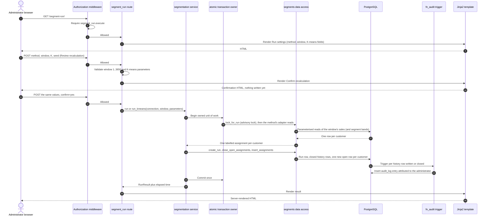
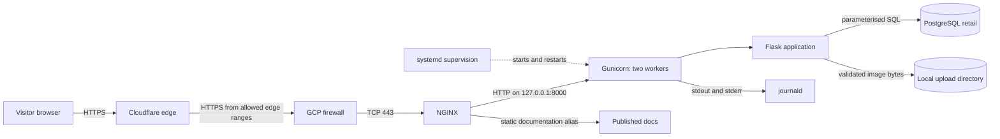
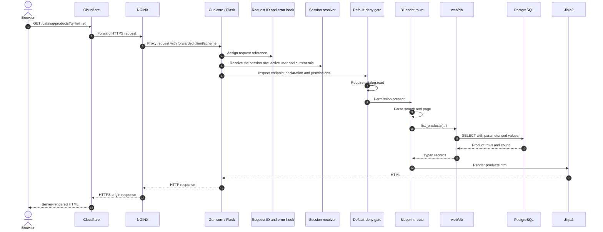

# MOSAIQ System and Demonstration Guide

**This is the deliverable of F6-08 (#110), brought to the second delivery's
analytics phase by AN-09 (#439).** That story asked that "a short script — who
signs in, what they click, what to say — is committed so anyone on the team can
run it". Sections 13 and 14 are that script. Sections 1 to 12 are the system
knowledge needed to answer questions around it, which is the other half of
rehearsing a demonstration rather than reciting one.

It is recorded here because the commit that added it did not say so, and a
reader arriving at a long file with no stated owner cannot tell whether it is a
deliverable or someone's notes.

This is the compact technical guide to keep at hand while rehearsing the
demonstration of **the web system**. It describes the system that exists in this
repository today, not an intended system inferred from its name. It separates
two states:

- **Running now:** implemented in the Flask application or the deployed
  infrastructure.
- **Covered elsewhere:** the distributed stage of the second delivery (the
  microservices and the Android and Electron clients). Its demonstration is
  scripted by F18-05 (#462), which will publish it as `docs/demo-distributed.md`.
  This guide does not describe it and invents nothing about it. The web system
  takes no part in it: it has no Redis connection and consumes no service.

The authoritative boundaries are [`scope.md`](scope.md) for the first delivery
and [`scope-delivery-2-analytics.md`](scope-delivery-2-analytics.md) for the
analytics phase. When an older decision and the current code disagree, this guide
calls out the difference instead of silently choosing the more convenient claim.

Page names, menu entries, buttons and messages below are written as the
templates render them. The captures in [`evidence/`](evidence/README.md) show the
same screens.

---

## 1. The retail-segmentation problem

Retailers accumulate facts about customers, sales, products, channels, stores
and inventory. The facts are individually useful, but they do not answer the
commercial questions until they are connected:

- Who purchased recently?
- Who purchases frequently?
- Who generates the most revenue?
- Which customers now behave alike?
- Which products, channels and stores explain that behaviour?
- Who changed a rule or assignment, and when?

Without that foundation, every customer tends to receive the same treatment,
data changes are difficult to trust, and a segment cannot be reproduced or
explained.

MOSAIQ addresses the problem in stages:

1. It centralises and governs the retail data in a normalised PostgreSQL model.
2. It imports sales from a versioned CSV file and reports every row it accepts
   or rejects.
3. It recalculates customer segments by RFM rules or by K-means through one
   method-agnostic pipeline, persisting each run and every customer's assignment
   history, so no earlier result is overwritten.
4. It explains movement between runs, compares the two methods, describes each
   customer's consumption and recommends products from stock.
5. It runs campaigns and experiments that keep assignment, exposure and
   conversion separate, and it reports the results on server-rendered
   dashboards.

A safe one-sentence description for the demonstration is:

> MOSAIQ is a server-rendered retail analytics platform that protects and
> connects customer, sales, catalogue and inventory data, records every
> segmentation run and every customer's assignment history under RFM rules or
> K-means, and measures campaign experiments without mixing who was assigned,
> who was reached and who bought.

Everything on screen in the seeded system is demonstration data. Say so; the
application says it too (section 12).

---

## 2. What exists now

| State | Capability |
|---|---|
| Running now | Public landing page; login with throttling after repeated failures; logout that revokes the server-side session; permission-based navigation; catalogue administration; user creation, editing, activation and deactivation; product-image upload; read-only consultation of products, customers, stock and segments; audit-log consultation; controlled errors; operational CLI commands |
| Running now | One Flask/Jinja2 application over PostgreSQL, deployed through Cloudflare, NGINX, Gunicorn and systemd on one GCP Compute Engine instance |
| Running now | Sales CSV import with a stored, downloadable rejection report (administrator) |
| Running now | Segment recalculation by RFM rules or by K-means, with durable runs and append-only assignment history; run history; customer segment timeline |
| Running now | Migration matrix between any two runs and a plain-language explanation for each customer; model comparison of an RFM-rules run with a K-means run |
| Running now | Customer consumption profile with before-and-now shifts; product recommendations from stock with a reason for each |
| Running now | Campaign lifecycle; experiment setup, assignment, exposure, conversion and uplift, each its own recorded step |
| Running now | Segmentation dashboard, segment history report, consumption reports, experiment report with CSV export, experiment dashboard, and a Reports page with revenue and a link to each report |
| Covered elsewhere | The distributed stage: microservices, Android over JSON, Electron over XML/XSD, JWT, Redis and MongoDB. Scripted by F18-05 (#462) |

The web system is one application. It reads and writes PostgreSQL directly,
connects to no Redis and consumes no service, so nothing in the distributed stage
changes what this guide demonstrates.

Deliberately not built in the web system, so do not present it as built:

- Inventory receipts, transfers and adjustments (`inventory.write` has no
  screen); accepted sales already decrement stock.
- Editing the label vocabulary or the segment rule catalogue (`segment.write` has
  no screen); the bands change only in the database.
- A customer self-service view (`user.self` has no screen).
- A measurement for the *Average ticket* target metric: it can be chosen and is
  labelled as not measured yet (#457).
- An HTTP ingestion endpoint: CSV through the Sales import page is the web
  system's only way to ingest sales (ADR-0020).

---

## 3. The main process: segment recalculation

The demonstration item called **main-process execution** is the segment
recalculation at `/segment-run/`, reached from **Segment run** in the Analysis
menu. Only the administrator can reach either its form or its execution route
because a run writes the assignment history that decides every customer's current
segment and every report built on it.

### 3.1 The two methods

The administrator chooses a **Method** (*RFM rules* or *K-means*) and a **Window,
in days** from 1 to 3,650; the default is 180. Both methods read the same raw
values for every customer with a transaction inside the window:

| Measure | MOSAIQ calculation | Meaning |
|---|---|---|
| Recency | `max(transaction.occurred_at)` | The latest purchase is the best recency |
| Frequency | `count(*)` over transactions | More sales is better |
| Monetary | `sum(transaction.total)` | More recorded spend is better |

Sales dated after the moment of the run are ignored, so a future-dated row can
never improve recency.

**RFM rules.** Each measure receives a score from 1 to 5, where 5 is best. The
`(R, F, M)` triple is matched against the minimum and maximum bands in
`segment_rule`, considering only segments valid today.

- Customers who tie on a measure receive the same score for it. Each quintile
  boundary is computed once per distinct value, so the result never depends on
  customer id or row order (RN-51, #352).
- One matching rule assigns its segment; if several match, the lowest
  `segment_id` wins.
- The seeded bands partition all 125 triples, five bands per label, so a seeded
  run never needs the fallback (RN-46). A scored customer who matched no rule
  (bands an administrator retuned) takes the worst label and is counted
  separately as *Matched no rule*.
- A customer with no sales in the window is *unassigned*, which is a recorded
  result, not an omission (RN-21).

**K-means.** The administrator also enters **K** (2 or more), a **Seed**, an
**Iteration limit** (default 100) and a **Tolerance** (default 0.0001). The K-means
fields appear when the method is switched to *K-means*. The fit is written in
the application (ADR-0021), not taken from a library.

- It clusters only customers with sales, over normalised R, F and M.
- Cluster numbers are arbitrary names, so they are never stored. Each cluster
  takes a stable label from what it contains: clusters are ordered by the sum of
  their centroid's R, F and M, and paired with the six labels best to worst by
  proportional rank (ADR-0030, RN-38). With K = 5 one label goes unused; with
  K = 8 two labels are shared. The run records which.
- The run records the window, K, seed, iteration limit, tolerance and its quality
  measures (inertia, silhouette, cluster sizes, whether it converged), so it can
  be reproduced from the database alone (RN-58). A fit that hit the iteration
  limit is recorded as not converged and never presented as settled.
- K below 2 is refused before any sale is read.

A label means a relative position. *AT_RISK* is the middle of five labels under
K = 5 and the fifth of eight under K = 8, so comparing runs with different K can
show movement caused by the model rather than by the customer (ADR-0030).

### 3.2 Assignment history, not in-place updates

A run never overwrites a customer's segment. It records one row per customer in
`customer_segment_history`, and for each customer it **closes** the previously
open row by setting `valid_to` and **opens** a new row (ADR-0017):

- The **current segment is the one open row** (`valid_to` is null); the schema's
  partial unique index allows only one per customer.
- A closed row is never changed again. The application role has no `UPDATE` on a
  history row except to close it once, and none on a run (ADR-0029, RN-47).
- A run that changes nothing still writes one new row per customer. The result
  page says so: *No segment changed. Every customer kept their segment. The run
  was still recorded with one result row per customer.*
- A customer with no sales gets a new open row whose label is empty, so a stale
  segment is never kept.
- The run row records the method, window, parameters, executor and time. The
  whole run (run row, closed rows, new rows) commits or rolls back together.

### 3.3 Execution sequence



The service owns the transaction. If the query or commit fails, the transaction
wrapper rolls back, no run and no history row remain, and the shared error
handler returns a controlled page. An advisory lock makes two simultaneous runs
queue instead of colliding.

### 3.4 What the screens show

The result page reports five figures. Read them aloud:

| Figure | Meaning |
|---|---|
| Customers processed | Every customer the run recorded (all of them, assigned or not) |
| Segments assigned | Customers who received a label |
| No sales in window | Customers left unassigned because they bought nothing in the window |
| Matched no rule | Scored customers whose triple matched no band and took the worst label (RFM rules only) |
| Time taken | Seconds the run took |

*Result details* adds the method, the window, *Segments changed* (customers whose
assignment differs from their previous open row) and *Segments cleared*
(customers who lost their label). The banner reads *Assignments updated* or *No
segment changed*, and its link *Read the audit entries.* opens the audit log
filtered to `customer_segment_history`.

### 3.5 What the seed holds

The seed holds 30 customers, 300 transactions spread over 180 days, and **31
runs**: 30 RFM-rules runs (#1 to #30, one per day, the last at load time), plus
K-means run #31 (K = 4, seed 463, twelve hours before the newest RFM run).
Each run has one history row per customer derived from the sales that existed
at its timestamp. The current assignments remain rule-based. Customers have
3 to 17 purchases each, and the newest RFM run reaches all six labels.

The published instance's capture from the earlier seed shows run #30 with
CHAMPION 11, LOYAL 6, POTENTIAL 1, AT_RISK 1,
HIBERNATING 9 and LOST 2 customers
([`evidence/an-02-segmentation-dashboard-1440.png`](evidence/an-02-segmentation-dashboard-1440.png)).
Counts of a later run depend on the day it is made, because the oldest seeded
sales leave a 180-day window as time passes, so read the figures on the screen
rather than quoting them. A seven-day window leaves some customers with no sales,
which is how to show *No sales in window* and the unassigned state.

A recorded K-means run over a freshly loaded seed (K = 5 and K = 8, seed 7, 180
days) is in [`evidence/f9-05-kmeans-variable-k.md`](evidence/f9-05-kmeans-variable-k.md).

### 3.6 Deliberate limitations

- The RFM bands and the label vocabulary are database data with no editing
  screen (`segment.write` is declared and unused).
- K-means is batch, over R, F and M only, and runs inside the web process; a
  large customer base would need a different design. The silhouette is not
  computed above 2,000 customers.
- A K-means run records no quintile scores, only raw R, F and M, because the
  scores belong to RFM rules.

---

## 4. The monolith

A monolith is not one source file or one operating-system PID. It means the
business application is delivered, versioned and operated as one unit. MOSAIQ
has many Python modules and Gunicorn has two workers, but there is still one
Flask application, one systemd service and one release target.

Internal modules call each other in process. They do not communicate through
HTTP, REST, JSON, XML or a message broker. PostgreSQL, NGINX and Cloudflare are
infrastructure around the business application, not microservices. The
distributed stage's services are separate deployable units beside it; the web
system does not call them and has no Redis connection.

### 4.1 End-to-end deployment path



### 4.2 Infrastructure-component definitions

| Component | General definition | Responsibility in MOSAIQ |
|---|---|---|
| Cloudflare | Public DNS, edge proxy and TLS service | Publishes `mosaiq.maxthecoder.online`, presents the browser-trusted certificate, forces HTTPS and connects to the origin in Full (strict) mode |
| GCP firewall | Network-ingress policy | Allows HTTPS to the VM from Cloudflare ranges and administrative SSH through OS Login; rejects other ingress |
| NGINX | Edge web server and reverse proxy | Terminates origin TLS, applies headers, request limits and a per-client limit on `POST /login`, resolves the real visitor address, serves the documentation alias and proxies application traffic |
| Gunicorn | Production WSGI server | Runs two Flask workers bound only to `127.0.0.1:8000` |
| systemd | Operating-system service manager | Starts MOSAIQ on boot, restarts it after failures and supplies its environment file |
| Flask | Python web framework | Dispatches requests, sessions, middleware, blueprints and templates |
| PostgreSQL | Relational database | Holds the 4NF domain model, constraints, indexes, sessions, assignment history and audit log |
| Local uploads | Persistent VM filesystem path | Holds product-image bytes; PostgreSQL holds only the generated relative path |
| journald | System log collector | Captures Gunicorn and application logs from stdout/stderr |
| GitHub Actions | Continuous-integration/deployment runner | Runs Compose smoke tests, formatting, linting, tests and clean database builds; deploys only a merge on `main` |

Docker Compose reproduces the application and PostgreSQL locally. It is a
development and local-demonstration path only; it must never be started on the
published instance because it collides with both production ports and would
displace the systemd deployment.

---

## 5. The life of an ordinary web request

This is the most useful architecture story to explain aloud because every
component has a clear reason to exist.

### 5.1 Normal authenticated read



For simple reads, routes often call `web/db` directly. For state-changing use
cases, the required path is `route -> service -> db`, because the service owns
validation, the complete transaction and expected failure translation.

### 5.2 Anonymous request to a protected page

1. The error hook assigns an eight-hex-character request reference.
2. The authorization middleware finds the route's declaration.
3. An anonymous `GET` is redirected to `/login?next=<safe local path>`.
4. An anonymous `POST` receives 403 because its request body cannot safely be
   replayed after login.
5. Login reads the user by email and verifies Argon2id in the authentication
   service. Repeated failures are throttled (section 8.1).
6. Success records a row in `app_session` and stores only an opaque session id,
   plus the user id, role and display name, in the signed Flask session cookie.
7. The browser is redirected to the original safe path or home.

`safe_next` rejects external hosts, schemes, protocol-relative URLs,
backslashes and line breaks, preventing the login page from becoming an open
redirect.

### 5.3 Permission refusal

Every application route must declare one of:

- `@public`: no login required.
- `@requires()`: any authenticated user.
- `@requires(permission)`: authenticated user holding every named permission.

A route with no declaration is treated as a programming defect and refused.
The route function never runs. The log records the user, role, endpoint, path,
method and shared request reference; the visitor receives a branded 403 page
without implementation details. `tests/test_analytics_authz.py` states which
role may reach each analytics route and fails the build when one is unmapped.

### 5.4 State-changing request and audit attribution

1. Middleware resolves the session and reads the signed-in user.
2. For every `POST`, `PUT`, `PATCH` and `DELETE`, a synchroniser CSRF token and
   the `Origin` header are checked before the gate; every form carries a hidden
   `csrf_token` field (ADR-0025).
3. When the request first opens its PostgreSQL connection, a connection
   initializer calls parameterised `set_config('mosaiq.user_id', user_id,
   false)`.
4. The route validates HTTP inputs and calls a write service.
5. The service opens the outermost `atomic` unit of work.
6. Data-access functions issue parameterised SQL and never commit.
7. PostgreSQL constraints enforce structural invariants.
8. Audit triggers read `mosaiq.user_id` and insert `audit_log` rows.
9. The service commits once after all work succeeds.
10. Expected integrity failures become typed, user-readable refusals; unexpected
    exceptions reach the shared 500 handler.
11. The request-scoped connection is closed during Flask teardown.

Nested services using the same connection join the outer transaction. This is
how administrator transfer and demonstration-account deactivation can succeed
or fail as a single operation.

---

## 6. Internal application components

| Component | MVC mapping | What it does |
|---|---|---|
| `web/app.py` | Composition root | Builds the Flask application; loads configuration; configures MIME types, logging, sessions, trusted proxy headers, errors, middleware and database lifecycle; registers blueprints and CLI commands |
| `web/config/` | Cross-cutting configuration | Reads documented environment variables and refuses unsafe production defaults |
| `web/errors.py` | Request preamble | Assigns request references and renders controlled HTTP/500 error pages |
| `web/log.py` | Cross-cutting logging | Enriches logs with reference, actor and client without making services import Flask |
| `web/security.py` | Cross-cutting session policy | Configures `HttpOnly`, `SameSite=Lax` and environment-controlled `Secure` cookies |
| `web/middleware/` | Request gate | Resolves the server-side session, checks the CSRF token, enforces the permission matrix before a controller runs and builds permission-driven navigation |
| `web/routes/` | Controller | Reads HTTP inputs, calls services or read functions and chooses a redirect or template |
| `web/services/` | Model: business rules | Validates use cases, owns transactions, hashes/verifies passwords, throttles sign-in, handles uploads, ingests sales, runs segmentation and K-means, builds migrations, profiles, recommendations and experiment measurements, and translates expected failures |
| `web/db/` | Model: persistence | Owns connection lifecycle, typed records and every SQL statement executed by Python |
| `web/templates/` | View | Produces HTML from values supplied by a route |
| `web/static/` | View assets | Provides design-system CSS, minimal progressive-enhancement JavaScript, the self-hosted Highcharts the dashboards use, images and self-hosted fonts |
| `web/cli.py` | Non-HTTP controller | Exposes administrator provisioning, password rotation and account reporting to operators |

The dependency direction stays downward: HTTP and CLI entry points may know
services and data access; services may know data access; data access does not
know Flask requests or templates.

### 6.1 Application factory

`create_app()` in `web/app.py` is the technical entry point. It does not
perform segmentation itself. Its job is to assemble a valid application:

1. Load `.env` as a local fallback and construct `Config`.
2. Register portable font MIME types.
3. Create the Flask object.
4. Apply secret, upload limit, logging and cookie policy.
5. Trust forwarded headers only when explicitly configured.
6. Register request IDs and error handlers before authorization.
7. Register the CSRF check, the session resolver and the default-deny
   authorization middleware.
8. Probe PostgreSQL at startup and install one request-scoped connection.
9. Register template-wide product identity.
10. Register every blueprint and CLI command.

Flask development mode discovers this factory automatically. Production
Gunicorn starts the same factory as `web.app:create_app()`.

### 6.2 Blueprints and workflows

| Blueprint | Prefix | Menu entry | Current workflow |
|---|---|---|---|
| `home` | `/` | Home | Public landing page, or the permission-aware signed-in overview |
| `auth` | `/login`, `/logout` | Sign out | Authenticate with email/password (throttled) and end the session |
| `admin` | `/admin` | Catalogs, Users | Catalogue CRUD; user creation, editing, activation and deactivation; protected product images |
| `sales_import` | `/admin/sales-import` | Sales import | Administrator-only CSV upload, stored report, rejections download |
| `catalog` | `/catalog` | Catalogs, Segments | Read-only products, customers, stock and segments; a customer's segment timeline, consumption profile and recommendations |
| `segment_run` | `/segment-run` | Segment run | Administrator-only, confirmed RFM-rules or K-means recalculation |
| `run_history` | `/run-history` | Run history | Every run, and each run's customers |
| `migration_matrix` | `/migration-matrix` | Migration matrix | Two runs compared by label; each cell lists its customers |
| `migration_explanation` | `/migration-explanation` | (linked) | Why one customer moved between two runs |
| `model_comparison` | `/model-comparison` | Model comparison | One RFM-rules run against one K-means run |
| `segmentation_dashboard` | `/segmentation-dashboard` | Segmentation dashboard | Charts and tables for one run |
| `segment_history_report` | `/segment-history-report` | Segment history report | Filtered history rows, each expandable |
| `consumption_reports` | `/consumption-reports` | Consumption reports | Consumption shifts and recommendations under shared filters |
| `campaigns` | `/campaigns` | Campaigns | Campaign list for `campaign.read`; create, edit-while-draft, activate, complete and cancel for `campaign.write` |
| `experiments` | `/experiments` | (from Campaigns) | Experiment setup, assignment, exposure, conversion and uplift |
| `experiment_report` | `/experiment-report` | Experiment report | Per-arm counts and uplift with a CSV export |
| `experiment_dashboard` | `/experiment-dashboard` | Experiment dashboard | Three charts for one experiment |
| `reports` | `/reports` | Reports | Revenue summary and a link to each report the role may open |
| `audit` | `/audit` | Audit log | Administrator/auditor filtering, pagination and before/after detail |

The menu has three sections: **Workspace** (Home, Catalogs, Users, Sales
import), **Analysis** (Segments, Campaigns, Segment run, Run history, Migration
matrix, Model comparison, Segmentation dashboard, Segment history report,
Consumption reports, Experiment dashboard, Experiment report, Reports) and
**Governance** (Audit log). An entry appears only when the role holds its
permission.

---

## 7. Current functional surface by role

This table describes reachable workflows, not every future-looking cell in the
canonical permission matrix. It follows `web/middleware/authz.py`.

| Role | Current useful access |
|---|---|
| `ADMIN` | Everything below, plus full CRUD for category, product, store, channel and role; users (create, edit, activate, deactivate); Sales import; Segment run; campaign and experiment writes; Audit log |
| `ANALYST` | Product and stock consultation; customers, segments, run history, migration matrix, model comparison, both dashboards, the segment history and consumption reports, the experiment report; campaign and experiment lists, uplift and conversion pages (read only); Reports |
| `STORE_MANAGER` | Product and stock consultation; customers, segments, consumption profiles, recommendations and every `segment.read` page above, for all stores (ADR-0023); Reports for every store (ADR-0048). No campaign or experiment pages |
| `MARKETING` | The analyst's access, plus campaign and experiment writes (create, edit draft, activate, complete, cancel, assign, record exposure, evaluate conversion) |
| `INVENTORY_PLANNER` | Product and stock consultation; Reports (revenue only, since no analytics report is offered); no inventory-write screen yet; no customer data |
| `AUDITOR` | The analyst's access, plus the Users list (read only) and the Audit log. Cannot write anywhere |
| `CUSTOMER` | Authenticated home only; `user.self` exists in the permission vocabulary but has no self-service route yet |

The canonical matrix is [`requirements.md`](requirements.md) section 3 and the
analytics surfaces are mapped in
[`analytics-permission-map.md`](analytics-permission-map.md). It is implemented as
a frozen mapping in `web/middleware/authz.py`, not as permission tables. Roles
are catalogue data, but grants change only through code review and deployment. A
newly created role code therefore receives no permissions until the mapping is
deliberately extended.

The seed's demonstration accounts are `admin@mosaiq-demo.com` (the administrator)
and `user2@mosaiq-demo.com` to `user30@mosaiq-demo.com`, all with the password in
the README. By seed order `user2` is an analyst, `user3` a store manager, `user4`
marketing, `user5` an inventory planner, `user6` an auditor and `user7` a
customer; the pattern then repeats. On the published instance they are
deactivated (section 8.6), so create a real account for each role you want to
show.

---

## 8. Current application workflows

### 8.1 Authentication and dashboard

- Login uses email and Argon2id verification.
- Unknown users, inactive users, wrong passwords and unusable hashes receive the
  same public error, *Invalid email or password.*
- A dummy Argon2 hash spends comparable work for a missing or inactive account.
- **Throttling.** After five failed attempts within fifteen minutes (settings
  `LOGIN_THROTTLE_MAX_ATTEMPTS` and `LOGIN_THROTTLE_WINDOW_SECONDS`) for an
  account or from a client address, the next attempt answers 429 with *Too many
  sign-in attempts. Try again later.* and a `Retry-After` header, even if the
  password is right. A successful sign-in clears only that account's failures.
  NGINX adds a shared per-client limit on `POST /login`. Evidence:
  [`evidence/login-throttling.md`](evidence/login-throttling.md).
- Successful login stores an opaque session id in the signed cookie and a row in
  `app_session`. The session is resolved from the database on **every** request
  (ADR-0022), so a role change reaches an open session on its next request.
- Sessions end after 30 minutes without activity and after 8 hours in all
  (ADR-0032).
- **Sign out** revokes the session server-side, so a copied cookie stops working;
  deactivating a user revokes that user's open sessions.
- The home page reloads the account record and shows figures according to the
  permission set: *Customers*, *Products* and *Stores* for catalog readers,
  *Active users* for user readers, and a *Recent changes* table with an *Open
  audit log* button for audit readers.

### 8.2 Catalogue administration

The administrator has list, search, create, update and delete workflows for:

- Categories, including optional parent categories.
- Products, including SKU, category, price, active state and image.
- Stores, including location and active state.
- Channels.
- Roles.

They are reached from **Catalogs**, then the **Manage catalogs** button.

Deletion that would break a foreign-key relationship is translated into a
plain-language conflict rather than exposing a PostgreSQL exception. Expected
uniqueness and referential failures return to the form with a useful message.

Product images are limited to JPEG, PNG and WebP and to the configured five-MiB
default. The application checks the reported MIME type, stream length and file
signature, ignores the original filename and stores a generated filename under
`UPLOAD_DIR`.

### 8.3 User management

The administrator reaches **Users** from the Workspace menu. The page lists
accounts with a **Search** box and offers **New user**; each row offers **Edit**
and **Deactivate** or **Activate**.

- **New user** takes Name, Email, Password (at least 12 characters) and Role.
  Passwords are hashed before PostgreSQL sees them.
- **Edit** corrects an account's Name, Email and Role, and nothing else
  (RF-09, #289). Password changes stay with the operator CLI.
- Accounts are deactivated rather than deleted so audit history retains its
  actor, and deactivation ends the account's open sessions.

The one-administrator invariant is enforced twice:

- The service refuses a second administrator and refuses leaving none. In the
  Edit form this surfaces as a refusal on the Role field.
- The partial unique index
  `ux_app_user_single_administrator` independently refuses a second row with
  `role_id = 1`.

Changing who holds the administrator seat is an atomic transfer because
promoting first would temporarily create two and demoting first would
temporarily create none. The web UI does not expose that transfer; the
service-level operation exists.

### 8.4 Read-only consultation

`/catalog` is separate from `/admin` so a reader does not receive edit/delete
controls that will only lead to a 403. The **Catalogs** hub offers *Products*,
*Stock*, *Customers* and *Segments*.

- Products require `catalog.read`.
- Stock requires `catalog.read` and may be filtered by store and product text.
- Customers require `segment.read`.
- Segments and membership require `segment.read`.

Customer detail includes registration channel, current segment (the open
assignment row, whichever method wrote it), interest categories, preferred
channels, the **Segment as of a date** lookup, the **Segment timeline** (section
8.8) and two buttons, **Consumption profile** and **Recommendations**. Segment
detail includes its RFM rule and paginated members.

### 8.5 Audit log

The audit log is read-only in the application. It supports entity and date
filters, pagination and a detail comparison of values before and after.

`fn_audit()` triggers capture inserts, updates and deletes on:

- `segment`, `segment_rule`, `campaign`, `experiment`.
- `category`, `product`, `store`, `channel`, `role`.
- `customer`, `app_user`.
- `customer_segment_history`: every history row a run closes or opens.

Transaction and transaction-line writes are deliberately excluded because the
sale tables already are history and auditing the busiest write path would
duplicate its cost. Experiment assignments, exposures and conversions are
append-only events and are not audited. The trigger strips `password_hash` before
an audit payload is stored, and the application role can neither update nor delete
an audit entry (ADR-0024).

PostgreSQL uses `jsonb` inside `audit_log` for before/after row payloads. This
does not violate the first-delivery prohibition on JSON exchange: it is a
database storage type, not an internal API or browser exchange format.

### 8.6 Operator CLI

The Flask CLI provides:

- `provision-administrator`: installs a real administrator and can deactivate
  every demonstration account in the same transaction.
- `rotate-password`: changes an existing account password without placing the
  plaintext in a command argument.
- `account-report`: lists active accounts and reports how many known-password
  demonstration accounts remain active.

The published instance keeps the seeded rows for audit attribution but keeps
their accounts inactive. The real administrator password never belongs in the
repository.

### 8.7 Sales import

**Sales import** (Workspace menu, `/admin/sales-import/`) is administrator-only
(`sales_ingest.execute`). It is an HTML upload page, not an HTTP ingestion
endpoint.

- The page states the contract version (1) and offers **CSV file** and
  **Upload**. A table lists earlier uploads (*Load*, *File*, *Received*,
  *Accepted*, *Rejected*, *Uploaded by*, *Uploaded at*).
- The header must be exactly `transaction_id, customer_id, store_id, channel_id,
  occurred_at, product_id, quantity, unit_price`, in UTF-8. Otherwise the whole
  file is refused with the reason and nothing is loaded. `occurred_at` is an ISO
  8601 timestamp with a UTC offset.
- Every other row is accepted or rejected on its own, and a rejection never stops
  the rows after it. After the upload the browser is redirected to the stored
  report, **Load #n**, which shows *Received*, *Accepted* and *Rejected* (received
  is accepted plus rejected) and a table of *Line* and *Reason* for every
  rejected row, with **Download CSV** for the same list. The report survives
  leaving the page.
- A rejection names the line of the file and a reason, for example *unknown
  customer*, *unknown product*, *product is inactive*, *quantity must be
  positive*, *unit price must be positive*, *unit price must have at most 2
  decimal places*, *occurred_at cannot be in the future*, *sale occurred before
  customer registration*, *source transaction id cannot be a spreadsheet
  formula*, *no inventory for store S and product P* and *insufficient stock for
  store S and product P: n available*.
- The CSV's `transaction_id` is the source's own identifier. A second row for the
  same source transaction id and product is rejected as a duplicate (*duplicate:
  X already has a line for product P*), so a retry adds no second sale; rows with
  the same id and different products are lines of one sale.
- An accepted line decrements that store's stock for the product in the same
  transaction, so **Catalogs**, then **Stock**, shows the lower quantity
  (ADR-0031, RN-14). The seed holds stock only for products 1 to 5 in each store,
  so a row for another product is rejected with *no inventory for store S and
  product P*.
- A new accepted sale changes recency, frequency and spend, so it can change the
  next segment run. Sales dated in the future cannot improve recency.

The repository carries no sample sales file (`*.csv` is ignored by git), so
prepare one before the demonstration with a few accepted rows, a repeated row, a
future date and a product the seed has no stock for. The seed's customers have
ids `00000000-0000-0000-0000-000000000001` to `...030`, stores 1 to 30, channels 1
to 5 and products 1 to 40.

### 8.8 Segmentation history, migration and model comparison

**Run history** (`/run-history/`, `segment.read`) lists every run, most recent
first: *Run*, *Method*, *Window*, *K*, *Seed*, *Customers*, *Executed by*, *Run
at*. A run opens to **Run #n**, which shows its method, window, customers scored,
executor and time; its *Parameters* as entered; for K-means its *Quality* measures
with their values; and a *Label mapping* line (*8 clusters over 6 labels, paired
by rank (ADR-0030)*, which labels are shared and which got no cluster). Below is
every customer the run scored with *Label*, *R*, *F*, *M*, *Last purchase*,
*Orders* and *Spend*; unassigned customers show *Unassigned* and are not omitted.

**A customer's timeline.** Open a customer from **Catalogs**, then **Customers**.

- **Segment as of a date**: enter a *Date* and press **Look up** to see the
  assignment that was open at the end of that day, or that no run had scored the
  customer yet.
- **Segment timeline** lists every assignment, newest first: *Run*, *Label* (with
  the date the customer entered it), *Valid from*, *Valid to* (*Open* for the
  current row), *R*, *F*, *M*, *Recency* in days, *Frequency*, *Monetary (MXN)*
  and *Change*. A changed row links **What changed** (the sales that entered the
  calculation and the sales that left the window between the two runs) and
  **Explanation**. The open row is the current segment.

**Migration matrix** (`/migration-matrix/`, `segment.read`). Choose the *Earlier
run* and the *Later run* and press **Compare**; either order is accepted and the
earlier run is always the *before* state. Rows are the earlier run's labels and
columns the later run's. *NEW* means the customer was absent from the earlier run,
*Not in later run* means absent from the later one, and *Unassigned* means the run
scored the customer and found no purchase to label; the three are different
states. Selecting a cell lists its customers with *Before*, *After*, *Direction*
(improved or declined, by the vocabulary's order) and **View explanation**; **Clear
cell filter** returns to the matrix.

**Migration explanation** (`/migration-explanation/`). For one customer and two
runs it shows *Why* in sentences and *Values and scores* in a table. Each measure
is judged **changed** or **stable** from the customer's own raw values, never from
the score: recency is stable within 7 days, frequency when the purchase count is
unchanged, monetary within 10% (RN-60). When the raw value is stable but the
score moved, it says other customers moved the quintile cut point. It reads the
stored history rows and rescores nothing.

**Model comparison** (`/model-comparison/`, `segment.read`). Choose a *Rule-based
run* and a *K-means run* and press **Compare** (the newest of each is chosen if
none is). It shows each run's parameters and quality, *Customers in both runs*,
*Agree*, *Disagree*, *Agreement rate*, *Population per label* in vocabulary order
and *Where they agree*, a cross-tabulation. A customer scored by only one run is
counted separately and is neither an agreement nor a disagreement. The comparison
has no direction and never says one method is better (RN-39).

### 8.9 Consumption profile and recommendations

From a customer's page:

- **Consumption profile** (`segment.read`). Over a *Window, in days* (changed with
  **Apply window**) it shows *Total spend*, *Purchase frequency*, *Average ticket*,
  *Last purchase*, *Average discount*, *Dominant channel*, *Dominant store*,
  *Favourite categories* (three), *Frequent products* (five) and *Segment and
  R/F/M* with the *Current segment* and *Previous segment*. A customer with no
  accepted sale in the window is told so; their sales measures are absent, not
  zero. *Average discount* compares with today's list price, not with a record of
  promotions (RN-35).
- **Before and now** compares the window's two halves and claims that a channel,
  store or category shifted only when each half has at least three purchases and
  a clear leader; a tie that spend broke differently is not a shift (RN-50).
- **Recommendations** (`segment.read`, so store managers may use it). At most ten
  products, each active, not bought by the customer in the window, in positive
  stock at the customer's usual store (their dominant store), with the reason in
  words and figures: the segment's buying, a registered interest, or the
  customer's own purchase history; a category covers the categories below it. A
  customer with no open label or no usual store is told which is missing and
  gets nothing invented. The page is never cached, so a product whose stock
  reaches zero is gone on the next reload.

**Consumption reports** (`/consumption-reports/`) puts the shifts and the
recommendations of every customer under one filter bar (*Store*, *Channel*,
*Category*, *As of*, *Window, in days*, **Filter** and **Clear**). Each of the two
panels, *Consumption shifts* and *Recommendations*, filters what the profile and
recommendation rules already compute, paginates on its own and shows its own
empty state.

### 8.10 Campaigns and experiments

**Campaigns** (`/campaigns/`, `campaign.read`; writes need `campaign.write`:
ADMIN and MARKETING). The list shows *ID*, *Name*, *Target label*, *Starts*,
*Ends* and *Status* (Draft, Active, Finished, Cancelled). **New campaign** takes a
*Name*, a *Target label* and *Start date* and *End date*. A campaign targets a
label, never one run's segment, so a recalculation does not change its meaning.

- Draft: **Edit**, **Activate**, **Cancel**. Active: **Complete**, **Cancel**.
  Finished and cancelled show *Closed* and nothing further is allowed. An illegal
  move is refused with the campaign's status and what it may become.
- **Activate** is refused for a campaign whose end date has passed (*edit the
  draft's dates first*) and for one with an experiment lacking its arms.
- The seeded campaigns carry 2026 dates and every status in turn, so a seeded
  draft needs new dates before it can be activated.

**Experiments** (**Experiments** button on Campaigns, `/experiments/`). **New
experiment** takes a *Name*, *Campaign*, *Target metric* (*Conversion rate*, or
*Average ticket (not measured yet)*), *Conversion window (days)*, *Start date*,
*End date*, *Data origin* (*Observed*, *Seeded (A/A validation)*, *Injected
(synthetic uplift)*), *Treatment groups* and *Control arm* (*Include one
control* or *No control (use two treatment arms)*), then a *name* and *treatment
description* for every arm. A no-control experiment has exactly two treatment
arms. Seeded and injected experiments carry a **Synthetic** pill everywhere.

Each experiment row offers **Edit**, **Assign** (until anyone is assigned) and,
once there are assignments, **Exposure**, **Conversion** and **Uplift**.

1. **Assign.** The page names the campaign's label, the number of customers who
   hold it now and how they split at random (reproducibly, arms differing by at
   most one customer). It warns *This cannot be undone*; the button reads
   **Assign n customers**. The campaign must be active. Assignment is written once,
   in one transaction, and is never rewritten: no update, delete or second
   assignment is possible, in the application or for the application's database
   role (ADR-0026, RN-42). From then on the campaign, dates, target metric,
   conversion window and arm definitions are fixed; only the name can change.
2. **Exposure.** *Assigned is not exposed.* The page shows *Assigned* and
   *Exposed* per arm and a delivery diagnostic. **Record an exposure** takes a
   *Customer id*; opening an arm (click its name) lets you tick customers or
   *Record exposure for every assigned customer* and press **Record selected
   exposures**. The control arm shows *Never exposed* and cannot be exposed.
   Exposure is refused before the experiment starts, after it ends and when its
   campaign is finished or cancelled; a repeat within a minute adds nothing.
3. **Conversion.** *A conversion links an assignment to a real sale inside the
   experiment's fixed window.* The table shows *Assigned*, *Converted*, *Pending*
   and *Not converted* per arm. **Evaluate conversion** records one conversion
   per assignment with a qualifying sale (from assignment until the window
   closes); evaluating again adds nothing. A customer whose window is still open
   is pending, not failed, and a customer with a qualifying sale not yet recorded
   is flagged until you evaluate.
4. **Uplift.** Each treatment arm against the control over **every assigned
   customer**, exposed or not (intent to treat): rate, *Uplift (points)*, *95%
   interval*, *p-value* and *Significant at 0.05* or *Not significant*. *Conversion
   among exposed customers* sits beside it as a secondary figure. *Preliminary*
   warns that windows are still open. An experiment with no control, an empty arm,
   an *Average ticket* target or unrecorded qualifying sales is refused with the
   reason, or asks you to go to **Conversion** first. A non-observed experiment
   shows **Synthetic**. The calculation is trusted because an A/A split and a
   fixed 10,000-per-arm injected uplift are tested to behave as expected
   (RN-27, RN-48).

The seeded experiments are all `SEEDED` or `INJECTED`, so every figure on them is
labelled **Synthetic**; none claims to be observed (#427). Odd-numbered seeded
experiments measure *Conversion rate*; even-numbered ones measure *Average
ticket*, which uplift refuses. They ran from 1 February to 1 March 2026, so
nothing can be exposed on them now and the segmentation dashboard's *Active
experiments* is empty until a current experiment has assignments.

### 8.11 Dashboards and reports

**Segmentation dashboard** (`/segmentation-dashboard/`, `segment.read`). Choose a
*Run* and press **Show**. The page shows the run and its *Previous run*; *Average
R, F and M by label*; the charts *Segment sizes*, *Revenue by label* (over the
run's own window), *RFM distribution* (a recency by frequency heatmap) and
*Migration flow* from the previous run (with *New to the population* and *Left
the population* counted beside it); then *Active experiments* (those running
today, with each arm's assigned, converted and conversion rate) and *Most
recommended products* with the stock at the stores they are recommended from.
Everything is keyed on the stable label and none of it knows which method made the
run. Tied customers sit in the same quintile bin. Chart data is embedded in the
HTML and Highcharts is served by the application itself, never fetched from an
external host or a JSON endpoint. A **Synthetic** banner says the figures are
demonstration data; it is set by the deployment (`Config.data_is_synthetic`,
true by default), not checked row by row.

**Segment history report** (`/segment-history-report/`). Filter every history row
by *Run*, *Label* (or *Unassigned*) and *Run from* / *Run to* dates; the filters
combine, and **Filter** and **Clear** apply and reset them. Each row expands with
**Why this label?**, which compares that customer's stored R/F/M with the row in
the immediately previous run, or says there is none.

**Experiment report** (`/experiment-report/`, `campaign.read`). Filter by
*Campaign* and *Data origin* (**Apply filters**, **Clear**). Each experiment's arms
show *Assigned*, *Exposed*, *Converted*, *Rate (assigned)*, *Bought after
exposure*, *Rate (exposed)*, *Pending*, *Uplift (points)* and *95% interval*, with
the data origin and **Synthetic** where it applies. **Export CSV** downloads the
same filtered rows and repeats the origin and the Synthetic label on every line.

**Experiment dashboard** (`/experiment-dashboard/`, `campaign.read`). Choose an
*Experiment* and press **Show**. Three charts use the figures the uplift page and
report already hold: conversion per arm over the assigned and over the exposed;
the difference from the baseline arm with its 95% interval (the control, or when
there is none the first treatment arm, called a *difference* and never an uplift);
and the cumulative share of customers who had converted, by day since assignment.
Each chart of a non-observed experiment says **Synthetic**.

**Reports** (`/reports/`, `report.read`) shows the revenue and sales count of the
latest 90 days of sales, split by channel and by store, with the **Synthetic**
banner, and then lists only the reports the role may open, *Segmentation
dashboard*, *Segment history report*, *Consumption reports* and *Experiment
report*.

---

## 9. PostgreSQL domain model

The schema has 29 tables.

| Domain | Tables | Definition in this project |
|---|---|---|
| Identity | `role`, `app_user`, `app_session` | Permission-profile names, accounts and server-side sessions |
| Customers | `customer`, `customer_preferred_channel`, `customer_interest_category` | Customer identity, optional login link, acquisition channel and independent preferences |
| Catalogue and sales | `channel`, `category`, `store`, `product`, `transaction`, `transaction_line`, `sales_load`, `sales_load_rejection`, `inventory` | What was sold, to whom, where and through which channel; ingestion outcomes; and current product/store stock |
| Segmentation | `segment_rule`, `segment_label`, `segment`, `segmentation_run`, `customer_segment_history` | Configurable RFM bands, stable labels, reproducible runs and durable assignment history |
| Marketing model | `campaign`, `experiment`, `experiment_group`, `experiment_assignment`, `experiment_exposure`, `experiment_conversion` | Campaign targeting and separate experiment assignment, exposure and conversion events |
| Notifications | `notification`, `notification_recipient` | In-app events (a finished sales load, a completed run, an experiment's end, a deactivation) and each recipient's read state |
| Governance | `audit_log` | Actor, entity, operation, before/after data and execution time |

A customer has no `current_segment_id`. That column was retired by ADR-0017; the
current segment is the one open row of `customer_segment_history`.

### 9.1 Fourth-normal-form rationale

The model records the anomaly removed at each stage:

- **1NF:** atomic values and no repeating groups.
- **2NF:** no attribute depends on only part of a composite key. Product name
  and category do not belong in every transaction line; the actual charged
  `unit_price` does.
- **3NF:** no transitive dependency. A product references a category instead of
  repeating the category name.
- **4NF:** a relation carries no two independent multivalued facts.

The central 4NF example is customer preferences. Preferred channels do not
determine interest categories, and interest categories do not determine
channels. A single three-column relation would invent channel/category pairings
and require a Cartesian combination of rows. MOSAIQ therefore uses two
independent junction tables:

```text
customer_preferred_channel(customer_id, channel_id)
customer_interest_category(customer_id, category_id)
```

The decomposition is lossless and states only the facts the business actually
provided. The analytics tables follow the same discipline: assignment, exposure
and conversion are three relations rather than three columns, because an
assigned customer may never be exposed and a conversion is a link to a sale, not
a total kept beside it. Full reasoning and the data dictionary are in
[`data-model.md`](data-model.md).

### 9.2 Reproducibility and least privilege

All DDL belongs to `sql/01_schema.sql`. Against an empty PostgreSQL installation,
the scripts must run in this order:

1. `00_create_database.sql`
2. `01_schema.sql`
3. `02_seed_30_per_table.sql`

The application connects as `retail_app`, which may perform required DML but
does not own the schema and cannot drop its tables. It also cannot update or
delete the audit log, a segmentation run, an experiment assignment or an
exposure, and it may only close a history row (ADR-0024, ADR-0026, ADR-0027,
ADR-0029). Dynamic values in every SQL statement are parameterised. Table and
column names that cannot be parameters are fixed in source or selected from an
explicit whitelist.

Every table has at least 30 seed rows except `role`, `channel` and
`segment_label`, whose real domains contain seven, five and six entries
respectively. Their reasons are recorded in `sql/seed-exempt.txt` rather than
padded with fictional values. The runtime tables (`app_session`, `sales_load`
and `sales_load_rejection`) are seeded, not exempt.

---

## 10. Architectural decisions to remember

An Architecture Decision Record captures the forcing context, the chosen
option, rejected alternatives, consequences and a compliance check. Accepted
records are immutable; a later decision supersedes them instead of rewriting
history.

| ADR | Current meaning and cost |
|---|---|
| [0001](adr/0001-flask-monolith-on-a-single-vm.md) | Chose Python 3.12, Flask, Jinja2 and local PostgreSQL instead of the illustrative Express stack. Superseded by ADR-0016, but it still describes how the web system runs |
| [0002](adr/0002-mosaiq-identity-and-design-system.md) | Chose MOSAIQ and a token-based, framework-free design system. It provides domain-specific visual language but must be maintained by the team |
| [0003](adr/0003-layered-architecture-with-an-explicit-service-layer.md) | Split MVC's model into business services and SQL data access. This improves testability and SQL review at the cost of extra indirection |
| [0004](adr/0004-model-ahead-of-the-deferred-segmentation-modules.md) | Kept the segmentation, campaign and experiment tables in the graded data model before the application used them. Its clause that no application code would read them is historical; ADR-0017 later replaced `current_segment_id` |
| [0005](adr/0005-document-mongodb-and-redis-designs-without-implementing-them.md) | Preserved MongoDB/Redis design work. Superseded by ADR-0016; the web system still has neither |
| [0006](adr/0006-run-under-both-systemd-and-docker-compose.md) | Introduced two execution paths. Superseded by ADR-0015 because switching production to Compose for a demo was unsafe |
| [0007](adr/0007-permissions-in-code-with-a-default-deny-middleware.md) | Keeps the permission specification in versioned code and refuses undeclared routes. The cost is that an administrator cannot edit grants at runtime. ADR-0022 replaced its trust in the cookie's role |
| [0008](adr/0008-the-instance-keeps-the-demonstration-accounts-deactivated.md) | Preserves seeded users for attribution while closing their publicly known credentials |
| [0009](adr/0009-nginx-as-the-reverse-proxy.md) | Uses NGINX for public ingress, TLS, headers and proxying instead of exposing Gunicorn |
| [0010](adr/0010-the-consultation-module-is-a-separate-read-only-blueprint.md) | Separates reader workflows from administrator CRUD and assigns customer access to `segment.read` |
| [0011](adr/0011-one-environment-deployed-from-main.md) | Treats the single VM as production and deploys only reviewed `main`; failed deploys restore the previous commit. There is no staging environment |
| [0012](adr/0012-release-merges-preserve-ancestry.md) | Requires true merge commits between `develop` and `main` so equivalent content retains shared ancestry |
| [0013](adr/0013-publish-mosaiq-through-cloudflare-with-an-origin-certificate.md) | Provides trusted public HTTPS and shields the origin, at the cost of depending on a team member's domain and Cloudflare account |
| [0014](adr/0014-service-owned-transactions-and-typed-write-failures.md) | Makes services own complete units of work and translate expected failures; data access never commits or chooses user messages |
| [0015](adr/0015-containers-are-a-development-path-only.md) | Keeps Compose for local reproducibility and forbids it on the instance, where systemd remains the deployment path |
| [0016](adr/0016-the-second-delivery-reinstates-the-distributed-architecture.md) | Authorises the distributed second delivery beside the monolith; the web system is one component and stays frozen |
| [0017](adr/0017-segment-assignment-history-replaces-the-mutable-current-segment.md) | Replaces the mutable current segment with durable runs and append-only assignment history. The cost is one history row per customer per run, even when nothing changed |
| [0018](adr/0018-two-segmentation-strategies-behind-one-method-agnostic-pipeline.md) / [0030](adr/0030-k-means-clusters-are-paired-with-labels-by-proportional-rank.md) | Two methods feed one pipeline that records stable labels, never cluster numbers; ADR-0030 lets K differ from the six labels by pairing by proportional rank, at the cost that a label becomes a relative position |
| [0019](adr/0019-experiment-measurement-separates-assignment-exposure-and-conversion.md) / [0028](adr/0028-experiment-treatment-arms-may-omit-control.md) | Assignment, exposure and conversion are separate events and uplift is intent to treat; ADR-0028 lets an experiment omit the control |
| [0020](adr/0020-csv-is-the-sole-sales-ingestion-entry-point-for-this-delivery.md) | CSV through the Sales import page is the web system's only ingestion path |
| [0021](adr/0021-k-means-is-implemented-in-the-application-rather-than-taken-as-a-dependency.md) | K-means is written in the application; the runtime stays at five packages, at the cost of owning the algorithm's edge cases |
| [0022](adr/0022-sessions-are-resolved-server-side-on-every-request.md) / [0032](adr/0032-server-side-sessions-have-idle-and-absolute-lifetimes.md) | Sessions live in `app_session`, are checked on every request and expire after 30 minutes idle or 8 hours |
| [0023](adr/0023-store-managers-read-segments-and-customers.md) | Store managers hold `segment.read` so they reach recommendations |
| [0025](adr/0025-state-changing-requests-carry-a-synchroniser-csrf-token.md) | Every unsafe request carries a CSRF token, as a second layer behind `SameSite=Lax` |
| [0026](adr/0026-experiment-assignments-are-append-only-for-the-application-role.md) / [0027](adr/0027-experiment-exposures-are-treatment-only-and-append-only.md) / [0029](adr/0029-segment-history-runs-and-experiments-are-protected-from-the-application-role.md) | The database itself, not only the application, refuses rewriting assignments, exposures, runs and closed history rows |
| [0031](adr/0031-sales-ingestion-decrements-inventory-atomically.md) | An accepted sale consumes stock in its own transaction; missing or insufficient stock rejects the row |

---

## 11. Security and failure behaviour

- Passwords are hashed with Argon2id before PostgreSQL sees them.
- Repeated failed sign-ins are throttled (section 8.1).
- Sessions are server-side, revocable and time-limited; sign out and deactivation
  end them.
- Every state-changing request carries a CSRF token.
- Dynamic SQL values are always parameters.
- Production refuses the development Flask secret.
- Session cookies are `HttpOnly`, `SameSite=Lax` and `Secure` behind TLS.
- Forwarded headers are trusted only for the configured NGINX hop.
- The database is loopback-only and reached remotely through SSH, not a public
  listener.
- Gunicorn is loopback-only and reached publicly only through NGINX.
- Application pages carry a same-origin script policy; the dashboards therefore
  serve Highcharts themselves and embed their data rather than fetching it.
- Product images are checked by MIME, size and signature.
- Sales files are validated row by row; spreadsheet-formula-like cells are refused
  on import and defused on CSV export.
- A partial unique index independently prevents a second administrator.
- The application role cannot rewrite history, runs, assignments, exposures or
  the audit log.
- Expected database refusals return user-readable field or conflict messages.
- Unexpected failures produce a generic 500 page with a reference and a
  correlated detailed log entry, never an interactive traceback.
- Application logs go to stderr and are retained by journald in production.
- No secret, dataset, CSV or uploaded file belongs in version control.

---

## 12. Documentation and implementation differences

These points are presentation traps. Describe the code that exists, and identify
future intent separately.

1. `scope.md` and the first-delivery roadmap deferred RFM analytics. The second
   delivery's analytics phase built it: say **RFM-rules or K-means
   recalculation with durable assignment history**, and never describe a segment
   as being updated in place. Each run closes the open row and opens a new one;
   the current segment is the open row.
2. ADR-0004 originally said no application code would read the deferred segment
   tables. The segment run, history, consultation, analytics and experiment
   features now read and write them. That clause is historical documentation
   debt, and `customer.current_segment_id` no longer exists.
3. The idealised layer description says every route calls a service. Current
   simple reads call `web/db` directly; writes and rule-heavy use cases go
   through services. SQL remains isolated correctly.
4. K-means here is a from-scratch batch implementation inside the web process,
   over R, F and M, not a library and not a service. Its labels are relative
   positions that depend on K, so a migration between runs with different K can
   reflect the model change.
5. Everything seeded is demonstration data. The dashboards and the Reports page
   show a **Synthetic** banner because the deployment declares it
   (`data_is_synthetic`), not because each row is checked. Experiments carry a
   real `data_origin`, and every seeded experiment is `SEEDED` or `INJECTED`, so
   its results are labelled Synthetic. Do not present a seeded uplift as a
   business result.
6. *Average ticket* can be chosen as an experiment's target metric but nothing
   measures it; uplift refuses it. Only *Conversion rate* is measured (#457).
7. The permission matrix includes inventory writes and customer self-service,
   but there are no workflows for those capabilities. A store manager reads every
   store's reports, as the matrix says (ADR-0048).
8. A campaign targets a label and an experiment is attached to a campaign.
   Assignment needs the campaign active; the seeded campaigns and experiments
   carry early-2026 dates, so exposing customers needs a campaign and experiment
   created with current dates.
9. The distributed stage (microservices, Android, Electron, JWT, Redis,
   MongoDB, OpenAPI, XML/XSD) does not run inside the web system and is not
   described here. Its demonstration is F18-05 (#462).

---

## 13. Recommended live-demonstration order

Prepare before starting:

- A real administrator, and an account for each role you want to compare
  (create them from **Users**; the seeded accounts are inactive on the instance).
- A sales CSV with the contract header (section 8.7): a few rows for products 1
  to 5 that will be accepted, a repeated row, a future-dated row, a zero price
  and a row for a product above 5.
- A browser window per role, or captured evidence, for the access comparison.

Steps marked *admin* need the administrator; the others work for any role that
can see the menu entry.

1. **Frame the problem.** Explain why connected customer, sales and catalogue
   data are necessary before useful segmentation is possible.
2. **Show the public boundary.** Open the landing page and identify the single
   published web system. Press **Sign in to MOSAIQ**.
3. **Show authentication.** Sign in as the administrator and explain Argon2id,
   the server-side session behind the cookie and the permission-driven menu
   (Workspace, Analysis, Governance). The home page shows *Customers*,
   *Products*, *Stores*, *Active users* and *Recent changes*.
4. **Manage users (admin).** Open **Users**, press **New user**, create an analyst
   with Name, Email, a password of at least 12 characters and the Role
   `ANALYST`, then **Edit** the account to change its name. Try to change a role
   to `ADMIN` to show the one-administrator refusal on the Role field. Explain
   that the service refuses it and the partial unique index would too.
5. **Show differentiated access.** Sign out (the **Sign out** control in the
   sidebar), sign in as the analyst. The menu has no Users, Sales import, Segment
   run or Audit log. Type `/admin/users` and show the 403 page: *This page is not
   part of what your role may reach.* Explain the default-deny gate.
6. **Show catalogue administration (admin).** Sign back in as the administrator.
   Open **Catalogs**, **Manage catalogs**, and create or edit a low-risk row; then
   explain route, service-owned transaction, parameterised SQL, constraint and
   audit trigger.
7. **Show image handling.** If time permits, attach a valid product image and
   mention disk-versus-database storage.
8. **Show consultation.** In **Catalogs**, search products, filter **Stock** by
   store (note a quantity you will check again), and open a customer.
9. **Import sales (admin).** Open **Sales import**, choose the prepared file and
   press **Upload**. On *Load #n* read *Received*, *Accepted* and *Rejected*, read
   each rejected *Line* and *Reason* (duplicate, future date, price, no
   inventory), and press **Download CSV**. Return to **Stock** and show the
   accepted quantity subtracted. Explain that accepted and rejected rows are
   reconciled and that nothing is half-written.
10. **Run the main process (admin).** Open **Segment run**, leave *RFM rules* and
    180 days, press **Review recalculation**, pause on *Confirm recalculation*
    (*Current assignments may change*), press **Confirm recalculation** and read
    the five figures and *Segments changed*. Explain why *Matched no rule* is 0 on
    the seeded bands and what *No sales in window* means. A second run reads *No
    segment changed* yet still records one row per customer.
11. **Show history, not updates.** Open **Run history**, open the run you just
    made, then open a customer from it. On the customer page show **Segment
    timeline**: every earlier assignment is still there, the *Valid to* of the
    current row is *Open*, and **Segment as of a date** with **Look up** answers a
    past date. Say that a run closes a row and opens another and never rewrites
    one.
12. **Run K-means (admin).** On **Segment run** choose *K-means*; the K, Seed,
    Iteration limit and Tolerance fields appear. Enter K = 5 and a seed, review and
    confirm. In **Run history** open the new run: *Parameters*, *Quality* with its
    values, and *Label mapping* (which label took no cluster). Explain that clusters
    are named by what they contain, never by number.
13. **Explain a migration.** Open **Migration matrix**, choose the *Earlier run*
    and the *Later run* (the RFM and K-means runs, or two RFM runs) and press
    **Compare**. Select a non-empty cell, read *Direction*, press **View
    explanation** and read *Why*. Point out the differences between *NEW*, *Not in
    later run* and *Unassigned*, and that a stable raw value with a moved score is
    reported as other customers moving the cut point.
14. **Compare the two methods.** Open **Model comparison**, choose both runs and
    press **Compare**. Read *Agree*, *Disagree*, *Agreement rate* and *Population
    per label*; note that it never says which method is better.
15. **Show the dashboard.** Open **Segmentation dashboard**, choose the run and
    press **Show**. Walk *Average R, F and M by label*, *Segment sizes*, *Revenue
    by label*, *RFM distribution* and *Migration flow*. State that the data is
    embedded in the HTML and Highcharts is served locally, and that the
    **Synthetic** banner reflects demonstration data.
16. **Show a customer's behaviour.** From a customer's page press **Consumption
    profile** and read the figures, *Before and now* and the reason a shift is or
    is not claimed. Then **Recommendations**: every product is in stock at the
    usual store and carries its reason.
17. **Show the filtered reports.** Open **Segment history report**, filter by *Run*
    and *Label*, and expand **Why this label?**. Open **Consumption reports**,
    filter by *Store* and press **Filter**; the two panels page and empty
    independently.
18. **Run a campaign and an experiment (admin).** Open **Campaigns**, press **New
    campaign** (a label that **Segmentation dashboard**'s *Segment sizes* shows
    with customers, today as the start and a later end date), save, press
    **Experiments**, then **New experiment**: attach it to the campaign, choose
    *Conversion rate*, a window, a start date of today or earlier, a data origin
    and a control with two or more named arms. Return to **Campaigns** and press
    **Activate**. On **Experiments** press **Assign**, read the preview and
    confirm. Press **Exposure** and record one exposure; open an arm and record
    several; show that the control cannot be exposed. Press **Conversion**, then
    **Evaluate conversion**: nobody has bought since assignment, so customers are
    pending. Explain that assignment, exposure and conversion are three separate
    recorded events and that an unexposed customer stays in the denominator.
19. **Show a measured result.** Open **Experiments** and use a seeded experiment
    with a **Synthetic** pill and *Conversion rate* (odd-numbered). Press
    **Uplift** (go through **Conversion** and **Evaluate conversion** first if it
    asks) and read *Uplift (points)*, the *95% interval* and *Conversion among
    exposed customers*, noting intent to treat. Then open **Experiment report**
    (filter by *Data origin*, press **Export CSV**) and **Experiment dashboard**
    (choose the experiment and press **Show**). Reload **Segmentation
    dashboard**: the experiment from step 18 is now under *Active experiments*.
20. **Show Reports.** Open **Reports**: revenue by channel and store, and a link to
    each report this role may open.
21. **Show the audit trail.** Open **Audit log**, filter *Entity* by
    `customer_segment_history`, then `campaign` or `experiment`, and open one
    entry to read its before and after values and its actor.
22. **Explain deployment.** Walk from Cloudflare to NGINX, Gunicorn/systemd,
    Flask and PostgreSQL using the request diagram.
23. **Show containers separately.** Demonstrate Compose on a developer machine,
    never on the instance, and explain that both execution paths use the same
    application dependencies and environment contract.
24. **Show login throttling, last.** Use a throwaway account or captured
    evidence ([`evidence/login-throttling.md`](evidence/login-throttling.md)).
    Five wrong passwords make the next attempt answer *Too many sign-in attempts.
    Try again later.* The limit also applies to the client address, so the
    presenter's own address cannot sign in again for up to fifteen minutes.
25. **Close with the boundary.** Name what the web system does not do (section 2).
    Say that the distributed second delivery (services, Android, Electron) is a
    separate demonstration, scripted by F18-05 (#462), and that the web system
    takes no part in it: it has no Redis connection and consumes no service.

---

## 14. Short narration to memorise

> A browser reaches MOSAIQ through Cloudflare and the GCP firewall. NGINX
> terminates the origin connection and forwards the request to the Gunicorn
> service on loopback. Flask first assigns a request reference, resolves the
> server-side session and applies its default-deny authorization gate. An allowed
> route reads the HTTP input. A simple query uses the isolated data-access layer;
> a write checks a CSRF token and calls a business service that owns the complete
> transaction. Psycopg sends parameterised SQL to PostgreSQL, whose constraints
> protect the model and whose triggers record attributed changes. The route then
> renders a Jinja2 template, so the browser receives HTML rather than an internal
> JSON API response.

For the main process:

> The administrator chooses a method and a sales window. MOSAIQ calculates each
> customer's recency, transaction frequency and monetary total. RFM rules turn
> each into a quintile from one to five, with ties sharing a score, and match the
> triple against the segment bands; K-means clusters the same values and names
> each cluster by what it contains. Either way every customer receives a stable
> label. The run is recorded with its parameters, and for every customer MOSAIQ
> closes the open assignment row and opens a new one, so nothing is overwritten
> and the open row is the current segment. A customer with no sales is recorded
> as unassigned. The whole run commits or rolls back together, PostgreSQL audits
> every row, and the history lets us compare any two runs, explain each customer's
> movement from their own stored values, and measure campaigns on a stable label.

For experiments:

> A campaign targets a label. When its experiment is assigned, the customers
> holding that label are split once into arms and the assignment can never be
> rewritten. Exposure is a separate event, recorded only for treatment customers,
> and conversion is a separate link from an assignment to a real sale inside a
> fixed window. Uplift is measured over everyone assigned, whether or not they were
> reached, and anything from seeded or injected data is labelled Synthetic.
