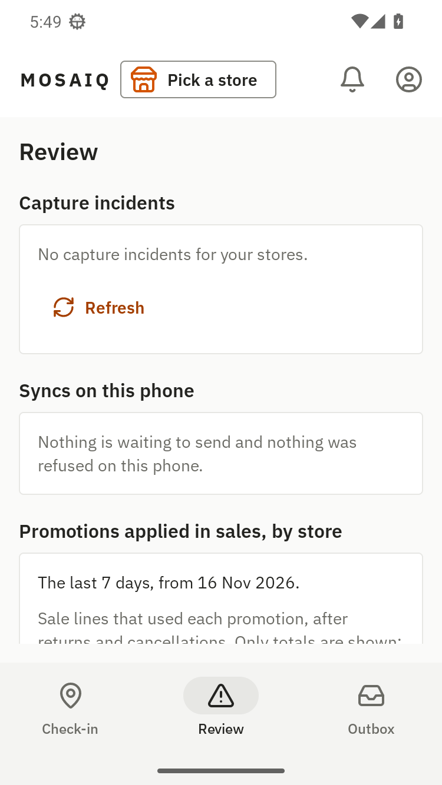
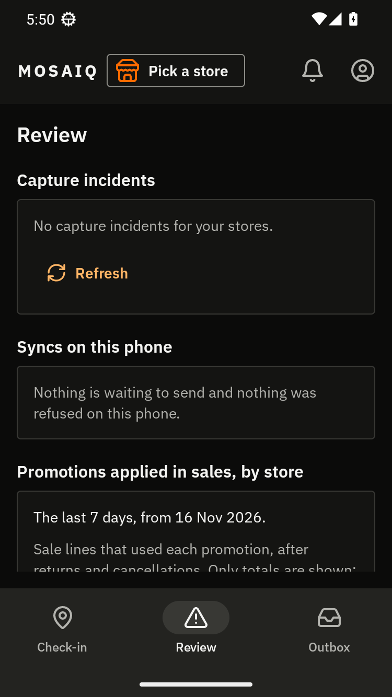
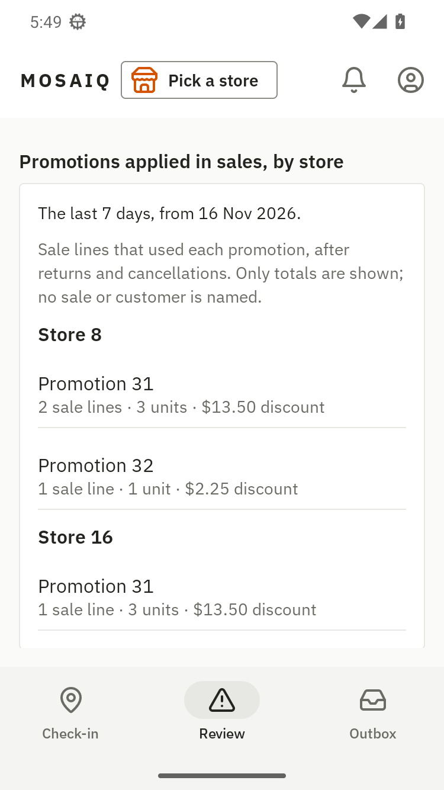
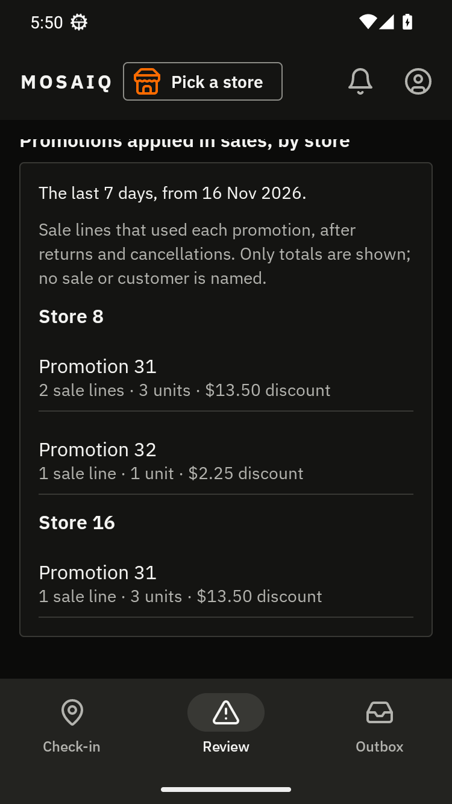
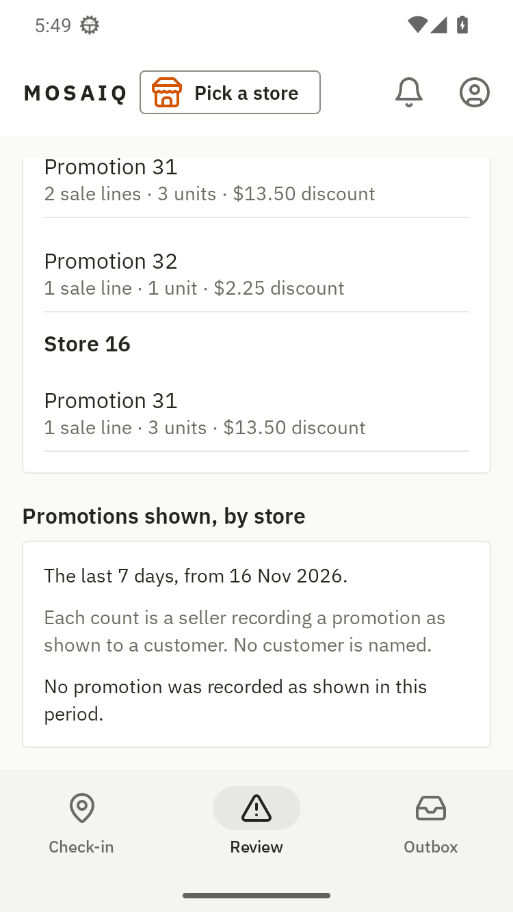
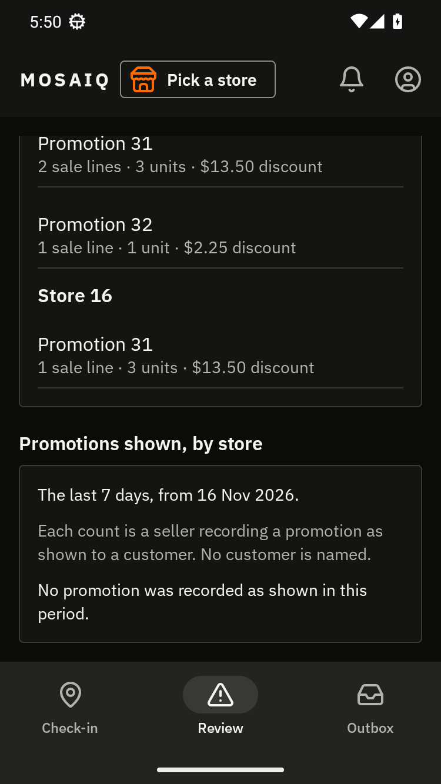

# #1143 (F27-16): promotions applied in sales, by store, at 375 dp

The supervisor's Review screen with its new part, "Promotions applied in sales, by
store" (PR #1151), at 375 dp in light and dark. The screenshots come from the real
debug app, driven through its own UI on an emulator, against the real services
behind a local gateway. The totals came from sales-service's
`listSalePromotionTotals`.

## Where it was run

| Piece | Here |
|---|---|
| Date | 2026-11-22 (UTC) |
| Emulator | Android Emulator on Linux (KVM), AVD on `system-images;android-33;google_apis;x86_64`. The display is overridden to 750 × 1334 px at 320 dpi, which is **375 × 667 dp**. |
| App | The debug build of `feature/1143-android-promotion-totals` at `d56b6de3`, with base URL `http://10.0.2.2:8080/` |
| Stack | `compose.distributed.yaml` at the same commit. It includes #1150's sales-service and starts from an empty database loaded with the three scripts. |
| Account | `user33@mosaiq-demo.com`, `COMMERCIAL_SUPERVISOR`, assigned to stores 8, 16 and 24 (seed, F19-04), with the published demonstration password (ADR-0008) |
| Scheme | `adb shell cmd uimode night no` or `yes`. The app follows the system scheme. |

## The data behind the screen

The seed holds no sale that applied a promotion, because its promotions belong to
campaigns of early 2026. The campaigns contract's `createPromotion` is still
`x-mosaiq-status: planned`, and campaigns-service answers it with 404. So one
promotion setup was written **to the local database only**, with bound
parameters:

- campaign 31, ACTIVE, from 2026-11-15 to 2026-12-31;
- promotion 31, 15 %, in stores 8 and 16;
- promotion 32, 10 %, in store 8;
- both promotions on channels 1 and 3.

The sales were then recorded through sales-service (`POST /v1/sales`, as the
seeded administrator), each line naming its promotion:

| Sale | Store | Lines |
|---|---|---|
| 301 | 8 | product 4 × 2 at 25.50 (promotion 31), product 2 × 1 at 20.25 (promotion 32), product 3 × 1 at list price |
| 302 | 8 | product 4 × 1 at 25.50 (promotion 31) |
| 303 | 16 | product 4 × 3 at 25.50 (promotion 31) |

The supervisor's own `GET /v1/sale-promotion-totals` answered with these totals:

- store 8, promotion 31: 2 lines, 3 units, discount 13.50;
- store 8, promotion 32: 1 line, 1 unit, discount 2.25;
- store 16, promotion 31: 1 line, 3 units, discount 13.50.

The phone shows exactly these figures.

## The screens

### The top of Review

| Light | Dark |
|---|---|
|  |  |

### Promotions applied in sales, by store

Per store, each promotion shows its sale lines, units and discount, net of
returns and cancellations. No sale or customer is named.

| Light | Dark |
|---|---|
|  |  |

### The bottom: promotions shown

The new part sits above "Promotions shown, by store". Nothing was recorded as
shown in this period, so that part is in its empty state.

| Light | Dark |
|---|---|
|  |  |

## Found on the way

The promotions appear as "Promotion 31" and "Promotion 32", not by name. The
screen takes names from campaigns-service's `listPromotions`, which is still
`x-mosaiq-status: planned` and answers 404, so every promotion falls back to its
number. This is the fallback #1151 designs for a promotion that is no longer
active. Names will appear once `listPromotions` is implemented, with no change
to the app.
