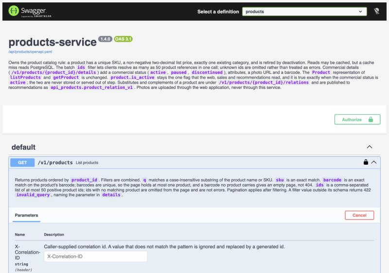
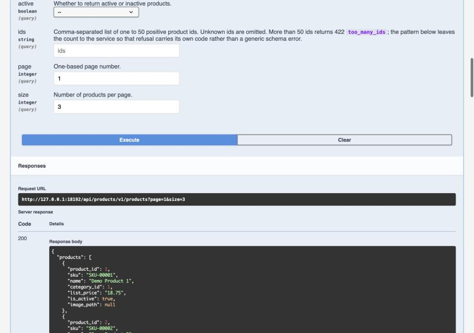

# Swagger UI page at `/api/docs/` (F29-16, #1192)

Verified locally on 2026-11-23, against the local gateway and the instance
NGINX file. **The deployed page has not been checked yet.** See "Pending" below.

## Local gateway

The run used an isolated copy of `compose.distributed.yaml`: project `p1192`,
gateway on `127.0.0.1:18192`, network and named volumes renamed, and the
service images built for #831 reused unchanged. It was taken down with
`down -v` afterwards.

| Check | Result |
|---|---|
| `GET /api/docs` | 301 to `/api/docs/` (relative `Location`) |
| `GET /api/docs/` | 200 `text/html`, with the instance CSP: `script-src 'self'` |
| `init.js`, `swagger-config.json`, `vendor/*` | 200 each, from the mounted `docs/api-docs` |
| `GET /api/<name>/openapi.yaml` for the 19 registry entries | 200 each |
| Browser console on load | No CSP violation, and no error until the first contract example is fetched (see "Known limits") |
| Origins the page contacted | `http://127.0.0.1:18192` only |
| "Try it out" `POST /v1/sessions` on `auth` | 201, sent to `/api/auth/v1/sessions` |
| "Try it out" `GET /v1/products` on `products` after Authorize | 200, sent to `/api/products/v1/products?page=1&size=3` with `Authorization: Bearer …` |
| `localStorage`, `sessionStorage`, `document.cookie` after both calls | Empty |

The `curl` panel was hidden before the second capture, so no token appears in
the image.

## Instance NGINX file

`deploy/nginx/mosaiq.conf` was tested with the CI recipe, `nginx:1.27-alpine`
with every committed service include. `docs/api-docs` was mounted at
`/opt/mosaiq/docs/api-docs`. The results:

- `nginx -t` is ok.
- `GET /api/docs` returns 301 to `/api/docs/`.
- `GET /api/docs/` returns 200 with the server block's headers and CSP.
- `vendor/swagger-ui-bundle.js` returns 200.

## Known limits

- Swagger UI clears the authorization when another service is picked from
  "Select a definition", so you click **Authorize** again for each service.
  The page keeps no token of its own.
- The contracts cite their examples by `externalValue: examples/…`, relative
  to `openapi.yaml`. No service serves `/examples/`, so Swagger UI shows the
  service's 404 envelope where an example would be, and the request body has
  to be typed. The service list and the rendering are unaffected. This is a
  gap between the contracts and the services, not part of this page.

## Pending

- On the instance, an operator installs `deploy/nginx/mosaiq.conf` (deploy
  drift check, F6-06), and a deploy publishes `docs/`. Then
  `https://mosaiq.maxthecoder.online/api/docs/` is opened and recorded here.
