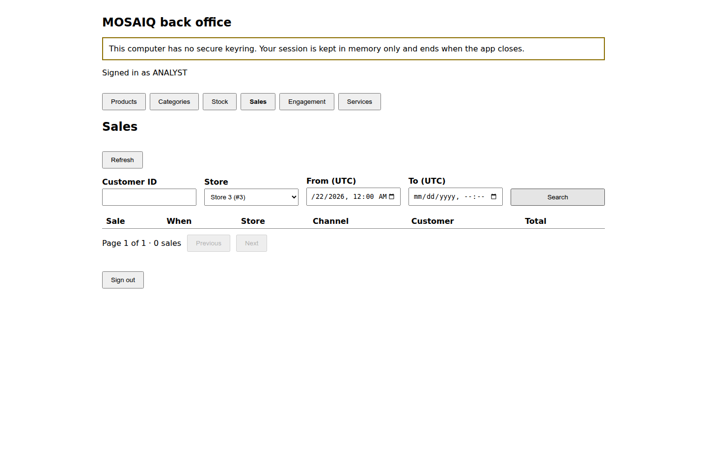
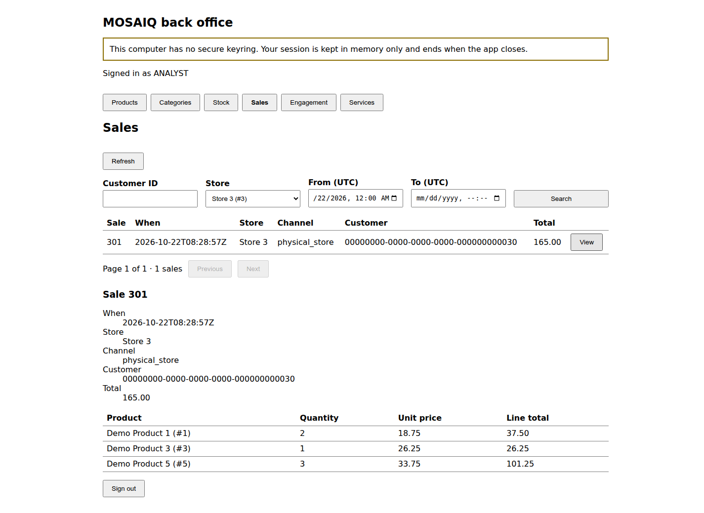

# #417 — A sale recorded in JSON, read back in the desktop client in XML

Step evidence for F18-05 (#462), from the acceptance criterion of F16-04 (#417):
a sale recorded in JSON through `POST /v1/sales` appears on the desktop
**Sales** screen after **Refresh**, with its lines and total, read from
sales-service in XML and validated against `contracts/sales/sales.xsd`.

## Where it ran

On 2026-10-22, on `develop` at `146a353`, on a laptop. The run did not use the
instance: `main` there carries six services, and neither auth-service nor
sales-service is among them. Docker was not available, so each piece ran as a
process from the repository:

| Piece | How |
|---|---|
| auth-service 0.1.1, sales-service 0.1.0, products-service 0.1.3 | gunicorn with each service's frozen uv environment and staged contracts |
| stores-service 0.1.2 | its Rust binary, `cargo build --locked` |
| Gateway | nginx 1.28.3 with `docker/distributed/gateway/default.conf`, upstreams pointed at loopback, on `127.0.0.1:8080` |
| PostgreSQL 18.6 | the three scripts, run clean from empty; each service connects as its own `svc_*` role |
| Redis 8.0.5 | one instance loading the four services' `redis/*.acl` files |
| Desktop client | Electron 38.8.6, `npm run build`, base URL `http://127.0.0.1:8080` |

The signing key is the local pair made by `docker/distributed/auth-keys.sh`.
Every service verified tokens against its public half.

## What was done

1. The desktop client signed in as `user2@mosaiq-demo.com` (ANALYST), opened
   **Sales**, and searched for store 3 from today at 00:00 UTC. There were
   **0 sales**.

   

2. A floor store manager, `user3@mosaiq-demo.com` (STORE_MANAGER), signed in to
   auth-service in JSON and posted one sale in JSON. The request is the one the
   contract specifies and the floor app will send:
   - `Content-Type` and `Accept` set to `application/json`;
   - a bearer token;
   - an `Idempotency-Key`;
   - store 3, channel 3 (`physical_store`), and three lines with prices charged.

   The Android screen that records sales is F17-04 (#437) and is not built yet,
   so a script sent the request:

   ```
   POST /api/sales/v1/sales  →  201
   {"sale_id": 301, "store_id": 3, "channel_id": 3, "total": "165.00",
    "occurred_at": "2026-10-22T08:28:57Z", "lines": [
      {"product_id": 1, "quantity": 2, "unit_price": "18.75"},
      {"product_id": 3, "quantity": 1, "unit_price": "26.25"},
      {"product_id": 5, "quantity": 3, "unit_price": "33.75"}], ...}
   ```

   In PostgreSQL the row is `transaction` 301, with
   `source_transaction_id = svc-sales:9119c430-…`, `data_origin = OBSERVED`
   and a total of 165.00.

3. **Refresh** on the desktop listed sale 301. **View** opened it with its
   three lines, line totals and total. The product names came from
   products-service, and the store and channel names came from stores-service
   and sales-service.

   

## How the XML was checked

The desktop's main process validates every response against the bundled XSD
before it renders it, and renders nothing that fails
(`clients/desktop/README.md`, security model). The gateway's access log shows
the desktop's reads (user agent `node`, the main process) around the JSON write:

```
GET  /api/sales/v1/sales?page=1&size=20                                            200 8494 "node"
GET  /api/sales/v1/sales?store_id=3&from=2026-10-22T00%3A00%3A00Z&page=1&size=20    200  294 "node"
POST /api/sales/v1/sales                                                           201  313 "Python-urllib/3.14"
GET  /api/sales/v1/sales?store_id=3&from=2026-10-22T00%3A00%3A00Z&page=1&size=20    200  787 "node"
GET  /api/sales/v1/sales/301                                                       200  650 "node"
GET  /api/sales/v1/sales/301                                                       200  650 "curl/8.18.0"
```

The last line is an independent check. The same sale was read as the ANALYST
with `Accept: application/xml`. The answer was 650 bytes, the same size the
desktop received:

```xml
<Sale xmlns="https://mosaiq.maxthecoder.online/xml/sales/v1" xmlns:common="https://mosaiq.maxthecoder.online/xml/common/v1"><sale_id>301</sale_id><customer_id>00000000-0000-0000-0000-000000000030</customer_id><store_id>3</store_id><channel_id>3</channel_id><occurred_at>2026-10-22T08:28:57Z</occurred_at><total>165.00</total><lines><product_id>1</product_id><quantity>2</quantity><unit_price>18.75</unit_price></lines><lines><product_id>3</product_id><quantity>1</quantity><unit_price>26.25</unit_price></lines><lines><product_id>5</product_id><quantity>3</quantity><unit_price>33.75</unit_price></lines></Sale>
```

`xmllint --noout --schema contracts/sales/sales.xsd sale-301.xml` printed
`validates`.

## Found on the way

The first attempt applied the store filter before the unfiltered first page
had finished loading. The slower, older response replaced the filtered one, so
the screen listed 20 sales from every store under a filter of store 3. The
screenshots above wait for the first page before filtering. The defect is
#660.

## Not shown here

- The run was not on the instance, and the phone did not record the sale. Both
  belong to the end-to-end demonstration itself: F18-05 (#462), after F17-04
  (#437) and a release of the services.
- The OS keyring was not available, so the client ran in `memory_only` mode.
  That is the banner at the top of both screenshots.
