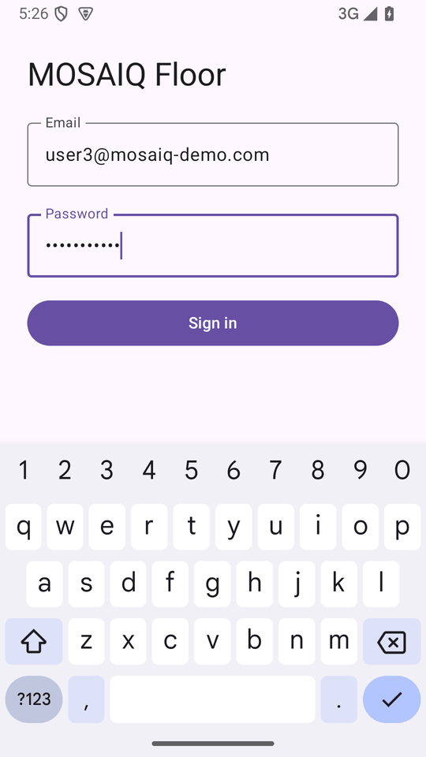
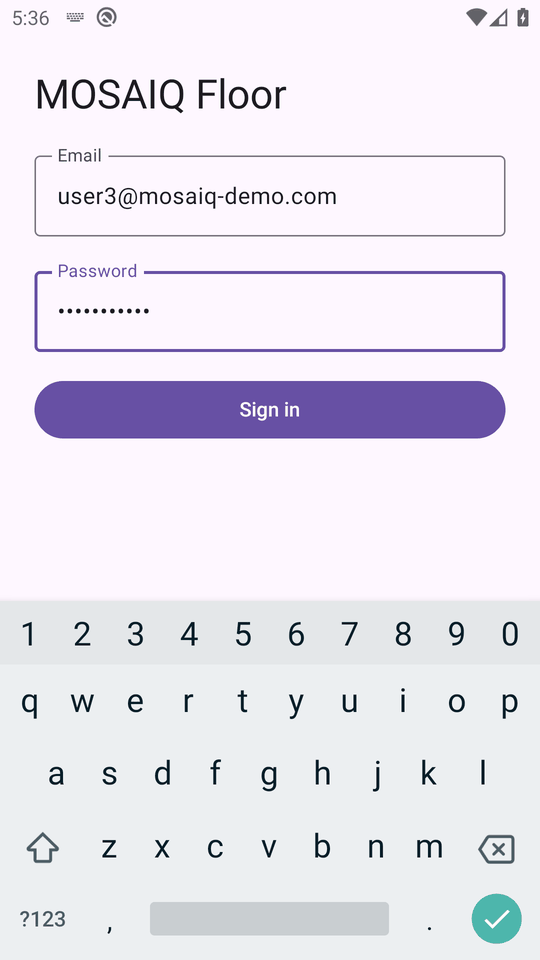
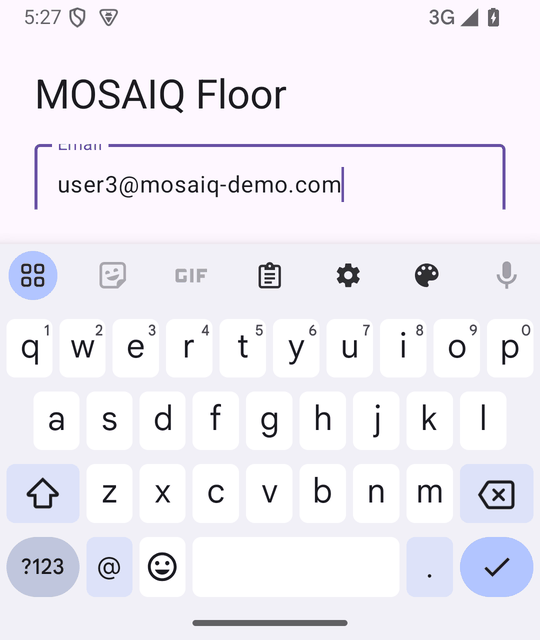
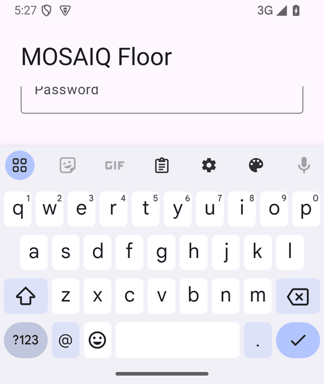
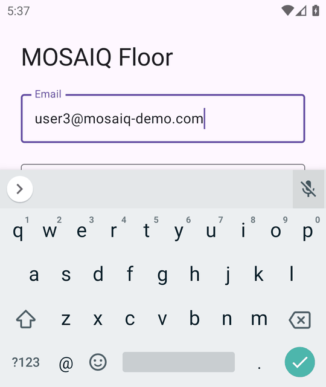
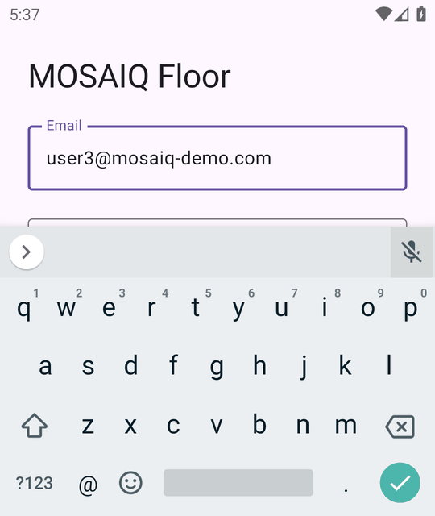
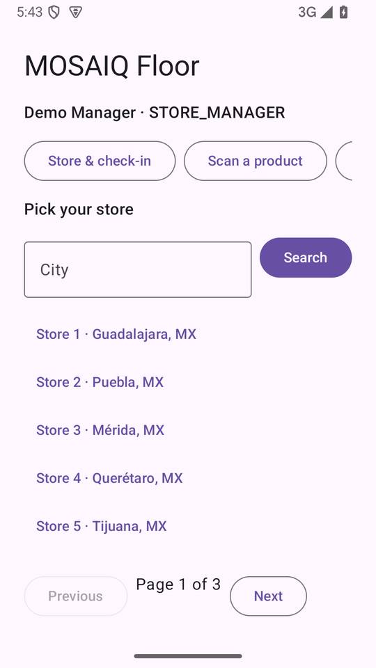
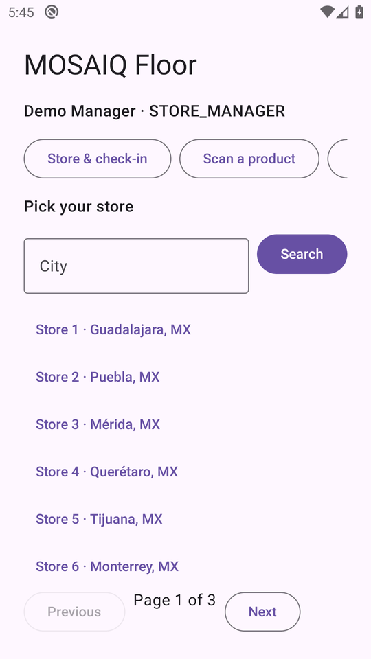
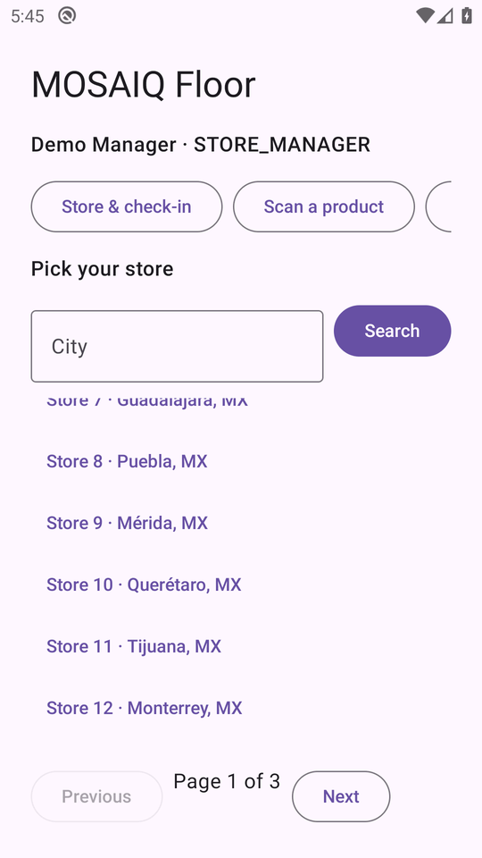
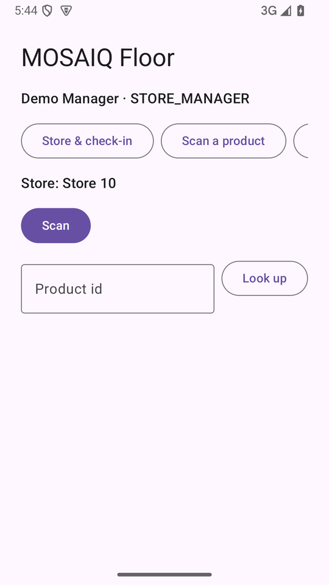

# #718 (UX-03): edge-to-edge, keyboard and scrolling on a 375dp screen

The debug app of this branch, installed without `-g`, run on two emulators:
API 35 and API 29. The app's minSdk is 26 and it sets no `windowSoftInputMode`,
so the keyboard behavior comes from `enableEdgeToEdge()` and `safeDrawingPadding()`
alone, and an old API level had to be checked.

## Where it was run

| Piece | Here |
|---|---|
| Emulators | Android Emulator 37.2.12 on Windows (WHPX). `system-images;android-35;google_apis;x86_64` (API 35) and `system-images;android-29;google_apis;x86_64` (API 29, Android 10) |
| Screen | 1080 × 1920 at `wm density 461`, which is 375dp wide. The short-screen shots use `wm size 1080x1280`, which is 375 × 444dp. Both were reset afterwards |
| App | The debug build of `rs/737` at `8373fe5` (the sign-in screens were taken at `f457b06`; nothing in them changed), base URL `http://10.0.2.2:8080/` |
| Backend | **Not the real stack.** A throwaway fake gateway (a small Python HTTP server, not committed) answered `POST /api/auth/v1/sessions`, `GET /api/users/v1/users/me` and `GET /api/stores/v1/stores`, with 60 stores in three pages of 20 and the response shapes of `contracts/auth`, `contracts/users` and `contracts/stores`. The 15-service stack was not started: it was not built on this machine. These screens are about layout, not about what a service answers |
| Screenshots | `screencap` at half size, as in [`445-android-screens.md`](445-android-screens.md) |

## Sign-in with the keyboard open (acceptance criterion 2)

375dp wide, both fields filled, the soft keyboard up (`mInputShown=true`). The
focused Password field and the Sign in button stay above the keyboard.

| API 35 | API 29 |
|---|---|
|  |  |

A short screen, 375 × 444dp, where the keyboard leaves about a third of the
height. The email field is focused and stays above the keyboard on both API
levels, and the form scrolls under the pinned title to reach what is below it.

| API 35 | API 35, scrolled | API 29 | API 29, scrolled |
|---|---|---|---|
|  |  |  |  |

On this short screen the scrolling area is small: the title and the 24dp
padding stay fixed, so only a little of the form is visible above the
keyboard at once. It works, but the title could scroll with the form if short
landscape screens matter.

## Store picker with a long list (acceptance criterion 4)

375dp wide, 60 stores in three pages. The list scrolls inside its own weighted
box; the Previous / Page / Next row stays on screen, at the first position of
the list and after scrolling it.

| API 35 | API 35, list scrolled | API 29 | API 29, list scrolled |
|---|---|---|---|
|  |  |  |  |

These screens were retaken after a fix. The first run of this evidence showed
the Search button squeezed into a column of single letters at 375dp: the City
field and the Search button shared a `Row`, and only the button was left what
the field did not take. The field now has `Modifier.weight(1f)`, so the button
keeps its own width (commit "keep the store search button its own width at
375dp"). `StorePickerLayoutTest` guards it: it fails with 32dp without the
weight and passes with it. The Scan screen's manual-entry `Row` already had the
weight, and the Check-in tab has no text field in a `Row`:



## `PermissionDeniedInstrumentedTest` against the new `FloorHome` modifiers

The test calls `FloorHome` directly and now gets a filled parent. It carries
`@DeniedPermissions`, so `connectedAndroidTest` leaves it out (it installs with
`-g`); `clients/android/run-denied-permission-tests.sh` runs it without `-g`.

```text
API 35 (mosaiq-shots):  OK (2 tests), Time: 9.418
API 29 (mosaiq-api29):  OK (2 tests), Time: 6.694
```

Both tests ran: `aDeniedCameraExplainsWhyAndOffersManualEntry` and
`aDeniedLocationQueuesTheCheckInWithoutAPosition`.

## Not covered

- A display cutout was not tried: the stock emulator profile has none.
- Landscape was not captured.
- Light theme only; the app has one theme.
