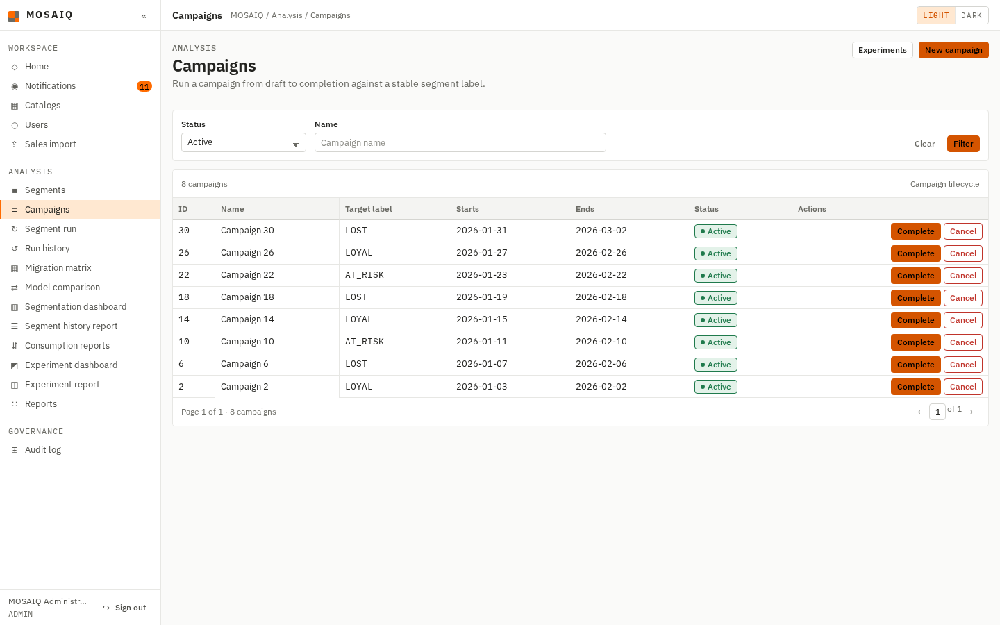
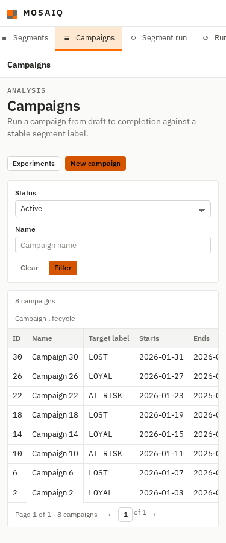
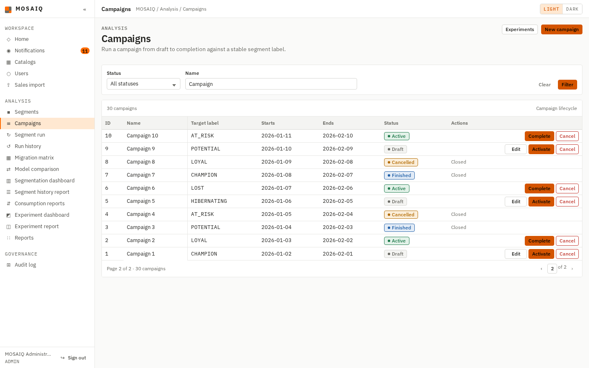
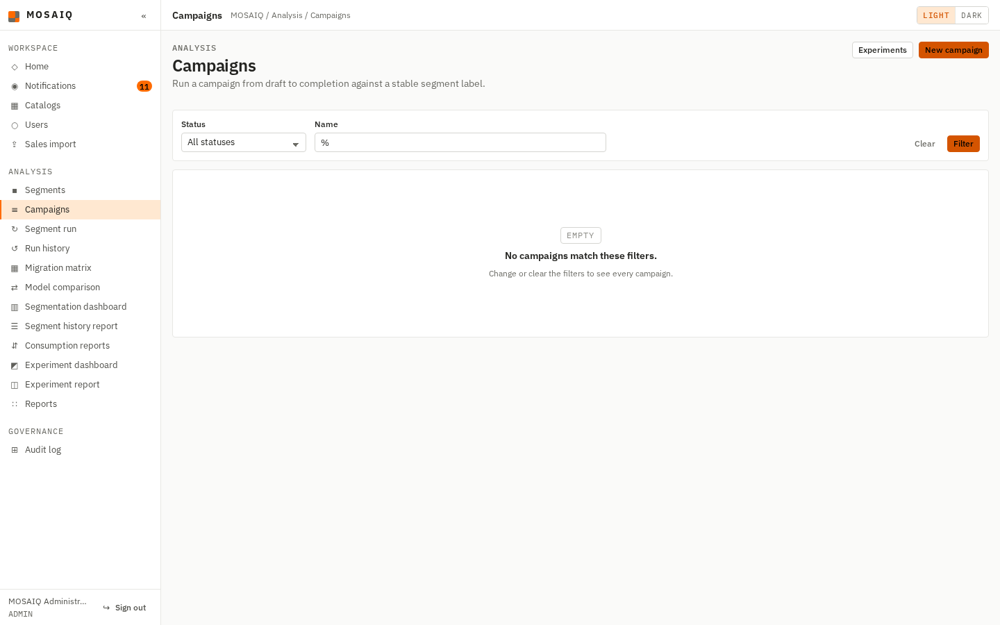
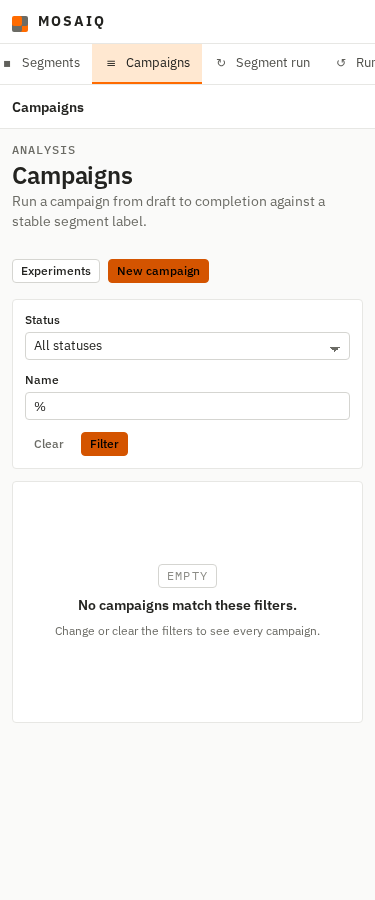
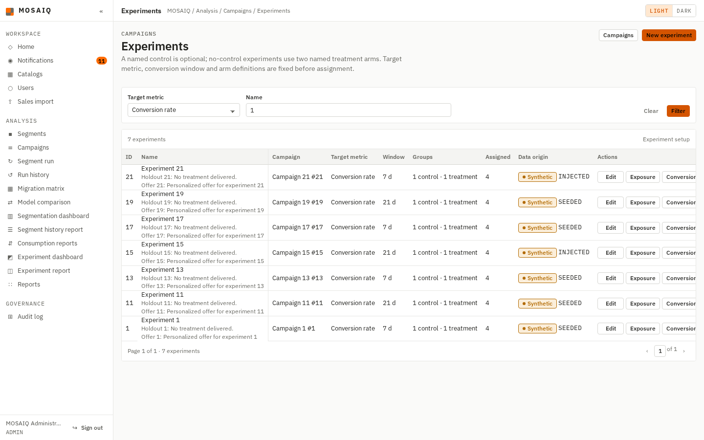
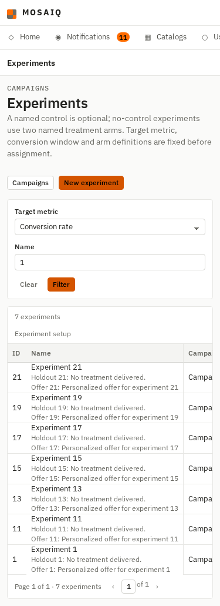
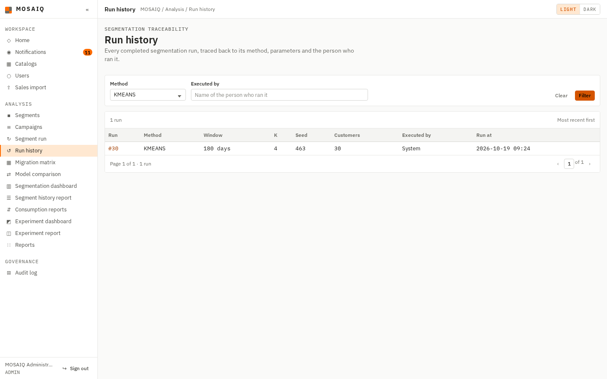
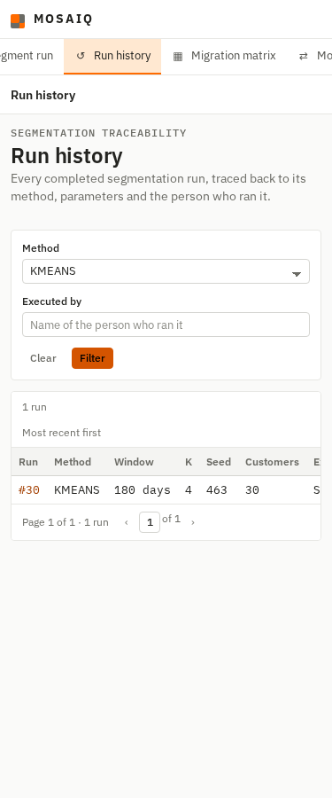

# AN-17b (#538) — Filters on the campaign, experiment and run-history lists

Evidence for #538. The three lists were paged but could not be filtered. Each one now
has a filter bar built the same way as the catalog lists' (`mq-filterbar`, a GET form, a
**Clear** link while a filter is set):

| List | Choice filter | Text filter |
|---|---|---|
| Campaigns `/campaigns/` | `status`: Draft, Active, Finished, Cancelled | `q`: the campaign name |
| Experiments `/experiments/` | `metric`: the target metrics in `TARGET_METRICS` | `q`: the experiment's name or its campaign's |
| Run history `/run-history/` | `method`: `RFM_RULES`, `KMEANS` | `q`: the executing user's name |

Each list query is a module constant in which a NULL parameter switches its condition
off (`%(status)s::text IS NULL OR status = %(status)s`), the pattern
`web/db/inventory.py` already uses. So there is one parameterized statement per list and
nothing is concatenated at call time. The text goes through `web/db/search.py`'s
`ilike_pattern`, which escapes `\`, `%` and `_`. A choice outside the vocabulary returns 400,
as the stock list's store filter does. The links into and out of the campaign list keep
the filters: paging, **Edit**, **Cancel** on the edit form, and the
Activate/Complete/Cancel buttons. A seeded run has no executing user, so a name search
never matches it. The empty state says so.

No schema change, and the permission gates are unchanged: `campaign.read` for campaigns
and experiments, `segment.read` for run history.

## What was run, and against what

Branch `feature/538-filter-analytics-lists`, from `develop` at `736fdb1`. PostgreSQL
16.15 in a container loaded with the three scripts in order from empty, and
`flask --app web.app run` from the repository's virtual environment. Headless Chromium
through Playwright 1.64.0, signed in as the seeded administrator. At 1440 px the
captures show the viewport. At 375 px they are full-page. `scrollWidth` equalled the
viewport width in every capture.

## The criteria

| Acceptance criterion | Proof |
|---|---|
| Each list follows the catalog lists' filter and pagination pattern: the filter survives paging, and an empty result says so | `test_the_filters_survive_paging` and `test_an_empty_filtered_result_says_so` for each list. `test_a_campaign_status_change_returns_to_the_filtered_list` covers the campaign actions. The page-2 capture below shows the previous-page link carrying `q` |
| `%` and `_` in a text filter match literally, with a test for each | `test_each_list_matches_wildcards_literally` (`%`, `_` and `\` for all three queries). On PostgreSQL, `test_campaign_filters_match_wildcards_literally`, `test_experiment_filters_match_wildcards_literally` and `test_run_filters_match_wildcards_literally` in `tests/test_analytics_db_postgres.py`: a search for `%` returns only the one row whose name contains `%`, not all 30 |
| The permission gate is unchanged when filtered | `test_a_filter_does_not_open_the_gate`: a filtered URL is still 403 for a role without the list's permission |

The PostgreSQL tests ran with `MOSAIQ_TEST_APP_URL` pointing at the container, as
`retail_app`. They rename seeded rows inside a transaction that is rolled back.

## Captures

Campaigns filtered by status: 8 of the 30 seeded campaigns are active.

Page 2 of a name search that matches all 30 campaigns. The previous-page link is
`/campaigns/?page=1&q=Campaign`.

A search for `%` alone. No seeded campaign name contains `%`, so the list is empty and
says so. Before the escape, `%` would have matched every campaign.

Experiments filtered by target metric and name together.

Run history filtered by method. The seed has one K-means run.

