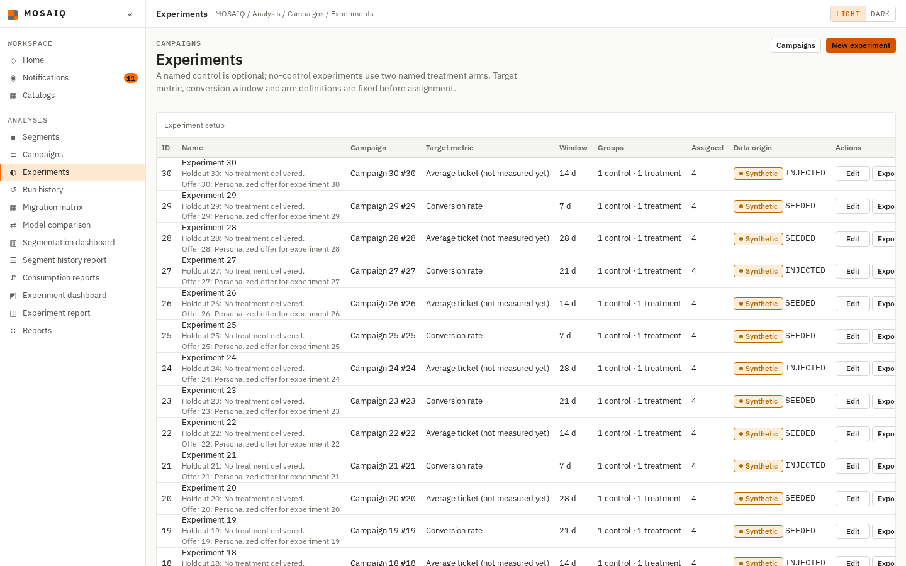
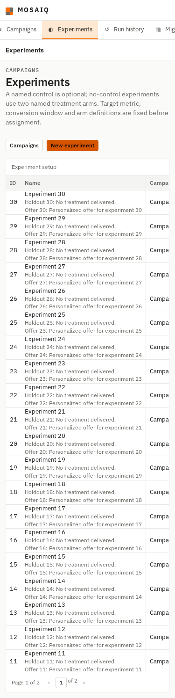
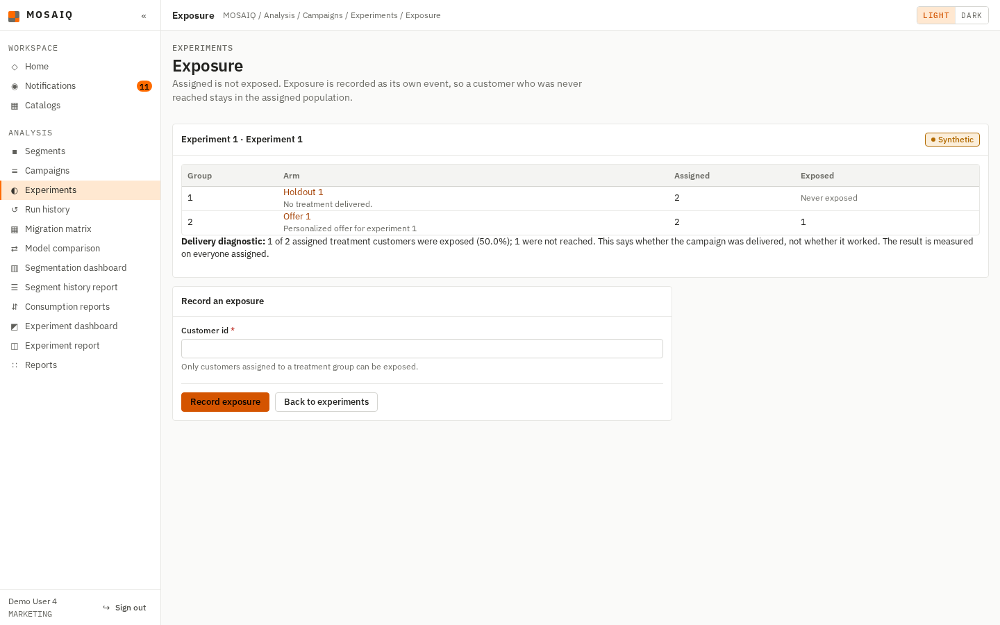
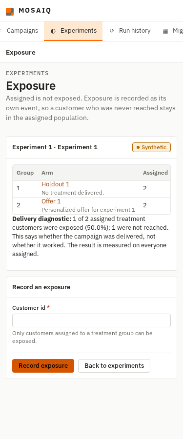
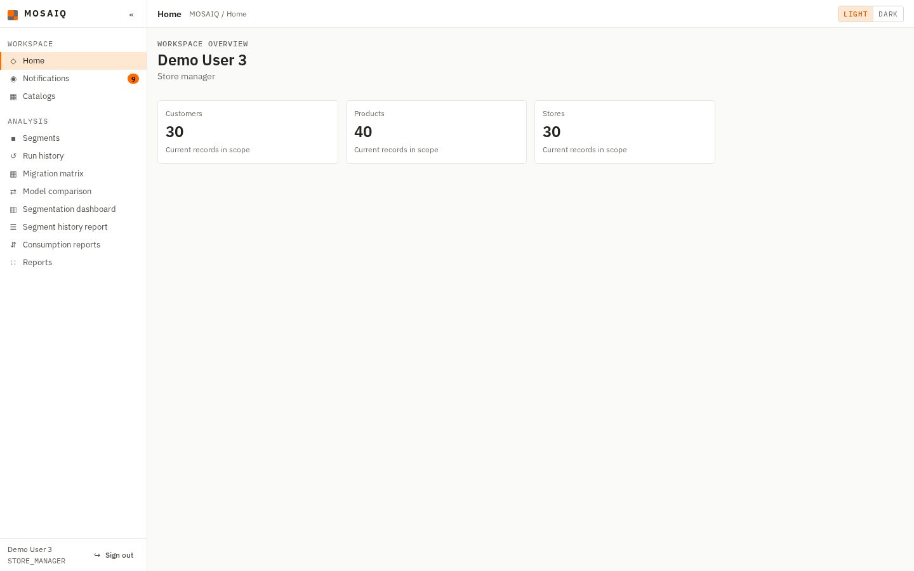
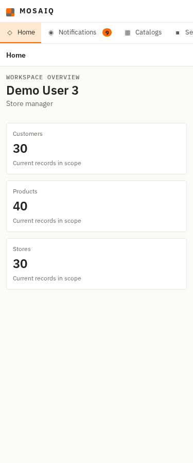

# AN-17c (#539) — Experiments in the navigation

Evidence for #539. The experiment pages under `/experiments/` existed but no menu
entry linked to them, so a campaign reader reached them only by typing the URL or from
a button on the Campaigns page. The navigation now has an **Experiments** entry in the
Analysis section, between Campaigns and Run history. It is gated on `campaign.read`,
the permission the experiment list itself requires, and every `experiments.*` page
marks it as the current entry. The Experiment dashboard and Experiment report keep
their own entries.

No schema change and no authorization change: the entry is added to `NAVIGATION` in
`web/middleware/authz.py`, and `menu()` maps every `experiments.*` endpoint to it, as
it already does for the catalog and admin pages.

## What was run, and against what

Branch `feature/539-experiments-navigation`, from `develop` at `736fdb1`. PostgreSQL
16.15 in a container loaded with the three scripts in order from empty, and
`flask --app web.app run` from the repository's virtual environment. Headless Chromium
through Playwright 1.64.0, signed in through the login page as the seeded MARKETING
user (`user4@mosaiq-demo.com`) and the seeded STORE_MANAGER user
(`user3@mosaiq-demo.com`). At 1440 px the captures show the viewport. At 375 px they
are full-page. `scrollWidth` equalled the viewport width in all six captures.

## The criteria

| Acceptance criterion | Proof |
|---|---|
| A user holding `campaign.read` sees Experiments, linking to the experiment list, marked current on experiment pages | The MARKETING captures below: the list and an experiment's exposure page each mark Experiments as `aria-current="page"`. `test_a_campaign_reader_is_offered_experiments` covers ADMIN, ANALYST, MARKETING and AUDITOR, and `test_every_experiment_page_marks_experiments_current` covers the list, new, edit, exposure and group pages |
| A user without `campaign.read` does not see the entry, with a test for both cases | The STORE_MANAGER captures below. `test_experiments_is_absent_without_campaign_read` covers STORE_MANAGER, INVENTORY_PLANNER and CUSTOMER |
| The navigation still fits at 375 px and 1440 px | All six captures. At 375 px the navigation is the existing horizontal strip, and it scrolls the current entry into view |

## Captures

The experiment list as MARKETING, Experiments current:

An experiment's exposure page as MARKETING. Experiments stays current on a detail page:

The home page as STORE_MANAGER, which does not hold `campaign.read`, with no
Experiments entry:

