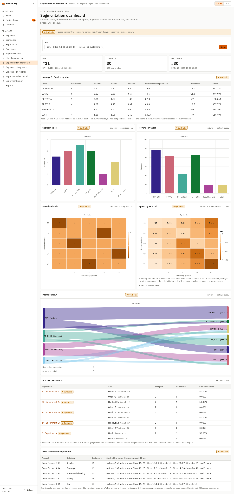
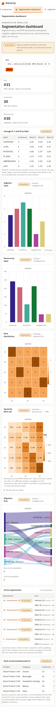
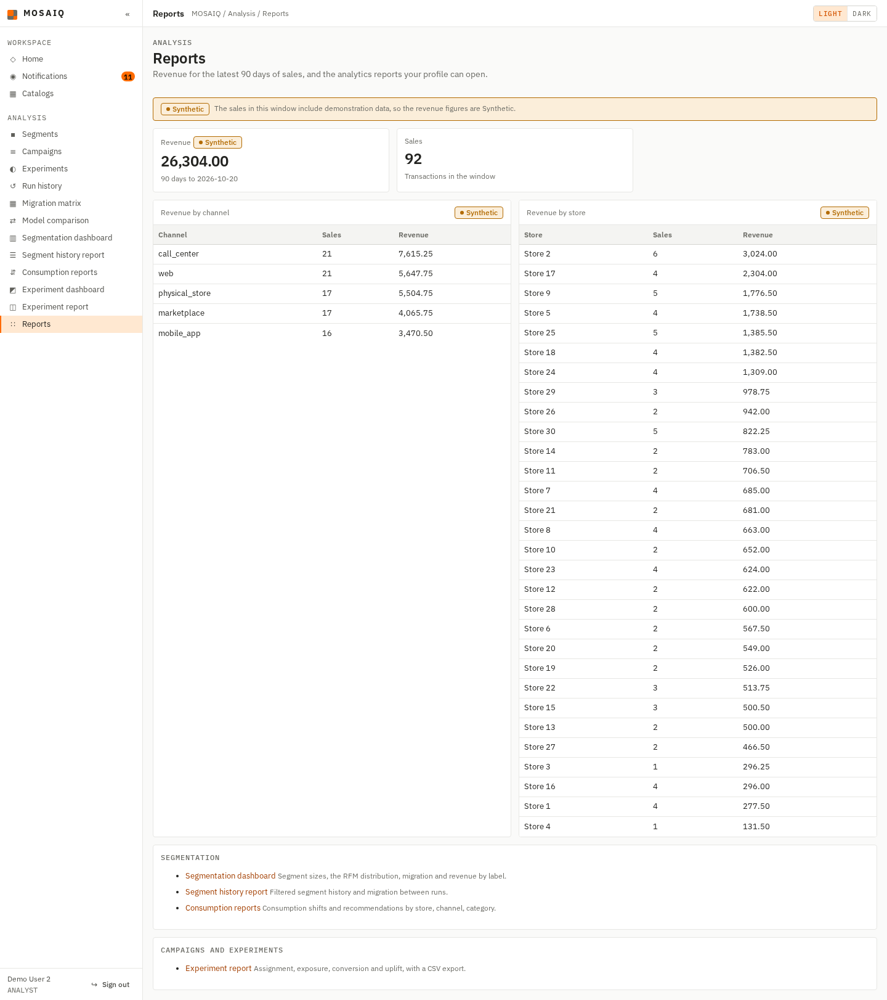
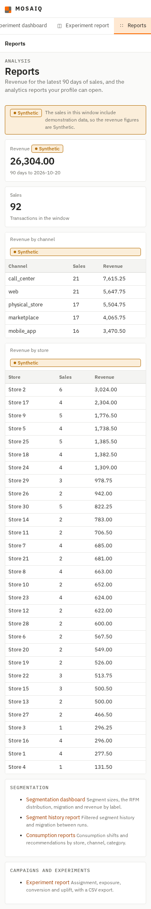
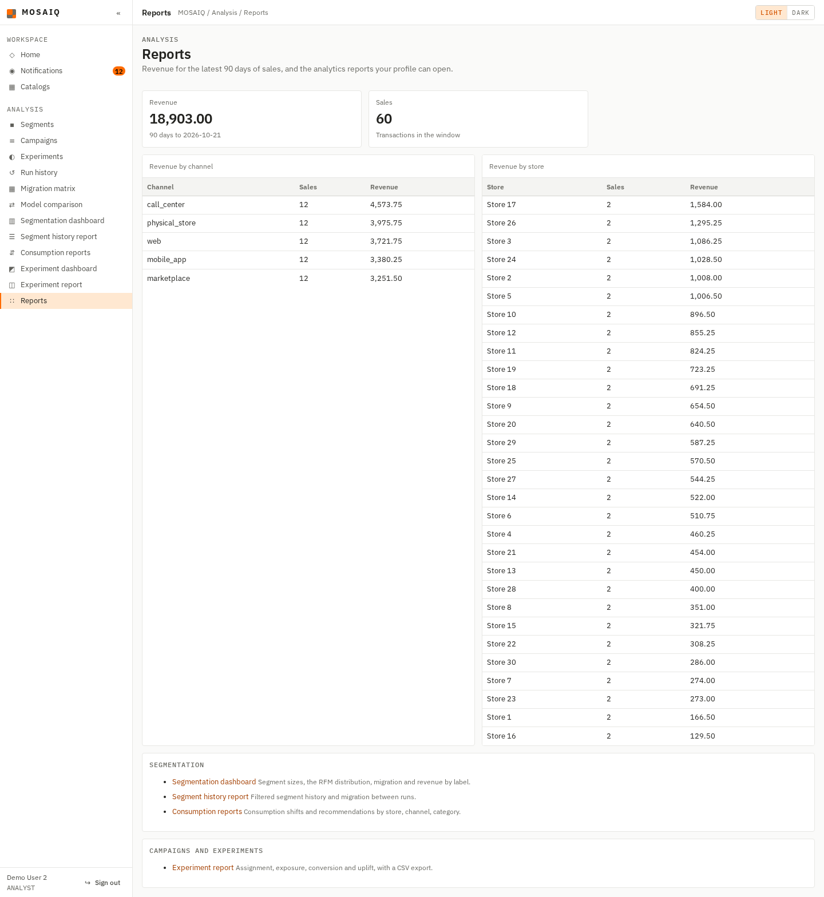
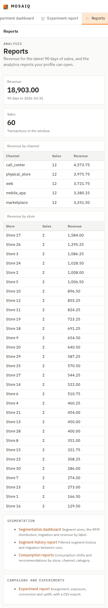
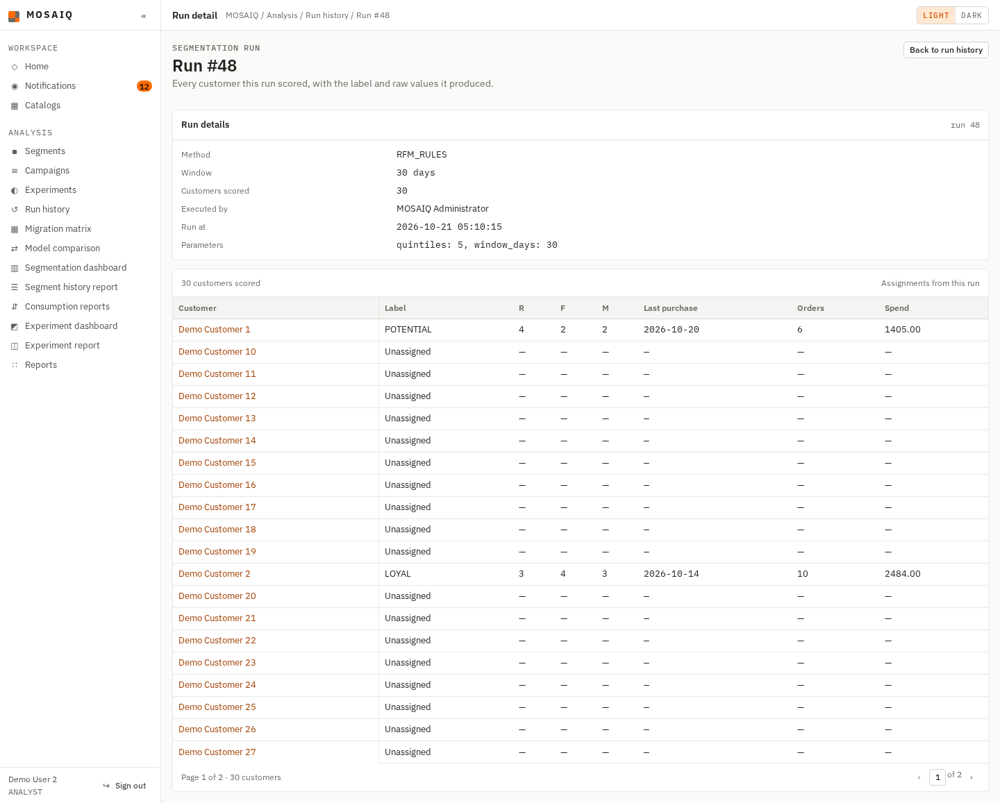
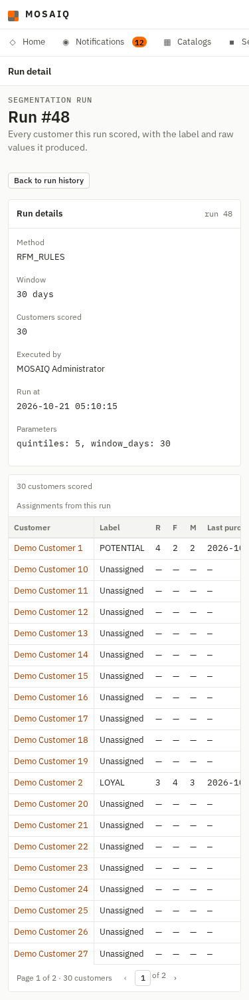
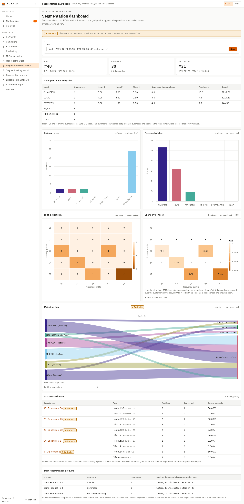
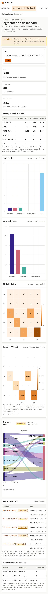

# AN-20 — the row-level Synthetic marker (#560)

**Story:** AN-20, #560. **Decision:** ADR-0052, with the ten implementation
decisions recorded on #560. **Depends on:** AN-19, #559 (`data_origin` on sales
and runs).

Every analytics page now marks a figure `Synthetic` from the `data_origin` of the
rows it reads, and `DATA_IS_SYNTHETIC` is gone. This file shows the same
application against one database in two states: the seed as loaded, where every
row is `SEEDED`, and the same database after the owner moved the seeded sales out
of a short window and recorded observed ones in it.

## Where it was run

- A throwaway `postgres:16` container, `an20-pg`, removed afterwards. It was
  loaded with `sql/00_create_database.sql`, `sql/01_schema.sql` and
  `sql/02_seed_30_per_table.sql`, in that order, on this branch. The instance
  was not touched (decision 9).
- The application ran from this branch with `flask --app web.app run`, connected
  as `retail_app`.
- Screenshots: headless Chromium through Playwright, full page, at 1440 px and
  375 px. Pages were read as `user2@mosaiq-demo.com` (an analyst); the run was
  started as `admin@mosaiq-demo.com`.

## 1. The seed as loaded: everything is SEEDED

```
SELECT data_origin, count(*) FROM transaction GROUP BY 1;       -> SEEDED|300
SELECT run_id, data_origin FROM segmentation_run ORDER BY run_at DESC LIMIT 2;
                                                                -> 31|SEEDED, 30|SEEDED
```

The segmentation dashboard for run #31 marks every panel: the banner, each chart
heading, each chart's subtitle, and each chart's `aria-label` (`Synthetic.
Customers per label`, and so on for all five charts and the heatmap table's
caption). The page held the word 26 times.




Reports sums the newest 90 days of sales, all seeded, so it carries the banner
and the pills (5 occurrences).




## 2. Moving the seeded sales out of a short window

As the database owner, in one transaction:

```sql
BEGIN;
-- Move every seeded sale three years back, out of any short window.
UPDATE transaction
   SET occurred_at = occurred_at - interval '3 years'
 WHERE data_origin = 'SEEDED';
-- Record 60 observed sales over the last 20 days, shaped like seeded ones.
INSERT INTO transaction
    (source_transaction_id, customer_id, store_id, channel_id,
     occurred_at, total, data_origin)
SELECT 'OBS-' || lpad(t.transaction_id::text, 8, '0'),
       t.customer_id, t.store_id, t.channel_id,
       now() - make_interval(days => (t.transaction_id % 20)::int),
       t.total, 'OBSERVED'
  FROM transaction AS t
 WHERE t.data_origin = 'SEEDED' AND t.transaction_id <= 60;
COMMIT;
```

```
 data_origin | count |    min     |    max
-------------+-------+------------+------------
 OBSERVED    |    60 | 2026-10-02 | 2026-10-21
 SEEDED      |   300 | 2023-05-04 | 2023-10-20
```

Then the administrator ran an `RFM_RULES` segmentation over 30 days from
**Segment run**. The database recorded its origin, not the application (#559):

```
SELECT run_id, method, window_days, data_origin, customer_count
  FROM segmentation_run ORDER BY run_id DESC LIMIT 2;
48|RFM_RULES|30|OBSERVED|30
31|RFM_RULES|180|SEEDED|30
```

## 3. The same pages over observed data

Reports now sums only observed sales: no banner, no pill, and the word
`Synthetic` appears nowhere in the HTML (0 occurrences).




Run #48's page has no mark either (0 occurrences).




The dashboard for run #48 shows the rule panel by panel. The run's own panels
(label means, sizes, revenue, both heatmaps) carry no mark, and neither do the
most recommended products: no seeded sale is in the 180-day profile window, and
every open label is run #48's. The migration flow compares run #48 with run #31,
which is `SEEDED`, so it is marked, in its heading, its subtitle and its
`aria-label`. The active experiments are the seed's `SEEDED`/`INJECTED` ones,
each with its own pill. The banner heads the page because some panels are
marked (11 occurrences in all).




## 4. Tests

- A SEEDED/OBSERVED pair per page in the route tests: segmentation dashboard
  (every chart's `aria-label`, the caption, the embedded JSON), run history list
  and page, migration matrix and explanation (either run), model comparison,
  segment history report, customer timeline and segment change, `/segment-run/`
  result, Reports, consumption reports, customer profile (sales panels and the
  segment panel apart), customer recommendations, the experiments list, uplift,
  the experiment dashboard and the experiment report with its CSV export. Each
  experiment page includes an `OBSERVED` experiment whose conversion links a
  `SEEDED` sale, which renders `Synthetic`.
- `tests/test_analytics_db_postgres.py::test_every_marker_read_executes_and_finds_the_seed_seeded`
  runs every changed `SELECT` as `retail_app` on the seed and expects every flag
  true. It passed against `an20-pg` before section 2's statements.
- `tests/test_config.py::test_no_tracked_file_names_the_retired_synthetic_flag`
  searches every tracked file for the retired flag, except `docs/adr/`,
  `docs/evidence/`, `docs/backlog.md` and `deploy/README.md` (which tells the
  operator to delete the line from the instance's environment file).

## What was not checked here

- The per-exposure figure (`EXPOSED_CONVERTED_SQL`) counts sales directly and is
  not checked against them (decision 5). RN-26 states the gap.
- The instance itself. `deploy/README.md` says #559's backfill must be applied
  before #560 deploys, and how to remove the stale environment line.
