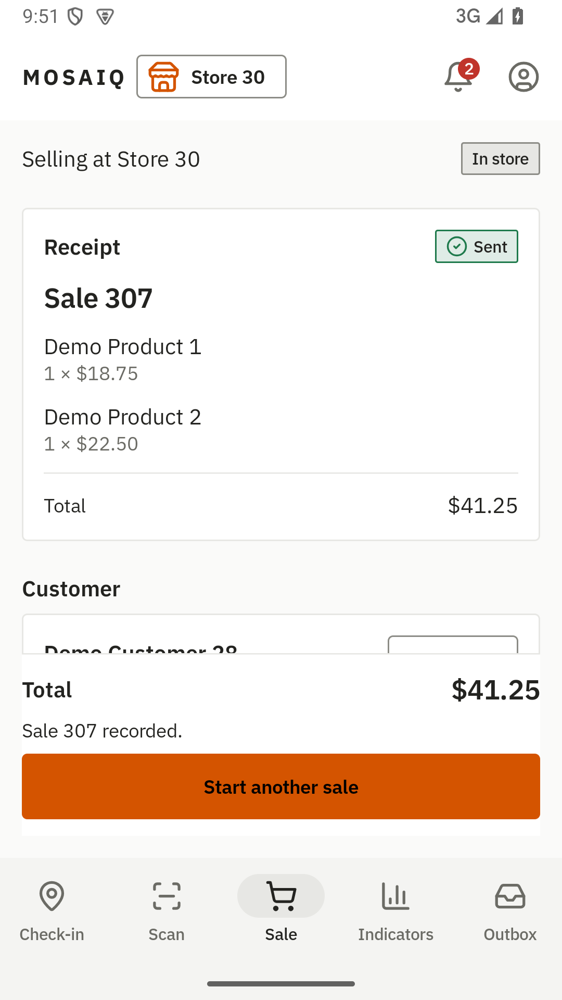

# F20-01 (#759): a real sale from the Android release build, through the instance's HTTPS gateway

> **Status: run on 2026-11-24 (03:36-03:53 UTC, 2026-11-23 evening in Mexico City) on
> the instance's release #1188 (`main` at `50bf7d5c`, tree identical to `develop` at
> `fdf0caed`). The sale, the rows, the refusals and the versions are recorded and
> match their raw files; the identity of the installed APK is only partly
> evidenced.** One sale, no. 307, was recorded from the release build through the
> HTTPS gateway; it took three confirmations and two environment findings (see
> [Found on the way](#found-on-the-way)). The raw exchanges, the rows and the versions
> are next to this file in [`f20-01/`](f20-01/). The APK's hashes, signature, compiled
> base URL and manifest were re-read from the APK the run installed and are in
> [`f20-01/build-and-sign.txt`](f20-01/build-and-sign.txt); the output of `adb install`
> and `dumpsys package` on the emulator was **not retained**, so the link between that
> file and the package on the device rests on the installed copy's SHA-256 alone. The
> run was made by the team's automation, with the owner's approval of the live
> acceptance runs given for that evening.

The acceptance criteria of #759, and where each is answered:

| Criterion | Section |
|---|---|
| A `STORE_MANAGER` created on the instance through users-service (ADR-0008 keeps the seeded accounts deactivated) signs in from a release build calling `https://mosaiq.maxthecoder.online/` | [The account](#1-the-account) and [the build](#2-build-the-release-apk) |
| The HTTPS request of the sale (method, path, headers with the token masked, body) and the 201 response with its `X-Correlation-ID` | [The sale over HTTPS](#4-the-sale-over-https) |
| The `transaction`, `transaction_line`, `sales.sale_capture` and decremented `inventory` rows, read with parameterized queries | [The rows](#5-the-rows) |
| 403 `forbidden_role` outside the role's `x-mosaiq-roles`, and 401 `invalid_token` with no token | [The refusals](#6-the-refusals) |
| The deployed version of every service involved | [The versions](#7-the-versions) |

Governing decisions: [ADR-0008](../adr/0008-the-instance-keeps-the-demonstration-accounts-deactivated.md),
[ADR-0039](../adr/0039-sales-service-records-a-sale-all-or-nothing-consuming-stock-through-the-stock-contract.md),
[ADR-0041](../adr/0041-android-and-electron-clients-run-different-processes-over-different-formats.md).

## Before the run

Each of these must hold, and the record says when it was checked.

1. **PR #989 (stock movements) is merged** (it was, on 2026-11-13), and stock-service
   is deployed at a release that includes it. The sale decrements the same
   `inventory` rows that #989's movements write, so the "before" snapshot is
   taken after it.
2. **Store assignments.** F19-07 (#757, ADR-0060) is on `develop`: sales-service
   reads `api_users.store_assignment_v1` on every `recordSale`, and a
   `STORE_MANAGER` with no assignment works in no store. Step 1.4 is therefore
   required, not conditional. Without it the sale is 403 `forbidden_store`.
3. **The instance is running.** Only the project owner can start
   `mosaiq-deployment-vm`. Check it first:

   ```sh
   gcloud compute instances describe mosaiq-deployment-vm \
     --zone=northamerica-south1-a --format='value(status)'   # RUNNING
   ```

4. **The instance answers.** Every service involved is ready through Cloudflare:

   ```sh
   for s in auth users stores categories products stock customers sales; do
     printf '%-10s %s\n' "$s" "$(curl -s -o /dev/null -w '%{http_code}' \
       "https://mosaiq.maxthecoder.online/api/$s/health/ready")"
   done   # every line 204
   ```

5. **Tools on the workstation:** Android SDK build-tools (`zipalign`,
   `apksigner`), the emulator with the system image
   `system-images;android-33;google_apis;x86_64` (not `google_apis_playstore`,
   which cannot be rooted), mitmproxy 10.1 or later, `jq`, and SSH
   access to the instance as a sudoer (the queries run there, with its psql).

Nothing in the run needs a physical phone. A phone without root cannot be
captured: the release build trusts only the system's certificate authorities
(`network_security_config.xml`), and a capture needs one more on that store. A
physical phone may still be used for a second, uncaptured run if one is wanted.

## The procedure

### 1. Create the account

The administrator is the real account F4-06 provisioned; its password was never
in this repository. Sign in as it, then create the store manager through
users-service. Passwords are read from the terminal, never typed on the command
line or kept in a file.

```sh
BASE=https://mosaiq.maxthecoder.online
mkdir -p -m 700 ~/f20-01
read -r  -p 'Administrator email: ' ADMIN_EMAIL
read -rs -p 'Administrator password: ' ADMIN_PASSWORD; echo
ADMIN_TOKEN=$(jq -n --arg e "$ADMIN_EMAIL" --arg p "$ADMIN_PASSWORD" \
    '{email:$e, password:$p, device_label:"F20-01 account setup"}' |
  curl -sS -X POST "$BASE/api/auth/v1/sessions" \
    -H 'Content-Type: application/json' -H 'Accept: application/json' \
    --data-binary @- | jq -r .access_token)
unset ADMIN_PASSWORD

# 1.2 A password generated here and kept only in the team's password manager.
MANAGER_PASSWORD=$(openssl rand -base64 18)
read -r -p 'New store manager email: ' MANAGER_EMAIL

# 1.3 The account (201, contracts/users/openapi.yaml createUser). The response
# is kept in a file outside the repository so its user_id feeds step 1.4.
jq -n --arg e "$MANAGER_EMAIL" --arg p "$MANAGER_PASSWORD" \
    '{name:"F20-01 Store Manager", email:$e, role_code:"STORE_MANAGER", password:$p}' |
  curl -sS -D ~/f20-01/create-user.headers -o ~/f20-01/create-user.json \
    -X POST "$BASE/api/users/v1/users" \
    -H "Authorization: Bearer $ADMIN_TOKEN" \
    -H 'Content-Type: application/json' -H 'Accept: application/json' \
    -H "X-Correlation-ID: f20-01-create-user" --data-binary @-
cat ~/f20-01/create-user.headers ~/f20-01/create-user.json
MANAGER_ID=$(jq -r .user_id ~/f20-01/create-user.json)

# 1.4 The store the sale is recorded in (replaceStoreAssignment, ADMIN only).
# Required since F19-07; see "Before the run".
read -r -p 'Store id for the sale: ' STORE_ID
jq -n --argjson s "$STORE_ID" '{store_ids:[$s]}' |
  curl -sS -i -X PUT "$BASE/api/users/v1/store-assignments/$MANAGER_ID" \
    -H "Authorization: Bearer $ADMIN_TOKEN" \
    -H 'Content-Type: application/json' -H 'Accept: application/json' \
    -H "X-Correlation-ID: f20-01-assign-store" --data-binary @-
```

1.5 Sign the administrator out:
`curl -sS -X DELETE "$BASE/api/auth/v1/sessions/current" -H "Authorization: Bearer $ADMIN_TOKEN"`,
then `unset ADMIN_TOKEN`. Give `MANAGER_PASSWORD` to the password manager and
`unset` it.

On the instance, read-only, the account as PostgreSQL holds it
([`sale_evidence.sql`](../../clients/android/evidence/sale_evidence.sql) is
copied there first, with `scp`):

```sh
sudo -u postgres psql -X -d retail -v ON_ERROR_STOP=1 \
  -v email='<the new email>' -f sale_evidence.sql
```

### 2. Build the release APK

From `clients/android/`, on the commit the record names. No
`-Pmosaiq.baseUrl`: the release build's default is the instance.

```sh
git rev-parse --short HEAD
./gradlew --no-daemon clean :app:assembleRelease
# The release type has no signingConfig, so Gradle leaves the APK unsigned. Sign
# it with a key made for this run, kept outside the repository.
keytool -genkeypair -v -keystore ~/.android/f20-01-release.jks -alias f20-01 \
  -keyalg RSA -keysize 4096 -validity 30 -dname 'CN=MOSAIQ F20-01 evidence'
BT="$ANDROID_HOME/build-tools/<version>"
"$BT/zipalign" -f -p 4 app/build/outputs/apk/release/app-release-unsigned.apk \
  ~/f20-01/mosaiq-floor-release.apk
"$BT/apksigner" sign --ks ~/.android/f20-01-release.jks --ks-key-alias f20-01 \
  ~/f20-01/mosaiq-floor-release.apk
"$BT/apksigner" verify --print-certs ~/f20-01/mosaiq-floor-release.apk
sha256sum ~/f20-01/mosaiq-floor-release.apk
# The base URL compiled into BuildConfig:
unzip -p ~/f20-01/mosaiq-floor-release.apk 'classes*.dex' | strings |
  grep -F 'https://mosaiq.maxthecoder.online/'
```

### 3. Prepare the device and the capture

The app has no HTTP logging, by design (`net/Network.kt`, README "Tokens"), and
the release build is not changed for this run. The request is captured outside
the app instead: mitmproxy on the workstation, as the emulator's proxy, with its
certificate authority added to the emulator's system store. The phone still
talks to `mosaiq.maxthecoder.online` over HTTPS, through Cloudflare and the
instance's NGINX. The only difference is the proxy's TLS hop in front of it.

```sh
# 3.1 An AVD that can be rooted (API 33, google_apis), started writable.
avdmanager create avd -n f20-01 -k 'system-images;android-33;google_apis;x86_64'
mitmdump --listen-host 127.0.0.1 --listen-port 8081 \
  --set hardump="$HOME/f20-01/capture.har" &      # writes the HAR on exit
emulator -avd f20-01 -writable-system -http-proxy http://127.0.0.1:8081 &

# 3.2 mitmproxy's CA into /system (once per AVD; ~/.mitmproxy exists after the
# first mitmdump start). On API 34 and later the system store is read from the
# conscrypt APEX (/apex/com.android.conscrypt/cacerts), so writing /system is not
# enough: copy that directory to a tmpfs mounted over
# /system/etc/security/cacerts, add the CA, and bind-mount it over the APEX path
# in every zygote's mount namespace (`nsenter --mount=/proc/<zygote pid>/ns/mnt`).
# It does not survive a reboot. The run of 2026-11-24 used this on API 35.
HASH=$(openssl x509 -inform PEM -subject_hash_old \
  -in ~/.mitmproxy/mitmproxy-ca-cert.pem | head -1)
cp ~/.mitmproxy/mitmproxy-ca-cert.pem "/tmp/$HASH.0"
adb root && adb shell avbctl disable-verification && adb reboot
adb wait-for-device && adb root && adb remount
adb push "/tmp/$HASH.0" /system/etc/security/cacerts/
adb shell chmod 644 "/system/etc/security/cacerts/$HASH.0" && adb reboot

# The emulator's -http-proxy did not carry the app's HTTPS: point the system at
# the proxy (10.0.2.2 is the Windows host; mitmdump listens there through WSL),
# then force-stop the app so OkHttp opens new connections through it.
adb shell settings put global http_proxy 10.0.2.2:8081

# 3.3 Install the release APK (uninstall any debug build first: same id,
# another signature) and show it is not debuggable.
adb uninstall online.maxthecoder.mosaiq.floor || true
adb install ~/f20-01/mosaiq-floor-release.apk
adb shell dumpsys package online.maxthecoder.mosaiq.floor |
  grep -E 'versionName|pkgFlags'      # no DEBUGGABLE
```

### 4. Record the sale on the phone

0. **Check in at the store first.** The app refuses to confirm a sale until the
   signed-in account has a check-in at the selected store on the phone
   (`check_in_required`, raised on the phone, no request made). Open
   **Check-in**, tap **Check in here** and grant the location permission, with the
   emulator's fix on the store's coordinates (`adb emu geo fix <lon> <lat>`; the
   store's are in `stores.store_location`). The check-in is a write
   (`POST /api/check-ins/v1/check-ins`).
1. Choose a store and one or two active products with stock there, and take the
   "before" snapshot on the instance:

   ```sh
   sudo -u postgres psql -X -d retail -v ON_ERROR_STOP=1 \
     -v store_id=<store> -v product_ids='{<id>,<id>}' -f sale_evidence.sql
   ```

2. On the emulator: sign in as the new store manager, pick that store, find a
   customer in **Sale**, add the products (typed by id; a scan also queues a
   `QR_SCAN` engagement event), and confirm. Take a screenshot of the recorded
   sale (`f20-01-android-sale-recorded.png`).
3. Stop mitmdump (Ctrl-C) so it writes the HAR, then render the exchanges with
   every token masked:

   ```sh
   python clients/android/evidence/sale_evidence.py har ~/f20-01/capture.har \
     --path /api/auth/v1/sessions --path /api/users/v1/users/me \
     --path /api/sales/v1/channels --path /api/sales/v1/sales
   ```

   It exits 3, printing nothing, if anything shaped like a token survives. The
   raw HAR holds live tokens: it stays outside the repository and is deleted
   once this document is filled. `*.har` is gitignored.

### 5. Read the rows on the instance

```sh
sudo -u postgres psql -X -d retail -v ON_ERROR_STOP=1 \
  -v sale_id=<sale_id of the 201> -v idempotency_key=<its Idempotency-Key> \
  -f sale_evidence.sql
```

The script runs inside `BEGIN READ ONLY … ROLLBACK`, and every value is a bind
parameter (`\bind`), never text in a statement.

### 6. Make the refused calls

The same account, signed in again from the workstation:

```sh
MOSAIQ_F20_BASE_URL=https://mosaiq.maxthecoder.online \
MOSAIQ_F20_EMAIL='<the new email>' \
  python clients/android/evidence/sale_evidence.py refusals
```

It asks for the password, then signs in, calls `GET /api/users/v1/users`
(`x-mosaiq-roles: [ADMIN, AUDITOR]`) with the token, calls
`POST /api/sales/v1/sales` with no token, and signs out. The services refuse
both calls before reading a body (`mosaiq_kit` checks the token and role
first), so neither writes. It exits 0 only when both refusals hold.

### 7. Read the versions on the instance

Read-only:

```sh
for s in auth users stores categories products stock customers sales; do
  printf '%-10s %s  %s\n' "$s" \
    "$(readlink "/opt/mosaiq/services/$s/current")" \
    "$(curl -s "https://mosaiq.maxthecoder.online/api/$s/openapi.yaml" |
       sed -n 's/^  version: //p' | head -1)"
done
sudo docker ps --format '{{.Names}}\t{{.Image}}' | sort
sudo git -C /opt/mosaiq/current rev-parse --short HEAD
```

Add a row for every other service whose path appears in the HAR
(`customer-preferences`, `segments`, `recommendations`, `engagement`,
`check-ins`), if the run reached one.

### 8. Afterwards

- The account stays active for F20-02 (#760), which reads this sale from
  Electron. Once #760 is recorded, deactivate it through
  `POST /api/users/v1/users/{user_id}/deactivation` (RN-04: deactivated, never
  deleted).
- Delete `~/f20-01/capture.har`. Remove the mitmproxy CA from the AVD, or delete
  the AVD. Keep or destroy `~/.android/f20-01-release.jks`; it signs nothing
  else.

---

## The record

### Where it ran

| Piece | Here |
|---|---|
| Date and time (UTC) | 2026-11-24, 03:36 - 03:53 (the sale at 03:51:17) |
| App | MOSAIQ Floor 0.1.0, release build (`:app:assembleRelease`) at `fdf0caedb301d5308ea804ff9cb9bb5b43ce73cb`, APK SHA-256 `319bcbb93f70656d5eba999e4922783a15b7a1a319fd01f745cbe1256cd293dc`, signed with a run-only key (certificate SHA-256 `7e61656cfb17201de880271c1852fb8112ac5cc48f1c263f01754881260ec31b`, 30 days). All of it from [`f20-01/build-and-sign.txt`](f20-01/build-and-sign.txt), re-read from the retained APK; the copy pushed to the emulator has the same SHA-256 |
| Base URL compiled in | `https://mosaiq.maxthecoder.online/` (found in `classes3.dex`, same file) |
| Device | Android Emulator 37.2.13.0, AVD `mosaiq-shots`: Android 15 (API 35), `google_apis` x86_64, `userdebug`, `sdk_gphone64_x86_64`. It is API 35, not the API 33 image the runbook names: the AVD on this machine. The manifest of the APK sets no `debuggable` (`aapt2`, same file); the device's `dumpsys package` output was not retained |
| Capture | mitmproxy 12.3.1 (`mitmdump`, HAR on exit) as the system HTTP proxy; its CA in the conscrypt APEX store through the tmpfs and bind mount of step 3.2 |
| Account | `f20-01-store-manager@example.test`, `STORE_MANAGER`, user `927d1bf9-c8cb-43ca-9841-704e5d0993bb`, created by users-service at 2026-11-24 03:39:01 UTC (correlation id `f20-01-create-user`), assigned to store 30 (correlation id `f20-01-assign-store`) |
| Approval | The owner approved the live acceptance runs of 2026-11-23 evening before they started; the lead's brief for the batch records it. The run was made by the team's automation |

### 1. The account

[`f20-01/create-account.txt`](f20-01/create-account.txt) holds both calls. Create, 201:

```text
HTTP/2 201
location: /v1/users/927d1bf9-c8cb-43ca-9841-704e5d0993bb
x-correlation-id: f20-01-create-user

{"user_id": "927d1bf9-c8cb-43ca-9841-704e5d0993bb", "name": "F20-01 Store Manager",
 "email": "f20-01-store-manager@example.test", "role_code": "STORE_MANAGER",
 "is_active": true, "created_at": "2026-11-24T03:39:01.083764Z"}
```

Assignment, 200 (`x-correlation-id: f20-01-assign-store`): `{"user_id":"927d1bf9-c8cb-43ca-9841-704e5d0993bb","store_ids":[30]}`.

The account as PostgreSQL holds it ([`rows-account.txt`](f20-01/rows-account.txt)):

```text
               user_id                |               email               |   role_code   | is_active |          created_at
 927d1bf9-c8cb-43ca-9841-704e5d0993bb | f20-01-store-manager@example.test | STORE_MANAGER | t         | 2026-11-24 03:39:01.083764+00
```

### 2. Sign-in from the phone

From [`f20-01/har-exchanges.md`](f20-01/har-exchanges.md), exchanges 1 and 2, tokens masked. The phone signed in as `Android Google sdk_gphone64_x86_64`:

- `POST /api/auth/v1/sessions` answered **201** at 03:41:30 (`x-correlation-id: 456ec2e3-dfdc-4eaf-836e-257fc6facb79`); `access_token` is `<masked #2>`, `expires_in` 600.
- `GET /api/users/v1/users/me` answered **200** (`x-correlation-id: 3bb5c189-56d5-4b13-aaa1-a9cebb23d4ee`) with `role_code` `STORE_MANAGER`, `is_active` true.

### 3. Inventory before

[`rows-before.txt`](f20-01/rows-before.txt), store 30:

```text
 store_id | product_id |    sku    | list_price | is_active | quantity_on_hand
       30 |          1 | SKU-00001 |      18.75 | t         |               41
       30 |          2 | SKU-00002 |      22.50 | t         |               42
```

The customer was Demo Customer 28 (`00000000-0000-0000-0000-000000000028`, `customer28@mosaiq-demo.com`).

### 4. The sale over HTTPS



*Store 30, customer Demo Customer 28, Demo Product 1 and Demo Product 2 at 1 x $18.75 and 1 x $22.50, total $41.25, receipt "Sale 307", state "Sent".*

Request (the third attempt, see "Found on the way"; `f20-01/har-exchanges.md` exchange 7):

```http
POST /api/sales/v1/sales HTTP/2.0
idempotency-key: 46f97341-a607-4d8c-b3e4-244b02fc408f
accept: application/json
x-correlation-id: 282ac864-cde5-4a36-addd-dff0b97463e7
authorization: Bearer <masked #2>
content-type: application/json; charset=utf-8
user-agent: okhttp/4.12.0

{ "customer_id": "00000000-0000-0000-0000-000000000028", "store_id": 30, "channel_id": 3,
  "occurred_at": "2026-11-23T21:51:10.148779-06:00",
  "lines": [ { "product_id": 1, "quantity": 1, "unit_price": "18.75" },
             { "product_id": 2, "quantity": 1, "unit_price": "22.50" } ] }
```

Response:

```http
HTTP/2.0 201
x-correlation-id: 282ac864-cde5-4a36-addd-dff0b97463e7
location: /v1/sales/307
strict-transport-security: max-age=31536000; includeSubDomains
cf-cache-status: DYNAMIC

{ "sale_id": 307, "customer_id": "00000000-0000-0000-0000-000000000028", "store_id": 30,
  "channel_id": 3, "occurred_at": "2026-11-24T03:51:10.148779Z", "total": "41.25",
  "lines": [ { "product_id": 1, "quantity": 1, "unit_price": "18.75" },
             { "product_id": 2, "quantity": 1, "unit_price": "22.50" } ] }
```

The `authorization` fingerprint (`<masked #2>`) is the same as the `access_token` fingerprint in the sign-in response: **yes**.

### 5. The rows

[`rows-after.txt`](f20-01/rows-after.txt), read with `-v sale_id=307 -v idempotency_key=46f97341-a607-4d8c-b3e4-244b02fc408f`:

```text
 transaction_id |             source_transaction_id              | key_matches |             customer_id              | store_id | channel_id |          occurred_at          | total | data_origin
            307 | svc-sales:46f97341-a607-4d8c-b3e4-244b02fc408f | t           | 00000000-0000-0000-0000-000000000028 |       30 |          3 | 2026-11-24 03:51:10.148779+00 | 41.25 | OBSERVED

 transaction_id | product_id | quantity | unit_price | line_total
            307 |          1 |        1 |      18.75 |      18.75
            307 |          2 |        1 |      22.50 |      22.50

 transaction_id | recorded_by                          | email                             | role_code     | captured_at
            307 | 927d1bf9-c8cb-43ca-9841-704e5d0993bb | f20-01-store-manager@example.test | STORE_MANAGER | 2026-11-24 03:51:17.700846+00

 store_id | product_id | sold | quantity_on_hand | updated_at
       30 |          1 |    1 |               40 | 2026-11-24 03:51:17.700846+00
       30 |          2 |    1 |               41 | 2026-11-24 03:51:17.700846+00

 stream                   | event_type | entity_id | occurred_at                   | relayed_at
 stream:sales.v1.recorded | INSERT     | 307       | 2026-11-24 03:51:17.700846+00 | 2026-11-24 03:51:17.73005+00
```

The outbox row was relayed 29.204 ms after the commit (`relayed_at` 03:51:17.730050, `occurred_at` 03:51:17.700846).

| Product | On hand before | Sold | On hand after |
|---|---|---|---|
| 1 (SKU-00001) at store 30 | 41 | 1 | 40 |
| 2 (SKU-00002) at store 30 | 42 | 1 | 41 |

What the sale did downstream, in the segmentation path, is F29-04's to prove, in [its record](f29-04-segmentation-path.md); this record claims the sale, the inventory and the outbox rows only.

### 6. The refusals

[`f20-01/refusals.md`](f20-01/refusals.md), from `sale_evidence.py refusals` (exit 0):

```text
- GET /api/users/v1/users with a token: expected 403 forbidden_role, got 403 forbidden_role (held)
- POST /api/sales/v1/sales without a token: expected 401 invalid_token, got 401 invalid_token (held)
- sign-out answered 204
```

The 403 is `x-correlation-id: c2faa54b-be6e-4da8-aad8-8bac8fdf0c91`, the 401 `eb7491b0-a860-4646-8949-5a4adb8c0c47`.

### 7. The versions

From [`f20-01/versions.txt`](f20-01/versions.txt), read-only on the instance at 03:5x UTC. The release is the one `current` points to; the contract is the served `info.version`.

| Service | Release on the instance (`current`) | Image | Contract (`info.version`) | Reached by this run |
|---|---|---|---|---|
| auth | `releases/0.1.4` | `mosaiq-auth:0.1.4` | 1.1.0 | sign-in, refresh, sign-out |
| users | `releases/0.2.0` | `mosaiq-users:0.2.0` | 1.4.0 | account, store assignment, `users/me`, the 403 |
| stores | `releases/0.2.0` | `mosaiq-stores:0.2.0` | 1.4.0 | store picker |
| categories | `releases/0.1.9` | `mosaiq-categories:0.1.9` | 1.2.0 | not seen in the HAR |
| products | `releases/0.3.0` | `mosaiq-products:0.3.0` | 1.4.0 | product lookup |
| stock | `releases/0.3.0` | `mosaiq-stock:0.3.0` | 1.3.0 | `api_stock.consume_v1` inside the sale's transaction |
| customers | `releases/0.4.0` | `mosaiq-customers:0.4.0` | 1.8.1 | customer search |
| sales | `releases/0.7.0` | `mosaiq-sales:0.7.0` | 1.10.1 | channels, the sale (422 twice, then 201), the 401 |
| customer-preferences | `releases/0.3.0` | `mosaiq-customer-preferences:0.3.0` | 1.1.2 | customer panel |
| segments | `releases/0.6.0` | `mosaiq-segments:0.6.0` | 1.6.2 | the customer panel's segment |
| recommendations | `releases/0.5.0` | `mosaiq-recommendations:0.5.0` | 2.0.4 | the customer's recommendations |
| engagement | `releases/0.4.0` | `mosaiq-engagement:0.4.0` | 2.5.0 / v1 | events, the capture after the sale |
| check-ins | `releases/0.3.0` | `mosaiq-check-ins:0.3.0` | 1.4.0 | the check-in |
| web (`/opt/mosaiq/current`) | `50bf7d5c` | - | - | not called; named for the schema it applied |

### Found on the way

1. **The app refuses to confirm a sale without a check-in at the store** (`check_in_required`, on the phone, no request; [screenshot](f20-01-android-check-in-required.png)). The runbook did not say so; step 4.0 now does. The check-in is a `201` from check-ins-service and needs the location permission and a fix inside the geofence (store 30: radius 400 m).
2. **sales-service refused the sale twice with 422 `future_dated`** (exchanges 5 and 6 of the HAR, correlation ids `24b2737f-937b-4955-b6f3-1a472a6a4a5f` and the one after it). The phone's `occurred_at` was `2026-11-23T21:48:25.968504-06:00`, which is 03:48:25.97 UTC, and the edge's own `date` header for the refusal is 03:48:25 GMT: the phone's clock was ahead of the server's. This is the behaviour [ADR-0039](../adr/0039-sales-service-records-a-sale-all-or-nothing-consuming-stock-through-the-stock-contract.md) and [ADR-0041](../adr/0041-android-and-electron-clients-run-different-processes-over-different-formats.md) accept: a sale after the server's `now()` is rejected, and a phone with a fast clock gets 422 `future_dated`. It is a confirmed operational consequence, not a defect. To go on, automatic time was turned off and the emulator's clock set 8.8 s behind WSL's, which gave the 201 above; automatic time was turned back on at once. The two refusals are kept in the HAR extract. A tolerance would need a superseding ADR that settles it and the parity with the CSV import.
3. **Cloudflare error 1010 refused `sale_evidence.py refusals`** (`Python-urllib/3.x` is a banned signature at the edge). The script now sends `User-Agent: mosaiq-acceptance/1`.
4. **Emulator capture on API 35.** `-http-proxy` did not carry the app's HTTPS, and the CA has to go into the conscrypt APEX store (steps 3.1 and 3.2 now say how). The first sign-in, made before the system proxy was set, is not in the HAR; the app was signed out, stopped and signed in again, and that is exchange 1.
5. **The administrator's password in `/root/mosaiq-admin.env`** is the whole line of the file (`MOSAIQ_ADMIN_PASSWORD=...`), as `IFS= read -r` reads it, not the part after the `=`: sourcing it signed in with a 401 `invalid_credentials`. Nothing was changed.

### What was not done

- The account stays active for F20-02 (#760), which reads this sale from Electron. It is deactivated once that is recorded (step 8).
- The raw HAR, the run-only signing key and the account's password stay outside the repository, in the lane's scratch folder, and are deleted when the batch ends.
- No physical phone was used (not required).
- The inventory of store 30 was left decremented by the sale (products 1 and 2: 41 -> 40 and 42 -> 41): the sale is the evidence and the runbook does not receive it back.
