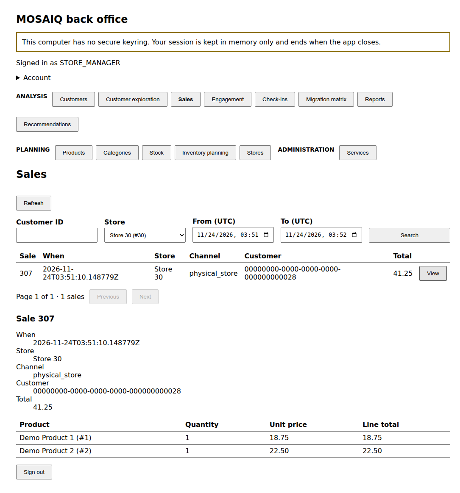
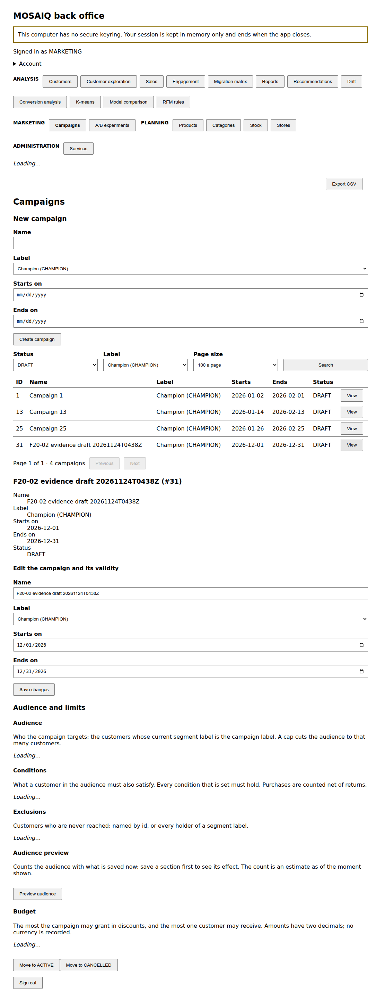
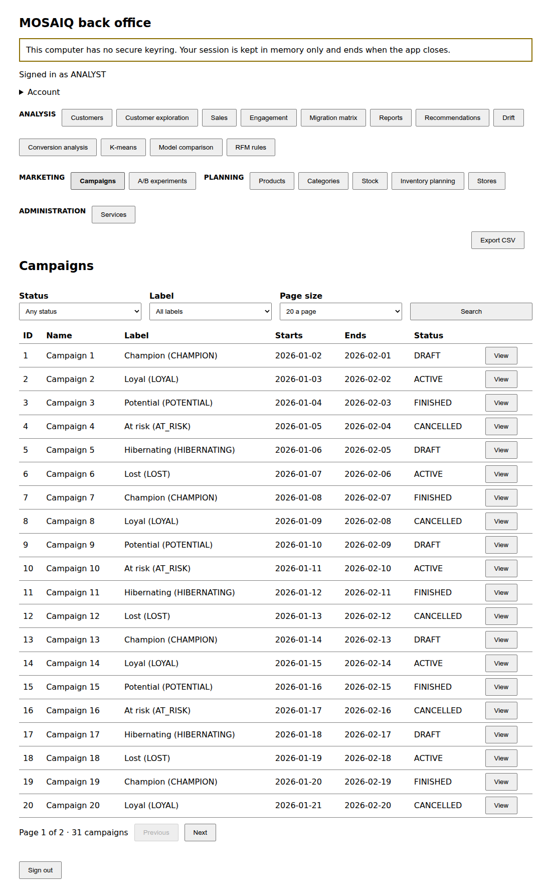
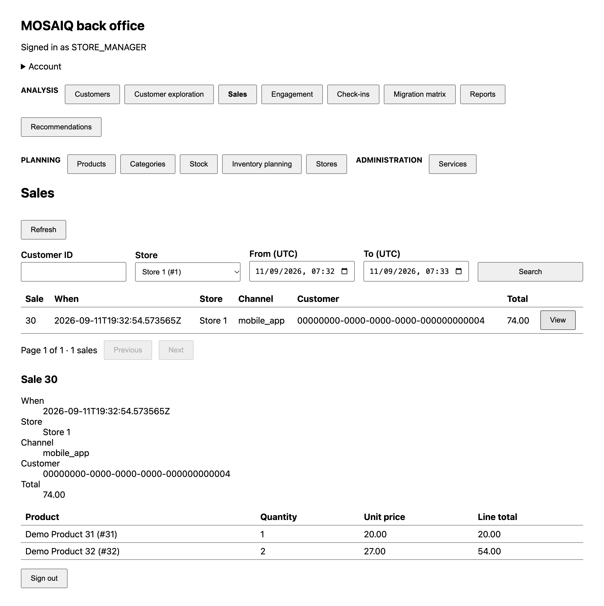
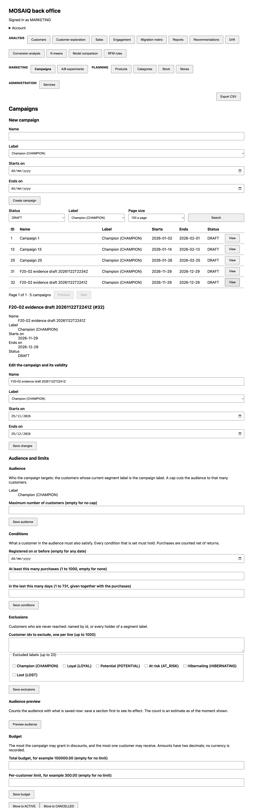
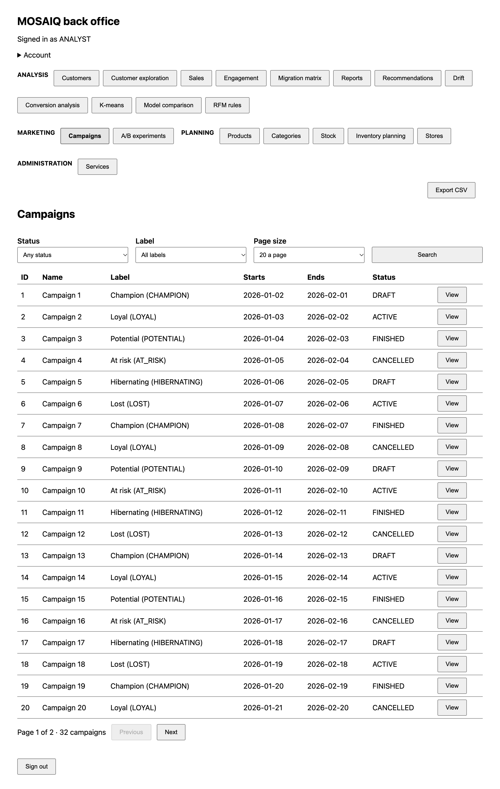

# F20-02 (#760): Electron reads F20-01's sale and writes a draft campaign through the gateway, in XML

> **Status: not yet run on the instance.** This document is the runbook and the
> template. It is blocked by
> [#759](https://github.com/Equipo-03-Proyecto10/retail-segmentation/issues/759)
> (F20-01, the real Android sale whose `sale_id` it reads), and it needs the
> team's approval first, because step 1 creates two accounts on the instance
> and step 3 writes a `campaign` row there. Every `‹fill: …›` below is filled
> during the live run. The only results recorded so far are the
> [local dry run](#local-dry-run-not-the-acceptance), which is **not the
> acceptance**.

Governing decisions:
[ADR-0035](../adr/0035-each-service-publishes-its-own-versioned-contract-and-no-two-services-share-a-resource.md),
[ADR-0041](../adr/0041-android-and-electron-clients-run-different-processes-over-different-formats.md),
[ADR-0008](../adr/0008-the-instance-keeps-the-demonstration-accounts-deactivated.md).

## The criteria, and where each is answered

| Criterion of #760 | Answered by | Section |
|---|---|---|
| 1. With `settings.json` pointing at the instance and a staff account, Electron reads F20-01's sale with `GET /v1/sales/{sale_id}`: the request, the XML response and its validation against `contracts/sales/sales.xsd` | The desktop client's own read (`npm run evidence:f20-02`), its exchange with `X-Correlation-ID`, the exact bytes it received validated again by `xmllint` (`tests/acceptance/f20_02.py`), the `transaction` row, and the Sales screen | [3](#3-the-three-calls-from-the-desktop-client), [4](#4-the-checks-xmllint-and-the-rows), [5](#5-the-screens) |
| 2. A `MARKETING` account creates a draft campaign in XML: the request, the response and the `campaign` row read with a parameterized query | The same run's `POST /v1/campaigns` (request and 201, both validated against `campaigns.xsd`), the `campaign` row read with a bind parameter, and the Campaigns screen showing the draft | [3](#3-the-three-calls-from-the-desktop-client), [4](#4-the-checks-xmllint-and-the-rows), [5](#5-the-screens) |
| 3. A role outside the operation's `x-mosaiq-roles` tries the same write: the 403 `common:Error` validates against `common.xsd`, and the screen shows it | The same run's forbidden write, the 403 validated against `contracts/common/v1/common.xsd`, and the Campaigns screen for that role. **See [the deviation](#the-deviation-in-criterion-3)**: the screen draws no create control for that role, so it shows the refusal by omission | [3](#3-the-three-calls-from-the-desktop-client), [4](#4-the-checks-xmllint-and-the-rows), [5](#5-the-screens) |
| The evidence names the version and commit | `summary.md` "Versions", the desktop run's version and commit, and the release of each service from [F20-01 step 7](f20-01-android-sale.md#7-read-the-versions-on-the-instance) | [The record](#the-record) |

### The deviation in criterion 3

The back office draws a write control only when the signed-in role may call
that operation, per the bundled `x-mosaiq-roles`
([`clients/desktop/README.md`](../../clients/desktop/README.md), "Products and
categories"; `src/renderer/campaigns.ts`). For `POST /v1/campaigns` those roles
are `ADMIN` and `MARKETING`, so an `ANALYST` sees the Campaigns list with no
**New campaign** form. A person using the window cannot attempt the write, and
the 403 envelope never reaches the screen by that route.

Agreed with Raquel (Proxy PO) on 2026-11-22, option A, for Marcelo (the issue's
author) to accept or refuse:

- the write is made by the same main-process method the form's submit calls,
  `Campaigns.createCampaign`, with the same body as the `MARKETING` step, both
  from `npm run evidence:f20-02` and through the window's own bridge
  (`window.mosaiq.createCampaign`, step 5);
- the 403 `common:Error` the service returns is validated against
  `common.xsd` by `xmllint`, and the error the client hands the screen is that
  envelope's code and correlation id;
- the screenshot shows the Campaigns screen for that role, with no create
  control.

Nothing in the app was changed for this. Changing the app so a forbidden write
can be attempted from the window would be product work with its own issue.

Acceptance: ‹fill: Marcelo's answer, and where (issue comment link)›.

## Who does what

| Step | Who | Where |
|---|---|---|
| 0. Preconditions, the version | Acceptance lead (Raquel) | workstation, GitHub |
| 1. The accounts | Instance operator (an administrator), as F20-01 step 1 | workstation |
| 2. `settings.json` | Desktop tester (Raquel) | workstation |
| 3. The three calls from the desktop client | Desktop tester | workstation, `clients/desktop` at the identified commit |
| 4. The checks: `xmllint` and the rows | Desktop tester, with the instance operator for the database | workstation, reading the database over SSH |
| 5. The screens | Desktop tester | workstation, the desktop app |
| 6. Afterwards | Instance operator | workstation |

No step changes code, and nothing in `clients/android/` is touched.

## 0. Before the run

Each of these must hold, and the record says when it was checked.

1. **#759 is done**: F20-01's sale exists on the instance, and its record gives
   the `sale_id`, the store, the store manager's email and the 201's
   `X-Correlation-ID`.
2. **The identified version**: one commit of `develop` (or a tag) that the
   instance runs, the same one as F20-01's run, and a checkout of it on the
   workstation (`git switch --detach <commit>`).
3. **The edge answers**: `bash deploy/check-api-edge.sh` prints nothing.
4. **The workstation's tools**: Node 22.12 or later (`node --version`),
   `cd clients/desktop && npm ci`, `xmllint --version`, and the repository's
   virtualenv with PyYAML (`pip install -r web/requirements-dev.txt`).
5. **Database access over SSH**: the instance operator's `ssh <host> sudo -n
   -u postgres psql --version` works from this workstation.

## The procedure

### 1. The accounts

The instance keeps the seeded demonstration accounts deactivated (ADR-0008),
so the run uses accounts created through users-service, exactly as
[F20-01 step 1](f20-01-android-sale.md#1-create-the-account) creates its store
manager (the administrator signs in, `POST /api/users/v1/users`, passwords
generated with `openssl rand` and kept only in the team's password manager):

| Step | Account | Role | Why this role |
|---|---|---|---|
| staff | F20-01's store manager, reused if it is still active | `STORE_MANAGER` | In `getSale`'s `x-mosaiq-roles`, and assigned to the sale's store (F19-07) |
| marketing | new, `name` "F20-02 Marketing" | `MARKETING` | In `createCampaign`'s `x-mosaiq-roles` (`ADMIN`, `MARKETING`) |
| forbidden | new, `name` "F20-02 Analyst" | `ANALYST` | Outside `createCampaign`'s roles, but it may read campaigns, so its Campaigns screen opens |

Record each `user_id` and the 201's `X-Correlation-ID`; never a password.

### 2. `settings.json`

Point the desktop app at the instance. The configuration directory is
`~/Library/Application Support/mosaiq-desktop/` on macOS,
`~/.config/mosaiq-desktop/` on Linux and `%APPDATA%\mosaiq-desktop\` on
Windows; `MOSAIQ_DESKTOP_CONFIG_DIR` overrides it
([`clients/desktop/README.md`](../../clients/desktop/README.md), "Against the
instance"). The release build reads the same folder: Electron names `userData`
after `package.json`, which has no `productName`, so the bundle name
`MOSAIQ Back Office` in `electron-builder.yml` does not change it (checked on a
`--mac dir` build, 2026-11-23). The script and the hand-driven app in step 5
therefore read one `settings.json`:

```json
{ "baseUrl": "https://mosaiq.maxthecoder.online" }
```

Every call then goes to `https://mosaiq.maxthecoder.online/api/<service>/v1/…`.

### 3. The three calls from the desktop client

From `clients/desktop` at the identified commit (`RUN` is an absolute path, so step 4 and step 5 can use it from the repository root and from here). The accounts are read at a
prompt (the password is not echoed) unless the variables are set; a password is
never an argument and is never written:

```sh
cd clients/desktop
RUN=$(git rev-parse --show-toplevel)/docs/evidence/f20-02/$(date -u +%Y%m%dT%H%MZ)
printf 'Staff email: '; read -r MOSAIQ_F20_02_STAFF_EMAIL
printf 'Staff password: '; read -rs MOSAIQ_F20_02_STAFF_PASSWORD; echo
printf 'Marketing email: '; read -r MOSAIQ_F20_02_MARKETING_EMAIL
printf 'Marketing password: '; read -rs MOSAIQ_F20_02_MARKETING_PASSWORD; echo
printf 'Analyst email: '; read -r MOSAIQ_F20_02_FORBIDDEN_EMAIL
printf 'Analyst password: '; read -rs MOSAIQ_F20_02_FORBIDDEN_PASSWORD; echo
export MOSAIQ_F20_02_STAFF_EMAIL MOSAIQ_F20_02_STAFF_PASSWORD \
  MOSAIQ_F20_02_MARKETING_EMAIL MOSAIQ_F20_02_MARKETING_PASSWORD \
  MOSAIQ_F20_02_FORBIDDEN_EMAIL MOSAIQ_F20_02_FORBIDDEN_PASSWORD

npm run evidence:f20-02 -- --out "$RUN/electron" --sale-id <F20-01's sale_id>
```

[`scripts/f20-02-evidence.ts`](../../clients/desktop/scripts/f20-02-evidence.ts)
reads the base URL from `settings.json` as the app does, and makes each call
with the main-process code the window uses: `Transport` (XML only, the request
and the response each validated against the bundled XSD before anything is
used), `Backoffice` (sign-in, sealed tokens, sign-out), `Floor.getSale` and
`Campaigns.createCampaign`. Only the token vault (the app's `memory_only` mode)
and a recording `fetch` are its own. For each account it signs in, makes one
call and signs out:

1. **staff**: `GET /api/sales/v1/sales/{sale_id}` (and the product, store and
   channel names the Sales screen reads with it);
2. **marketing**: `POST /api/campaigns/v1/campaigns` with a draft named
   `F20-02 evidence draft <UTC minute>`, label `CHAMPION`, starting in 7 days
   and ending in 37 (`--name`, `--label`, `--starts-on`, `--ends-on` change
   them);
3. **forbidden**: the same `POST` with the same body.

It prints one line per step (role, status, error code, `X-Correlation-ID`) and
exits 0 only when the read answers 200, the draft 201 in `DRAFT`, the analyst's
role is outside the operation's roles and its write answers 403
`forbidden_role`. It writes:

- `result.json`: each step's account, role, status, correlation id, and the
  sale, campaign or error as the client parsed it; the desktop version and
  commit;
- `exchanges.md` and `exchanges.json`: every request and response, with its
  `X-Correlation-ID`, passwords, tokens and refresh tokens replaced by
  `<masked #n>`. It refuses to write anything if a token or one of the
  passwords survived;
- `bodies/`: the exact bytes of every request and response body except the
  sign-in and refresh, for step 4's `xmllint`.

Write down the campaign id it printed in `result.json`.

### 4. The checks: `xmllint` and the rows

From the repository root, reading the database over SSH, read only:

```sh
. .venv/bin/activate
export MOSAIQ_BASE_URL=https://mosaiq.maxthecoder.online
export MOSAIQ_DB_EXEC="ssh <host> sudo -n -u postgres"
python -m tests.acceptance.f20_02 --electron "$RUN/electron" --out "$RUN/checked"
```

[`tests/acceptance/f20_02.py`](../../tests/acceptance/f20_02.py) trusts none of
the client's conclusions. It needs no account (its only requests are the
unauthenticated `GET /api/<name>/openapi.yaml` for the versions) and it writes
`summary.md` (each check, expected and actual, linked), `exchanges.md` (the
client's exchanges, numbered as in step 3, then its own) and `rows.md`:

- **Criterion 1**: the staff role is in `getSale`'s `x-mosaiq-roles`; the read
  answered 200 `application/xml`; `xmllint --schema contracts/sales/sales.xsd`
  on the bytes received; the `transaction` row for the `sale_id`
  (`WHERE transaction_id = $1`), whose total is the XML's.
- **Criterion 2**: `MARKETING` is in `createCampaign`'s roles; 201; the request
  and the response each valid against `contracts/campaigns/campaigns.xsd`; the
  response is the draft that was sent, in `DRAFT`; the `campaign` row
  (`WHERE campaign_id = $1`) is the response's.
- **Criterion 3**: the analyst's role is outside the roles; the window would
  draw no create control (the role's operations); the body is the `MARKETING`
  step's; 403; the envelope valid against `contracts/common/v1/common.xsd`,
  with code `forbidden_role` and the request's own correlation id; the error
  handed to the screen is that envelope; and only one campaign has the draft's
  name, so the refusal wrote nothing.

Every query is a bind parameter (`\bind`) in a `BEGIN READ ONLY` transaction
([`tests/acceptance/evidence.py`](../../tests/acceptance/evidence.py),
`Database`). It exits 0 only when every check holds.

### 5. The screens

**What the instructor sees** is the desktop release build, by hand, with the
step 2 `settings.json`:

1. Sign in as the staff account. **Sales**: choose the sale's store, set From
   and To (UTC) around its time, **Search**, then **View** on the sale.
   Capture `f20-02-desktop-01-sale.png`: the same `sale_id`, lines and total as
   F20-01's 201. Sign out.
2. Sign in as the `MARKETING` account. **Campaigns**: Status `DRAFT`, the
   draft's label, the largest page size, **Search**, then **Next** until step
   3's campaign is listed, and **View** on it. Capture `f20-02-desktop-02-draft-campaign.png`. Sign out.
3. Sign in as the analyst. **Campaigns**. Capture
   `f20-02-desktop-03-no-create-control.png`: the list, and no **New campaign**
   form. Sign out.

**The same, reproducibly**, with the checkout's build and the same variables
as step 3 (on Linux prefix `xvfb-run -a`):

```sh
cd clients/desktop && npm run build
MOSAIQ_F20_02_ELECTRON_DIR="$RUN/electron" MOSAIQ_EVIDENCE_DIR="$RUN/screens" \
  npx playwright test tests/window/f20-02-live.spec.ts
```

[`tests/window/f20-02-live.spec.ts`](../../clients/desktop/tests/window/f20-02-live.spec.ts)
(skipped unless `MOSAIQ_F20_02_ELECTRON_DIR` is set) does the three screens
above, full page, and creates nothing. On the third it also sends the draft
through the window's own bridge, `window.mosaiq.createCampaign`, the call the
form's submit makes, and writes its answer to `window-forced-write.json`: the
`forbidden_role` envelope with its correlation id.

### 6. Afterwards

- Deactivate the two step 1 accounts through
  `POST /api/users/v1/users/{user_id}/deactivation` (RN-04), unless another
  acceptance test still needs them. F20-01's store manager follows F20-01's
  own step 8.
- The draft stays in `DRAFT`. Moving it to `CANCELLED`
  (`POST /api/campaigns/v1/campaigns/{id}/transitions`) is the operator's
  choice and is recorded if done; nothing deletes a campaign.
- Commit `$RUN/checked/summary.md`, `exchanges.md` and `rows.md`,
  `$RUN/electron/result.json`, and the screenshots, with the filled record.
  `bodies/`, `exchanges.json` and `record.json` stay with the run outside the
  repository.
- `unset` the six `MOSAIQ_F20_02_*` variables.

---

## The record

*Everything below is filled during the live run.*

### Where it ran

| Piece | Value |
|---|---|
| Identified version | ‹fill: commit or tag› of `develop`, the same as F20-01's run ‹fill: link› |
| Date and time (UTC) | ‹fill: start – end› |
| Instance | `https://mosaiq.maxthecoder.online/`, web commit ‹fill› |
| Desktop | ‹fill: `desktop version` and `desktop checkout commit` from `summary.md`›; release build for the screens ‹fill: version› |
| `settings.json` | `{ "baseUrl": "https://mosaiq.maxthecoder.online" }` in ‹fill: directory› |
| Accounts | staff ‹fill: email›, `STORE_MANAGER`, store ‹fill›; marketing ‹fill: email›, user ‹fill: id›; analyst ‹fill: email›, user ‹fill: id› |
| Who ran each step | ‹fill: step → name› |
| Approval | ‹fill: who approved the live run, and where› |

### Versions

‹fill: the "Versions" table of `f20-02/<run>/checked/summary.md`, and the
release of each service from F20-01 step 7.›

| Service | Release (`current`) | Contract (`info.version`) |
|---|---|---|
| auth | ‹fill› | ‹fill› |
| users | ‹fill› | ‹fill› |
| sales | ‹fill› | ‹fill› |
| campaigns | ‹fill› | ‹fill› |

### Criterion 1: Electron reads F20-01's sale in XML



*‹fill: caption — sale, store, lines and total as the screen shows them›*

| What | Value | Evidence |
|---|---|---|
| F20-01's sale | `sale_id` ‹fill›, its 201's `X-Correlation-ID` ‹fill› | [F20-01](f20-01-android-sale.md#4-the-sale-over-https) |
| `GET /api/sales/v1/sales/‹fill›` | ‹fill: 200 `application/xml`›, `X-Correlation-ID` ‹fill› | ‹fill: `checked/exchanges.md#exchange-n`› |
| `xmllint` against `contracts/sales/sales.xsd` | ‹fill: "validates"› | ‹fill: `checked/summary.md`› |
| `transaction` row, total equals the XML's | ‹fill› | ‹fill: `checked/rows.md#rows-1`› |

### Criterion 2: a draft campaign in XML



*‹fill: caption›*

| What | Value | Evidence |
|---|---|---|
| `POST /api/campaigns/v1/campaigns` | ‹fill: 201›, campaign ‹fill›, `X-Correlation-ID` ‹fill› | ‹fill: exchange link› |
| `xmllint`: request and response against `campaigns.xsd` | ‹fill› | ‹fill› |
| `campaign` row | ‹fill: id, name, label, dates, `DRAFT`› | ‹fill: `checked/rows.md#rows-2`› |

### Criterion 3: a role outside `x-mosaiq-roles`



*‹fill: caption›*

| What | Value | Evidence |
|---|---|---|
| The account's role, and `createCampaign`'s roles | ‹fill: `ANALYST`›; `ADMIN`, `MARKETING` | `contracts/campaigns/openapi.yaml` |
| `POST /api/campaigns/v1/campaigns`, same body | ‹fill: 403›, `X-Correlation-ID` ‹fill› | ‹fill: exchange link› |
| `xmllint` against `contracts/common/v1/common.xsd` | ‹fill› | ‹fill› |
| The envelope: code and correlation id | ‹fill: `forbidden_role`, the request's id› | same |
| Through the window's bridge | ‹fill: `window-forced-write.json`, code and correlation id› | ‹fill› |
| Nothing was written | ‹fill: no campaign of the draft's name after step 3's `campaign_id`› | ‹fill: `checked/rows.md#rows-3`› |
| The deviation accepted | ‹fill: by Marcelo, link› | [above](#the-deviation-in-criterion-3) |

Checks: ‹fill: "N checks, N held" from `checked/summary.md`, linked›.

### Found on the way

‹fill, or "Nothing."›

### What was not done

‹fill›

---

## Local dry run (not the acceptance)

> **Local dry run, not the acceptance.** It ran on a throwaway local stack, not
> on the instance and not on an identified version. A seeded sale stood in for
> F20-01's, and the seed's demonstration accounts stood in for step 1's. It
> shows that the scripts work end to end and what they record.

### Where it ran

| Piece | Here |
|---|---|
| Date (UTC) | 2026-11-22, 22:41:03 – 22:41:30 (the three steps, then the screens, then the checks) |
| Tree | `develop` at `cc322d7d` plus this pull request's scripts, committed as `5cbbd2fe` before the run (`checkout describe` reads `kit-py/v0.1.8-601-g5cbbd2fe`, not dirty) |
| Stack | `compose.distributed.yaml` on an Apple Silicon Mac: db, both Redis, MongoDB, the gateway, and the nine services the run reaches (auth, users, stores, products, stock, customers, sales, campaigns, segments), built from that tree |
| Isolation | As F29-03's dry run: project `p760` from `docker compose -p p760 config`, the network `mosaiq` renamed `p760-mosaiq`, the volumes `mosaiq-pgsocket` and `mosaiq-redis-acl` renamed `p760-*`, the image tag `p760`, every service port dropped but the gateway's, on `127.0.0.1:18760`. Brought down with `down -v` afterwards |
| `settings.json` | `{ "baseUrl": "http://127.0.0.1:18760" }` in a scratch `MOSAIQ_DESKTOP_CONFIG_DIR` |
| Accounts | the seed's demonstration accounts (root README), on that throwaway database only: `user3@` (`STORE_MANAGER`, stores 1, 9, 17, 25), `user4@` (`MARKETING`), `user2@` (`ANALYST`) |
| Sale | seeded transaction 30: store 1, customer `…0004`, channel `mobile_app`, 74.00, two lines |
| Node | 26.13 (Homebrew, arm64) |

### Results

```sh
cd clients/desktop
npm run evidence:f20-02 -- --out "$RUN/electron" --sale-id 30         # exit 0
npm run build && MOSAIQ_F20_02_ELECTRON_DIR="$RUN/electron" \
  MOSAIQ_EVIDENCE_DIR="$RUN/screens" npx playwright test tests/window/f20-02-live.spec.ts   # 3 passed
cd ../.. && MOSAIQ_BASE_URL=http://127.0.0.1:18760 \
  MOSAIQ_DB_EXEC="docker exec -i -e PGUSER=postgres p760-db-1" \
  python -m tests.acceptance.f20_02 --electron "$RUN/electron" --out "$RUN/checked"   # exit 0
```

**19 checks, 19 held**
([`summary.md`](f20-02/local-dry-run/summary.md),
[`exchanges.md`](f20-02/local-dry-run/exchanges.md),
[`rows.md`](f20-02/local-dry-run/rows.md),
the client's [`result.json`](f20-02/local-dry-run/electron-result.json)).

| Criterion | What held |
|---|---|
| 1. The sale in XML | `user3@` (`STORE_MANAGER`, in `getSale`'s roles) read `GET /api/sales/v1/sales/30`: 200 `application/xml`, `X-Correlation-ID 92cdcdc1-e61a-46d2-b746-9e06b7ea4883` ([exchange 3](f20-02/local-dry-run/exchanges.md#exchange-3)). The client accepted it after its own validation, and `xmllint` validated the same bytes against `contracts/sales/sales.xsd`. Its `sale_id` and total, 74.00, are the `transaction` row's ([rows 1](f20-02/local-dry-run/rows.md#rows-1)) |
| 2. The draft in XML | `user4@` (`MARKETING`) sent `CreateCampaignRequest` "F20-02 evidence draft 20261122T2241Z", `CHAMPION`, 2026-11-29 to 2026-12-29: 201, `Location: /v1/campaigns/32`, `X-Correlation-ID ecb9a505-55b5-43f2-b68e-f02f59c29edd` ([exchange 10](f20-02/local-dry-run/exchanges.md#exchange-10)). Request and response valid against `campaigns.xsd`; the response and the `campaign` row ([rows 2](f20-02/local-dry-run/rows.md#rows-2)) are the draft sent, in `DRAFT` |
| 3. The forbidden write | `user2@` (`ANALYST`, outside `ADMIN`, `MARKETING`) sent the identical body: 403, `X-Correlation-ID 0cad30e7-0c5d-498e-9594-4c54caf240f2` ([exchange 14](f20-02/local-dry-run/exchanges.md#exchange-14)). The `common:Error` validates against `contracts/common/v1/common.xsd`; code `forbidden_role`, correlation id the request's; one campaign has the draft's name ([rows 3](f20-02/local-dry-run/rows.md#rows-3)). Through the window's bridge the same write was refused `forbidden_role`, correlation id `1b5928c2-aaad-412a-927c-ecfb6192168f` ([`window-forced-write.json`](f20-02/local-dry-run/window-forced-write.json)) |

The screens, from `tests/window/f20-02-live.spec.ts` (the checkout's build, not
a release build):



*Local dry run. Sale 30 on the Sales screen, read in XML as `STORE_MANAGER`:
store 1, `mobile_app`, 74.00, two lines.*



*Local dry run. The Campaigns screen as `MARKETING`, filtered to `DRAFT` and
`CHAMPION`, with campaign 32 open in `DRAFT`. Campaign 31 above it is from an
earlier trial run of the same scripts on the same throwaway database.*



*Local dry run. The Campaigns screen as `ANALYST`: the list, and no
**New campaign** form (compare the `MARKETING` screen above).*

No file the scripts wrote held the demonstration password or anything shaped
like a token; the scratch path of `settings.json` is shown as `<scratch>`.

### Not run here

- Anything on the instance, and F20-01's real sale (#759 is open).
- The desktop release build: the screens came from the checkout's build.
- Step 1's account creation and step 6's deactivation: the seed's accounts were
  used.
