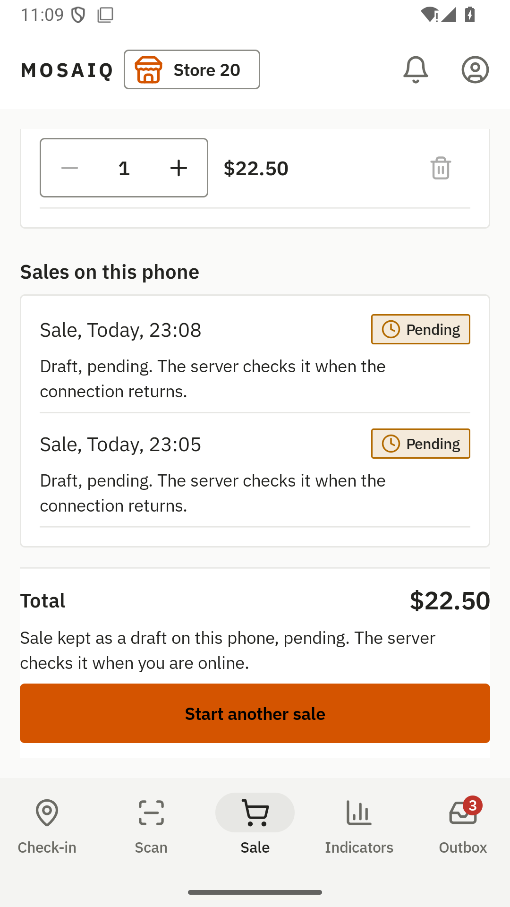
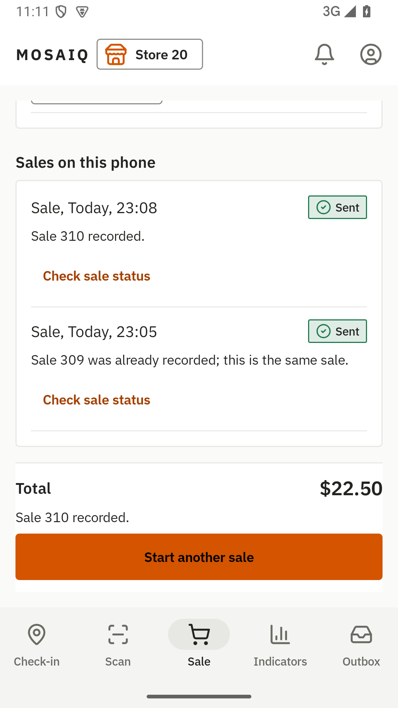

# F29-06 (#891): the acceptance tests of privacy, revocation and disconnection

> **Status: "Privacidad" and "Sesión revocada" ran on the instance on
> 2026-11-24 (04:00 UTC) and held; "Desconexión" is pending.** This document is
> the runbook and the record of three of the instructor's sixteen acceptance
> tests (AC-12 "Privacidad", AC-13 "Sesión revocada", AC-14 "Desconexión";
> [`scope-delivery-3.md`](../scope-delivery-3.md) §10 and §11). Nothing blocks
> them any more: #757, #792, #795 and
> [#867](https://github.com/Equipo-03-Proyecto10/retail-segmentation/issues/867)
> (F27-13, offline drafts with a pending state, merged in #1141 on 2026-11-21)
> are closed. The two server-side parts are recorded below with their evidence
> under [`f29-06/20261124T0359Z/`](f29-06/20261124T0359Z/). "Desconexión" needs the
> Android emulator and a person at the phone: its rows are still `‹fill: …›`.
> The [local dry run](#local-dry-run-not-the-acceptance) is **not the
> acceptance**.

Governing decisions:
[ADR-0036](../adr/0036-auth-service-issues-role-only-rs256-tokens-whose-sessions-live-in-redis.md),
[ADR-0037](../adr/0037-two-redis-instances-carry-sessions-caches-limits-and-inter-service-streams.md),
[ADR-0041](../adr/0041-android-and-electron-clients-run-different-processes-over-different-formats.md),
[ADR-0060](../adr/0060-four-store-profiles-map-to-four-roles-and-services-read-each-users-stores-per-request.md).

## The criteria, and where each is answered

| Criterion of #891 | Answered by | Section |
|---|---|---|
| "Privacidad": each role that asks for profiles or data it may not read is refused, on every path, and F18-04's suite covers each | `f29_06 privacy`: F18-04's [`test_privacy.py`](../../tests/negative/test_privacy.py) (every role outside every operation of the eleven services that hold customer data, in JSON and in XML), `test_roles.py` (every service) and `test_store_scope.py` (another store's rows, F19-07); and the web's route matrix, [`tests/test_authz.py`](../../tests/test_authz.py) | [1](#1-privacidad) |
| "Sesión revocada": after sign-out, every service refuses authenticated calls | `f29_06 revocation`: F18-04's `test_revocation.py` (one session, accepted by every service, then 401 `session_revoked` from every one) and `test_auth.py`'s sign-out and refresh-reuse cases | [2](#2-sesión-revocada) |
| "Desconexión": when pending operations recover, no sale is duplicated | The floor tester's offline sales (#867), one with its response dropped on purpose, then `f29_06 disconnection`: as many sales as were confirmed, no request recorded twice, each `Idempotency-Key` once | [3](#3-desconexión) |

### Which F18-04 case covers which customer data

`test_privacy.py` calls each protected operation of these services with every
role its `x-mosaiq-roles` leaves out, and each GET that answers XML again in
XML. Each must be 403 `forbidden_role`. The role is checked before any row is
read (`mosaiq_kit`), so a refusal reads no data.

| Service | Customer data it holds or answers | Also covered by |
|---|---|---|
| customers | identity, contact, loyalty cards, anonymization | `test_revocation.py` (no statement for a revoked token, local) |
| customer-preferences | channels, interests, consent and restrictions | — |
| sales | each customer's purchases | `test_store_scope.py` (another store's sales) |
| segments | current segment and migrations | — |
| rfm-engine | R, F and M per customer | — |
| recommendations | recommendations and their explanations | — |
| engagement | field events and capture incidents | `test_store_scope.py` |
| check-ins | customer visits | `test_store_scope.py` |
| experimentation | assignments, exposures and attributions | — |
| audit-trail | the trail of changes to customer rows | — |
| analytics-kpis | KPIs computed from them | — |

The web system reads PostgreSQL directly, so its path is its own: every route
declares the permission it needs and the gate refuses every other role before
the view runs (F4-01, `web/middleware/authz.py`). `tests/test_authz.py` walks
every route and role at the identified commit.

## Who does what

| Step | Who | Where |
|---|---|---|
| 0. Preconditions, the version | Acceptance lead (Raquel) | workstation, GitHub |
| 1. Privacidad | Instance operator (root), with the acceptance lead | the instance |
| 2. Sesión revocada | Instance operator (root), with the acceptance lead | the instance |
| 3.1–3.3 Desconexión, the phone | Floor tester (the Android owner), **by hand** with the release build | emulator behind mitmproxy |
| 3.4 Desconexión, the rows | Acceptance lead, with the instance operator | the instance |

No step changes code; nothing in `clients/android/` is edited for this run.

## 0. Before the run

1. **The Android release build contains #867.** #867 was merged through #1141
   (`d107b4b7`). Build the release APK from the identified commit, which is
   later, and record that commit with the APK's SHA-256. `versionName` is still
   `0.1.0` and does not tell one build from another. Steps 1 and 2 do not need
   the phone.
2. **The identified version**: the same commit as F29-03
   ([f29-03-transaction-path.md](f29-03-transaction-path.md) step 0), deployed
   for every service, with the F20-03 runner passed on it.
3. **The tree on the instance** at that commit, readable by `postgres`, with a
   virtualenv holding `pytest` and PyYAML (as for F18-04,
   [tests/negative/README.md](../../tests/negative/README.md) "The instance").
4. **No redis-state restart** in the hour before steps 1 and 2: the Rust
   services refuse their first request after one with 503 (tests/negative
   README, "Order").

## The procedure

On the instance, as root, from the tree of item 0.3. The administrator's
credential goes only into this shell's environment, read at a prompt; the
suite creates one account per other role through users-service and
deactivates every one of them at the end, including after a failure.

```sh
cd <the tree> && . .venv/bin/activate
read -r MOSAIQ_NEGATIVE_ADMIN_EMAIL
read -rs MOSAIQ_NEGATIVE_ADMIN_PASSWORD
export MOSAIQ_NEGATIVE_ADMIN_EMAIL MOSAIQ_NEGATIVE_ADMIN_PASSWORD
export MOSAIQ_BASE_URL=https://127.0.0.1 MOSAIQ_HOST=mosaiq.maxthecoder.online \
  MOSAIQ_INSECURE_TLS=1 MOSAIQ_DB_EXEC="runuser -u postgres --"
RUN=docs/evidence/f29-06/$(date -u +%Y%m%dT%H%MZ)
```

Sign-ins are paced at 10.5 s on the instance (`tests/negative/stack.py`), so
each step takes a few minutes.

### 1. "Privacidad"

```sh
python -m tests.acceptance.f29_06 privacy --out "$RUN/privacy"
```

It records the served contract versions, then runs `test_privacy.py`,
`test_roles.py` and `test_store_scope.py` with their F18-04 evidence written to
`$RUN/privacy/negative-evidence.md`, the JUnit file and the log beside it. Its
`summary.md` holds when pytest exits 0 and every F18-04 case of the run held.
The store-scope reads by id of another store's rows run locally only
(`test_store_scope.py`); the record lists them as not run.

The web's path, on a workstation at the same commit:

```sh
git checkout <identified commit>
pytest -q tests/test_authz.py tests/test_analytics_authz.py | tee "$RUN/privacy/web-authz.log"
```

### 2. "Sesión revocada"

```sh
python -m tests.acceptance.f29_06 revocation --out "$RUN/revocation"
```

One administrator session is accepted by every service's probe, signed out,
and refused by every one with 401 `session_revoked`; a signed-out access token
and a reused refresh token are refused by auth (`test_auth.py`). The customers
case that shows a revoked token reads no database changes PostgreSQL's
logging, so it runs locally only; the record lists it as not run.

### 3. "Desconexión"

The floor tester, with the release build that contains #867, behind mitmproxy
as in [F20-01 step 3](f20-01-android-sale.md#3-prepare-the-device-and-the-capture),
signed in as a `STORE_MANAGER` or `SALES_ASSOCIATE` account assigned to the
store (F29-03 step 1 creates one). Write down the UTC time before 3.1 and after
3.3: they bound the window of 3.4.

1. **Offline.** Turn the emulator's network off (airplane mode). Record two
   sales. After each **Confirm** the snackbar reads "Sale kept as a draft on
   this phone, pending. The server checks it when you are online." In the sale
   history, each row has the badge **Pending** and reads "Draft, pending. The
   server checks it when the connection returns." The Outbox screen reads
   "2 writes waiting to send". Nothing reaches mitmproxy. Screenshot:
   `f29-06-offline-pending.png` (the history with both rows).
2. **A lost response.** In the mitmproxy console, set the intercept filter to
   `~u /api/sales/v1/sales & ~s` (sales responses only). Turn the network on.
   The app sends the pending sales by itself, one at a time, as soon as it has
   a network: no tap is needed. mitmproxy holds the first 201 before it reaches
   the phone. Kill that flow (`x`): the server has recorded the sale, and the
   phone has lost the answer. Clear the intercept filter.

   The phone does not show an error for this. Its outbox treats a lost
   connection as "send again later" (`OutboxWorker`, `Attempt.Retry`), so both
   sales stay **Pending**. The app sends again on its own after its backoff,
   10 s and then doubling. To avoid waiting, tap **Send now** on the Outbox
   screen. The resend is the same outbox row, so it carries the same
   `Idempotency-Key`. sales-service answers 200 with `Idempotent-Replayed: true`
   and the original sale. On the phone, that sale's receipt, opened from the
   history, reads
   "Sale ‹id› was already recorded; this is the same sale." Screenshot:
   `f29-06-replayed.png`. Then the second sale is sent and answered 201.
3. **Recovered.** The Outbox screen reads "Everything is synced", and both sales
   show in the history as recorded, each once, with the badge **Sent**.
   Screenshot: `f29-06-recovered.png`. Stop mitmdump and render the exchanges
   with every token masked:

   ```sh
   python clients/android/evidence/sale_evidence.py har ~/f20-01/capture.har \
     --path /api/sales/v1/sales > f29-06-android-exchanges.md
   ```

   From it, note each sale's `Idempotency-Key`. The killed flow and its resend
   carry the same key. The exchanges hold three requests for two sales: two
   answered 201 and one answered 200 with `Idempotent-Replayed: true`.
4. **The rows**, on the instance:

   ```sh
   python -m tests.acceptance.f29_06 disconnection --out "$RUN/disconnection" \
     --account <the floor account's email> \
     --since <UTC before 3.1, as 2026-12-01T15:00:00Z> \
     --until <UTC after 3.3> --expect 2 \
     --key <key of sale 1> --key <key of sale 2>
   ```

   Read-only. It lists the account's sales in the window and holds when there
   are exactly as many as the tester confirmed, no request body (its SHA-256 in
   `sales.sale_capture`) and no sale content (customer, store, time, total) is
   recorded twice, and each key names exactly one `transaction`.

### Afterwards

Commit `summary.md`, `negative-evidence.md`, `junit.xml`, `pytest.log`,
`exchanges.md` and `rows.md` of each `$RUN/*` with the filled record, and the
screenshots. `record.json` stays outside the repository. Delete the HAR.

---

## The record

*"Privacidad" and "Sesión revocada" are filled from the live run of
2026-11-24; "Desconexión" is filled during its own run.*

### Where it ran

| Piece | Value |
|---|---|
| Identified version | Release #1188: `main` at `50bf7d5c` (its tree is identical to `develop` at `fdf0caed`), every service at its `services/<name>/VERSION` of that tree, as the "Versions" table shows. F20-03 report: not checked by this run |
| Date and time (UTC) | 2026-11-24 03:59:30 – 04:04:45: "Privacidad" 03:59:30 – 04:01:43, "Sesión revocada" 04:02:27 – 04:04:45. Desconexión: pending |
| Instance | `https://mosaiq.maxthecoder.online/`, reached from the instance itself on `https://127.0.0.1` under the published host name; web commit `50bf7d5c48336a39f89f34f9bb8d44a78057fb06` |
| Tree used | `git archive` of the identified tree (`tests/`, `contracts/`, `pyproject.toml`, each `services/*/compose.yaml`) at `/var/tmp/mosaiq-1124-C1/tree` in a virtualenv with `pytest` 9.2.0 and PyYAML, plus one changed file, [`test_revocation.py`](../../tests/negative/test_revocation.py) (see "Found on the way"). The record's `checkout commit` therefore reads `(unavailable)`: the tree is an archive, not a checkout |
| Android build | pending (Desconexión) |
| Floor account | pending (Desconexión) |
| Who ran each step | An agent of the acceptance batch (lane C1), as the instance operator through `gcloud compute ssh`, holding the batch's instance lock |
| Approval | The run was requested by the lead of the 2026-11-23 batch (`goal1124`, brief "The instance" and its 22:00 addendum). The administrator's credential was read from the root-only file on the instance into the process environment and never printed |

### Versions

The "Versions" table of [`privacy/summary.md`](f29-06/20261124T0359Z/privacy/summary.md) (the
revocation run's table is the same): the served contracts auth 1.1.0, users
1.4.0, products 1.4.0, categories 1.2.0, stores 1.4.0, stock 1.3.0, customers
1.8.1, customer-preferences 1.1.2, sales 1.10.1, segments 1.6.2,
recommendations 2.0.4, engagement 2.5.0, check-ins 1.4.0, campaigns 1.4.2,
audit-trail 1.5.0, rfm-engine 1.2.1, model-registry 1.3.0, experimentation
1.2.1 and analytics-kpis 1.2.0; the releases auth 0.1.4, users 0.2.0, products
0.3.0, categories 0.1.9, stores 0.2.0, stock 0.3.0, customers 0.4.0,
customer-preferences 0.3.0, sales 0.7.0, segments 0.6.0, recommendations
0.5.0, engagement 0.4.0, check-ins 0.3.0, campaigns 0.4.0, audit-trail 0.1.5,
rfm-engine 0.8.0, model-registry 0.5.0, experimentation 0.8.1 and
analytics-kpis 0.4.0; web commit `50bf7d5c`.

### AC-12 "Privacidad"

`python -m tests.acceptance.f29_06 privacy`: **52 tests passed, 1 skipped,
1369 F18-04 cases, 1369 held** ([`summary.md`](f29-06/20261124T0359Z/privacy/summary.md)). The
contracts have grown since the local dry run, which asked 851 such cases.

| Part | Cases | Held | Not run here, and why | Evidence |
|---|---|---|---|---|
| Every role, every customer-data operation, JSON and XML (`test_privacy.py`) | 1154 (analytics-kpis 66, audit-trail 80, check-ins 73, customer-preferences 98, customers 128, engagement 133, experimentation 130, recommendations 40, rfm-engine 131, sales 177, segments 98) | 1154 | — | [`privacy/negative-evidence.md`](f29-06/20261124T0359Z/privacy/negative-evidence.md) |
| One role outside every operation of every service (`test_roles.py`) | 189 | 189 | — | same |
| Another store's rows (`test_store_scope.py`) | 26 | 26 | The reads and reversals by id of another store's rows: they need a sale, a reversal, an event and a check-in in another store, which persist, so they run on the local stack only (the one skipped test) | same |
| The web's routes (`tests/test_authz.py`, `test_analytics_authz.py`) | 613 | 613 | — | [`privacy/web-authz.log`](f29-06/20261124T0359Z/privacy/web-authz.log): `pytest` on a workstation at `fdf0caed`, whose tree is the identified one, 613 passed in 14.5 s |

Every refusal in the table is 403 `forbidden_role` (or `forbidden_store`) with
no data. The store-scope cases wrote nothing: they refuse before any write.

### AC-13 "Sesión revocada"

`python -m tests.acceptance.f29_06 revocation`: **3 tests passed, 1 skipped,
40 F18-04 cases, 40 held** ([`summary.md`](f29-06/20261124T0359Z/revocation/summary.md)).

| Part | Cases | Held | Not run here, and why | Evidence |
|---|---|---|---|---|
| A signed-out session on every service | 38: for each of the nineteen services, the request before the sign-out (authenticated: 15 answered 200 and four, users, engagement, check-ins and audit-trail, 403 `forbidden_role` for the run's role, never 401) and the next request after it, 401 `session_revoked` from every one | 38 | Customers' "no statement logged for a revoked token": it changes the database's logging, so it runs on the local stack only (the one skipped test) | [`revocation/negative-evidence.md`](f29-06/20261124T0359Z/revocation/negative-evidence.md) |
| Sign-out and refresh reuse at auth | 2: a rotated refresh token reused is 401 `refresh_reused`; that session's access token is then 401 `session_revoked`. A signed-out access token is 401 `session_revoked` at auth | 2 (the sign-out case asserts without a row) | — | same |

The session signed out is a fresh one of an `ANALYST` account the run created
(`f18-04-<run>-analyst@example.test`), not the administrator's and not a
seeded account's. The 401 comes before the role check on every service
(ADR-0037), so a role that one operation refuses shows the revocation as well:
a service that answered 403 before the sign-out answered 401 `session_revoked`
after it.

### AC-14 "Desconexión"





| What | Value | Evidence |
|---|---|---|
| Window | ‹fill: since – until› | |
| Sales confirmed by the tester | ‹fill: 2› | screenshots |
| The killed 201 and its resend | sale ‹fill›, key ‹fill›, resend 200 `Idempotent-Replayed: true` | ‹fill: `f29-06-android-exchanges.md`› |
| Sales the account recorded in the window | ‹fill› | ‹fill: `disconnection/rows.md`› |
| The same request twice / the same content twice | ‹fill: 0 / 0› | same |
| Each key, once | ‹fill› | same |

### Found on the way

- **The revocation case signed out the real administrator.**
  `test_a_signed_out_session_is_refused_everywhere` signed in as the
  administrator again and signed that fresh session out. The administrator is
  not an account a run creates, so the instance run asked for a role it created.
  `MOSAIQ_REVOCATION_ROLE` (default `ADMIN`, so every other run is unchanged)
  names the role, the run set `ANALYST`, and the case now records each
  service's answer before the sign-out so the 401 after it is shown to be the
  revocation. Committed as `test(negative): let the revocation case sign out a
  role the run created (#891)`; the instance tree held that one changed file.
- The two runs of the suite left 20 throwaway accounts, all deactivated
  (`is_active = false`): `f18-04-58787068e8-*@example.test` (the privacy run,
  eleven with its two spares) and `f18-04-9aac6c898d-*@example.test` (the
  revocation run, nine). The store-scope fixture also left two store
  assignments, on store 2, held by two of the deactivated accounts.
- Nothing refused a request it should have allowed, and no case failed.

### What was not done

- **"Desconexión" (AC-14)**, steps 3.1 to 3.4: it needs the Android emulator
  and the release build with #867, and stays for the acceptance of the phone.
  Its record above is unfilled on purpose.
- The reads by id of another store's rows and the customers "no statement
  logged" case: they run on the local stack only (see the tables).
- The F20-03 report was not checked: this run took the identified version
  from the release (#1188).
- `check-api-edge.sh` was not run: it trips the sign-in limit.

---

## Local dry run (not the acceptance)

> **Local dry run, not the acceptance.** It ran on a throwaway local stack, not
> on the instance and not on an identified version. It shows that the
> collectors and the new F18-04 case work, and what they report. "Desconexión"
> was not run with the phone: #867 was still open then. Only the server's half of
> it ran.

### Where it ran

| Piece | Here |
|---|---|
| Date (UTC) | 2026-11-19, 03:29 – 03:35 |
| Tree | `develop` at `46433fc7` plus this pull request's files, uncommitted at the time (`checkout describe` reads `kit-py/v0.1.8-453-g46433fc7-dirty`) |
| Stack | `compose.distributed.yaml`, all nineteen services built from that tree on an Apple Silicon Mac, readiness 204 from every one |
| Isolation | the project renamed `p888`: `docker compose -p p888 config`, then the external network `mosaiq`, the volumes `mosaiq-pgsocket` and `mosaiq-redis-acl` and the image tag `local` renamed, every service port but the gateway's dropped, the gateway on `127.0.0.1:18080`. Brought down with `down -v` afterwards; it removed only its own volumes |
| Accounts | the seed's demonstration accounts (root README), on that throwaway database only |

Settings for every step:

```sh
export MOSAIQ_BASE_URL=http://127.0.0.1:18080 \
  MOSAIQ_SIGNING_KEY=docker/distributed/keys/auth-local-dev.pem \
  MOSAIQ_DB_EXEC="docker exec -i -e PGUSER=postgres p888-db-1" \
  MOSAIQ_DB_CONTAINER=p888-db-1 MOSAIQ_CUSTOMERS_CONTAINER=p888-customers-1
```

### "Privacidad"

`python -m tests.acceptance.f29_06 privacy --out <dir>`: **51 tests passed,
1034 F18-04 cases, 1034 held.**

| Part | Cases | Held |
|---|---|---|
| `test_privacy.py`, every role outside each operation, JSON and XML | 851 | 851 |
| `test_roles.py`, the first role outside each operation, every service | 149 | 149 |
| `test_store_scope.py`, another store, JSON and XML | 34 | 34 |

`test_privacy.py`'s cases per service: sales 165, engagement 133, customers
128, customer-preferences 98, audit-trail 80, check-ins 73, experimentation 64,
segments 62, analytics-kpis 26, rfm-engine 12, recommendations 10.

The first run, two minutes after the stack came up, failed one case of 1035:
`ANALYST on GET /v1/audit-entries` answered 503 `auth_unavailable`, not 403.
audit-trail is a Rust service, and it had started before redis-state; its first
protected request after that is refused once, the behaviour
[tests/negative/README.md](../../tests/negative/README.md) ("Order") describes.
The run straight after held every case. On the instance, step 0.4 avoids it.

### "Sesión revocada"

`python -m tests.acceptance.f29_06 revocation --out <dir>`: **4 tests passed,
24 F18-04 cases, 24 held.** One administrator session was accepted by each of
the nineteen services, then refused by each with 401 `session_revoked` on its
next request after sign-out. customers-service refused it with no statement
logged for `svc_customers` (control: 2 statements for the accepted read). A
reused refresh token was 401 `refresh_reused`, and that session's access token
401 `session_revoked`.

### "Desconexión", the server's half

`python -m tests.acceptance.f29_06 replay --out <dir>` as `user3@`
(`STORE_MANAGER`, store 1): **7 checks, 7 held.** One sale was sent once (201,
sale 305), again (200), and three times at once (200 each), all with the same
`Idempotency-Key`. Every resend answered `Idempotent-Replayed: true` and sale
305. PostgreSQL holds one `transaction` for the key, and the product's
`inventory` fell by one unit, from 10 to 9.

`python -m tests.acceptance.f29_06 disconnection --account user3@mosaiq-demo.com
--since <30 min before> --until <1 min after> --expect 1 --key <that key>`:
**4 checks, 4 held.** One sale in the window, no request body and no sale
content recorded twice, the key once.

**Control.** The same request body was then sent with a *new* key, as a
client that loses its key would. sales-service accepted it as a second sale
(201, sale 306): the key is what makes a resend the same sale. The same
`disconnection` command then failed all three of its checks: 2 sales for 1
expected, one request body twice, one sale's content twice. So the check can see
the duplicate it exists to find. On the phone, the key must survive the
recovery; that is what step 3.2 tests.

### Not run here

- The phone's offline sales and the dropped response (steps 3.1–3.3): #867
  was still open. #867 later added the same check without a person:
  `aSaleWhoseAnswerIsLostIsReplayedAsTheSameSaleAndNeverTwice` in
  `clients/android/app/src/androidTest/.../StackSaleInstrumentedTest.kt`. That
  test lets the first sale request reach the real services, drops its answer,
  and expects one sale after the replay. It needs the emulator and the local
  stack, and its pull request records that it was not run there. It supports
  step 3 but does not replace it: the acceptance is the release build on the
  instance.
- The web's routes (`tests/test_authz.py`): they run in the repository's
  `pytest`, not against a stack.
- Anything on the instance.
