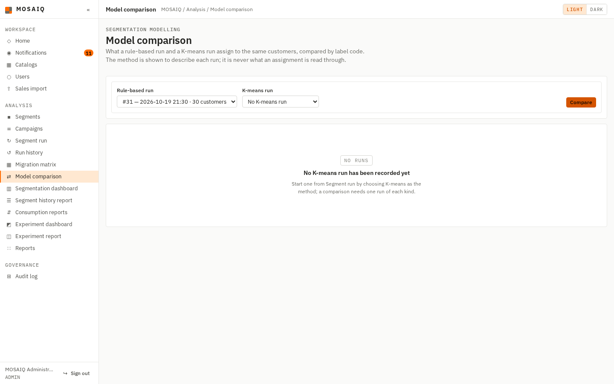
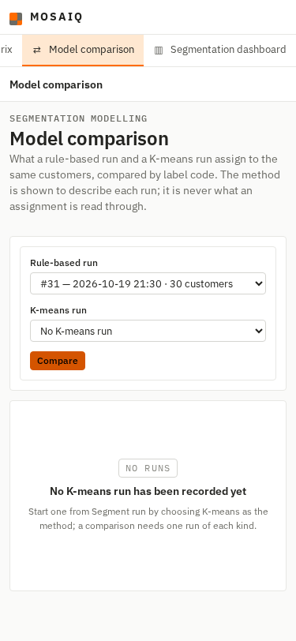
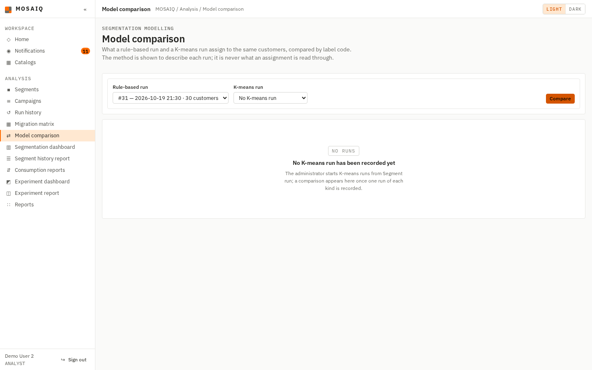
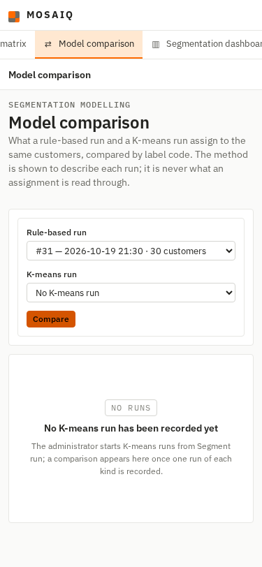

# #547 — The K-means empty state on Model comparison

When no K-means run exists, the Model comparison page used to say that *K-means runs
cannot be started from a screen in this release*. That stopped being true with #335:
the administrator chooses K-means on the **Segment run** page. The empty state now
says so, and says it in two ways, because only the administrator holds
`segment_run.execute` while five roles may read this page:

- With `segment_run.execute`: *Start one from Segment run by choosing K-means as the
  method; a comparison needs one run of each kind.*
- Without it: *The administrator starts K-means runs from Segment run; a comparison
  appears here once one run of each kind is recorded.* A reader is told who can act,
  not sent to a page the menu does not offer them.

Only the wording changed. No route, permission or query was touched. The rule-based
empty state above it is outside this issue and was left as it was.

## What was run, and against what

Branch `fix/547-kmeans-comparison-empty-state`, from `develop` at `2473ae4`. The
three SQL scripts were loaded in order into an empty PostgreSQL 16.15 container. The
seeded KMEANS run was then deleted from that throwaway database so the empty state
would show. The application ran with `flask run`, and Chromium was driven through
Playwright, signed in as the demonstration administrator and as `user2@`, an
analyst. Captures are full-page at 375 px and 1440 px. `scrollWidth` did not exceed
`clientWidth` in any of them.

## The criteria

| Acceptance criterion | Proof |
|---|---|
| The stale explanation is replaced with guidance consistent with the current run screen | Both messages name **Segment run**, and the administrator's names the *K-means* method it offers |
| The empty state stays useful to readers without permission to execute a run | The reader captures, and `test_with_no_kmeans_run_a_reader_learns_who_starts_one` for ANALYST, STORE_MANAGER, MARKETING and AUDITOR |
| The wording is verified at 375 px and 1440 px | The four captures below |

## Captures

Administrator, 1440 px and 375 px:

Analyst, 1440 px and 375 px:

