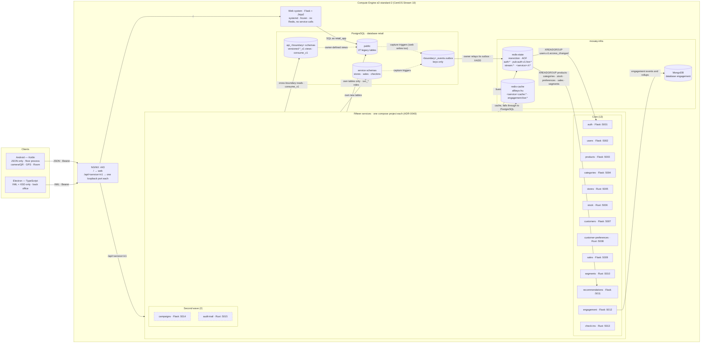

# Scope — Delivery 2, distributed stage

This document scopes the distributed part of the second delivery: the
microservices, the two client applications, Redis, MongoDB and shared JWT.
[ADR-0016][adr-0016] reinstated this architecture. ADR-0034 to ADR-0046 decide
its shape.

The monolith's analytics phase has its own boundary in
[`scope-delivery-2-analytics.md`](scope-delivery-2-analytics.md), and
[`scope.md`](scope.md) remains the unchanged boundary of the first delivery.
Nothing here edits either of them.

---

## 1. Objective

Add fifteen containerised microservices, each implementing one business rule,
plus an Android client and an Electron client, to the MOSAIQ platform. Redis
and MongoDB run in real operation, and JWT is shared across the services. The
web system stays as it is.

The result is demonstrated as one process across every component. A sale
recorded on the phone is validated by a service, lands in PostgreSQL, appears
in the web system with no web change, and is read back by the desktop client.

The shape follows the instructor's reference architecture: Flask microservices
over one centralized PostgreSQL, Redis for sessions, revocation, cache and
counters, and clients over JSON and XML. Section 10 records where it
deliberately differs.

## 2. Binding requirements

The instructor set these requirements for the stage, and the team confirmed
them. They override any earlier text in this repository, including the
six-to-ten count in [ADR-0016][adr-0016].

1. **Total independence.** The microservices are totally independent and
   decoupled. Each one can grow, and be built, versioned, deployed, scaled and
   rolled back, on its own.
2. **Never mix endpoints.** No service exposes, duplicates, proxies or nests
   another service's resources.
3. **One business rule per microservice,** never mixed.
4. **At least ten microservices,** with no upper cap. The team plans fifteen:
   thirteen core and two in a second wave. Every one is a real rule, not
   filler ([ADR-0043][adr-0043]).
5. **The web system is frozen.** It gets no Redis, consumes no service and is
   never rewired. Only the services consult Redis (Q-12, section 11). The web
   may still receive bug fixes and the analytics gaps tracked in #405: the
   experiment dashboard and internal notifications.

Course requirements still in force:

- Each service has its own container, versioned routes, authentication, JSON
  **and** XML responses, health endpoints and an OpenAPI document.
- Android consumes JSON only, uses at least four services and two device
  capabilities.
- Electron consumes XML only, validated against an XSD, uses at least four
  services, and runs a different process from Android.
- MongoDB is in real operation: insert, query, update, aggregation and
  indexes.
- Redis holds sessions, revoked tokens, cache, counters and rate limits, and
  only the services use it.
- JWT is shared, with revocation enforced through Redis.
- Contracts are specified before the clients that consume them.

Repository rules still in force: all DDL lives in `sql/01_schema.sql` and the
three scripts run clean from empty; the model is in 4NF with a written
justification; every table has at least 30 seed rows or an entry in
`sql/seed-exempt.txt`; there is exactly one administrator, refused by the
application **and** by the partial unique index; every SQL statement is
parameterized; no secrets live in source; everything runs on one e2-standard-2
instance (8 GB), with no managed databases and no Kubernetes.

## 3. Components

No arrow joins two services. Services never call each other over HTTP; they
meet only through the producer's `api_*` objects and through Redis Streams
([ADR-0044][adr-0044]). Products, categories, stores and segments also consume
their own stream, to clear their own caches.

### Services

| # | Service | Lang | Port | One rule (RN ids in [`business-rules.md`](business-rules.md)) | Governing ADRs |
|---|---|---|---|---|---|
| 1 | auth-service | Flask | 5001 | A principal is authenticated only by a valid credential of an active account, and every token stays usable only while its session is live (RN-03) | [0036][adr-0036], [0037][adr-0037] |
| 2 | users-service | Flask | 5002 | Accounts exist under the single-administrator rule: never two, never zero, and moved only by an explicit transfer. Email is unique case-insensitively, and accounts are deactivated, never deleted (RN-01, RN-02, RN-04) | [0034][adr-0034], [0036][adr-0036] |
| 3 | products-service | Flask | 5003 | Product master: unique SKU, price never negative, exactly one existing category, retired by deactivation (RN-10, RN-11) | [0034][adr-0034], [0042][adr-0042] |
| 4 | categories-service | Flask | 5004 | The category tree has no cycles. A category with products, children or customer interests is never deleted through services (RN-33, RN-06, RN-07) | [0034][adr-0034] |
| 5 | stores-service | Rust | 5005 | Each store has at most one location, with valid coordinates and a 25–2000 m geofence, set by ADMIN only | [0034][adr-0034], [0046][adr-0046] |
| 6 | stock-service | Rust | 5006 | Stock is never negative and is consumed only by an accepted sale, atomically with it (RN-14, [ADR-0031][adr-0031]) | [0034][adr-0034], [0039][adr-0039] |
| 7 | customers-service | Flask | 5007 | A customer is registered once, with a valid unique email when given, a known channel and a registration date not in the future, and is never deleted through services (RN-08) | [0034][adr-0034] |
| 8 | customer-preferences-service | Rust | 5008 | Preferred channels and interest categories are two independent multivalued facts, each replaced atomically as a whole set | [0034][adr-0034] |
| 9 | sales-service | Flask | 5009 | A sale is recorded exactly once, all or nothing, and consumes its stock in the same transaction. Lines are dated not in the future, on or after registration, for active products, with positive quantities and positive two-decimal prices (RN-11 to RN-13, RN-37 on accepted sales) | [0039][adr-0039], [0046][adr-0046] |
| 10 | segments-service | Rust | 5010 | A customer has at most one current segment, named by its stable label code. Unassigned states are reported as they are (RN-20, RN-21, [ADR-0018][adr-0018]) | [0034][adr-0034], [0043][adr-0043] |
| 11 | recommendations-service | Flask | 5011 | Recommend active, in-stock products not already bought, matching a stated signal, with reasons, or report why nothing qualifies (RN-40) | [0034][adr-0034], [0044][adr-0044] |
| 12 | engagement-service | Flask + MongoDB | 5012 | In-store engagement (`QR_SCAN`, `RECO_CLICK`) is recorded once per client event, attributed, voided rather than deleted, and summarized | [0038][adr-0038] |
| 13 | check-ins-service | Rust | 5013 | A staff check-in is verified only when the server-computed distance lies within the store's geofence at acceptable accuracy. Overrides are append-only reviews | [0034][adr-0034], [0046][adr-0046] |
| 14 | campaigns-service *(second wave)* | Flask | 5014 | The campaign state machine: DRAFT→ACTIVE/CANCELLED, ACTIVE→FINISHED/CANCELLED. Edits only in DRAFT, and the end date never before the start (RN-15, RN-16, RN-22, RN-31, RN-32) | [0034][adr-0034], [0043][adr-0043] |
| 15 | audit-trail-service *(second wave)* | Rust | 5015 | The audit trail is append-only, attributed, free of credentials, and readable by ADMIN and AUDITOR only (RN-28, RN-29, RN-30) | [0034][adr-0034], [0043][adr-0043] |

Every service is also bound by [ADR-0035][adr-0035] (its contract and
resources), [ADR-0040][adr-0040] (its build and deployment),
[ADR-0044][adr-0044] (how it meets other boundaries) and [ADR-0045][adr-0045]
(it never imports the web). [ADR-0034][adr-0034] holds the full ownership and
grant matrix.

Four of these rules have no RN id yet: stores' location, customer-preferences'
whole-set replace, engagement's once-per-event record and check-ins' geofence
verification. RN-37 also names two different rules today (K-means runs and
accepted sales). [ADR-0043][adr-0043] requires both fixed in
`docs/business-rules.md` before the registry cites them.

The Rust build of the products reads in `bench/products-service-rs/` is a
benchmark artifact, not a service. It is never routed, never deployed and
never counted ([ADR-0042][adr-0042]).

### Resources registry

Each top-level resource, the first path segment after `/v1`, belongs to
exactly one service. `contracts/registry.yaml` records this, and CI fails on a
duplicate or unregistered segment ([ADR-0035][adr-0035]).

| Service | Resources |
|---|---|
| auth | `sessions`, `jwks.json` |
| users | `users`, `roles`, `administrator-transfers` |
| products | `products` |
| categories | `categories` |
| stores | `stores` |
| stock | `stock-levels` |
| customers | `customers` |
| customer-preferences | `preference-profiles` |
| sales | `sales`, `channels` |
| segments | `segments`, `segment-assignments` |
| recommendations | `recommendations` |
| engagement | `engagement-events`, `engagement-summaries` |
| check-ins | `check-ins` |
| campaigns | `campaigns` |
| audit-trail | `audit-entries` |

A foreign id appears only as a query parameter or a body field, as in
`/v1/stock-levels?product_id=` or `/v1/recommendations?customer_id=`. One fact
has one write endpoint. The meta routes `/health/live`, `/health/ready`,
`/openapi.yaml` and `/schema.xsd` sit outside `/v1` and outside the registry.

### The web system

The web system keeps its server-side sessions, reads and writes PostgreSQL
directly as `retail_app`, connects to no Redis and consumes no service. It sees
what the services record because they write the same `public` tables it reads.
Its own writes reach the services through capture triggers in
`sql/01_schema.sql`, which fill the owner's outbox with no web code change.
`retail_app` gets no privilege on any service schema
([ADR-0046][adr-0046]).

## 4. Constraints

| # | Application to this stage |
|---|---|
| C-1 | Does not bind Delivery 2. Each service exposes versioned HTTP routes under its own contract ([ADR-0035][adr-0035]). The web system still exposes none |
| C-2 | Does not bind Delivery 2. Services answer in JSON **and** XML. The web system still exchanges no JSON or XML with another component; it meets the services only in PostgreSQL |
| C-3 | Does not bind Delivery 2. The web system remains one application. Each service is its own deployable and its own compose project ([ADR-0040][adr-0040]) |
| C-4 | Applies unchanged. users-service refuses a second `ADMIN` with its own check and moves the role only through `administrator-transfers`; `ux_app_user_single_administrator` refuses it again, and that refusal maps to 409, never 500. The web keeps both of its halves. Both enforcements remain required |
| C-5 | Applies. Everything runs on the team's own Compute Engine instance |
| C-6 | Applies. PostgreSQL stays installed on the instance. Redis and MongoDB run as containers on it, never as managed services |
| C-7 | Does not bind Delivery 2. [ADR-0016][adr-0016] reinstated microservices, [ADR-0043][adr-0043] sets the floor at ten, and [ADR-0034][adr-0034] names the fifteen |
| C-8 | Applies. Services are published on the assigned host under `/api/<service>/v1/` |

## 5. Rules every component follows

- **Contracts come first.** A service's OpenAPI, XSD and examples merge before
  its implementation, and before any client story that consumes them. Each
  service versions its own contract ([ADR-0035][adr-0035]).
- **One rule per service, and one owner per resource.** A service implements
  exactly one business rule and is registered with it in
  `contracts/registry.yaml`. It never exposes, nests, proxies or re-serves
  another service's resource ([ADR-0043][adr-0043], [ADR-0035][adr-0035]).
- **No web imports.** No service imports or copies `web/`. A rule shared with
  the web is carried by the database, or by a port pinned with golden fixtures
  ([ADR-0045][adr-0045]).
- **Cross-boundary reads go through `api_*` contracts only.** A service holds
  privileges on its own tables and reads another boundary only through that
  producer's versioned `api_<boundary>.*_v1` views and functions. No
  service-to-service HTTP ([ADR-0034][adr-0034], [ADR-0044][adr-0044]).
- **Events travel on Redis Streams.** The owner relays its own transactional
  outbox to `redis-state`. `pg_notify` is only an owner's private wake-up, and
  no service listens on another boundary's channel ([ADR-0044][adr-0044]).
- **Authentication.** RS256 tokens carrying the role code only are issued by
  auth-service, and verified locally by every other service, which then checks
  that the session's liveness key exists in `redis-state`
  ([ADR-0036][adr-0036]).
- **Fail closed.** When `redis-state` is unreachable, authentication fails with
  503. When `redis-cache` is unreachable, reads fall through to PostgreSQL
  ([ADR-0037][adr-0037]).
- **Independent build and deployment.** Each service has its own lock file,
  `VERSION`, image and compose project, and rolls back alone
  ([ADR-0040][adr-0040]).
- **Service-owned tables live in service schemas,** never in `public`
  ([ADR-0046][adr-0046]).
- **No secrets in source.** New configuration goes in `.env.example` with a
  safe local default.
- **Every SQL statement is parameterized,** in Python and in Rust.

## 6. Phases

| Phase | Name | Contents | Epic |
|---|---|---|---|
| 13 | Distributed foundation | Accepted decision set, contract conventions and registry, mechanism-only kits for Python and Rust, Redis and MongoDB, service roles, schemas and `api_*` contracts, outboxes, CI | #400 |
| 14 | Microservices | A contract and an implementation for each of the fifteen services: the thirteen core first, then the second wave | #399 |
| 15 | Rust twin and benchmark | The bench-only Rust build of the products reads, and the k6 comparison | #401 |
| 16 | Desktop client | Electron back office over XML | #402 |
| 17 | Android client | Kotlin floor app over JSON | #403 |
| 18 | Deployment and demonstration | Per-service deployment on the instance, NGINX routes, negative tests, end-to-end demo, diagrams | #404 |

Story ids and the dependency graph are in [`backlog.md`](backlog.md). Phase
14's stories are being reissued for the fifteen-service design. Nothing in
phases 14–18 starts before F13-01 (#408) accepts the decision set.

## 7. Deliverables

| # | Deliverable | Location |
|---|---|---|
| 1 | Accepted decision set | `docs/adr/0034`–`0046` |
| 2 | Per-service contracts (OpenAPI 3.1, XSD, examples), shared common types, the registry, database and stream contracts | `contracts/` |
| 3 | Fifteen microservices with their tests, `VERSION`, lock file and compose project | `services/` |
| 4 | Mechanism-only kits, released by tag | `packages/kit-py/`, `packages/kit-rs/` |
| 5 | Service roles, service schemas, `api_*` contracts, outboxes, grants and seed rows, with their 4NF justification | `sql/00_create_database.sql`, `sql/01_schema.sql`, `sql/02_seed_30_per_table.sql`, `sql/seed-exempt.txt`, `docs/data-model.md` |
| 6 | Redis and MongoDB specifications | `docs/datastores/` |
| 7 | Android and Electron clients | `clients/android/`, `clients/desktop/` |
| 8 | Flask vs Rust benchmark of the products reads, and its report | `bench/products-service-rs/`, `bench/k6/`, `docs/evidence/` |
| 9 | Deployment of the stack on the instance | `deploy/infra/`, `deploy/systemd/`, `.github/workflows/` |
| 10 | Negative tests and end-to-end demonstration evidence | `docs/evidence/`, `docs/demo-distributed.md` |
| 11 | Updated architecture diagrams and README | `docs/architecture/`, `README.md` |

Directories are created by the story that produces their first file.

## 8. Out of scope

- **Kubernetes, managed databases, and any second VM** (C-5, C-6).
- **Any Redis connection or service call from the web system.** This is the
  boundary of #398.
- **Rebuilding the web system** or moving it into containers.
- **Account email verification over SMTP.** It is in the reference
  architecture but not in our requirements. Spike F13-10 (#446) decides it,
  noting that GCP blocks outbound port 25 on Compute Engine.
- **Push notifications** (they need Firebase). The Android device capabilities
  are camera/QR, GPS and local storage.
- **Stock receipts, transfers, counts and adjustments** (`inventory.write`).
  They are still sequenced after the analytics phase in
  [`roadmap.md`](roadmap.md). When built, they become further stock-owned
  `api_stock` functions.

## 9. Success criteria

The distributed stage is complete when all of these are checkable and pass:

1. ADR-0034 to ADR-0046 are Accepted, and no implementation merged before its
   record.
2. At least ten services run, each in its own container and each implementing
   exactly one registered business rule. Each has versioned routes, JSON and
   XML responses, authentication, `/health/live`, `/health/ready` and an
   OpenAPI document that CI validates.
3. Every top-level resource belongs to exactly one service, and CI proves it
   against `contracts/registry.yaml`. Every XML example and every desktop
   response validates against its XSD.
4. Each `svc_*` role holds exactly the privileges in
   `contracts/db/grants.csv`, and CI proves it in both directions. No service
   role holds a privilege on another boundary's base table. A second
   administrator is refused by users-service and by the index.
5. A revoked session is refused by every service on the very next request,
   with no PostgreSQL query. With `redis-state` down, protected routes answer
   503.
6. MongoDB demonstrates insert, query (with index use), update, aggregation and
   indexing on engagement recorded by the clients.
7. The Android client uses at least four services and two device
   capabilities. The Electron client uses at least four services, in a
   different process.
8. The end-to-end demonstration (F18-05) runs on the instance and is recorded:
   Android sends JSON, a service validates the JWT, Redis confirms the session
   is live, the data lands in PostgreSQL or MongoDB, the web system shows it,
   and Electron reads it back in XML.
9. The Flask vs Rust report is reproducible from the repository.
10. The web system works unchanged, and its CI jobs still pass.

## 10. Where this differs from the reference architecture

| Reference | This stage | Reason |
|---|---|---|
| Cloud SQL and Memorystore | PostgreSQL on the VM, Redis and MongoDB in containers | C-6 excludes managed databases, and CentOS Stream 10 packages neither Redis nor MongoDB |
| HS256 with one secret shared by every service | RS256: only auth-service signs | With a shared secret, any service could mint an administrator's token ([ADR-0036][adr-0036]) |
| Redis for sessions, revocation, cache and counters | Two Redis instances, one that never evicts and one cache, also carrying the inter-service streams | Sessions and streams must never be evicted, while a cache must be ([ADR-0037][adr-0037]) |
| A public Electron client reading one service | An authenticated Electron client over four or more services, validating XSD | Our requirements ([ADR-0041][adr-0041]) |
| Postfix SMTP for verification | Out of scope pending F13-10 | Not in our requirements, and port 25 is blocked on GCP |
| Services for books, authors, orders and payments | Fifteen single-rule services over our retail domain | Our domain has no payments, and the instructor requires one business rule per service ([ADR-0034][adr-0034], [ADR-0043][adr-0043]) |

## 11. Answered by the instructor

| ID | Answer |
|---|---|
| Q-12 | **ANSWERED (2026-10-13).** The course's Redis requirement says that every component consults Redis during authentication or authorization. That means the microservices, not the web system. The web system connects to no Redis and keeps its PostgreSQL sessions ([ADR-0022](adr/0022-sessions-are-resolved-server-side-on-every-request.md)). Only the services consult Redis ([ADR-0037][adr-0037]) |

## 12. Open questions

| ID | Question | Working assumption |
|---|---|---|
| Q-11 | Is account email verification part of the second delivery? | No, until F13-10 (#446) records the Product Owner's answer |
| Q-13 | The instructor is asked to confirm in writing that (1) read-only boundaries, such as segments and audit-trail, count as services implementing one business rule, and (2) services that co-write legacy `public` tables with the frozen web, reading across boundaries only through versioned `api_*` views and exchanging events only on Redis Streams, satisfy "totally independent" | Yes to both. [ADR-0043][adr-0043] keeps the floor of ten even under the strict reading of (1) |

[adr-0016]: adr/0016-the-second-delivery-reinstates-the-distributed-architecture.md
[adr-0018]: adr/0018-two-segmentation-strategies-behind-one-method-agnostic-pipeline.md
[adr-0031]: adr/0031-sales-ingestion-decrements-inventory-atomically.md
[adr-0034]: adr/0034-fifteen-single-rule-services-each-the-only-service-writer-of-its-data.md
[adr-0035]: adr/0035-each-service-publishes-its-own-versioned-contract-and-no-two-services-share-a-resource.md
[adr-0036]: adr/0036-auth-service-issues-role-only-rs256-tokens-whose-sessions-live-in-redis.md
[adr-0037]: adr/0037-two-redis-instances-carry-sessions-caches-limits-and-inter-service-streams.md
[adr-0038]: adr/0038-mongodb-holds-in-store-engagement-owned-by-engagement-service-alone.md
[adr-0039]: adr/0039-sales-service-records-a-sale-all-or-nothing-consuming-stock-through-the-stock-contract.md
[adr-0040]: adr/0040-each-service-is-built-in-ci-and-runs-as-its-own-compose-project.md
[adr-0041]: adr/0041-android-and-electron-clients-run-different-processes-over-different-formats.md
[adr-0042]: adr/0042-a-bench-only-rust-build-of-the-products-reads-is-compared-under-one-load.md
[adr-0043]: adr/0043-at-least-ten-microservices-each-implementing-one-business-rule.md
[adr-0044]: adr/0044-boundaries-meet-only-through-versioned-database-contracts-and-redis-streams.md
[adr-0045]: adr/0045-services-never-import-the-web-system.md
[adr-0046]: adr/0046-service-owned-data-lives-in-service-schemas.md
