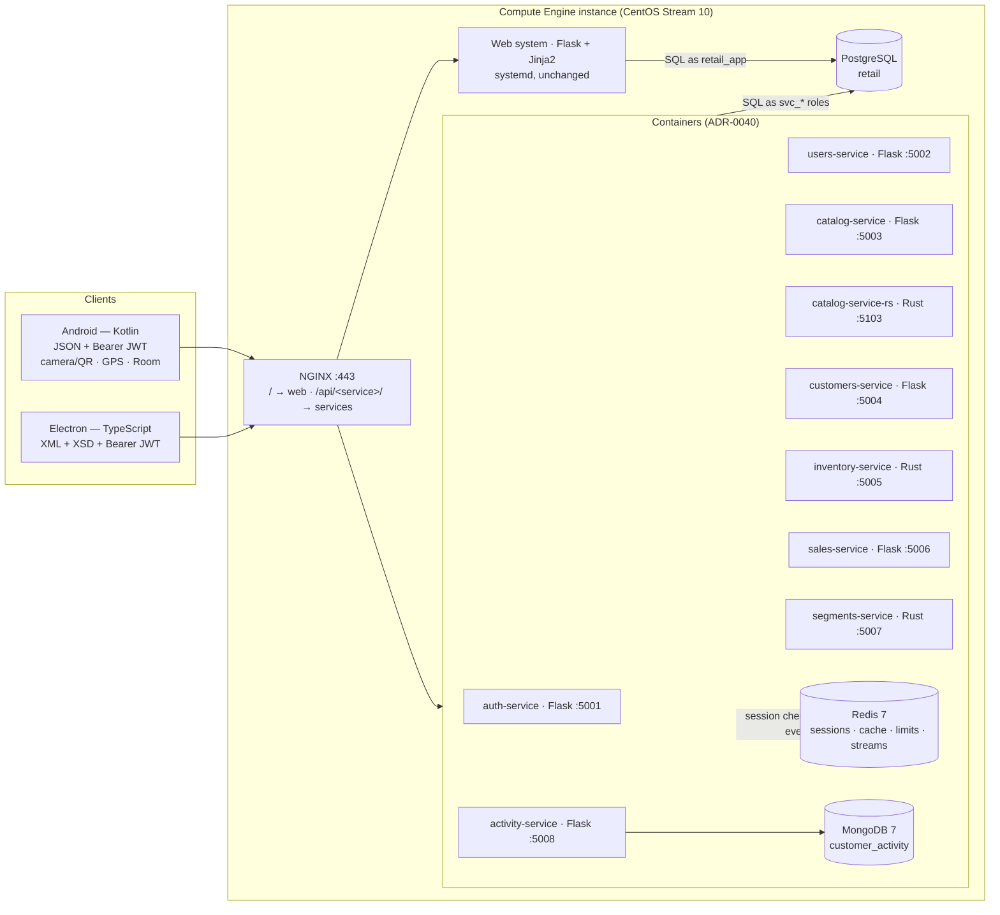

# Scope — Delivery 2, distributed stage

This document scopes the distributed part of the second delivery: the
microservices, the two client applications, Redis, MongoDB and shared JWT.
[ADR-0016](adr/0016-the-second-delivery-reinstates-the-distributed-architecture.md)
reinstated this architecture. ADR-0034 to ADR-0042 decide its shape.

The monolith's analytics phase has its own boundary in
[`scope-delivery-2-analytics.md`](scope-delivery-2-analytics.md), and
[`scope.md`](scope.md) remains the unchanged boundary of the first delivery.
Nothing here edits either of them.

---

## 1. Objective

Add eight containerised microservices, an Android client and an Electron
client to the MOSAIQ platform, with Redis and MongoDB in real operation and JWT
shared across components. The web system stays as it is.

The result is demonstrated as one process across every component. A sale
recorded on the phone is validated by a service, lands in PostgreSQL, appears
in the web system, and is read back by the desktop client.

The shape follows the instructor's reference architecture: Flask microservices
over one centralized PostgreSQL, Redis for sessions, revocation, cache and
counters, and clients over JSON and XML. Section 9 records where it
deliberately differs.

## 2. Components

| Service | Language | Responsibility | Governing decision |
|---|---|---|---|
| auth-service | Flask | Sign-in, refresh rotation, sign-out, JWKS, session revocation | ADR-0036 |
| users-service | Flask | User administration under the single-administrator rule | ADR-0034 |
| catalog-service | Flask | Products and categories, cached | ADR-0034, ADR-0037 |
| catalog-service-rs | Rust | The catalog read contract, for the comparison | ADR-0042 |
| customers-service | Flask | Customers and their preferences | ADR-0034 |
| inventory-service | Rust | Stock availability per store, read-only | ADR-0034 |
| sales-service | Flask | Recording sales through the existing ingestion rules | ADR-0039 |
| segments-service | Rust | Segments, history and recommendations, read-only | ADR-0034 |
| activity-service | Flask + MongoDB | QR scans, check-ins, recommendation clicks, purchases | ADR-0038 |

That is eight boundaries and nine containers. The Rust twin is one boundary
implemented twice, so it counts once toward the six-to-ten limit.

**The web system** keeps its server-side sessions, reads and writes
PostgreSQL directly, connects to no Redis, and consumes no service. It still
receives the analytics fixes and the two missing requirements tracked in #405:
the experiment dashboard and internal notifications.

## 3. Constraints

| # | Application to this stage |
|---|---|
| C-1 | Does not bind Delivery 2. Services expose versioned HTTP routes under [ADR-0035](adr/0035-integration-contracts-are-written-before-the-code-that-serves-or-consumes-them.md). The web system still exposes none |
| C-2 | Does not bind Delivery 2. Services answer in JSON **and** XML. The web system still exchanges no JSON or XML with another component |
| C-3 | Does not bind Delivery 2. The web system remains one application; the services are separate deployables under [ADR-0040](adr/0040-services-redis-and-mongodb-run-as-containers-on-the-instance.md) |
| C-4 | Applies unchanged. users-service refuses a second `ADMIN` by reusing `web/services/users.py`, and the partial unique index refuses it again. Both enforcements remain required |
| C-5 | Applies. Everything runs on the team's own Compute Engine instance |
| C-6 | Applies. PostgreSQL stays installed on the instance. Redis and MongoDB run as containers on it, never as managed services |
| C-7 | Does not bind Delivery 2. ADR-0016 reinstated microservices, and ADR-0034 bounds them |
| C-8 | Applies. Services are published on the assigned host under `/api/<service>/` |

## 4. Rules every component follows

- **Contracts come first.** A service's OpenAPI, XSD and examples merge before
  its implementation, and before any client story that consumes them (ADR-0035).
- **One service writer per table**, enforced by PostgreSQL roles, and no
  service-to-service HTTP (ADR-0034).
- **Authentication.** RS256 tokens are issued only by auth-service, and
  verified locally by every other service. A session is live only while it
  exists in Redis, and Redis failures make authentication fail closed (ADR-0036,
  ADR-0037).
- **Business rules have one implementation.** Python services import the
  web's transport-free modules, and the Rust services are read-only (ADR-0034,
  ADR-0039).
- **No secrets in source.** New configuration goes in `.env.example` with a
  safe local default.
- **Every SQL statement is parameterized,** in Python and in Rust.

## 5. Phases

| Phase | Name | Contents | Epic |
|---|---|---|---|
| 13 | Distributed foundation | Accepted decision set, contract conventions, Python and Rust service kits, Redis and MongoDB, per-service roles, Compose overlay, CI | #400 |
| 14 | Microservices | A contract and an implementation for each of the eight services, plus store coordinates | #399 |
| 15 | Rust twin and benchmark | catalog-service-rs and the k6 comparison | #401 |
| 16 | Desktop client | Electron back office over XML | #402 |
| 17 | Android client | Kotlin associate app over JSON | #403 |
| 18 | Deployment and demonstration | Containers on the instance, NGINX routes, deploy workflow, negative tests, end-to-end demo, diagrams | #404 |

Story ids, issue numbers and the dependency graph are in
[`backlog.md`](backlog.md). Nothing in phases 14–18 starts before F13-01 (#408)
accepts the decision set.

## 6. Deliverables

| # | Deliverable | Location |
|---|---|---|
| 1 | Accepted decision set | `docs/adr/0034`–`0042` |
| 2 | Integration contracts: OpenAPI 3.1, XSD, examples | `contracts/` |
| 3 | Microservices with their tests and containers | `services/` |
| 4 | Per-service roles and grants, store coordinates | `sql/00_create_database.sql`, `sql/01_schema.sql`, `sql/02_seed_30_per_table.sql` |
| 5 | Redis and MongoDB specifications | `docs/datastores/` |
| 6 | Android and Electron clients | `clients/android/`, `clients/desktop/` |
| 7 | Flask vs Rust benchmark and report | `bench/catalog/`, `docs/evidence/` |
| 8 | Deployment of the stack on the instance | `deploy/`, `compose.services.yaml`, `.github/workflows/` |
| 9 | Negative tests and end-to-end demonstration evidence | `docs/evidence/`, `docs/demo-distributed.md` |
| 10 | Updated architecture diagrams and README | `docs/architecture/`, `README.md` |

Directories are created by the story that produces their first file.

## 7. Out of scope

- **Kubernetes, managed databases, and any second VM** (C-5, C-6).
- **Any Redis connection or service call from the web system.** This is the
  boundary of #398.
- **Rebuilding the web system** or moving it into containers.
- **Account email verification over SMTP.** It is in the reference
  architecture but not in our requirements. Spike F13-10 (#446) decides it,
  noting that GCP blocks outbound port 25 on Compute Engine.
- **Push notifications** (they need Firebase). The Android device capabilities
  are camera/QR, GPS and local storage.
- **Stock receipts, transfers, counts and adjustments** (`inventory.write`).
  They are still sequenced after the analytics phase in [`roadmap.md`](roadmap.md).

## 8. Success criteria

The distributed stage is complete when all of these are checkable and pass:

1. ADR-0034 to ADR-0042 are Accepted, and no implementation merged before its
   record.
2. Eight services run in their own containers. Each has versioned routes, JSON
   and XML responses, authentication, `/health/live`, `/health/ready` and an
   OpenAPI document that CI validates.
3. Every XML example and every desktop response validates against its XSD.
4. A revoked session is refused by every service on the very next request,
   with no PostgreSQL query. With Redis down, protected routes answer 503.
5. Each `svc_*` role holds exactly its matrix privileges, and CI proves it. A
   second administrator is refused by users-service and by the index.
6. MongoDB demonstrates insert, query (with index use), update, aggregation and
   indexing on activity recorded by the clients.
7. The Android client uses at least four services and two device
   capabilities. The Electron client uses at least four services, in a
   different process.
8. The end-to-end demonstration (F18-05) runs on the instance and is recorded.
9. The Flask vs Rust report is reproducible from the repository.
10. The web system works as before, and its CI jobs still pass.

## 9. Where this differs from the reference architecture

| Reference | This stage | Reason |
|---|---|---|
| Cloud SQL and Memorystore | PostgreSQL on the VM, Redis and MongoDB in containers | C-6 excludes managed databases, and CentOS Stream 10 packages neither Redis nor MongoDB |
| HS256 with one secret shared by every service | RS256: only auth-service signs | With a shared secret, any service could mint an administrator's token (ADR-0036) |
| A public Electron client reading one service | An authenticated Electron client over four or more services, validating XSD | Our requirements (ADR-0041) |
| Postfix SMTP for verification | Out of scope pending F13-10 | Not in our requirements, and port 25 is blocked on GCP |
| Services for books, authors, orders and payments | Catalog, customers, sales, plus inventory, segments and activity | Our domain has no payments, and its distinctive data needs services (ADR-0034) |

## 10. Open questions

| ID | Question | Working assumption |
|---|---|---|
| Q-11 | Is account email verification part of the second delivery? | No, until F13-10 (#446) records the Product Owner's answer |
