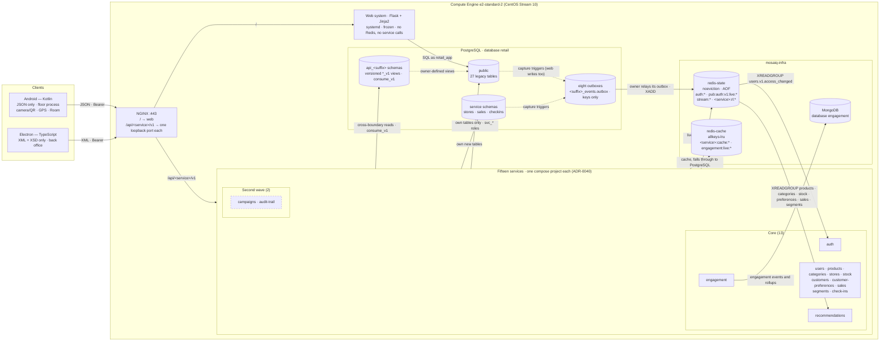

# Scope — Delivery 2, distributed stage

This document scopes the distributed part of the second delivery: the
microservices, the two clients, Redis, MongoDB and shared JWT.
[ADR-0016][adr-0016] reinstated this architecture; ADR-0034 to ADR-0046 decide
its shape. The analytics phase keeps its own boundary in
[`scope-delivery-2-analytics.md`](scope-delivery-2-analytics.md), and
[`scope.md`](scope.md) the first delivery's; nothing here edits either.

---

## 1. Objective

Add fifteen containerised microservices, each implementing one business rule,
plus an Android and an Electron client, to MOSAIQ. Redis and MongoDB run in
real operation, JWT is shared across the services, and the web system stays as
it is. One process is demonstrated end to end: a sale recorded on the phone is
validated by a service, lands in PostgreSQL, appears in the web system with no
web change, and is read back by the desktop client. The shape follows the
instructor's reference architecture; section 10 records where it differs.

## 2. Binding requirements

The instructor set these and the team confirmed them. They override any earlier
text, including the six-to-ten count in [ADR-0016][adr-0016].

1. **Total independence.** Each service is built, versioned, deployed, scaled and rolled back on its own.
2. **Never mix endpoints.** No service exposes, duplicates, proxies or nests another service's resources.
3. **One business rule per microservice,** never mixed.
4. **At least ten microservices,** with no upper cap. The team plans fifteen: thirteen core and two in a second wave ([ADR-0043][adr-0043]).
5. **The web system is frozen.** It gets no Redis, consumes no service and is never rewired (Q-12), apart from bug fixes and the analytics gaps in #405.

Course requirements still in force: each service has its own container,
versioned routes, authentication, JSON **and** XML, health endpoints and an
OpenAPI document. Android consumes JSON only and uses four or more services and
two device capabilities; Electron consumes XML only, validated against an XSD,
uses four or more services and runs a different process. MongoDB runs insert,
query, update, aggregation and indexes. Redis holds sessions, revoked tokens,
cache, counters and rate limits for the services only; JWT is shared and
revoked through Redis: a revoked token is one whose `pub:auth:v1:live:{sid}`
no longer exists ([ADR-0036][adr-0036]). Contracts precede clients.

Repository rules still in force: DDL only in `sql/01_schema.sql`, three scripts
clean from empty, 4NF with a written justification, 30 seed rows or a
`sql/seed-exempt.txt` entry, exactly one administrator (application **and**
index), parameterized SQL, no secrets in source, one e2-standard-2 instance.

## 3. Components

No arrow joins two services: they meet only through the producer's `api_*`
objects and Redis Streams ([ADR-0044][adr-0044]).

### Services

Thirteen core services and two in a second wave, campaigns and audit-trail.
The registry of [ADR-0034][adr-0034] gives each one's single rule with its RN
ids, its language, port, PostgreSQL role and top-level resources. Every service
is also bound by [ADR-0035][adr-0035] (its contract and resources),
[ADR-0040][adr-0040] (its build and deployment), [ADR-0044][adr-0044] (how it
meets other boundaries) and [ADR-0045][adr-0045] (it never imports the web).

Every rule cites RN ids in [`business-rules.md`](business-rules.md). RN-52 to
RN-56 were added for auth, stores, customer-preferences, engagement and
check-ins. The duplicate RN-37, RN-47 and RN-50 headings are tracked by AN-15
(#460), and the sales rule cites RN-37 (accepted sales). The Rust build of the
products reads in `bench/products-service-rs/` is a benchmark artifact, not a
service ([ADR-0042][adr-0042]).

### Resources

Each top-level resource, the first path segment after `/v1`, belongs to exactly
one service, recorded in `contracts/registry.yaml` and checked by CI
([ADR-0035][adr-0035]). A path never contains another service's registered
resource name. Another boundary's id may key a resource only when it is that
resource's own identity (`/v1/preference-profiles/{customer_id}`,
`/v1/stock-levels/{store_id}/{product_id}`); otherwise foreign ids are query or
body fields. One fact has one write endpoint. The meta routes `/health/live`,
`/health/ready`, `/openapi.yaml` and `/schema.xsd` sit outside `/v1` and the
registry.

### The web system

The web system keeps its server-side sessions, reads and writes PostgreSQL as
`retail_app`, connects to no Redis and consumes no service. It sees what the
services record in the `public` tables it reads, and its own writes reach them
through capture triggers in `sql/01_schema.sql` that fill the owner's outbox.
`retail_app` gets no privilege on any service schema ([ADR-0046][adr-0046]).

## 4. Constraints

| # | Application to this stage |
|---|---|
| C-1 | Does not bind Delivery 2. Each service exposes versioned HTTP routes under its own contract ([ADR-0035][adr-0035]). The web system still exposes none |
| C-2 | Does not bind Delivery 2. Services answer in JSON **and** XML. The web system still exchanges no JSON or XML with another component; it meets the services only in PostgreSQL |
| C-3 | Does not bind Delivery 2. The web system remains one application. Each service is its own deployable and its own compose project ([ADR-0040][adr-0040]) |
| C-4 | Applies unchanged. users-service refuses a second `ADMIN` with its own check and moves the role only through `administrator-transfers`; `ux_app_user_single_administrator` refuses it again, and that refusal maps to 409, never 500. The web keeps both of its halves. Both enforcements remain required |
| C-5 | Applies. Everything runs on the team's own Compute Engine instance |
| C-6 | Applies. PostgreSQL stays installed on the instance. Redis and MongoDB run as containers on it, never as managed services |
| C-7 | Does not bind Delivery 2. [ADR-0016][adr-0016] reinstated microservices, [ADR-0043][adr-0043] sets the floor at ten, and [ADR-0034][adr-0034] names the fifteen |
| C-8 | Applies. Services are published on the assigned host under `/api/<service>/v1/` |

## 5. Rules every component follows

- **Contracts come first,** each versioned by its service ([ADR-0035][adr-0035]).
- **One rule per service, one owner per resource** ([ADR-0043][adr-0043], [ADR-0035][adr-0035]).
- **No web imports** ([ADR-0045][adr-0045]).
- **Cross-boundary reads go through `api_*` contracts only,** never service-to-service HTTP ([ADR-0034][adr-0034], [ADR-0044][adr-0044]).
- **Events travel on Redis Streams** from the owner's outbox ([ADR-0044][adr-0044]).
- **Only auth-service signs tokens,** and every service checks session liveness ([ADR-0036][adr-0036]).
- **Fail closed.** Authentication fails closed when Redis state is unreachable ([ADR-0036][adr-0036], [ADR-0037][adr-0037]).
- **Independent build and deployment,** each service rolling back alone ([ADR-0040][adr-0040]).
- **Service-owned tables live in service schemas,** never in `public` ([ADR-0046][adr-0046]).
- **No secrets in source,** and **every SQL statement is parameterized,** in Python and in Rust.

## 6. Phases

| Phase | Name | Contents | Epic |
|---|---|---|---|
| 13 | Distributed foundation | Accepted decision set, contract conventions and registry, mechanism-only kits for Python and Rust, Redis and MongoDB, service roles, schemas and `api_*` contracts, outboxes, CI | #400 |
| 14 | Microservices | A contract and an implementation for each of the fifteen services: the thirteen core first, then the second wave | #399 |
| 15 | Rust twin and benchmark | The bench-only Rust build of the products reads, and the k6 comparison | #401 |
| 16 | Desktop client | Electron back office over XML | #402 |
| 17 | Android client | Kotlin floor app over JSON | #403 |
| 18 | Deployment and demonstration | Per-service deployment on the instance, NGINX routes, negative tests, end-to-end demo, diagrams | #404 |

Story ids and the dependency graph are in [`backlog.md`](backlog.md). Its phase 13–18 tables follow the fifteen-service design; where they differ, ADR-0034 to ADR-0046 win. F13-01 (#408) accepted the decision set on 2026-10-15.

## 7. Deliverables

| # | Deliverable | Location |
|---|---|---|
| 1 | Accepted decision set | `docs/adr/0034`–`0046` |
| 2 | Per-service contracts (OpenAPI 3.1, XSD, examples), shared common types, the registry, database and stream contracts | `contracts/` |
| 3 | Fifteen microservices with their tests, `VERSION`, lock file and compose project | `services/` |
| 4 | Mechanism-only kits, released by tag | `packages/kit-py/`, `packages/kit-rs/` |
| 5 | Service roles, service schemas, `api_*` contracts, outboxes, grants and seed rows, with their 4NF justification | `sql/00_create_database.sql`, `sql/01_schema.sql`, `sql/02_seed_30_per_table.sql`, `sql/seed-exempt.txt`, `docs/data-model.md` |
| 6 | Redis and MongoDB specifications | `docs/datastores/` |
| 7 | Android and Electron clients | `clients/android/`, `clients/desktop/` |
| 8 | Flask vs Rust benchmark of the products reads, and its report | `bench/products-service-rs/`, `bench/k6/`, `docs/evidence/` |
| 9 | Deployment of the stack on the instance | `deploy/infra/`, `deploy/systemd/`, `.github/workflows/` |
| 10 | Negative tests, end-to-end demonstration evidence, and updated architecture diagrams and README | `docs/evidence/`, `docs/demo-distributed.md`, `docs/architecture/`, `README.md` |

## 8. Out of scope

- **Kubernetes, managed databases, and any second VM** (C-5, C-6).
- **Any Redis connection or service call from the web system** (#398).
- **Rebuilding the web system** or moving it into containers.
- **Account email verification over SMTP,** pending spike F13-10 (#446); GCP blocks outbound port 25.
- **Push notifications** (they need Firebase); Android uses camera/QR, GPS and local storage.
- **Stock receipts, transfers, counts and adjustments** (`inventory.write`), sequenced after analytics in [`roadmap.md`](roadmap.md).

## 9. Success criteria

The distributed stage is complete when all of these are checkable and pass:

1. ADR-0034 to ADR-0046 are Accepted, and no implementation merged before its record.
2. At least ten services run, each in its own container and implementing exactly one registered rule, with versioned routes, JSON and XML, authentication, `/health/live`, `/health/ready` and an OpenAPI document that CI validates.
3. CI proves every top-level resource belongs to exactly one service. Every XML example and desktop response validates against its XSD.
4. Each `svc_*` role holds exactly the privileges in `contracts/db/grants.csv`, proved by CI both ways. A second administrator is refused by users-service and by the index.
5. A revoked session is refused by every service on the next request, with no PostgreSQL query. With `redis-state` down, protected routes answer 503.
6. MongoDB demonstrates insert, query (with index use), update, aggregation and indexing on engagement recorded by the clients.
7. Android uses at least four services and two device capabilities; Electron uses at least four services, in a different process.
8. The end-to-end demonstration (F18-05) runs on the instance and is recorded: Android sends JSON, a service validates the JWT, Redis confirms the session is live, the data lands in PostgreSQL or MongoDB, the web system shows a phone sale with no web change (in the reports index revenue summary and the stock consultation), and Electron reads it back in XML.
9. The Flask vs Rust report is reproducible from the repository.
10. The web system works unchanged, and its CI jobs still pass.

## 10. Where this differs from the reference architecture

| Reference | This stage | Reason |
|---|---|---|
| Cloud SQL and Memorystore | PostgreSQL on the VM, Redis and MongoDB in containers | C-6 excludes managed databases, and CentOS Stream 10 packages neither Redis nor MongoDB |
| HS256 with one secret shared by every service | RS256: only auth-service signs | With a shared secret, any service could mint an administrator's token ([ADR-0036][adr-0036]) |
| Redis for sessions, revocation, cache and counters | Two Redis instances, one that never evicts and one cache, also carrying the inter-service streams | Sessions and streams must never be evicted, while a cache must be ([ADR-0037][adr-0037]) |
| A public Electron client reading one service | An authenticated Electron client over four or more services, validating XSD | Our requirements ([ADR-0041][adr-0041]) |
| Postfix SMTP for verification | Out of scope pending F13-10 | Not in our requirements, and port 25 is blocked on GCP |
| Services for books, authors, orders and payments | Fifteen single-rule services over our retail domain | Our domain has no payments, and the instructor requires one business rule per service ([ADR-0034][adr-0034], [ADR-0043][adr-0043]) |

## 11. Answered questions

| ID | Answer |
|---|---|
| Q-12 | **ANSWERED (2026-10-13).** The course's Redis requirement says that every component consults Redis during authentication or authorization. That means the microservices, not the web system. The web system connects to no Redis and keeps its PostgreSQL sessions ([ADR-0022](adr/0022-sessions-are-resolved-server-side-on-every-request.md)). Only the services consult Redis ([ADR-0037][adr-0037]) |
| Q-13 | **ANSWERED by the instructor (2026-10-15).** Yes to both: (1) read-only boundaries, such as segments and audit-trail, count as services implementing one business rule, and (2) services that co-write legacy `public` tables with the frozen web, reading across boundaries only through versioned `api_*` views and exchanging events only on Redis Streams, satisfy "totally independent" ([ADR-0043][adr-0043], [ADR-0034][adr-0034]) |

**Decided by the team.** Q-14 (2026-10-15): **No.** Only deactivations made in the web create AN-04's notification (#419). A deactivation through users-service (`POST /v1/users/{user_id}/deactivation`) creates none, and no trigger on `app_user` is added for it.

## 12. Open questions

Q-13 and Q-14 are answered in §11.

| ID | Question | Working assumption |
|---|---|---|
| Q-11 | Is account email verification part of the second delivery? | No, until F13-10 (#446) records the Product Owner's answer |

[adr-0016]: adr/0016-the-second-delivery-reinstates-the-distributed-architecture.md
[adr-0034]: adr/0034-fifteen-single-rule-services-each-the-only-service-writer-of-its-data.md
[adr-0035]: adr/0035-each-service-publishes-its-own-versioned-contract-and-no-two-services-share-a-resource.md
[adr-0036]: adr/0036-auth-service-issues-role-only-rs256-tokens-whose-sessions-live-in-redis.md
[adr-0037]: adr/0037-two-redis-instances-carry-sessions-caches-limits-and-inter-service-streams.md
[adr-0040]: adr/0040-each-service-is-built-in-ci-and-runs-as-its-own-compose-project.md
[adr-0041]: adr/0041-android-and-electron-clients-run-different-processes-over-different-formats.md
[adr-0042]: adr/0042-a-bench-only-rust-build-of-the-products-reads-is-compared-under-one-load.md
[adr-0043]: adr/0043-at-least-ten-microservices-each-implementing-one-business-rule.md
[adr-0044]: adr/0044-boundaries-meet-only-through-versioned-database-contracts-and-redis-streams.md
[adr-0045]: adr/0045-services-never-import-the-web-system.md
[adr-0046]: adr/0046-service-owned-data-lives-in-service-schemas.md
